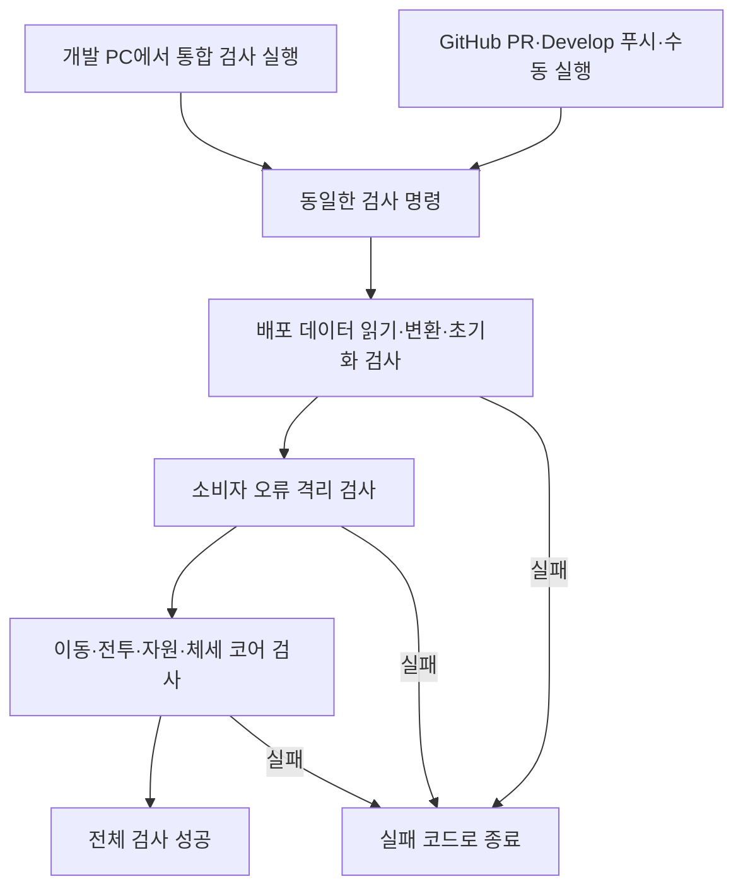
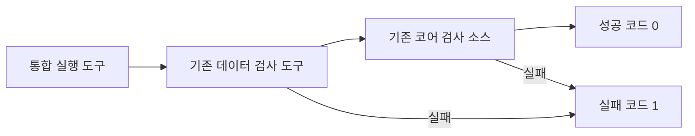
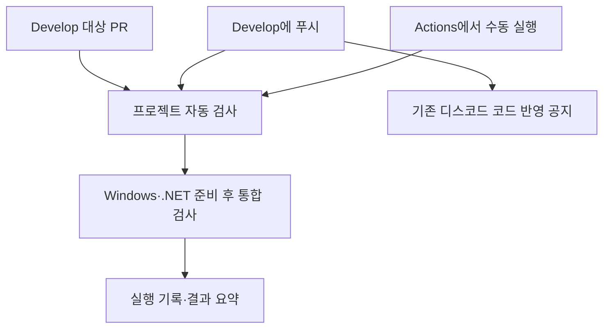
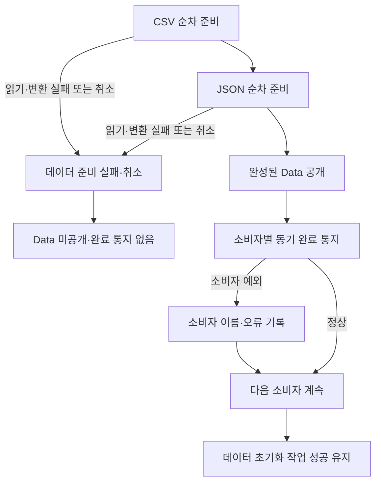
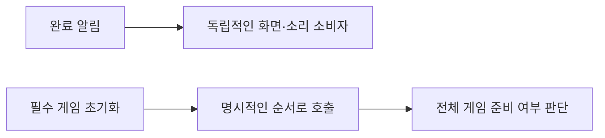
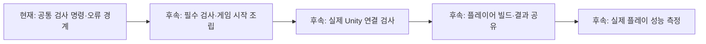

# 검사 자동화와 데이터 오류 경계

## 현재 적용 범위



이번 변경은 검사 실행의 자동화와 데이터 준비·소비자 처리 오류의 분리에 한정합니다.
게임 시작 조립자·물리·상태 팩토리·풀링·시간 진행 구조는 변경하지 않습니다.
클라이언트에 데이터 유효성 검사기를 추가하지 않습니다. 배포된 데이터를 읽는 개발용 회귀 검사이며,
원본 엑셀의 값·범위·중복·참조 검사는 계속 DataSheet에서 수행합니다.

## 개발 PC에서 실행

```powershell
powershell.exe -NoProfile -ExecutionPolicy Bypass -File Tools/Verify-Project.ps1
```

기본 검사는 .NET 10 SDK로 실행하며 Unity 설치나 라이선스가 필요하지 않습니다.
데이터 검사는 기존 Verify-Data.ps1을 호출하고 코어 검사는 기존 검사 소스를 Check.csproj로 실행합니다.
검사 내용을 복제하지 않습니다. 어느 단계든 실패하면 다음 단계를 실행하지 않고 종료 코드 1을 반환합니다.
출력은 임시 폴더에 생성하고 종료 시 정리합니다. 최초 실행에는 NuGet 접근이 필요합니다.
기존 Unity Roslyn·Mono 기반 코어 검사 명령도 유지합니다.



엔진 참조까지 확인할 때는 다음 명령을 사용합니다.
설치된 Unity와 복원·컴파일된 패키지의 입력 시스템 참조가 필요하며 에디터 경로는 선택적으로 지정합니다.

```powershell
powershell.exe -NoProfile -ExecutionPolicy Bypass -File Tools/Verify-Project.ps1 -CompileUnity
```

이 선택 검사는 엔진 모듈을 참조한 컴파일입니다. 실제 에디터 플레이·장치 입력·물리·플레이어 빌드를 대신하지 않습니다.

## GitHub 자동 검사



설정은 [.github/workflows/project-checks.yml](../.github/workflows/project-checks.yml)입니다.
GitHub의 Actions → 프로젝트 자동 검사에서 실패 단계와 결과 요약을 확인합니다.
검사 대상 커밋을 결과에 기록합니다. GitHub에서 실제 실행한 결과는 설정을 커밋·푸시한 뒤 확인해야 합니다.
자동 검사는 저장소에 배포된 CSV·JSON과 코어를 대상으로 하며 형제 DataSheet 저장소를 자동으로 받거나 배포하지 않습니다.
기본 브랜치에 설정이 반영된 후 수동 실행할 수 있습니다.

기존 디스코드 머지 알림은 코드 반영 알림으로 독립 실행됩니다.
디스코드 반영 공지가 와도 검사·빌드 성공을 뜻하지 않습니다.
이번 자동 검사에는 웹훅 비밀값과 Unity 라이선스가 필요하지 않습니다.
자동 검사 추가만으로 머지가 차단되지는 않습니다.
필수 검사로 지정하려면 저장소 관리자가 브랜치 규칙에서 데이터·게임 코어 검사를 필수로 등록해야 합니다.

## 데이터 준비와 소비자 오류 분리



| 상황 | 데이터 준비 결과 | 처리 |
| --- | --- | --- |
| CSV·JSON 읽기·변환 실패 | 실패 | 원래 예외 반환, Data 미공개, 완료 통지 없음 |
| 준비 중 취소 | 취소 | 완료 통지 없음, 같은 객체에서 자동 재시도하지 않음 |
| 완료 소비자의 동기 예외 | 성공 유지 | 실패한 소비자를 기록하고 다음 소비자에게 전달 |
| 소비자 내부 취소 예외 | 성공 유지 | 이미 완료된 데이터 준비의 취소로 바꾸지 않음 |
| 오류 기록 콜백의 예외 | 성공 유지 | 진단 출력으로 원래 오류와 기록 오류를 남기고 전달 계속 |

완료 통지는 DataBootstrapper와 GameDataInitializer 모두 DataReadyNotification.Publish를 사용합니다.
이 도우미는 데이터 준비 통지에 한정한 내부 책임으로 DataBootstrapper.cs에 함께 둡니다.
구독 목록을 호출 시작 시 고정하고 구독 순서대로 한 번씩 실행합니다.
처리 도중 구독 변경은 다음 발행부터 적용됩니다.
Data는 통지 전에 공개되고, InitializeAsync는 동기 소비자 통지가 끝난 후 완료됩니다.
재호출은 같은 작업을 반환하며 실패한 소비자를 자동 재실행하지 않습니다.

순수 C# 호출자는 DataBootstrapper 생성자의 선택 인자 reportConsumerError로
소비자 이름과 예외를 받을 수 있습니다. 미지정 시 Trace 오류 출력을 사용합니다.
씬에서는 소비자 오류를 한글 Unity 로그로 기록합니다.
준비 실패 로그와 소비자 실패 로그를 구분하므로 소비자의 오류를 로딩 실패로 오인하지 않습니다.

## 소비자가 지켜야 할 계약



이벤트는 독립적인 결과 통지용입니다. 필수 기능의 초기화 순서를 구독 순서로 구현하지 않습니다.
데이터 준비 성공은 게임 전체 준비 성공을 뜻하지 않습니다.
소비자의 부분 변경은 자동 원복하지 않으며 필요한 복구는 해당 소비자가 소유합니다.
같은 소비자를 중복 구독하면 등록 횟수만큼 호출됩니다. 기존 활성화·비활성화 구독 수명은 유지합니다.

Action 기반 동기 통지만 격리합니다. async void 처리자가 await 이후 던지는 예외,
소비자가 따로 시작한 작업, 초기화 후 현재 Data를 직접 전달하는 호출은 이 경계 밖입니다.
비동기 소비자는 자신이 시작한 작업의 오류·취소·수명을 직접 관리해야 합니다.
필수 비동기 초기화가 필요하면 별도 조립자가 Task를 직접 기다리는 방향으로 확장합니다.
무거운 처리를 동기 이벤트 안에 넣으면 초기화 작업의 반환도 늦어집니다.

## 지향하는 방향과 예상 효과



| 방향 | 예상 효과 | 현재 한계·전제 |
| --- | --- | --- |
| 로컬과 GitHub의 동일 검사 사용 | 누락과 환경별 실행 절차 차이 감소 | 실제 Unity 실행 환경과는 다름 |
| 데이터 준비·소비자 오류 분리 | 정상 데이터 유지, 오류 위치 식별, 다른 소비자 전달 보장 | 소비자 자체 복구는 별도 |
| 브랜치 필수 검사 | 검사 실패 상태의 반영 방지 | 관리자 규칙 설정 필요 |
| 게임 시작 조립과 명시적 의존성 | 필수 초기화 순서·입력 허용 조건 명확화 | 이번 변경에는 미구현 |
| 실제 Unity 검사·빌드 공유 | 기획·아트가 실행파일로 결과 확인 | 라이선스·실행 환경 확보 후 구현 |
| 두 저장소의 버전 조합 기록 | 원본·배포 결과 조합 재현 | DataSheet 교차 저장소 자동화는 후속 |

확인된 효과와 예상 효과를 구분합니다. 프레임 성능 개선 수치를 주장하지 않으며
시간 진행 통합·상태 재사용·풀링·어셈블리 분리는 이번 변경 범위에 넣지 않습니다.
네트워크는 구현하지 않습니다.

## 검증 기록

2026-10-31 기준 기본 통합 검사: 데이터 683개, 코어 123개 통과.
두 초기화 계층의 통지 계약, 소비자 실패 후 다음 소비자 실행, 소비자 내부 취소,
오류 기록 실패, 데이터 준비 실패 유지, 재호출 시 중복 통지 방지를 검사합니다.
DataSheet 배포 도구의 검사 전용 실행도 13개 탭과 생성 계획 검사를 통과했습니다.
실제 GitHub 자동 검사와 Unity 플레이어 빌드는 별도 확인 대상으로 남습니다.
