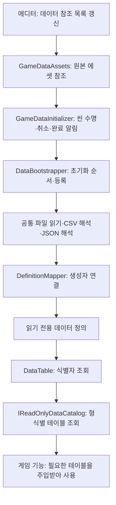
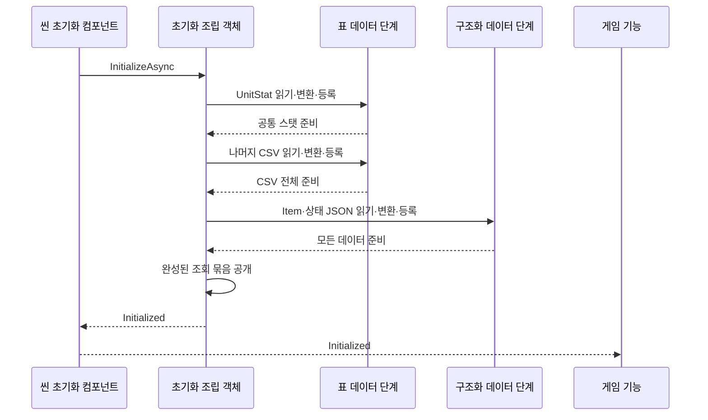
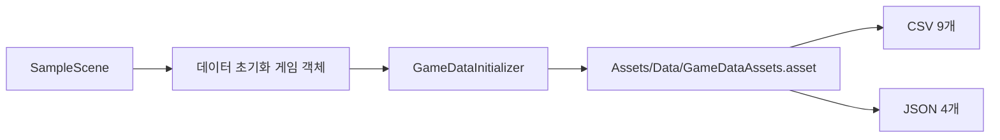
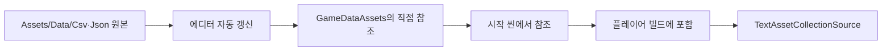
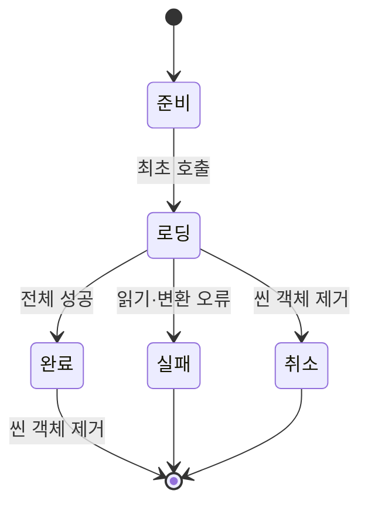

# 데이터 계층 인수인계 가이드

이 문서는 데이터 초기화 결과를 캐릭터·상태·표현 계층에서 사용하는 방법을 설명합니다. 코드 기준 경로는 `Assets/3.Script`입니다.

## 책임과 의존 방향



| 계층 | 위치 | 책임 |
| --- | --- | --- |
| 입력 계약 | `Assets/3.Script/Common/Text` | 비동기 문자열 입력 계약 |
| 형식 읽기 | `Assets/3.Script/Common/Csv`, `Common/Json` | 문자열 해석과 객체 변환 호출 |
| 데이터 정의 | `Assets/3.Script/Data`의 루트 클래스 | 읽기 전용 설정값·공통 스탯 상속 |
| 변환 | `Assets/3.Script/Data/Mapping` | 생성자 연결·값 해석·상태 묶음 |
| 저장소 | `Assets/3.Script/Data/Storage` | ID 조회와 읽기 전용 목록 |
| 초기화·입력 어댑터 | `Assets/3.Script/Data/Infrastructure` | 순서 제어·에셋 읽기·씬 수명 |
| 에디터 연결 | `Assets/Editor/Data` | 참조 목록 자동 갱신·씬 연결·빌드 검증 도구 |

게임 기능은 파일을 직접 읽지 않습니다. 공유 정의에 현재 체력·타이머·대상 같은 가변 상태를 기록하지 않습니다. 이 문서의 Boss·Player 등은 캐릭터 실행 객체가 아니라 설정 정의입니다.

## 실행 순서



CSV는 `UnitStat → Buff → Language → Skill → Stage → StageLayer → State → Player → Monster` 순서입니다. JSON은 `Item → PlayerState → BossState → EliteState` 순서입니다. 각 단계는 앞 단계가 완료된 뒤 시작합니다. Player·Monster는 이미 등록한 UnitStat을 조회해 상속 스탯을 구성합니다. Boss·Elite는 공통 스탯과 해당 상태 배열로 구성합니다.

실패·취소 시 미완성 조회 묶음과 완료 이벤트를 공개하지 않습니다. 이벤트 처리자는 받은 데이터로 자신의 기능을 연결하며 파일 로딩을 다시 시작하지 않습니다.

## 씬에서 실행



기본 씬에는 `데이터 초기화` 객체와 에셋 참조를 연결했습니다. 다른 시작 씬을 사용하면 해당 씬을 연 뒤 **인귀 → 데이터 → 현재 씬에 초기화 연결** 메뉴를 실행하고 씬을 저장합니다. 초기화 컴포넌트는 씬마다 한 개를 둡니다. 컴포넌트를 복제하면 초기화 작업도 별도로 생성됩니다.

실행하면 컴포넌트의 시작 단계에서 자동 초기화합니다. 성공 시 `데이터 초기화가 완료되었습니다.`를 출력합니다. 자동 실행 전에 명시적으로 `InitializeAsync()`를 호출해도 동일 컴포넌트는 같은 작업을 공유합니다. 호출은 엔진 주 실행 흐름에서 합니다.

## 빌드에서 데이터를 읽는 방식



빌드에서는 에디터 전용 경로인 `Assets/Data`를 파일 시스템으로 열지 않습니다. 씬이 참조한 에셋 목록을 통해 텍스트 에셋을 읽습니다. 런타임에 DataSheet 프로젝트나 .NET SDK는 필요하지 않습니다.

데이터 파일을 추가·삭제·이동하면 에디터 후처리가 목록을 갱신합니다. 빌드 직전에도 갱신합니다. 수동 갱신은 **인귀 → 데이터 → 에셋 목록 갱신**입니다. 참조 목록은 데이터 유효성 검사기가 아닙니다. 값·범위·중복·참조 검사는 DataSheet에서 수행합니다.

## 완료 이벤트와 구독 수명

```csharp
using HumanGhost.Data.Definitions;
using HumanGhost.Data.Infrastructure;
using HumanGhost.Data.Storage;
using UnityEngine;

public sealed class PlayerDataConsumer : MonoBehaviour
{
    [SerializeField] private GameDataInitializer _initializer = null;
    private IReadOnlyDataTable<Player> _players;

    private void OnEnable()
    {
        _initializer.Initialized += OnInitialized;
        // 초기화가 끝난 후 활성화돼도 현재 데이터를 바로 전달받습니다.
        if (_initializer.Data != null)
            OnInitialized(_initializer.Data);
    }

    private void OnInitialized(IReadOnlyDataCatalog catalog)
    {
        _players = catalog.GetTable<Player>();
        Debug.Log($"플레이어 정의 {_players.Count}개를 전달받았습니다.");
    }

    private void OnDisable()
    {
        if (_initializer != null)
            _initializer.Initialized -= OnInitialized;
    }
}
```

구독 순서에 의존하는 기능 초기화는 별도의 조립 코드에서 순서대로 호출합니다. 완료 이벤트는 서로 독립적인 소비자에게 결과를 전달하는 용도로 사용합니다. 데이터 연결에 실패한 이벤트 처리자의 예외를 무시하지 않습니다. 처리자가 예외를 던지면 호출자에게 전파될 수 있으므로 소비자의 오류를 데이터 로딩 오류와 구분해 확인합니다.

## 테이블 조회

```csharp
IReadOnlyDataTable<Player> players = catalog.GetTable<Player>();
Player definition = players.Get(2001);

// 선택적으로 존재하는 데이터는 존재 여부와 함께 조회합니다.
if (players.TryGet(2001, out Player found))
{
    int maximumStamina = found.StaminaMax;
}

// 목록 순서는 원본 등록 순서이며 식별자나 스테이지 순서로 자동 정렬하지 않습니다.
foreach (Player player in players.All)
{
    int unitId = player.UnitID;
}
```

예시 식별자 2001은 현재 시트의 플레이어 행입니다. 실제 기능에 필요한 식별자는 초기 설정이나 입력에서 전달받습니다. Get은 필수 데이터가 없으면 오류를 알리고, TryGet은 찾지 못했을 때 거짓을 반환합니다. 데이터 목록의 추가·삭제·교체 기능은 공개하지 않습니다. 저장소는 정의 객체를 복제하지 않으며 같은 읽기 전용 정의 참조를 공유합니다.

## 행 식별자와 유닛 식별자

| 조회 형식 | 키 | 의미 |
| --- | --- | --- |
| UnitStat | ID | 공통 유닛 정의 |
| Player·Monster | 각 행 ID | 개별 설정 정의. 공통 스탯은 UnitID로 연결 |
| Item·Skill·Stage 등 | 각 행 ID | 테이블 정의 |
| UnitStateGroup\<PlayerState\> | UnitID | 해당 플레이어의 상태이상 묶음 |
| UnitStateGroup\<BossState\> | UnitID | 보스의 페이즈 묶음 |
| UnitStateGroup\<EliteState\> | UnitID | 엘리트의 상태 묶음 |
| Boss·Elite | 공통 유닛 ID | 공통 스탯과 상태 묶음을 조합한 정의 |

```csharp
var groups = catalog.GetTable<UnitStateGroup<PlayerState>>();
var playerStates = groups.Get(1001).States;
var boss = catalog.GetTable<Boss>().Get(1006);
```

BossState의 여러 행을 여러 보스로 해석하지 않습니다. 현재 EliteState는 빈 배열이므로 Elite 저장소도 비어 있습니다. 상태 행은 각각의 묶음에서 조회하며 별도의 전역 행 저장소로 등록하지 않았습니다.

## 수명과 취소



초기화 객체가 최초 호출의 취소 토큰을 소유합니다. 같은 객체에 대한 재호출은 같은 작업을 반환합니다. 실패·취소 후 자동 재시도하지 않습니다. 재시도 정책이 필요하면 새 초기화 객체를 구성합니다.

씬 컴포넌트는 제거 시 취소를 요청하고 자신의 구독을 해제합니다. 소비자는 비활성화될 때 자신의 구독을 해제합니다. 씬 전환을 넘어 자동 유지하는 정적 저장소나 유지 객체는 없습니다. 여러 씬에서 공유해야 한다면 별도의 게임 수명 소유자를 정한 뒤 연결해야 합니다.

## 신규 테이블과 구조 변경

1. DataSheet에서 새 파일·탭의 타입·검사 규칙을 지정하고 배포합니다.
2. 클라이언트의 `Assets/3.Script/Data`에 최초 정의 클래스가 추가됐는지 확인합니다.
3. `DataBootstrapper`에 해당 형식의 공통 로딩 메서드 호출을 등록합니다. CSV와 JSON의 단계 구분을 지킵니다.
4. 새 생성자 인자와 프로퍼티 이름은 컬럼명과 대소문자만 다르게 유지합니다. 생성자는 하나이며 지원 값은 정수·선택 정수·문자열·플래그입니다.
5. 참조 에셋 목록을 갱신하고 새 형식에 필요한 사용 검사를 추가합니다.

추출기의 새 탭 자동 탐색과 클라이언트의 게임 초기화 등록은 별도 책임입니다. 현재 런타임 초기화 대상은 코드에 명시한 13개 원본입니다. 원본이 추가됐다는 이유만으로 임의의 게임 기능을 자동 초기화하지 않습니다.

C# 배포는 **파일이 없을 때만 추가**합니다. 기존 컬럼·생성자·State.Key 변경은 기존 클래스·열거형에 자동 반영되지 않으므로 개발자가 함께 수정해야 합니다. CSV·JSON은 매번 갱신합니다. 코드 생성기와 배포 EXE의 클래스 출력 경로도 `Assets/3.Script/Data`입니다.

## 빌드에서 생성자 보존

공통 변환기는 생성자 정보를 자료형별로 한 번만 읽어 재사용합니다. 로딩 때만 리플렉션을 사용하고 실행 중 매 프레임 해석하지 않습니다. `Mapping/link.xml`은 데이터 정의의 생성자·프로퍼티를 제거하지 않도록 지정합니다. 조립 정의에 직접 참조하는 제네릭 형식을 명시합니다.

어셈블리 정의 파일을 추가해 데이터 정의의 어셈블리 이름이 바뀌면 연결 보존 설정도 수정해야 합니다. 최종 목표 플랫폼의 빌드에서 제거 설정과 초기화를 다시 확인합니다. 현재 검증 결과를 모든 플랫폼에 대한 보장으로 해석하지 않습니다.

## 검증과 전달 상태

- 실제 CSV·JSON, 변환·상속·저장소·초기화 순서·실패·취소 개발 검사가 준비돼 있습니다.
- 설치된 Unity 모듈을 참조한 실행 코드·에디터 코드 컴파일을 확인합니다.
- 기본 씬의 초기화 컴포넌트·에셋 목록·13개 원본 참조를 구성했습니다.
- 이 실행 환경의 Unity 일괄 실행은 라이선스 연결 시도 후 종료 코드 1로 종료되어 실제 플레이와 윈도우 빌드 검증은 완료하지 못했습니다.

에디터에서 다음을 확인하면 인수인계 실행 확인을 마칠 수 있습니다.

1. 기본 씬을 열고 초기화 객체의 에셋 목록 참조를 확인합니다.
2. 실행하여 한글 초기화 완료 로그와 오류 유무를 확인합니다.
3. 위 예시처럼 테이블을 조회하고 장면을 종료해 취소·구독 해제를 확인합니다.
4. 윈도우 플레이어를 빌드하고 동일한 초기화 완료 로그를 확인합니다.

일괄 검증 메서드는 `HumanGhost.Editor.Data.GameDataVerification.Run`입니다. 환경 변수 `HUMANGHOST_VERIFY_ROOT`에 임시 출력 경로를 지정하고 Unity 일괄 실행의 실행 메서드로 사용합니다. 이 도구는 기본 씬 연결을 갱신·저장하고 에셋 초기화 후 윈도우 빌드를 시도합니다.

문서 작성 기준일은 2026-10-30입니다. 캐릭터 런타임·상태 머신·상태 팩토리·이동·전투·풀링은 다음 작업자의 영역으로 남겨 두었습니다.

개발용 검사와 엔진 모듈 참조 컴파일은 다음 명령으로 재현합니다. 개발 PC의 .NET 10 SDK와 설치된 Unity가 필요하며 임시 빌드 파일은 종료 시 정리합니다.

```powershell
powershell.exe -NoProfile -ExecutionPolicy Bypass -File Tools/Verify-Data.ps1 -CompileUnity
```

Unity 설치 경로가 기본 위치와 다르면 `-UnityEditorPath`로 에디터 실행파일 경로를 전달합니다. Unity 패키지는 에디터에서 먼저 복원합니다. 이 명령의 성공은 플레이·플레이어 빌드 성공을 뜻하지 않습니다.