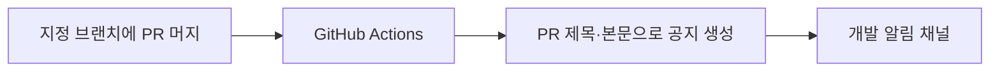

## 디스코드 머지 알림

알림 설정은 [.github/workflows/discord-merge.yml](../.github/workflows/discord-merge.yml)에서 관리합니다.
대상은 **Develop** 브랜치입니다. 일반 푸시와 머지 없이 닫은 PR에는 공지하지 않습니다.
머지 공지는 빌드·검사·게임 배포 성공을 뜻하지 않습니다.

저장소의 Settings → Secrets and variables → Actions에
`DISCORD_WEBHOOK_URL` 비밀값을 등록합니다. 웹훅 주소는 코드나 문서에 넣지 않습니다.
별도 서버나 봇 프로그램은 필요하지 않습니다.

설정 파일을 기본 브랜치에 반영한 뒤 Actions → 디스코드 머지 알림 → Run workflow로
연결 테스트를 실행합니다. 성공한 실행마다 테스트 공지가 한 건 올라옵니다.
이후 PR을 머지해 자동 공지도 확인합니다. 실행 기록을 다시 실행하면 같은 공지가 다시 전송될 수 있습니다.
전송 실패는 Actions 실행 기록에서 확인하고, 웹훅 삭제·주소 변경 시 비밀값을 갱신합니다.

공지에는 PR 제목·본문·반영 브랜치·머지 담당자·PR 링크가 포함됩니다.
본문은 3000자까지 표시하며 전체 내용은 PR에서 확인합니다.
팀원이 이해할 수 있도록 PR 본문에 변경 내용, 기획·아트·개발 담당자의 후속 작업과 주의사항을 작성합니다.
전체 호출 알림은 사용하지 않습니다. 저장소 접근 권한이 없는 팀원도 공지 본문은 볼 수 있지만 비공개 PR 링크는 열 수 없습니다.

