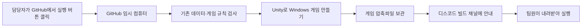
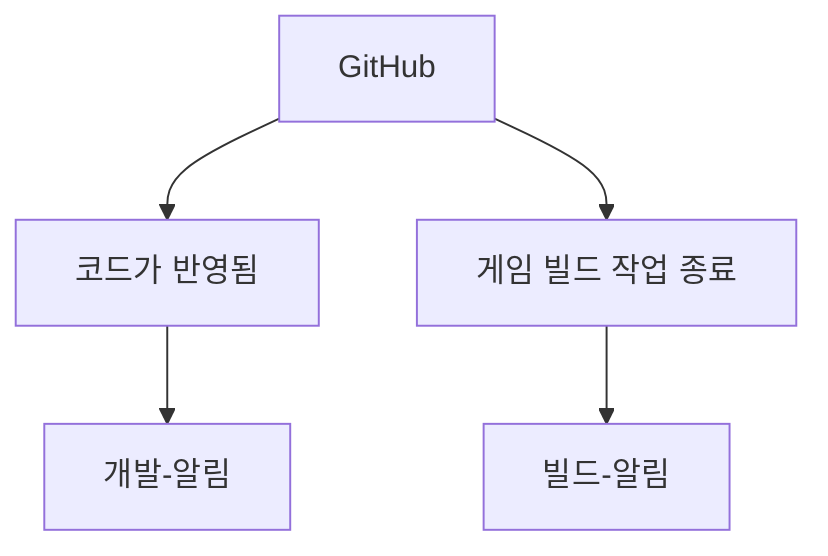
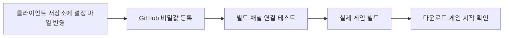
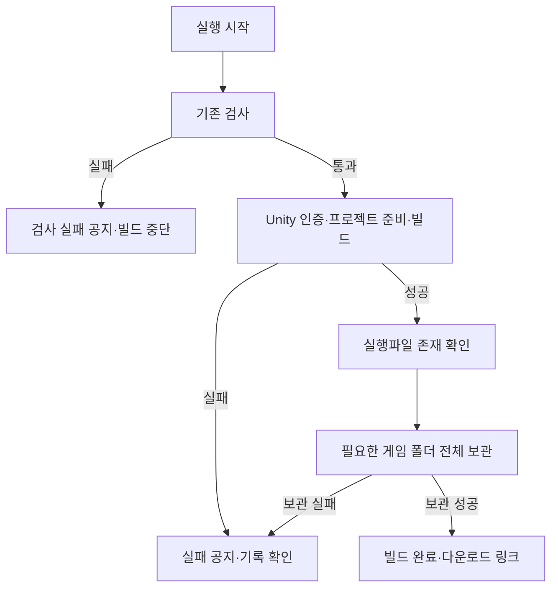
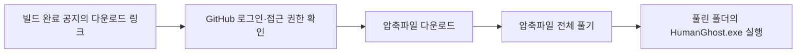
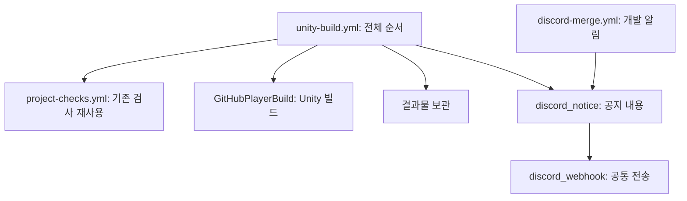
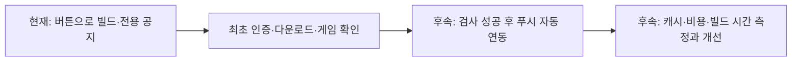

# GitHub 빌드와 디스코드 공지 사용 안내

## 이 기능은 왜 필요한가요?

빌드는 Unity 프로젝트를 다른 사람이 실행할 수 있는 게임 파일로 만드는 작업입니다.
내 PC를 계속 켜두거나 별도 빌드용 PC를 준비하지 않고 GitHub가 제공하는 임시 컴퓨터에서 실행합니다.
기획·아트 담당자는 완성된 압축파일을 받아 게임을 확인할 수 있습니다.



현재는 **버튼으로 시작하면 검사부터 공지까지 자동 진행**합니다.
코드를 푸시할 때마다 게임 빌드를 실행하도록 연결한 상태는 아닙니다.
최초 인증·다운로드·실행을 확인한 뒤 푸시 연동을 추가하는 순서입니다.
GitHub 사용 시간·저장 공간은 계정 요금제의 한도를 사용하며 별도 무료 무제한 서비스를 의미하지 않습니다.

## 공지 채널은 두 개입니다



| 채널 | 알려주는 내용 | GitHub 비밀값 |
| --- | --- | --- |
| 개발-알림 | 코드 반영·개발 채널 연결 테스트 | DISCORD_WEBHOOK_URL |
| 빌드-알림 | 빌드 완료·검사 실패·빌드 실패·연결 테스트 | DISCORD_BUILD_WEBHOOK_URL |

개발 채널에 메시지가 왔다고 게임 파일이 만들어진 것은 아닙니다.
빌드 채널에 '빌드 완료'와 다운로드 링크가 도착했는지 확인합니다.
비밀값은 웹훅 주소나 인증 내용을 숨겨 보관하는 GitHub의 저장 공간입니다.

## 최초 한 번: 개발자와 준비



이 설정은 **Human_Ghost- 클라이언트 저장소**에서 사용합니다. DataSheet에 Unity 인증 정보를 추가할 필요는 없습니다.
아래 비밀값을 Settings → Secrets and variables → Actions → Secrets에 등록합니다.

| 이름 | 넣을 내용 |
| --- | --- |
| UNITY_EMAIL | Unity 계정 이메일 |
| UNITY_PASSWORD | Unity 계정 비밀번호. Google 비밀번호를 대신 넣지 않음 |
| UNITY_LICENSE | 해당 계정으로 활성화한 Personal 라이선스 파일의 전체 내용 |
| DISCORD_BUILD_WEBHOOK_URL | 빌드-알림 채널에서 만든 웹훅 주소 |
| DISCORD_WEBHOOK_URL | 기존 개발-알림 채널의 웹훅 주소 |

일반 변수인 Variables에 넣지 않습니다. 등록 내용·비밀번호·라이선스 원문은 채팅이나 화면으로 공유하지 않습니다.
라이선스 파일은 일반적으로 C:\ProgramData\Unity\Unity_lic.ulf에 있습니다.
파일이 존재한다고 GitHub의 인증 성공까지 보장되는 것은 아닙니다. 실제 첫 빌드에서 확인합니다.
Google 로그인 계정의 별도 Unity 비밀번호 설정과 라이선스 계정 일치는 개발자와 확인합니다.

## 어디를 눌러 실행하나요?

1. 브라우저에서 클라이언트 GitHub 저장소를 엽니다.
2. **화면 맨 위 Actions**를 누릅니다. Settings 안의 Actions 메뉴와 다릅니다.
3. 왼쪽 목록에서 **Windows 게임 빌드**를 선택합니다.
4. 오른쪽 **Run workflow** 버튼을 누릅니다.
5. 실행할 브랜치를 고릅니다. 처음에는 개발자가 설정을 반영한 **Develop**을 선택합니다.
6. 아래 표를 보고 operation과 scene을 선택합니다.
7. 초록색 **Run workflow**를 누르고 실행 기록이 생길 때까지 기다립니다.

```text
클라이언트 GitHub 저장소
  → 맨 위 Actions
    → 왼쪽 Windows 게임 빌드
      → 오른쪽 Run workflow
        → 브랜치·operation·scene 선택
          → 초록색 Run workflow
```

| 선택 칸 | 선택 값 | 의미 |
| --- | --- | --- |
| operation | notice-test | 빌드 채널로 테스트 메시지만 보냄. 게임은 만들지 않음 |
| operation | build | 검사 후 실제 Windows 게임을 만들고 결과를 공지 |
| scene | dohwagol | R3c 도화골 전투 테스트(MapDohwagolTest). 기본값 |
| scene | preview | 독립 게임플레이 검사 장면(GameplayPreview) |
| scene | build-settings | Unity 빌드 설정에 등록된 활성 씬 사용 |

처음에는 **notice-test**로 채널을 확인한 뒤 **build / dohwagol**로 도화골 전투 게임 파일을 만듭니다.
notice-test에서는 scene 값이 사용되지 않습니다.
현재 build-settings는 MapDohwagolTest 활성·SampleScene 비활성입니다. 명령줄 -humanGhostScene 생략 시에도 dohwagol을 사용하며 기존 preview 선택은 유지합니다. Title은 운영 실행 담당 연결 후 별도 시작 경로로 사용합니다. 실제 빌드는 이후 자동화 시스템에서 검증합니다.
버튼이나 목록이 없으면 개발자에게 설정의 기본 브랜치 반영과 계정 실행 권한을 확인해달라고 요청합니다.

## 실행 중에는 무엇을 하나요?



작업은 GitHub에서 계속 실행되므로 내 PC의 Unity를 열어둘 필요가 없습니다.
처음에는 Unity 도구와 프로젝트 파일을 준비하느라 오래 걸릴 수 있습니다.
실제 빌드 작업의 제한 시간은 60분이고, 기존 검사와 공지 시간이 별도로 추가됩니다.
동시 실행을 제한하지만 여러 번 버튼을 누르면 불필요한 대기·실행이 생길 수 있으니 한 번 누르고 기다립니다.

## 결과를 어떻게 구분하나요?

| 표시·공지 | 의미 | 할 일 |
| --- | --- | --- |
| 빌드 채널 연결 테스트 | 공지 전송만 성공 | 실제 게임 빌드는 따로 실행 |
| Windows 빌드 완료 | 이번 검사·게임 생성·결과물 보관 성공 | 다운로드 링크 열기 |
| 빌드 전 검사 실패 | 검사에 실패해 Unity 빌드를 실행하지 않음 | 실행 기록을 개발자에게 전달 |
| 빌드·결과물 보관 실패 | 인증·Unity 빌드·게임 파일 확인·보관 중 실패 | 실패한 단계의 기록 전달 |
| 빌드 작업 취소 | 작업이 취소됨 | 새 게임 완성으로 판단하지 않음 |
| 공지가 오지 않음 | 진행 중이거나 공지 전송 단계 실패 가능 | GitHub 실행 기록 확인 |

공지를 누르면 해당 GitHub 실행 기록을 엽니다.
전체 실행이 실패해도 빌드 자체와 공지 전송 중 어느 단계가 실패했는지 구분합니다.
사용자가 전체 작업을 강제로 취소하거나 GitHub 장애가 발생하면 취소 공지가 오지 않을 수 있습니다.
공지 실패는 완성된 게임 파일을 삭제하지 않습니다. GitHub 기록에서 보관된 결과물을 확인할 수 있습니다.

## 게임을 내려받아 실행하기



1. 디스코드의 **게임 파일 다운로드** 링크를 누릅니다.
2. GitHub 로그인이나 저장소 접근 권한이 필요하면 개발자에게 요청합니다.
3. 받은 압축파일을 우클릭하고 **모두 압축 풀기**를 선택합니다.
4. 압축이 풀린 폴더 안의 **HumanGhost.exe**를 실행합니다.

압축파일 안에서 바로 실행하거나 exe만 다른 폴더로 옮기지 않습니다.
같이 들어 있는 HumanGhost_Data·UnityPlayer.dll 등도 실행에 필요합니다.
보관 기간은 **7일**입니다. 기간이 지났거나 결과물이 삭제되면 빌드를 다시 실행해야 합니다.
비공개 저장소 파일은 링크가 있다고 누구나 내려받을 수 있는 것이 아닙니다.
확인 장면의 조작은 [임시 게임플레이 확인 안내](임시%20게임플레이%20확인%20안내.md)를 참고합니다.
빌드 성공과 실제 게임 기능·플레이 성공은 다르므로 실행 후 동작도 확인합니다.

## 실패했을 때 전달할 내용

```text
빌드를 실행했는데 확인이 필요해요.
실행한 날짜·시간:
선택한 브랜치:
operation / scene:
GitHub 실행 기록 주소:
실패한 단계 이름 또는 화면:
디스코드 공지가 도착했나요?:
다운로드·게임 실행 결과:
```

모르는 항목은 비워두거나 '모르겠음'으로 적어도 됩니다.
화면 캡처는 Windows 키 + Shift + S로 하고, 계정 비밀번호·라이선스·웹훅 원문은 포함하지 않습니다.
실패 기록 전체에 비밀값이 없는지 확인한 뒤 공유합니다. 원인을 모르겠다면 코드를 직접 수정하지 말고 개발자에게 전달합니다.
재실행하면 새 공지가 다시 전송될 수 있습니다.

## 개발자가 알아야 할 책임과 코드 위치



| 파일 | 위치를 선택한 이유 |
| --- | --- |
| .github/workflows/unity-build.yml | GitHub 실행 환경·비밀값 전달·순서·결과물·공지의 조립 책임 |
| .github/workflows/project-checks.yml | 기존 검사를 호출 가능하게 해 검사 절차 중복 방지 |
| Assets/Editor/Build/GitHubPlayerBuild.cs | Unity 빌드 API 전용. 게임 런타임에 포함하지 않음 |
| Tools/Automation/discord_notice.py | 개발·빌드 결과를 메시지로 변환. Unity 코드와 분리 |
| Tools/Automation/discord_webhook.py | 웹훅 전송·멘션 제한·전송 오류 처리 공통화 |

Unity 버전은 ProjectVersion.txt에서 읽습니다.
Windows 64비트 Mono 개발 빌드이며, GitHub의 Linux 실행 환경에서 생성합니다.
출력은 build/StandaloneWindows64, 버전은 0.1.실행번호입니다. 실행번호와 커밋은 공지에 기록합니다.
씬 선택은 빌드 호출에만 적용하고 EditorBuildSettings를 수정하지 않습니다.
빌드 중 바꾼 스크립팅 백엔드와 버전은 종료 시 복원합니다.
기존 데이터 에셋 갱신은 빌드 전처리기를 그대로 사용하며 원본 시트 배포를 이 작업에서 실행하지 않습니다.
코드 반영 공지는 DataSheet 저장소의 알림과 별개로 기존 채널에 유지됩니다.
독립 빌드 단계를 추가한 구조이며 게임 상태·전투 규칙은 변경하지 않습니다.

## 검증 상태와 앞으로의 방향

2026-11-02 기준 공지 로직 13개 경우를 실제 전송 없이 확인했습니다.
원격 비밀값 내용은 읽지 않았으며 실제 Personal 인증·Unity 이미지 준비·클라우드 빌드·게임 실행은 최초 GitHub 실행 후 확인해야 합니다.
과거 선택 참조 검사에서 보고한 직렬화 필드 경고와 실제 Unity 빌드 결과는 구분합니다.



의도는 빌드 담당자의 반복 작업을 줄이고 팀원이 같은 커밋의 게임을 확인하게 하는 것입니다.
예상 효과는 배포 누락 감소와 성공·실패 위치의 명확화이며, 아직 측정한 시간 단축 수치는 없습니다.
현재는 프로젝트 Library 캐시를 추가하지 않았습니다. 최초 동작과 저장 용량 사용을 확인한 뒤 도입합니다.
설정 방식의 참고 문서는 [GameCI 빌드 안내](https://game.ci/docs/github/builder/)와 [Personal 인증 안내](https://game.ci/docs/github/activation/)입니다.
