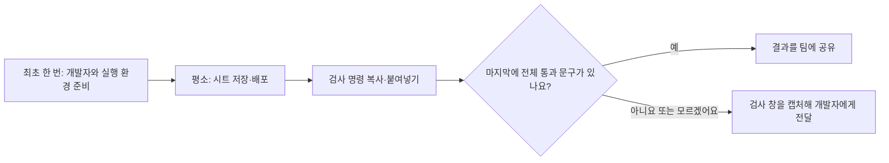
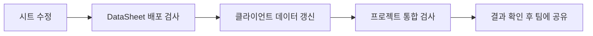
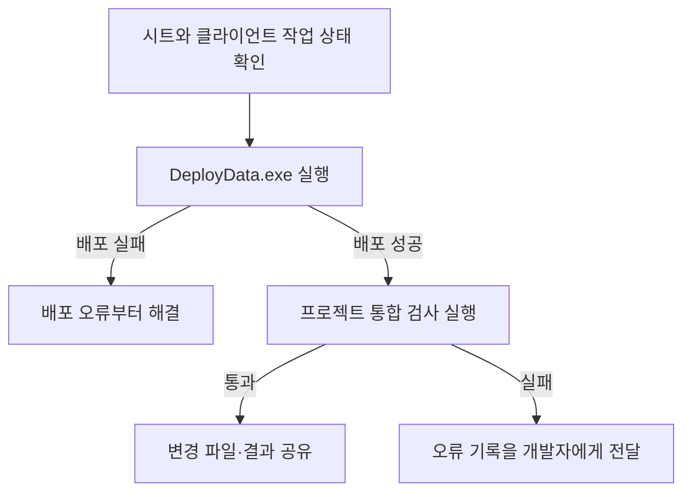
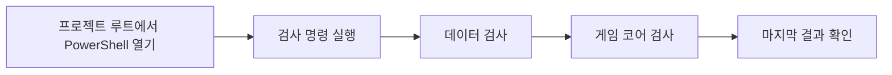
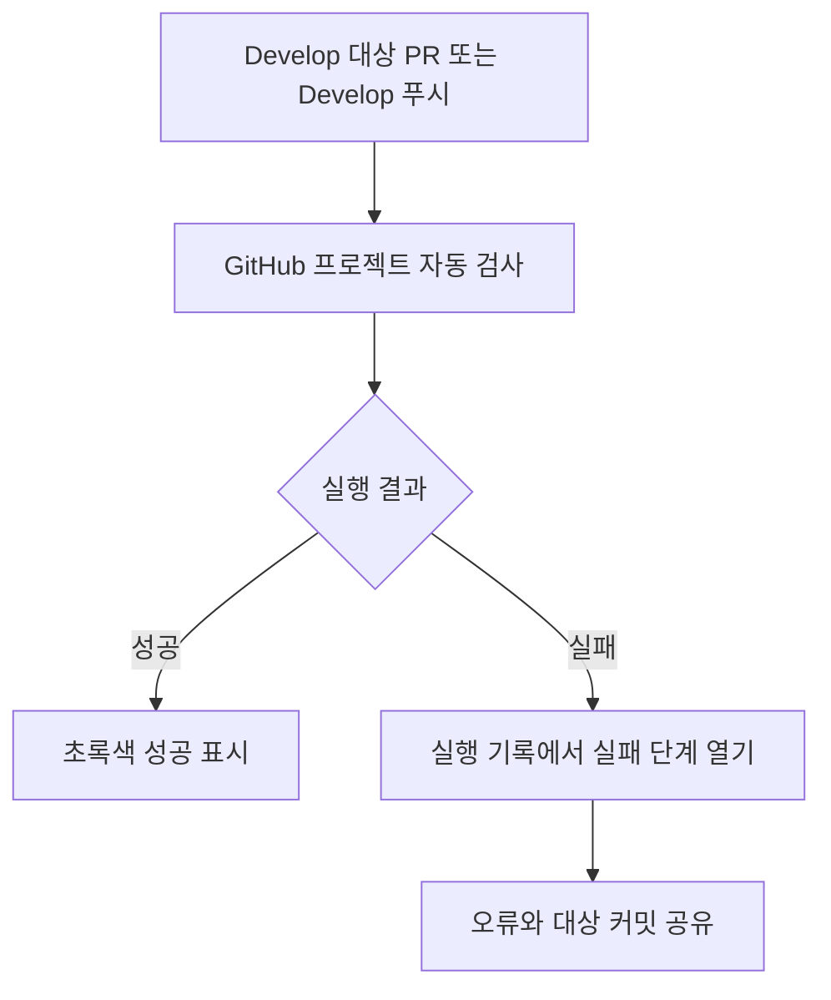
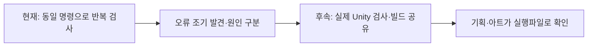

# 기획자용 프로젝트 검사 사용 안내

이 문서는 프로그래밍 경험이 없어도 따라 할 수 있도록 작성했습니다.
기획자가 할 일은 **검사를 실행하고, 마지막 결과를 확인하고, 실패하면 화면을 개발자에게 전달하는 것**입니다.
오류의 원인을 직접 분석하거나 코드를 고칠 필요는 없습니다.

## 처음이라면 여기부터 읽으세요



처음 사용하는 날에는 개발자에게 다음처럼 요청하세요.

> 제 PC에서 프로젝트 검사를 사용할 수 있도록 필요한 프로그램을 설치하고,
> 어느 폴더에서 실행하는지 한 번 같이 확인해주세요.

처음 설정을 마쳤다면 아래의 **실행 방법 → 성공과 실패 확인** 순서로 따라 하세요.
GitHub에서 결과를 보는 방법은 익숙해진 뒤 읽어도 됩니다.

| 문서에 나오는 말 | 쉬운 뜻 |
| --- | --- |
| 프로젝트 폴더 | 게임 제작 파일을 모아 둔 Human_Ghost- 폴더 |
| 배포 | 작성한 시트를 게임에서 읽는 파일로 바꿔 정해진 폴더에 전달하는 작업 |
| PowerShell | 복사한 명령을 입력해 검사 프로그램을 실행하는 Windows 창 |
| 통합 검사 | 게임이 데이터를 읽는 과정과 준비된 게임 규칙을 한 번에 확인하는 작업 |
| SDK | 검사를 실행하기 위해 처음 한 번 설치하는 개발 도구. 설치는 개발자와 함께 진행 |
| 브랜치·커밋 | Fork에서 확인하는 작업 갈래와 저장 기록. 모르면 화면으로 전달해도 됨 |

## 사용하는 이유

예를 들어 엑셀에 플레이어 체력을 수정하고 배포했더라도, 게임 코드가 그 파일을 제대로 읽는지까지 확인해야 합니다.
검사 도구는 준비된 확인 항목을 자동으로 실행합니다.
목적은 **문제를 다른 팀원에게 넘기기 전에 발견하고, 개발자에게 어디에서 실패했는지 알려주는 것**입니다.
실패했다고 해서 반드시 기획자가 값을 잘못 입력한 것은 아닙니다. 코드나 PC 설정 때문에 실패할 수도 있습니다.



| 확인하려는 문제 | 사용하는 이유 |
| --- | --- |
| 새 데이터와 현재 코드의 연결 문제 | 배포된 CSV·JSON을 실제 읽기·변환·초기화 코드로 확인하기 위해 |
| 기존 이동·전투 규칙의 예상치 못한 변경 | 준비된 코어 검사로 기존 동작이 유지되는지 확인하기 위해 |
| 데이터를 읽는 문제와 그 데이터를 사용하는 기능의 문제를 혼동 | 서로 다른 오류를 구분하는 처리가 유지되는지 확인하기 위해 |
| 사람마다 확인 항목이 다른 문제 | 로컬과 GitHub에서 같은 검사 명령을 실행하기 위해 |

이 도구는 **배포 도구가 아닌 확인 도구**입니다.
엑셀 추출·클라이언트 배포는 기존 DataSheet의 DeployData.exe를 사용합니다.
원본의 타입·범위·중복·참조 검사는 DataSheet가 담당합니다.
여기서는 클라이언트에 이미 배포된 데이터와 코드의 연결을 확인합니다.
통과해도 모든 기획 내용이 맞거나 실제 게임 플레이가 완성됐다는 뜻은 아닙니다.

## 언제 실행하나요?

시트를 수정해 클라이언트에 배포한 뒤, 다른 팀원에게 변경을 공유하기 전에 실행합니다.
신규 파일·탭 추가, 컬럼·타입·상태 변경 후에는 특히 확인합니다.
개발자가 클라이언트 코드를 변경해 함께 최신화했을 때도 실행하면 연결 문제를 일찍 발견할 수 있습니다.



엑셀의 열 이름이나 값의 종류를 바꿀 때는 개발자에게 먼저 알려주세요.
예를 들어 체력 열의 이름을 바꾸면 게임 코드도 수정해야 할 수 있습니다.
검사를 통과시키려고 C# 코드 파일이나 검사 프로그램을 직접 수정할 필요는 없습니다.

## 실행 전 준비

| 항목 | 준비 사항 |
| --- | --- |
| 운영체제 | Windows |
| 프로젝트 | Human_Ghost- 폴더와 그 안의 Tools 폴더 |
| 실행 환경 | .NET 10 SDK 설치. 런타임만 설치한 경우에는 실행할 수 없음 |
| 인터넷 | 최초 실행의 패키지 다운로드와 필요 시 복원·보안 정보 조회에 사용 |
| 검사할 데이터 | DataSheet에서 배포 완료한 클라이언트 CSV·JSON |
| Unity | 기본 검사에서는 실행하거나 설치할 필요 없음 |

DataSheet의 DeployData.exe는 SDK가 필요 없는 별도 실행파일이지만,
현재 통합 검사 도구는 PowerShell과 .NET SDK를 사용하는 방식입니다.
설치 여부가 불명확하면 개발자에게 최초 환경 설정을 요청합니다.
아래 설치 확인 명령은 개발자와 함께 확인할 때만 사용해도 됩니다.

다음 명령으로 설치된 SDK를 확인할 수 있습니다.
```powershell
dotnet --list-sdks
```
출력에 10.0으로 시작하는 SDK가 있어야 합니다.
명령을 찾을 수 없거나 목록에 없다면 개발자에게 알려주세요.

## 실행 방법

1. 키보드에서 **Windows 키와 E 키**를 함께 눌러 파일 탐색기를 엽니다.
2. 개발자가 알려준 **Human_Ghost- 폴더**를 엽니다.
3. 폴더 안에 **Assets, Docs, Tools**가 보이는지 확인합니다. Assets나 Tools 안으로 들어가지 않습니다.

```text
Human_Ghost-  ← 이 폴더를 연 상태에서 실행
├── Assets
├── Docs
└── Tools
```

4. 탐색기 위쪽에서 **폴더 경로가 표시되는 주소 표시줄**을 클릭합니다. 파일 검색 칸과 다릅니다.
5. 기존 경로 대신 `powershell`을 입력하고 **Enter**를 누릅니다.
6. 글자를 입력할 수 있는 창이 열리면 아래 명령 한 줄을 복사합니다.
7. 열린 창에서 **Ctrl+V**로 붙여넣고 **Enter**를 누릅니다. 명령 안의 단어를 바꾸지 않습니다.

```powershell
powershell.exe -NoProfile -ExecutionPolicy Bypass -File Tools/Verify-Project.ps1
```

8. 검사 문구가 나오는 동안 창을 닫지 말고 기다립니다. 처음 실행은 다운로드 때문에 더 오래 걸릴 수 있습니다.
9. 출력이 멈추고 다시 `PS C:\…>`처럼 입력할 수 있는 줄이 나타나면 마지막 결과를 확인합니다.
10. 아래의 성공 문구가 없다면 화면을 캡처해 개발자에게 전달합니다. 창 색깔만으로 성공을 판단하지 않습니다.

검사 스크립트를 더블클릭하거나 Tools 폴더 안에서 상대 경로 명령을 실행하지 않습니다.
프로젝트 위치가 다른 PC에서도 Assets·Docs·Tools가 보이는 폴더에서 같은 명령을 사용합니다.
관리자 실행은 기본 조건이 아닙니다.
기획자는 `-CompileUnity`를 붙이지 않습니다. 해당 선택 검사는 개발자의 엔진 참조 컴파일용입니다.



## 성공과 실패 확인

성공하면 다음과 같은 내용이 나옵니다. 검사 개수와 식별자는 데이터·검사 변경에 따라 달라질 수 있습니다.

```text
검사 683개 통과
게임 코어 검사를 시작합니다.
코어 검사 123개 통과. 플레이어 2001, 공통 스탯 1001
프로젝트 검사를 모두 통과했습니다. 실제 Unity 플레이와 플레이어 빌드는 별도 확인 대상입니다.
```

**데이터 검사 통과만 보고 종료하지 말고 마지막 전체 통과 문구까지 확인합니다.**
다음 문구가 있으면 이번 검사는 성공한 것입니다.

> 프로젝트 검사를 모두 통과했습니다.

실패하면 뒤의 검사는 자동으로 멈춥니다. 숫자 코드를 따로 입력해 확인할 필요는 없습니다.
성공 문구의 의미를 모르겠거나 오류인지 구분하기 어렵다면 그대로 개발자에게 물어보세요.

| 표시 또는 상황 | 다음 행동 |
| --- | --- |
| dotnet 명령을 찾지 못함 | SDK 설치와 새 PowerShell 창 실행 여부를 개발자에게 확인 |
| 스크립트 경로를 찾지 못함 | Human_Ghost- 루트에서 실행했는지, 최신 코드에 Tools 파일이 있는지 확인 |
| 패키지 다운로드·접속·권한 오류 | 오류 전체를 전달. 반복해서 데이터 값을 바꾸지 않음 |
| 데이터 검사 단계 실패 | 직전에 수정·배포한 파일·탭·컬럼과 오류 내용을 전달 |
| 게임 코어 검사 단계 실패 | 최근 코드·데이터 변경과 실패한 검사 내용을 개발자에게 전달 |
| 실행이 끝나지 않음 | 진행 중 출력과 대기 시간을 전달. 완료 전 성공으로 판단하지 않음 |

실행 중인 수정 작업을 먼저 정리하고 검사합니다. 통과한 뒤 데이터를 다시 바꾸면 변경 후 다시 검사해야 합니다.
확인 없이 Pull하거나 재배포해 작업 중인 변경을 덮어쓰지 않습니다.

## 개발자에게 전달할 내용

```text
오늘 검사하다가 아래 화면이 나왔어요.
실행한 시간:
수정한 엑셀 파일과 아래쪽 탭 이름:
수정 내용: 예) 플레이어 체력을 100에서 120으로 변경
DeployData.exe 실행 결과: 성공 / 실패 / 잘 모르겠음
검사 결과: 성공 문구 없음 / 실패 표시 / 잘 모르겠음
첨부: 검사 창 화면
```

오류 마지막 한 줄뿐 아니라 그 위의 최초 오류도 함께 전달합니다.
브랜치·커밋을 모르면 Fork에서 해당 프로젝트를 선택한 화면도 함께 전달해주세요.
모르는 항목은 비워두거나 잘 모르겠음으로 적어도 됩니다.
검사 도구가 별도 보고서 파일을 자동 저장하지 않으므로 필요한 출력은 창에서 복사하거나 캡처합니다.
화면 캡처는 **Windows 키 + Shift + S**를 누른 뒤 검사 창 부분을 드래그하면 됩니다.
팀 채팅에 **Ctrl+V**로 붙여넣고 위 설명과 함께 보내세요.
웹훅 주소·계정 비밀번호 등 비밀값은 전달하지 않습니다.

## GitHub에서 결과 확인



이 절차는 개발자가 올린 변경의 검사 결과를 웹에서 확인하고 싶을 때 사용합니다.
내 PC에서 아직 공유하지 않은 수정 내용은 웹 검사에 들어 있지 않습니다.

1. 인터넷 브라우저에서 클라이언트 GitHub 저장소를 엽니다.
2. 화면 맨 위의 **Actions**를 누릅니다. Settings 안의 Actions 메뉴와 다릅니다.
3. 왼쪽 목록에서 **프로젝트 자동 검사**를 누릅니다.
4. 개발자가 알려준 실행 기록을 선택하고 결과를 확인합니다.
성공은 Success, 실패는 Failure, 진행 중은 In progress로 표시됩니다.
진행 중·취소·건너뜀은 성공으로 보지 않습니다.
수동 실행은 Actions → 프로젝트 자동 검사 → Run workflow에서 검사할 브랜치를 선택합니다.
설정이 기본 브랜치에 반영돼 있어야 하며 버튼이 없으면 개발자에게 권한과 반영 상태를 확인합니다.

로컬에서 배포한 변경은 GitHub에 푸시하기 전까지 GitHub 검사에 포함되지 않습니다.
GitHub 검사는 서버에 올라간 코드를 확인하므로 로컬 검사와 대상 커밋을 구분합니다.
디스코드의 코드 반영 알림은 검사 성공 알림이 아닙니다.
이번 검사에서 DataSheet 원본을 새로 추출하거나 게임 실행파일을 만들지는 않습니다.

## 설계 의도·향후 방향·예상 효과



현재 목표는 데이터 변경 후 확인 절차를 통일하고 개발자에게 문제를 정확하게 전달하는 것입니다.
기획자는 실행·결과 확인·화면 전달을 맡고, 개발자는 최초 설치·오류 분석·코드 수정을 맡습니다.
예상 효과는 확인 누락과 반복 문의 감소이며, 성능 향상 수치를 의미하지 않습니다.
향후 실제 Unity 검사·빌드 공유까지 연결하면 기획·아트가 검증된 실행파일로 결과를 확인할 수 있습니다.
이는 후속 계획이며 현재 자동 생성되는 결과물은 아닙니다.
현재 검사 도구는 더블클릭 실행형 EXE가 아닙니다.

개발자용 책임·오류 계약·검증 범위는 [검사 자동화와 오류 경계](AutomationAndFailures.md)에 정리합니다.
데이터 작성·배포 절차는 DataSheet 프로젝트의 Docs/PlannerGuide.md를 따릅니다.
작성 기준일: 2026-10-31.
