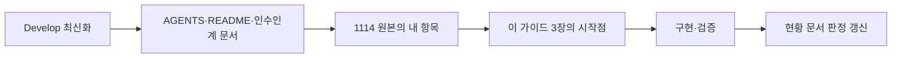
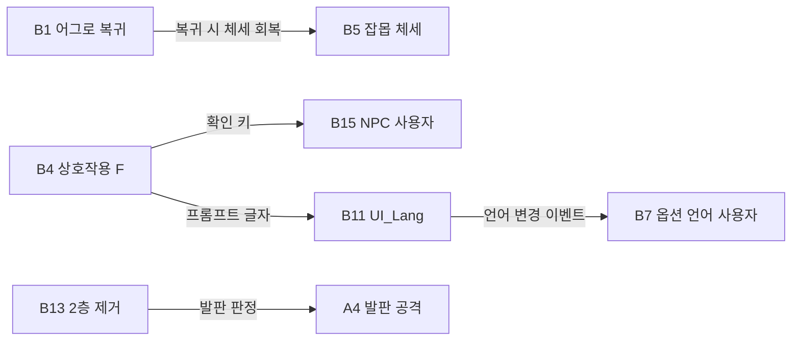

# 1114 다른 작업자 작업 가이드

기준일: 2026-11-14 · 기준 코드: HYT/work 72f50033(= origin/Develop) · 대상: 1114 통합 전달 중 사용자 담당(A1·A2·A3·B6·B7·B15·B17·C6)을 뺀 항목의 작업자

이 가이드는 각자 맡은 항목을 시작할 때 참고하는 안내입니다. 요구 내용과 확인 방법은 기획 원본 [개발전달_최종통합_1114](../../../DataSheet/Docs/개발전달_최종통합_1114.md), 항목별 판정은 [1114 통합 전달 대응 현황](1114%20통합%20전달%20대응%20현황.md)을 기준으로 하며 여기에 다시 적지 않습니다.

## 목차

1. [시작 전에](#1-시작-전에)
2. [지켜야 할 기준](#2-지켜야-할-기준)
3. [항목별 시작점과 주의점](#3-항목별-시작점과-주의점)
4. [다른 항목과 맞닿는 곳](#4-다른-항목과-맞닿는-곳)
5. [끝낼 때](#5-끝낼-때)

## 1. 시작 전에

1. Develop을 받아 72f50033 이후인지 확인합니다. 두 저장소(Human_Ghost-, DataSheet)는 같은 상위 폴더에 둡니다.
2. [AGENTS.md](../../AGENTS.md) → [README](../../README.md) → [다른 PC 작업 시작과 설계원칙 인수인계](다른%20PC%20작업%20시작과%20설계원칙%20인수인계.md) 순서로 읽습니다.
3. 1114 원본에서 자기 항목의 "바꿀 것·근거·확인"을 읽고, 아래 3장의 시작점에서 코드를 엽니다.

## 2. 지켜야 할 기준

상세 계약은 인수인계 문서 3장을 따릅니다. 1114 작업에서 특히 자주 걸리는 것만 적습니다.

| 기준 | 1114 작업에서의 뜻 |
| --- | --- |
| 데이터 기반 | 시트에 있는 수치(MonsterAggro, Player.HangAuto, UnitStat Poise 등)를 코드 상수로 다시 적지 않습니다. 데이터에 없는 수치가 필요하면 기획에 열을 요청합니다 |
| 정수 단위 | 거리는 시트 타일×100, 내부는 IntegerPosition(타일×1,000,000)이며 `IntegerPosition.FromData`로 변환합니다. 시간은 ms입니다 |
| 일반 정의 클래스 | `Assets/3.Script/Data`의 정의는 최초 생성 후 자동 갱신되지 않습니다. 시트 열이 바뀌면 생성자를 직접 맞춥니다. enum·로딩 계획은 직접 고치지 않습니다 |
| 다른 담당 기능 | 남의 항목 코드를 고쳐야 하면 그 담당자와 먼저 맞춥니다(4장) |
| 명명 | 필드 `_camelCase`, 메서드 `PascalCase`. 씬·프리팹 오브젝트와 호출 키는 영문 ASCII |
| 문구 | 화면 글자는 Language ID로 읽습니다. 코드에 한국어 화면 문구를 넣지 않습니다 |
| 테스트 전용 기능 | 기존 조건(`UNITY_EDITOR || DEVELOPMENT_BUILD`, `Debug.isDebugBuild`)을 재사용합니다 |

## 3. 항목별 시작점과 주의점

### 3.1 전투·이동 (A4~A8, B3, B5, B16)

| 번호 | 시작점 | 주의점 |
| --- | --- | --- |
| A4 | BossCombat, PreviewBossDriver의 피격 판정 | 원인이 코드에서 특정되지 않았습니다. 발판 높이에서 판정 범위를 먼저 재현합니다. B13에서 2층 발판을 없애도 1층 발판 판정은 남습니다 |
| A5 | BossCombat.PullVelocity | 당김 속도는 사슬에 묶였을 때만 생깁니다. 사슬 없이 끌리면 충돌·밀어내기 쪽을 의심합니다 |
| A6 | PreviewMonsterDriver의 `MoveHorizontal`·벽 처리, MonsterActor.NotifyWallHit | 벽 정지 코드는 있습니다. 실제 맵 벽 충돌체와 스폰 이동 범위(`_spanMin/_spanMax`)를 확인합니다. 허점 800ms는 Monster 3002 비고 기준입니다 |
| A7 | PlayerActor.HealMoveSpeed | 지금은 약초 중 이동 속도가 절반입니다. 800ms 동안 0으로 바꾸되, 시간은 상태·데이터 기준을 재사용합니다 |
| A8 | 서낭당 닫기 뒤 상태 복귀(ShrineInteract, 서낭당 화면 닫기 흐름) | 일어서기 애니메이션 완료 전 이동 입력을 막습니다. 입력 잠금은 소유자가 해제까지 책임집니다 |
| B3 | Player.HangAuto(정의만 있음), 매달리기 판정 | 키 판정 순서에 매달리기가 빠졌다는 기획 근거가 있습니다. 놓은 직후 같은 턱 재잡기 방지가 필요합니다. 가마터 Hang_* 6곳으로 확인합니다 |
| B5 | MonsterActor 체세·노출·처형, ExecutionRewardSession | 체세와 처형 규칙은 이미 있습니다. 남은 것은 머리 위 체세 표시와 처형 보상 지급 연결 확인입니다 |
| B16 | 플레이어 공격 상태와 구르기 전이 | 1~3타 후딜만 취소 가능, 4타 불가. 공격 시작부터 취소는 기획 검토 중이니 넣지 않습니다 |

### 3.2 몬스터 어그로 (B1)

설계는 [담당 예정 기능 설계와 연결 기준 4장](담당%20예정%20기능%20설계와%20연결%20기준.md#4-몬스터-추적-설정)에 1114 확정 규칙 표와 함께 정리돼 있습니다.

- 시작점: PreviewMonsterDriver(지금은 가로 거리 `Distance(offset)`와 SightRange만 관측), MonsterActor.Observe/ClearTarget, `Assets/Data/Csv/MonsterAggro.csv`(로딩만 됨).
- 규칙과 상태는 Core에 두고, 상대 위치 관측과 실제 이동은 PreviewMonsterDriver에서 연결합니다. 매 프레임 장면 전체 검색은 추가하지 않습니다.
- 공격 패턴·돌진·잡기·그로기·처형 중에는 해제하지 않습니다. 패턴·타격 규칙 자체는 바꾸지 않습니다.
- 남은 확인: 경계값 포함 여부, 복귀 도착 허용 오차, 복귀 경로가 막혔을 때의 처리.

### 3.3 입력·카메라 (B2, B4)

| 번호 | 시작점 | 주의점 |
| --- | --- | --- |
| B2 | PreviewFollowCamera | 지금은 대상 높이를 그대로 따라갑니다. 점프 중 세로 고정, ↑↓ 0.5초 3칸 보기, 기본 높이 조정. 값은 Inspector로 두고 빌드에서 기획과 맞춥니다 |
| B4 | `Assets/10.Input/InputSystem_Actions.inputactions` 420줄(`<Keyboard>/e`), `Assets/3.Script/Adapters/KeyboardControls.cs` 64줄(`"e"`), `InteractPrompt.prefab`의 `09_interact_E.png` | **입력 에셋만 바꾸면 KeyboardControls가 실행 중 E로 되돌립니다.** 두 곳을 모두 F로 바꿉니다. A안·B안 모두 F이고 F는 다른 키와 겹치지 않습니다. F 키 그림은 아트에서 받은 뒤 교체합니다 |

### 3.4 UI·표시 (B8~B11, B13·B14·B18, C1~C5)

| 번호 | 시작점 | 주의점 |
| --- | --- | --- |
| B8 | HudScreen(`_dimAlpha = 0.9f`) | 평소 0.9는 들어가 있습니다. 강조 때 1.0 전환만 확인합니다 |
| B9 | `Assets/9.Font/SongMyung` | 참조하는 프리팹·씬이 없습니다. 파일 정리 여부만 정합니다 |
| B10 | StageNameBanner(0.5·2·0.5초) | 시간은 반영돼 있습니다. 글자 위치 올리기와 같은 맵 재진입 재표시를 확인합니다 |
| B11 | UI_Lang 정의·로딩, LanguageTextSource | 설계는 [담당 예정 설계 5.1](담당%20예정%20기능%20설계와%20연결%20기준.md#51-ui-언어는-문장과-기능별-키를-분리). 화면마다 번역 사전을 따로 만들지 않고 공통 조회를 씁니다. Key 중복·TextID 참조 검사는 DataSheet가 이미 하니 클라이언트에 다시 만들지 않습니다 |
| B13·B14 | 보스방 맵(8004), 보스 프리팹 | 맵·프리팹 수정은 .meta를 함께 커밋합니다. guid가 바뀌면 StageContentSet 연결이 끊깁니다 |
| B18 | 보스 이름 UI | 크기만 조정합니다 |
| C1~C5 | 스킬·약초 아이콘, 왼쪽 아래 UI, 시작 조작키 글자, 구덩이 경계 | C5가 그림 문제면 아트로 넘깁니다 |

### 3.5 이미 코드에 반영된 것 (B12)

GalimgilRewards가 `countStages [8002, 8006]`, `soulPerKill 3`, 버림을 데이터로 계산합니다. 18마리 처치 뒤 54혼, 재입장 미지급을 Play로 확인합니다.

## 4. 다른 항목과 맞닿는 곳

| 맞닿는 곳 | 맞출 것 |
| --- | --- |
| B1 ↔ B5 | 복귀 때 체세를 가득 채우는 코드는 B5 체세 소유 코드를 재사용합니다 |
| B4 ↔ B15(사용자) | B4가 끝나면 사용자에게 알려 NPC 대화를 F로 다시 확인합니다 |
| B11 ↔ B7(사용자) | 언어 선택 저장·변경 이벤트는 B7 쪽 기존 LanguageSettings를 그대로 구독합니다 |
| B13 ↔ A4 | 2층 제거 뒤 남는 발판에서 A4를 확인합니다 |
| C6·A2(사용자) | StageExit에 RouteID(경로 통계)·ExitAction(Travel/FinishDemo) 열과 보스방 마무리 12번 행이 추가됐습니다. StageExit를 다루는 작업은 이 열과 행을 지우지 않습니다 |
| A2(사용자) ↔ B13 | 보스방 오른쪽 끝이 시연 마무리 관문입니다. 보스방 맵을 고칠 때 오른쪽 끝으로 걸어갈 수 있는지 유지합니다 |
| TextboxScreen | `IsOpen`은 대사 재생 또는 마무리 검은 화면이 열려 있을 때 true입니다. 대사 건너뛰기는 대사 재생 중에만 됩니다 |
| MenuInput·PauseMenuHost | MenuInput으로 만든 메뉴는 ESC(뒤로)로 닫히고, 그 프레임에는 일시정지가 다시 열리지 않습니다(`MenuInput.LastBackFrame`). 새 UI도 MenuInput을 쓰면 됩니다. 일시정지를 코드에서 닫을 때는 `PauseMenuHost.CloseIfOpen()` |
| 에디터 테스트 이동 | 인귀/테스트에 갈림길 입구 이동이 추가됐고, 메뉴를 누를 때 열리는 일시정지는 자동으로 닫힙니다 |

## 5. 끝낼 때

1. `./Tools/Verify-Project.ps1 -CompileUnity`로 검사합니다.
2. 1114 원본의 "확인" 문장대로 Play로 확인합니다. 검사 통과, Play 확인, 실행파일 확인은 구분해 적습니다.
3. [1114 통합 전달 대응 현황](1114%20통합%20전달%20대응%20현황.md)의 판정과 근거를 갱신하고, 바뀐 기능의 설계·기획자 안내 문서도 함께 고칩니다.
4. 기획 원본(DataSheet 1114 문서)에는 결과를 덧쓰지 않습니다.
