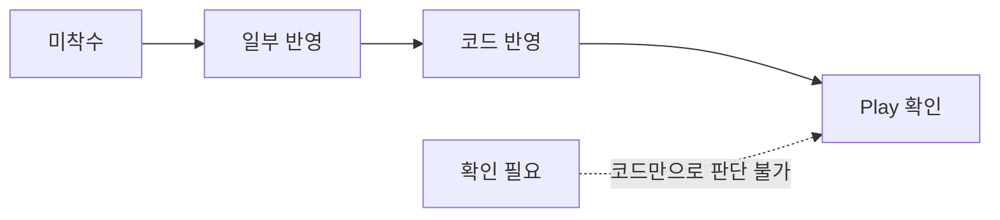
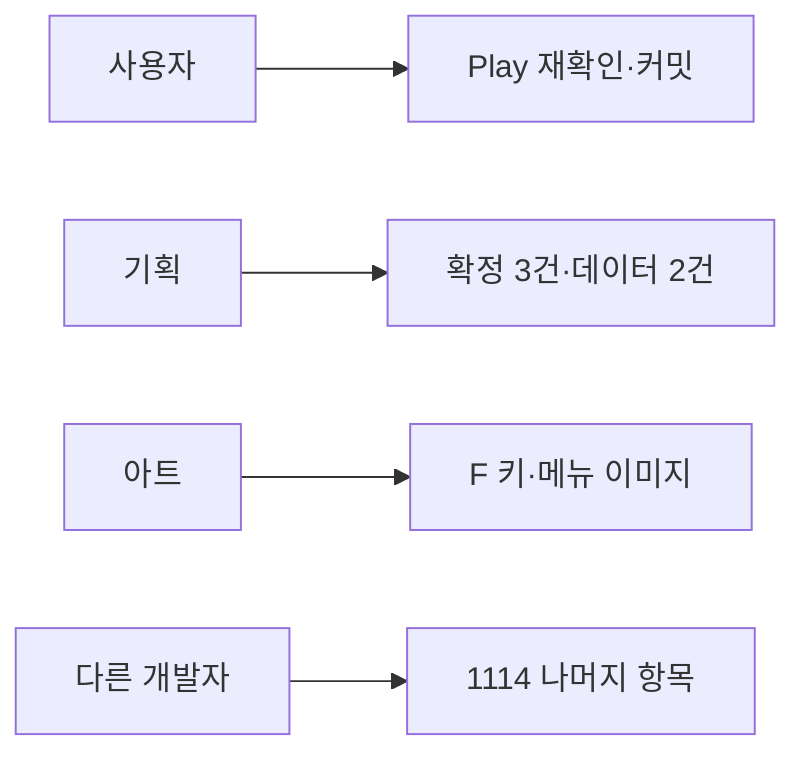

# 1114 통합 전달 대응 현황

기준일: 2026-11-14(후속 갱신) · 기준 코드: 공통 e0090fb + 미커밋 후속 작업 / DataSheet bdf8629 · 기획 원본: DataSheet [개발전달_최종통합_1114](../../../DataSheet/Docs/개발전달_최종통합_1114.md)

기획 원본에는 구현 결과를 덧쓰지 않고 이 문서에서 대응 현황을 관리합니다. 판정은 **코드·데이터·커밋 확인** 기준이며, 사용자 Play나 실행파일 확인을 따로 적지 않은 항목은 실제 동작을 확인한 것이 아닙니다. 담당 예정 기능의 설계는 [담당 예정 기능 설계와 연결 기준](담당%20예정%20기능%20설계와%20연결%20기준.md)을 따릅니다.

## 목차

1. [판정 기준](#1-판정-기준)
2. [한눈에 보기](#2-한눈에-보기)
3. [A: 시연이 막히는 것](#3-a-시연이-막히는-것)
4. [B: 지스타 전 필수](#4-b-지스타-전-필수)
5. [C: 다듬기](#5-c-다듬기)
6. [담당 구분](#6-담당-구분)
7. [다른 작업자 인계 목록](#7-다른-작업자-인계-목록)
8. [1114 외 추가 수정](#8-1114-외-추가-수정)
9. [역할별 다음 할 일](#9-역할별-다음-할-일)

## 후속 작업 체크포인트 — 2026-11-14

패링 완료 순서·추가 처형 보상/저장·MonsterAggro·자동 매달리기·F 입력·UI_Lang 주요 화면·지게귀 달리기 리그를 연결했습니다. 상세 책임과 사용 절차는 [후속 구현 설계](1114%20전투·입력·리깅%20후속%20구현.md)와 [기획자 확인 안내](../기획자용%20안내문서/1114%20후속%20작업%20확인%20안내.md)를 봅니다. 공통 StageExit·TravelExit·검은 마무리·ESC 동작은 유지했습니다.

최신 데이터 8,885개·코어 1,773개 검사, Unity 실제 참조의 게임·에디터 317개 소스 컴파일(경고·오류 0개)을 통과했습니다. SDK가 없어 Verify-Project.ps1 자체 실행은 불가했으며 Unity 내장 런타임·Roslyn으로 기존 검사 소스를 실행했습니다. 지게귀 두 종류·양방향 분리 Play 120프레임(변형 238/238)과 피격·노출 복귀, 타이틀·옵션·서낭당 KO/EN 문구·가시성을 확인했습니다.

마지막 자산 변경 뒤 Unity MCP가 응답하지 않아 전체 장면 수용 확인은 중단됐습니다. 자동 매달리기 6곳·서낭당 일어서기·보스 2페이즈 패턴 전체·상단 발판 제거 뒤 통행·잡몹 체세 표시·UI 정렬은 Play 확인이 남습니다. 커밋·푸시·플레이어 빌드·배포는 하지 않았습니다.

## 1. 판정 기준

| 판정 | 뜻 |
| --- | --- |
| 미착수 | 요구한 동작의 코드가 없음 |
| 일부 반영 | 기반은 있으나 요구 중 일부가 빠짐 |
| 코드 반영 | 요구한 동작의 코드·데이터 연결을 확인. 실제 Play는 미확인 |
| Play 확인 | 사용자가 실제 실행으로 확인 |
| 확인 필요 | 맵·프리팹·그림·물리 문제라 코드만으로 판단할 수 없음 |

## 2. 한눈에 보기

| 번호 | 항목 | 판정 | 담당 |
| --- | --- | --- | --- |
| A1 | 가마터·갈림길 출구 멈춤 | 코드 반영 | 사용자 |
| A2 | 보스 처치 뒤 엔딩 흐름 | Play 확인 | 사용자 |
| A3 | 인트로 영상 | 코드 반영 | 사용자 |
| A4 | 발판 위 공격이 보스에 안 맞음 | 확인 필요 | 다른 작업자 |
| A5 | 사슬 없이 끌려옴 | 일부 반영·재현 필요 | 다른 작업자 |
| A6 | 지게귀 벽 통과 | 확인 필요 | 다른 작업자 |
| A7 | 약초 중 이동 | 코드·규칙 검사 | 다른 작업자 |
| A8 | 서낭당 앉은 채 이동 | 코드 반영 | 다른 작업자 |
| B1 | 몬스터 어그로 | 코드·규칙 검사 | 다른 작업자 |
| B2 | 카메라 | 코드 반영 | 다른 작업자 |
| B3 | 매달리기 자동 잡기 | 코드 반영 | 다른 작업자 |
| B4 | 상호작용 키 E → F | 코드 반영(F 그림 대기) | 다른 작업자 |
| B5 | 잡몹 체세·처형 | 코드·규칙 검사 | 다른 작업자 |
| B6 | 타이틀 메뉴 | 코드 반영(아트 대기) | 사용자 |
| B7 | 옵션 언어·창모드 | 코드 반영 | 사용자 |
| B8 | HUD 불투명도 | 코드 반영 | 다른 작업자 |
| B9 | 글꼴 3종 | 코드 반영 | 다른 작업자 |
| B10 | 맵 도착 이름 | 일부 반영 | 다른 작업자 |
| B11 | UI_Lang 화면 연결 | 코드 반영·일부 프리팹 확인 | 다른 작업자 |
| B12 | 갈림길 보상 혼 | 코드 반영 | 다른 작업자 |
| B13 | 보스방 2층 제거 | 자산 반영·Play 필요 | 다른 작업자 |
| B14 | 보스가 떠 있음 | 확인 필요 | 다른 작업자 |
| B15 | NPC 표시·대화 | Play 확인 | 사용자 |
| B16 | 공격 중 구르기 끊기 | 확인 필요 | 다른 작업자 |
| B17 | 재화 부족 안내 | 코드 반영 | 사용자 |
| B18 | 보스 이름 크기 | 코드 반영 | 다른 작업자 |
| C1~C5 | UI·그림 다듬기 | C1·C4 반영, C2·C5 미완료 | 다른 작업자 |
| C6 | 갈림길 경로 선택 통계 | Play 확인(로컬) | 사용자 |

담당은 2026-11-14 사용자 지시입니다. 다른 작업자 항목의 실제 담당자 배정은 이 문서에서 추정하지 않습니다.

## 3. A: 시연이 막히는 것

| 번호 | 현재 근거 | 남은 작업 |
| --- | --- | --- |
| A1 | ec0a9408에서 출구를 StageExit 데이터로 전환. 도착 앵커를 맵 이름 추정 대신 ArrivalAnchorName으로 지정(8006·8007 행 포함) | 1114 확인 표의 6개 이동 Play 확인 |
| A2 | 2026-11-14: 처치·처형·대화 종료 뒤 2000ms 대기(Inspector `보스 처치 뒤 엔딩 대기`) 후 22003 재생. StageExit에 ExitAction 열과 12번 행(8004 RightEdge, FinishDemo, 잠금 안내 30351) 추가. 영상을 본 뒤 오른쪽 관문에 닿으면 TextboxScreen.OpenBlackout으로 검은 화면 가운데 30352를 3000ms(또는 넘기기 입력) 표시 후 타이틀 | 2026-11-14 사용자 Play로 처치 → 영상 → 복귀 → 오른쪽 관문 → 문구 → 타이틀 이동 확인(배포·컴파일 포함). 남은 확인: 2초 기준 시점(처치 순간 vs 처형·대화 종료 뒤)은 기획 확인 |
| A3 | TitleGameEntry.NewGame이 Intro 컷씬을 찾고, Addressables에 Cutscene_Intro_Video 등록 | 새 게임만 재생, 사망 재시작·이어하기 미재생, Enter 스킵 Play 확인 |
| A4 | 코드만으로 원인을 특정하지 못함 | 발판 위 1~4타 판정 범위 확인 |
| A5 | 사슬 당김 종료를 보스 앞 1타일로 보정. 사슬 피격 시에만 PullVelocity가 발생하는 계약 유지 | 사슬 없이 끌렸다는 원 보고를 Play로 재현 |
| A6 | 벽 충돌 시 이동 정지·NotifyWallHit 처리 존재 | 실제 맵 벽 충돌체와 이동 범위 확인, 허점 800ms 확인 |
| A7 | 약초 상태 가로 속도 0으로 수정, 799/800ms 경계·종료 복원 검사 | 실제 입력 확인 |
| A8 | GameplayPreview.Shrine과 PreviewPlayerSprite에 기도 유지·역재생 일어서기·별도 입력 잠금 연결 | UI 닫기·저장 지연·모달 겹침 실제 확인 |

## 4. B: 지스타 전 필수

| 번호 | 현재 근거 | 남은 작업 |
| --- | --- | --- |
| B1 | MonsterAwareness·MonsterActor·PreviewMonsterDriver에 데이터 기반 높이 인식·해제·복귀·재획득 지연 연결, 규칙 검사 | 실제 맵에서 벽에 막힌 복귀·플레이어 사망·보호 상태 확인 |
| B2 | 점프 높이 유지·긴 낙하 예외·0.5초 위아래 3타일 보기·Inspector 구도 보정 연결 | 실제 빌드 화면 구도 확인·조정 |
| B3 | HangAuto를 Move의 공중 접촉 자동 잡기에 연결. 놓은 턱 제외는 잡기 범위 이탈 후 해제 | 가마터 Hang_* 6곳 실제 확인 |
| B4 | 입력 에셋과 KeyboardControls 모두 F, 두 조작 방식 공통. E 그림을 숨기고 F 글자로 안내 | NPC·서낭당·장부·처형 F 입력, F 그림 공급 후 교체 |
| B5 | MonsterPoiseView 머리 위 표시, 실제 처형 보상의 지갑·회복·오염·저장 연결. 중복·실패·저장 호환 검사 | 새 표시·실제 보상 수용 확인. 오염 먹물 UI·인벤토리는 후속 |
| B6 | 메뉴 순서·이어하기 우선 커서·부스 빌드 나가기 숨김(TitleBoothSettings)·붉은 점 숨김은 기존 코드로 충족. 2026-11-14: 타이틀 정지 배경(HG_BackGround.png)이 영상(HG_BackGround.mp4)과 다른 그림이라 영상 준비 전 검게 가리고 영상 실패 때만 표시(TitleVideoBackground `_fallback`) | **아트 요청:** 메뉴 글자 이미지가 상태별로 섞여 있음(새로 시작 pressed 밝기 158, 이어하기 hover 225, 옵션 normal 194, 나가기 225). 같은 상태(normal)의 4장이 와야 선택 색이 고르게 보임. Play 확인 |
| B7 | 옵션 순서와 언어 줄 반영, 화면 모드는 타이틀에서만 표시, 전체 화면은 1920×1080 테두리 없음(FullScreenWindow). 2026-11-14: WindowModeApplication 창모드 1208×720 → 1280×720 | 실행파일에서 창모드 크기 확인(에디터에서는 적용하지 않음) |
| B8 | HudScreen 평소 알파 0.9 | 강조 때 1.0 전환 Play 확인 |
| B9 | SongMyung 글꼴을 참조하는 프리팹·씬·에셋 없음 | 남은 글꼴 파일 정리 여부 결정 |
| B10 | StageNameBanner 0.5초·2초·0.5초와 씬 진입 표시 코드 유지 | 이름 위치 올리기, 재진입 시 재표시 실제 확인 |
| B11 | 공통 ReadUi(ID→TextID→Language)로 주요 UI 연결, 기존 LanguageSettings 구독. 타이틀·옵션·서낭당 KO/EN 프리팹 확인 | 영문 잘림·줄바꿈과 나머지 화면 수용 확인. 예약 120행 전부의 렌더를 확인한 것은 아님 |
| B12 | GalimgilRewards가 countStages [8002, 8006]·soulPerKill 3·버림을 데이터로 계산 | 18마리 처치 후 54혼, 재입장 미지급 Play 확인 |
| B13·B14·B18 | 실제 연결된 K9 맵 상단 그림·충돌 12개 비활성화, 관문·지면 유지. 기존 보스 접지 보정 유지, 보스 이름 최소 42 | 상단 제거 뒤 통로·판정·발 접지·이름 크기 실제 확인 |
| B15 | NPC 연결 복구(b5d76172)와 대사 연결(72f50033) | 사용자 실제 확인 완료. 상호작용 키는 B4 반영 후 F로 재확인 |
| B16 | 구르기 취소 관련 코드 위치 미특정 | 1~3타 후딜 취소 가능, 4타 불가 확인 |
| B17 | ShrineScreen이 재화 부족 시 30225 표시. 2026-11-14 사용자 Play에서 오류 발견: 새 서낭당 UI에서 Panel이 MenuView/Panel·OfferView/Panel로 나뉘었는데 안내 팝업 크기 맞춤이 예전 경로 `Panel`을 찾아 InvalidOperationException. 지금 보이는 화면의 패널을 쓰도록 수정 | 혼 부족 상태에서 바치기 → 30225 팝업 → 닫기 Play 재확인 |

## 5. C: 다듬기

C1은 스킬 이름 숨김, C4는 두 게임 장면의 시험용 Instructions 객체 비활성화를 반영했습니다. C3 기존 약초 중앙 보정은 유지했습니다. C2 하단 간격·C5 구덩이 안개 경계는 미완료이며 실제 화면 대조가 필요합니다. C5가 그림 문제이면 아트 담당으로 넘깁니다.

| 번호 | 현재 근거 | 남은 작업 |
| --- | --- | --- |
| C6 | StageExit에 RouteID 열 추가(7번 행 = 1), 클라이언트 정의 수정, 실제 출구 이동이 시작될 때 기록 연결(영역·맵 끝·문 출구 모두), 같은 갈림길 RouteID 중복 배포 검사 추가(2026-11-14). 컴파일·Play 미확인 | 2026-11-14 에디터 로컬 확인(사이트 전송 끔): 협곡 출구 통과 시 route_selected 1건(junction 8007, route 1, destination 8003), 중복 없음. 남은 확인: 실행파일에서 통계 사이트 집계·다운로드 반영. 이전 메모: Unity 컴파일, 협곡 출구 통과 후 사이트 1건 증가 확인. [담당 예정 설계 6장](담당%20예정%20기능%20설계와%20연결%20기준.md#6-갈림길-선택-통계) |

## 6. 담당 구분

2026-11-14 사용자 지시로 아래와 같이 나눕니다. 1114 원본의 "영민 님" 표기(B11)도 다른 작업자 쪽에 포함됩니다.

| 구분 | 항목 |
| --- | --- |
| 사용자 | A1 출구, A2 엔딩, A3 인트로, B6 타이틀 메뉴, B7 옵션, B15 NPC, B17 재화 부족 안내, C6 갈림길 통계 |
| 다른 작업자 | A4~A8, B1~B5, B8~B14, B16, B18, C1~C5 |

## 7. 다른 작업자 인계 목록

원 시작점은 [다른 작업자 가이드](1114%20다른%20작업자%20작업%20가이드.md), 현재 연결과 검증은 [후속 구현 설계](1114%20전투·입력·리깅%20후속%20구현.md)를 봅니다. 가이드의 초기 미착수 표기보다 이 현황의 후속 체크포인트를 우선합니다.

다음 담당자는 MCP 재연결 후 F 입력·가마터 자동 잡기 6곳·서낭당 일어서기·지게귀 벽/패링/체세/처형·보스 2페이즈와 발·오른쪽 관문을 실제로 확인합니다. A4·A5는 원 보고 원인 재현이 남습니다. C2·C5·B10 위치는 화면 대조 뒤 조정합니다. F 그림 공급은 아트 후속이며 원본 시트·PNG·기존 GUID를 추정으로 수정하지 않습니다.

## 8. 1114 외 추가 수정

2026-11-14 사용자 Play 중 발견해 고친 것입니다. 1114 원본 항목에는 없습니다.

| 문제 | 원인 | 수정 | 상태 |
| --- | --- | --- | --- |
| ESC로 일시정지가 닫히지 않음(계속하기만 동작) | ESC로 메뉴를 닫은 같은 프레임에 PauseMenuHost.Update가 ESC를 보고 다시 엶. 서낭당·오류 창 등을 ESC로 닫아도 같은 현상 | MenuInput.LastBackFrame에 "뒤로"를 처리한 프레임을 기록하고, 그 프레임에는 일시정지를 열지 않음 | 코드 반영, Play 미확인 |
| 서낭당 재화 부족 시 오류 창 | 새 서낭당 UI에서 Panel이 MenuView/Panel·OfferView/Panel로 나뉨 | 현재 보이는 화면의 패널 사용(B17) | 코드 반영, Play 미확인 |
| 에디터 테스트 이동 메뉴가 항상 회색 | 메뉴를 누르면 게임 창이 포커스를 잃어 일시정지가 열리고, 이동 조건이 일시정지를 막음 | 조건에서 일시정지를 빼고 이동 직전에 PauseMenuHost.CloseIfOpen | 코드 반영 |
| 갈림길로 바로 갈 테스트 수단 없음 | 갈림길은 도착 앵커가 두 개라 기존 이동 방식이 실패 | 인귀/테스트/갈림길 입구로 이동 추가. Stage.NextStage로 정방향 입구(Spawn_FromOnggi)를 데이터에서 고름 | Play 확인 |

갈림길 아래쪽 길(Route_Low → P_Road)과 폐광(P_MineDown)으로 이동되지 않는 것은 1114 4장의 의도된 막음이며 수정 대상이 아닙니다.

## 9. 역할별 다음 할 일

### 9.1 사용자

| 할 일 | 확인 방법 |
| --- | --- |
| A1 이동 6개 Play 확인 | 1114 A1 확인 표의 여섯 방향 이동 |
| A3 인트로 Play 확인 | 새 게임만 재생, 이어하기·사망 재시작 미재생, Enter 스킵 |
| B6 타이틀 배경 확인 | 타이틀 시작 때 도축장 정지 그림이 비치지 않음 |
| B7 창모드 확인 | 실행파일에서 1280×720 창 |
| B17·ESC 확인 | 혼 부족 → 30225 팝업 → ESC로 팝업만 닫힘, 일시정지·서낭당·오류 창이 ESC로 닫히고 게임 복귀 |
| C6 사이트 집계 확인 | 실행파일에서 협곡 출구 통과 후 통계 사이트 협곡 경로 1건 증가 |
| 커밋 | DataSheet 먼저, 클라이언트 다음. 사용자 작업이 아닌 변경(F8 보스 시험 창·관련 문서 2건)은 따로 확인 |

### 9.2 기획

| 할 일 | 이유 |
| --- | --- |
| A2 2초 기준 시점 확정 | 지금은 처형·대화가 끝난 뒤부터 2초. 처치 순간부터면 개발에 알림 |
| A2 관문 위치 확인 | 보스방 오른쪽 끝(구조물_02 x=22.4)을 관문으로 판단. 다르면 StageExit 12번 행의 TriggerType·AnchorName 조정 |
| 갈림길 막힌 길 안내 여부 | 아래쪽 길·폐광 끝에서 지금은 안내 없이 멈춤. "앞이 막혀 있다"(30351)를 띄울지 결정 |
| StageExit 새 열 숙지 | RouteID(경로 통계, 0=대상 아님, 같은 갈림길에서 중복 금지), ExitAction(Travel/FinishDemo). 폐광·산사 맵이 생기면 출구 행에 RouteID 2·3 입력 |
| 8006·8007 StageLayer 행 | 1114 4장 예고대로 원경 데이터 입력 |
| B12 보상 확인 | 테스트 이동으로 들어가면 0혼으로 기록되므로 일반 진행으로 18마리 → 54혼 확인 |

### 9.3 아트

| 할 일 | 이유 |
| --- | --- |
| F 키 상호작용 그림 | B4는 F 글자로 안내 중. 전용 그림 공급 후 연결 |
| 타이틀 메뉴 글자 이미지 4장을 같은 상태(normal)로 | 새로 시작 pressed(밝기 158)·이어하기 hover(225)·옵션 normal(194)·나가기(225)가 섞여 선택 색이 고르지 않음(B6 피드백 27) |
| C5 구덩이 경계선 | 그림 문제로 판단되면 |

### 9.4 다른 개발자

1114의 A4~A8·B1~B5·B8~B14·B16·B18·C1~C5입니다. 코드 시작점과 주의점은 7장과 [1114 다른 작업자 작업 가이드](1114%20다른%20작업자%20작업%20가이드.md)를 봅니다. 오늘 바뀐 공통 동작 중 알아야 할 것:

- StageExit에 RouteID·ExitAction 열과 12번 행이 생겼습니다. 출구 이동은 GameplayPreview.TravelExit 한 곳을 거칩니다.
- TextboxScreen.IsOpen은 대사 재생 또는 마무리 검은 화면이 열려 있을 때 true입니다.
- MenuInput으로 만든 메뉴는 ESC(뒤로)로 닫히며, 닫은 프레임에는 일시정지가 열리지 않습니다. 새 메뉴도 MenuInput을 쓰면 자동 적용됩니다.
- 보스방 오른쪽 끝이 시연 마무리 관문입니다. B13 보스방 수정 때 걸어갈 수 있게 유지합니다.

판정이 바뀌면 이 문서의 표와 [현재 구현과 검증 현황](현재%20구현과%20검증%20현황.md)을 함께 갱신합니다.
