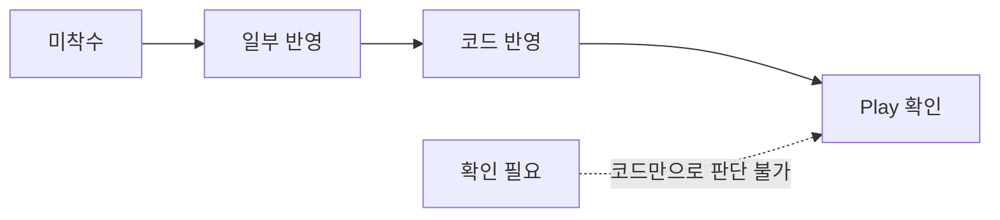
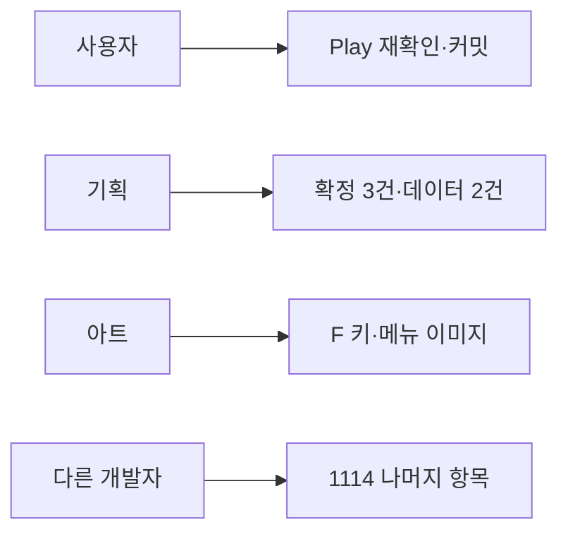

# 1114 통합 전달 대응 현황

기준일: 2026-11-14(오후 갱신) · 기준 코드: HYT/work 72f50033(= origin/Develop) + 미커밋 사용자 작업 · 기획 원본: DataSheet [개발전달_최종통합_1114](../../../DataSheet/Docs/개발전달_최종통합_1114.md)

기획 원본에는 구현 결과를 덧쓰지 않고 이 문서에서 대응 현황을 관리합니다. 판정은 **코드·데이터·커밋 확인** 기준이며, 사용자 Play나 실행파일 확인을 따로 적지 않은 항목은 실제 동작을 확인한 것이 아닙니다. 담당 예정 기능의 설계는 [담당 예정 기능 설계와 연결 기준](담당%20예정%20기능%20설계와%20연결%20기준.md)을 따릅니다.

## 목차

1. [판정 기준](#1-판정-기준)
2. [한눈에 보기](#2-한눈에-보기)
3. [A: 시연이 막히는 것](#3-a-시연이-막히는-것)
4. [B: 지스타 전 필수](#4-b-지스타-전-필수)
5. [C: 다듬기](#5-c-다듬기)
6. [담당 구분](#6-담당-구분)
7. [다른 작업자 인계 목록](#7-다른-작업자-인계-목록)
8. [1114 외 추가 수정](#8-1114-외-추가-수정)
9. [역할별 다음 할 일](#9-역할별-다음-할-일)

## 1. 판정 기준

| 판정 | 뜻 |
| --- | --- |
| 미착수 | 요구한 동작의 코드가 없음 |
| 일부 반영 | 기반은 있으나 요구 중 일부가 빠짐 |
| 코드 반영 | 요구한 동작의 코드·데이터 연결을 확인. 실제 Play는 미확인 |
| Play 확인 | 사용자가 실제 실행으로 확인 |
| 확인 필요 | 맵·프리팹·그림·물리 문제라 코드만으로 판단할 수 없음 |

## 2. 한눈에 보기

| 번호 | 항목 | 판정 | 담당 |
| --- | --- | --- | --- |
| A1 | 가마터·갈림길 출구 멈춤 | 코드 반영 | 사용자 |
| A2 | 보스 처치 뒤 엔딩 흐름 | Play 확인 | 사용자 |
| A3 | 인트로 영상 | 코드 반영 | 사용자 |
| A4 | 발판 위 공격이 보스에 안 맞음 | 확인 필요 | 다른 작업자 |
| A5 | 사슬 없이 끌려옴 | 확인 필요 | 다른 작업자 |
| A6 | 지게귀 벽 통과 | 확인 필요 | 다른 작업자 |
| A7 | 약초 중 이동 | 미착수 | 다른 작업자 |
| A8 | 서낭당 앉은 채 이동 | 확인 필요 | 다른 작업자 |
| B1 | 몬스터 어그로 | 미착수 | 다른 작업자 |
| B2 | 카메라 | 미착수 | 다른 작업자 |
| B3 | 매달리기 자동 잡기 | 미착수 | 다른 작업자 |
| B4 | 상호작용 키 E → F | 미착수 | 다른 작업자 |
| B5 | 잡몹 체세·처형 | 확인 필요 | 다른 작업자 |
| B6 | 타이틀 메뉴 | 코드 반영(아트 대기) | 사용자 |
| B7 | 옵션 언어·창모드 | 코드 반영 | 사용자 |
| B8 | HUD 불투명도 | 코드 반영 | 다른 작업자 |
| B9 | 글꼴 3종 | 코드 반영 | 다른 작업자 |
| B10 | 맵 도착 이름 | 일부 반영 | 다른 작업자 |
| B11 | UI_Lang 화면 연결 | 미착수 | 다른 작업자 |
| B12 | 갈림길 보상 혼 | 코드 반영 | 다른 작업자 |
| B13 | 보스방 2층 제거 | 확인 필요 | 다른 작업자 |
| B14 | 보스가 떠 있음 | 확인 필요 | 다른 작업자 |
| B15 | NPC 표시·대화 | Play 확인 | 사용자 |
| B16 | 공격 중 구르기 끊기 | 확인 필요 | 다른 작업자 |
| B17 | 재화 부족 안내 | 코드 반영 | 사용자 |
| B18 | 보스 이름 크기 | 확인 필요 | 다른 작업자 |
| C1~C5 | UI·그림 다듬기 | 확인 필요 | 다른 작업자 |
| C6 | 갈림길 경로 선택 통계 | Play 확인(로컬) | 사용자 |

담당은 2026-11-14 사용자 지시입니다. 다른 작업자 항목의 실제 담당자 배정은 이 문서에서 추정하지 않습니다.

## 3. A: 시연이 막히는 것

| 번호 | 현재 근거 | 남은 작업 |
| --- | --- | --- |
| A1 | ec0a9408에서 출구를 StageExit 데이터로 전환. 도착 앵커를 맵 이름 추정 대신 ArrivalAnchorName으로 지정(8006·8007 행 포함) | 1114 확인 표의 6개 이동 Play 확인 |
| A2 | 2026-11-14: 처치·처형·대화 종료 뒤 2000ms 대기(Inspector `보스 처치 뒤 엔딩 대기`) 후 22003 재생. StageExit에 ExitAction 열과 12번 행(8004 RightEdge, FinishDemo, 잠금 안내 30351) 추가. 영상을 본 뒤 오른쪽 관문에 닿으면 TextboxScreen.OpenBlackout으로 검은 화면 가운데 30352를 3000ms(또는 넘기기 입력) 표시 후 타이틀 | 2026-11-14 사용자 Play로 처치 → 영상 → 복귀 → 오른쪽 관문 → 문구 → 타이틀 이동 확인(배포·컴파일 포함). 남은 확인: 2초 기준 시점(처치 순간 vs 처형·대화 종료 뒤)은 기획 확인 |
| A3 | TitleGameEntry.NewGame이 Intro 컷씬을 찾고, Addressables에 Cutscene_Intro_Video 등록 | 새 게임만 재생, 사망 재시작·이어하기 미재생, Enter 스킵 Play 확인 |
| A4 | 코드만으로 원인을 특정하지 못함 | 발판 위 1~4타 판정 범위 확인 |
| A5 | 당김 속도는 사슬에 묶였을 때만 생김(BossCombat.PullVelocity) | 사슬 없이 끌리는 원인(충돌·밀어내기 등) Play로 재현 |
| A6 | 벽 충돌 시 이동 정지·NotifyWallHit 처리 존재 | 실제 맵 벽 충돌체와 이동 범위 확인, 허점 800ms 확인 |
| A7 | 약초 중 이동 속도가 절반으로 유지됨(PlayerActor.HealMoveSpeed) | 800ms 동안 이동 0으로 변경 |
| A8 | 관련 코드 위치 미특정 | UI 닫은 뒤 일어서기 완료 전 이동 차단 확인 |

## 4. B: 지스타 전 필수

| 번호 | 현재 근거 | 남은 작업 |
| --- | --- | --- |
| B1 | MonsterAggro 로딩만 됨. PreviewMonsterDriver는 가로 거리와 SightRange만 관측 | 세로 인식·해제 2종·복귀·재획득 지연 구현. 규칙은 [담당 예정 설계 4장](담당%20예정%20기능%20설계와%20연결%20기준.md#4-몬스터-추적-설정) |
| B2 | PreviewFollowCamera는 대상 높이를 그대로 따라감. 점프 고정·위아래 보기 없음 | 점프 중 세로 고정, ↑↓ 0.5초 3칸 보기, 기본 높이 조정 |
| B3 | Player.HangAuto는 정의에만 있고 소비 코드 없음 | 점프·낙하 중 턱 접촉 자동 매달림, 놓은 직후 재잡기 방지 |
| B4 | 입력 에셋 `<Keyboard>/e`와 KeyboardControls의 `"e"` 덮어쓰기 두 곳, 프롬프트 그림 09_interact_E | 두 곳을 F로 변경, F 키 그림 공급 후 교체 |
| B5 | MonsterActor에 체세·노출·처형(KILL/DAMAGE) 규칙과 ExecutionRewardSession 존재 | 잡몹 머리 위 체세 표시, 처형 보상 지급 연결 Play 확인 |
| B6 | 메뉴 순서·이어하기 우선 커서·부스 빌드 나가기 숨김(TitleBoothSettings)·붉은 점 숨김은 기존 코드로 충족. 2026-11-14: 타이틀 정지 배경(HG_BackGround.png)이 영상(HG_BackGround.mp4)과 다른 그림이라 영상 준비 전 검게 가리고 영상 실패 때만 표시(TitleVideoBackground `_fallback`) | **아트 요청:** 메뉴 글자 이미지가 상태별로 섞여 있음(새로 시작 pressed 밝기 158, 이어하기 hover 225, 옵션 normal 194, 나가기 225). 같은 상태(normal)의 4장이 와야 선택 색이 고르게 보임. Play 확인 |
| B7 | 옵션 순서와 언어 줄 반영, 화면 모드는 타이틀에서만 표시, 전체 화면은 1920×1080 테두리 없음(FullScreenWindow). 2026-11-14: WindowModeApplication 창모드 1208×720 → 1280×720 | 실행파일에서 창모드 크기 확인(에디터에서는 적용하지 않음) |
| B8 | HudScreen 평소 알파 0.9 | 강조 때 1.0 전환 Play 확인 |
| B9 | SongMyung 글꼴을 참조하는 프리팹·씬·에셋 없음 | 남은 글꼴 파일 정리 여부 결정 |
| B10 | StageNameBanner 0.5초·2초·0.5초 | 이름 위치 올리기, 재진입 시 재표시 확인 |
| B11 | UI_Lang 정의·로딩만 있고 화면 소비 없음 | 담당 확정 후 기능 키 조회 연결 |
| B12 | GalimgilRewards가 countStages [8002, 8006]·soulPerKill 3·버림을 데이터로 계산 | 18마리 처치 후 54혼, 재입장 미지급 Play 확인 |
| B13·B14·B18 | 맵·프리팹·표시 크기 문제 | 보스방 맵과 보스 프리팹 확인 |
| B15 | NPC 연결 복구(b5d76172)와 대사 연결(72f50033) | 사용자 실제 확인 완료. 상호작용 키는 B4 반영 후 F로 재확인 |
| B16 | 구르기 취소 관련 코드 위치 미특정 | 1~3타 후딜 취소 가능, 4타 불가 확인 |
| B17 | ShrineScreen이 재화 부족 시 30225 표시. 2026-11-14 사용자 Play에서 오류 발견: 새 서낭당 UI에서 Panel이 MenuView/Panel·OfferView/Panel로 나뉘었는데 안내 팝업 크기 맞춤이 예전 경로 `Panel`을 찾아 InvalidOperationException. 지금 보이는 화면의 패널을 쓰도록 수정 | 혼 부족 상태에서 바치기 → 30225 팝업 → 닫기 Play 재확인 |

## 5. C: 다듬기

C1~C5는 아이콘·UI 위치·그림 경계 문제라 코드로 판단하지 않았습니다. C5가 그림 문제면 아트 담당으로 넘깁니다.

| 번호 | 현재 근거 | 남은 작업 |
| --- | --- | --- |
| C6 | StageExit에 RouteID 열 추가(7번 행 = 1), 클라이언트 정의 수정, 실제 출구 이동이 시작될 때 기록 연결(영역·맵 끝·문 출구 모두), 같은 갈림길 RouteID 중복 배포 검사 추가(2026-11-14). 컴파일·Play 미확인 | 2026-11-14 에디터 로컬 확인(사이트 전송 끔): 협곡 출구 통과 시 route_selected 1건(junction 8007, route 1, destination 8003), 중복 없음. 남은 확인: 실행파일에서 통계 사이트 집계·다운로드 반영. 이전 메모: Unity 컴파일, 협곡 출구 통과 후 사이트 1건 증가 확인. [담당 예정 설계 6장](담당%20예정%20기능%20설계와%20연결%20기준.md#6-갈림길-선택-통계) |

## 6. 담당 구분

2026-11-14 사용자 지시로 아래와 같이 나눕니다. 1114 원본의 "영민 님" 표기(B11)도 다른 작업자 쪽에 포함됩니다.

| 구분 | 항목 |
| --- | --- |
| 사용자 | A1 출구, A2 엔딩, A3 인트로, B6 타이틀 메뉴, B7 옵션, B15 NPC, B17 재화 부족 안내, C6 갈림길 통계 |
| 다른 작업자 | A4~A8, B1~B5, B8~B14, B16, B18, C1~C5 |

## 7. 다른 작업자 인계 목록

다른 작업자가 바로 시작할 수 있도록 확인된 코드 위치와 남은 작업을 모았습니다. 작업 기준과 맞닿는 곳은 [1114 다른 작업자 작업 가이드](1114%20다른%20작업자%20작업%20가이드.md)를 봅니다. 판정 근거는 3~5장 표와 같습니다.

| 번호 | 시작할 코드·자산 | 남은 작업 | 참고 |
| --- | --- | --- | --- |
| A4 | 보스 피격 판정(BossCombat·PreviewBossDriver) | 발판 위 1~4타 판정 범위 확인 | 원인 미특정 |
| A5 | BossCombat.PullVelocity(사슬 묶임에만 당김) | 사슬 없이 끌리는 원인 재현 | 충돌·밀어내기 의심 |
| A6 | PreviewMonsterDriver 벽 처리·MonsterActor.NotifyWallHit | 실제 벽 충돌체·이동 범위 확인, 허점 800ms | Monster 3002 비고 |
| A7 | PlayerActor.HealMoveSpeed(현재 절반 속도) | 약초 800ms 동안 이동 0 | |
| A8 | 서낭당 닫기 뒤 상태 복귀 | 일어서기 완료 전 이동 차단 | 코드 위치 미특정 |
| B1 | PreviewMonsterDriver·MonsterActor·MonsterAggro | 세로 인식·해제 2종·복귀·재획득 지연 | 확정 규칙은 [담당 예정 설계 4장](담당%20예정%20기능%20설계와%20연결%20기준.md#4-몬스터-추적-설정) |
| B2 | PreviewFollowCamera | 점프 중 세로 고정, ↑↓ 0.5초 3칸 보기, 기본 높이 | 값은 빌드에서 함께 조정 |
| B3 | Player.HangAuto(정의만 있음) | 자동 매달림, 놓은 직후 재잡기 방지 | 가마터 Hang_* 6곳으로 확인 |
| B4 | InputSystem_Actions.inputactions 420줄, KeyboardControls.cs 64줄, InteractPrompt의 09_interact_E | 두 곳을 F로, F 키 그림 교체 | 입력 에셋만 바꾸면 KeyboardControls가 E로 되돌림 |
| B5 | MonsterActor 체세·처형, ExecutionRewardSession | 머리 위 체세 표시, 처형 보상 지급 확인 | 복귀 시 체세 회복(B1)과 맞닿음 |
| B8 | HudScreen(평소 0.9) | 강조 때 1.0 확인 | |
| B9 | Assets/9.Font/SongMyung(참조 없음) | 남은 파일 정리 여부 | |
| B10 | StageNameBanner(0.5·2·0.5초) | 이름 위치 올리기, 재진입 재표시 | |
| B11 | UI_Lang 정의·로딩, LanguageTextSource | 기능 키 조회를 화면에 연결 | 설계는 [담당 예정 설계 5.1](담당%20예정%20기능%20설계와%20연결%20기준.md#51-ui-언어는-문장과-기능별-키를-분리) |
| B12 | GalimgilRewards | 18마리 54혼, 재입장 미지급 Play 확인 | 코드 반영됨 |
| B13·B14·B18 | 보스방 맵·보스 프리팹·보스 이름 UI | 2층 제거, 발 위치, 글자 크기 | |
| B16 | 플레이어 공격·구르기 상태 전이 | 1~3타 후딜 취소, 4타 불가 | 코드 위치 미특정 |
| C1~C5 | 스킬·약초 아이콘, 왼쪽 아래 UI, 시작 조작키 글자, 구덩이 경계 | 1114 C표 기준 | C5가 그림 문제면 아트로 |

## 8. 1114 외 추가 수정

2026-11-14 사용자 Play 중 발견해 고친 것입니다. 1114 원본 항목에는 없습니다.

| 문제 | 원인 | 수정 | 상태 |
| --- | --- | --- | --- |
| ESC로 일시정지가 닫히지 않음(계속하기만 동작) | ESC로 메뉴를 닫은 같은 프레임에 PauseMenuHost.Update가 ESC를 보고 다시 엶. 서낭당·오류 창 등을 ESC로 닫아도 같은 현상 | MenuInput.LastBackFrame에 "뒤로"를 처리한 프레임을 기록하고, 그 프레임에는 일시정지를 열지 않음 | 코드 반영, Play 미확인 |
| 서낭당 재화 부족 시 오류 창 | 새 서낭당 UI에서 Panel이 MenuView/Panel·OfferView/Panel로 나뉨 | 현재 보이는 화면의 패널 사용(B17) | 코드 반영, Play 미확인 |
| 에디터 테스트 이동 메뉴가 항상 회색 | 메뉴를 누르면 게임 창이 포커스를 잃어 일시정지가 열리고, 이동 조건이 일시정지를 막음 | 조건에서 일시정지를 빼고 이동 직전에 PauseMenuHost.CloseIfOpen | 코드 반영 |
| 갈림길로 바로 갈 테스트 수단 없음 | 갈림길은 도착 앵커가 두 개라 기존 이동 방식이 실패 | 인귀/테스트/갈림길 입구로 이동 추가. Stage.NextStage로 정방향 입구(Spawn_FromOnggi)를 데이터에서 고름 | Play 확인 |

갈림길 아래쪽 길(Route_Low → P_Road)과 폐광(P_MineDown)으로 이동되지 않는 것은 1114 4장의 의도된 막음이며 수정 대상이 아닙니다.

## 9. 역할별 다음 할 일

### 9.1 사용자

| 할 일 | 확인 방법 |
| --- | --- |
| A1 이동 6개 Play 확인 | 1114 A1 확인 표의 여섯 방향 이동 |
| A3 인트로 Play 확인 | 새 게임만 재생, 이어하기·사망 재시작 미재생, Enter 스킵 |
| B6 타이틀 배경 확인 | 타이틀 시작 때 도축장 정지 그림이 비치지 않음 |
| B7 창모드 확인 | 실행파일에서 1280×720 창 |
| B17·ESC 확인 | 혼 부족 → 30225 팝업 → ESC로 팝업만 닫힘, 일시정지·서낭당·오류 창이 ESC로 닫히고 게임 복귀 |
| C6 사이트 집계 확인 | 실행파일에서 협곡 출구 통과 후 통계 사이트 협곡 경로 1건 증가 |
| 커밋 | DataSheet 먼저, 클라이언트 다음. 사용자 작업이 아닌 변경(F8 보스 시험 창·관련 문서 2건)은 따로 확인 |

### 9.2 기획

| 할 일 | 이유 |
| --- | --- |
| A2 2초 기준 시점 확정 | 지금은 처형·대화가 끝난 뒤부터 2초. 처치 순간부터면 개발에 알림 |
| A2 관문 위치 확인 | 보스방 오른쪽 끝(구조물_02 x=22.4)을 관문으로 판단. 다르면 StageExit 12번 행의 TriggerType·AnchorName 조정 |
| 갈림길 막힌 길 안내 여부 | 아래쪽 길·폐광 끝에서 지금은 안내 없이 멈춤. "앞이 막혀 있다"(30351)를 띄울지 결정 |
| StageExit 새 열 숙지 | RouteID(경로 통계, 0=대상 아님, 같은 갈림길에서 중복 금지), ExitAction(Travel/FinishDemo). 폐광·산사 맵이 생기면 출구 행에 RouteID 2·3 입력 |
| 8006·8007 StageLayer 행 | 1114 4장 예고대로 원경 데이터 입력 |
| B12 보상 확인 | 테스트 이동으로 들어가면 0혼으로 기록되므로 일반 진행으로 18마리 → 54혼 확인 |

### 9.3 아트

| 할 일 | 이유 |
| --- | --- |
| F 키 상호작용 그림 | B4. 지금 프롬프트는 09_interact_E.png |
| 타이틀 메뉴 글자 이미지 4장을 같은 상태(normal)로 | 새로 시작 pressed(밝기 158)·이어하기 hover(225)·옵션 normal(194)·나가기(225)가 섞여 선택 색이 고르지 않음(B6 피드백 27) |
| C5 구덩이 경계선 | 그림 문제로 판단되면 |

### 9.4 다른 개발자

1114의 A4~A8·B1~B5·B8~B14·B16·B18·C1~C5입니다. 코드 시작점과 주의점은 7장과 [1114 다른 작업자 작업 가이드](1114%20다른%20작업자%20작업%20가이드.md)를 봅니다. 오늘 바뀐 공통 동작 중 알아야 할 것:

- StageExit에 RouteID·ExitAction 열과 12번 행이 생겼습니다. 출구 이동은 GameplayPreview.TravelExit 한 곳을 거칩니다.
- TextboxScreen.IsOpen은 대사 재생 또는 마무리 검은 화면이 열려 있을 때 true입니다.
- MenuInput으로 만든 메뉴는 ESC(뒤로)로 닫히며, 닫은 프레임에는 일시정지가 열리지 않습니다. 새 메뉴도 MenuInput을 쓰면 자동 적용됩니다.
- 보스방 오른쪽 끝이 시연 마무리 관문입니다. B13 보스방 수정 때 걸어갈 수 있게 유지합니다.

판정이 바뀌면 이 문서의 표와 [현재 구현과 검증 현황](현재%20구현과%20검증%20현황.md)을 함께 갱신합니다.
