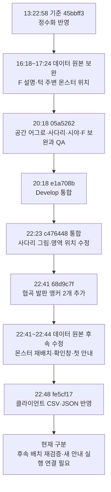

# 1115 13시23분 이후 변경 이력과 통합 상태

2026-11-15 확인 기준. 기준 커밋은 `45bbff3`(13:22:58), 조사한 클라이언트 최종 커밋은 `fe5cf17`(22:48:57)이다. 모든 시각은 한국 시각이다. Git 기록은 변경이 기록·통합된 시점을 보여 주며 실제 작업 시작·종료 시각이나 원격 업로드 시각을 확정하지 않는다.

## 목차

1. [전체 흐름](#전체-흐름)
2. [무엇을 어떻게 왜 바꿨는가](#무엇을-어떻게-왜-바꿨는가)
3. [검증 범위와 현재 남은 확인](#검증-범위와-현재-남은-확인)
4. [기록과 담당 귀속](#기록과-담당-귀속)

## 전체 흐름

기준 커밋에 이미 포함된 정수화와 그 이전 타이틀·인트로 빌드 수정은 이번 구간의 신규 작업으로 세지 않는다. 기준 이후 클라이언트 변경은 병합을 포함한 5개 커밋이며, 병합 커밋 자체를 별도 기능 개발로 세지 않는다.

## 무엇을 어떻게 왜 바꿨는가

| 기록 시각·근거 | 무엇을 어떻게 진행했는가 | 이유·결과 |
| --- | --- | --- |
| 16:18 DataSheet `199c576`, 17:24 `7728665` | FieldObject 설명의 쉼터 키를 E→F로 맞추고 협곡·가마터의 턱 위 몬스터 위치를 조정했다. 이후 공식 데이터 배포로 클라이언트에 반영했다. | 기존 F 조작 설명과 공급 설명을 맞추고, 매달리기 지점과 몬스터 배치가 겹치는 상황을 줄이기 위한 보완이다. 설명 변경 자체가 입력 코드를 바꾼 것은 아니다. |
| 20:18 `05a5262` | 실제 게임 카메라의 화면 범위, 연결된 보행 발판, 마지막 실제 착지 높이, 매달림·등반 상태를 함께 보고 어그로 대상을 판단하도록 했다. Unity 관측은 표현 경계에서 처리하고 코어에는 대상 적격 여부를 전달했다. | 거리만으로 다른 층·화면 밖의 플레이어를 추적하거나 매달린 플레이어에게 공격하는 문제를 줄인다. 부적격 상태에서는 공격·투사체 예약도 취소하고 실제 타격 직전에 다시 확인한다. 체력·처형 기회 등은 유지한다. |
| 같은 커밋 | 사다리 등반의 몸 방향·축, 실제 발판과 사다리의 안내 표시, F 안내의 남은 E 아이콘 경로를 보완했다. 카메라는 500ms 유지 입력과 위 3칸을 유지하고 아래 보기를 6칸으로 확장했다. | 이동 가능 지형과 사다리 정렬을 읽기 쉽게 하고, 아래 지형을 더 넓게 확인하게 한다. 기존 표시·이동 모듈을 재사용했다. 상세 책임과 계약은 [기능 설계](1115%20화면·발판%20인식과%20이동%20피드백%20보완.md)를 따른다. |
| 20:18 `e1a708b` | 위 구현과 QA 기록을 Develop에 병합했다. | 별도 작업 브랜치의 변경을 통합한 단계다. 새 기능을 한 번 더 구현한 단계는 아니다. |
| 22:23 통합 `c476448` | 갈림길 사다리 그림을 양쪽 기둥 형태로 수정하고, 가마터 사다리 영역 두 곳을 x50→49.5, x98→97.5로 이동했다. | 사다리 그림과 실제 이동 영역을 맞추기 위한 후속 조정이다. 이 커밋의 작성 시각은 17:24:47, 커미터 시각은 22:23:23으로 서로 다르다. |
| 22:41 `68d9c7f`, DataSheet `cc3690d` | 협곡에 x35·x94 발판 앵커를 추가하고 몬스터를 재배치했다. 같은 층 간격을 확보하며 협곡 총수를 30→23마리로 줄였다. 가마터는 총 9마리를 유지하며 턱 위 세 지점을 땅으로 옮겼다. | 절벽·매달림 주변 배치와 밀집도를 보완하기 위한 맵·콘텐츠 수정이다. 앵커 추가와 데이터 배치는 각각 프리팹과 원본 JSON에서 진행됐다. |
| 22:43~22:44 DataSheet `64004c8`, `c183f3c`; 22:48 클라이언트 `fe5cf17` | 서낭당 업그레이드 확인창 Popup 15009·15010, 문구 30361·30362와 첫 안내 30363~30366을 공급했다. 클라이언트 Language·Popup CSV 및 두 맵의 spawn JSON에 반영했다. | 구매 비용·변화를 확인하고 저장·엽전·혼·결박 가르기를 설명할 콘텐츠 준비다. 마지막 클라이언트 커밋은 데이터 4개 파일만 변경했으며 실행 UI 연결 완료를 뜻하지 않는다. |

## 검증 범위와 현재 남은 확인

20:18 구현의 검증 기록은 [화면·발판 인식과 이동 피드백 보완](1115%20화면·발판%20인식과%20이동%20피드백%20보완.md)에 있다. 기록상 데이터 검사 9,101개, 코어 검사 2,201개, 게임·에디터 소스 329개 컴파일, 실제 조립 객체 39개의 공간 검사 392개, 공급 공격 패턴 78개 및 별도 투사체 검사를 수행했다. 사다리·턱 이동·카메라 499/500ms 경계·F 재활성화·7개 맵 조립도 확인했다.

이 검증은 당시 협곡 30마리·가마터 9마리와 당시 사다리 위치를 대상으로 한다. 마지막 Play 기록은 오류 0개, 기존 EventSystem 중복 경고 2개이며, 실제 키보드로 모든 구간을 완주한 검증은 아니다. 이번 이력 정리에서는 해당 검사를 새로 실행하지 않았다.

| 현재 상태 | 판정·다음 확인 |
| --- | --- |
| 공간 어그로·이동 피드백 코드 | 구현과 당시 QA 기록이 있다. 이후 바뀐 최종 배치 전체의 QA로 확대 해석하지 않는다. |
| 가마터 사다리 후속 이동 | 영역 이동 후에도 기존 `-50` 정수 축 보정이 남는다. 콜라이더 자체 오프셋도 있으므로 오류로 단정하지 않고 최종 그림·등반 축 정렬을 다시 확인해야 한다. |
| 협곡 23마리·새 발판 배치 | 현재 JSON 합계는 23마리다. 이전 30마리 기준 검사와 구분하여 최신 맵의 이동·착지·어그로를 재확인해야 한다. |
| 새 구매 확인창·첫 안내 | 데이터 공급·배포 상태다. 현재 `ShrineScreen.Submit`→`ShrineMenu.Submit`은 바로 구매를 실행하며 새 확인 단계가 없다. 새 ID의 스크립트 참조도 확인되지 않아 실제 표시 연결 완료로 볼 수 없다. |

현재 실행 경로 근거: `Assets/3.Script/Presentation/ShrineScreen.cs`, `Assets/3.Script/Core/Progression/ShrineMenu.cs`. 배치 근거: `Assets/Data/Json/spawn/8003.json`, `8006.json` 및 해당 맵 프리팹. 이번 요청에서는 게임 코드·데이터를 수정하지 않고 이력 문서와 문서 목록만 추가했다.

## 기록과 담당 귀속

- `05a5262`와 통합 커밋의 Git 작성자는 NYM, 후속 맵·데이터 클라이언트 커밋의 Git 작성자는 HyunhoKim이다. 계정 이름만으로 다른 사람의 실명·역할을 추정하지 않는다.
- DataSheet의 위 원본 커밋들은 Git 작성자가 Claude로 기록되어 있다. 사용자 확정 귀속 기준에 따라 Kim Hyun Ho의 작업으로 설명하며 원래 Git 작성자와 구분한다. 원본 UTC 기록은 이 문서에서 한국 시각으로 변환했다.
- 아트 원본 제작·공급은 아트 담당자의 기여이며, Git에 기록된 그림 수정·배치·연결 작업과 구분한다. 이 기록만으로 원본 제작자를 특정하지 않는다.
- 이 문서는 로컬 Git 이력과 현재 파일, 기존 QA 문서의 대조 결과다. 원격 업로드의 정확한 시각이나 최신 CI·실행파일의 성공을 별도로 확정하지 않는다.
