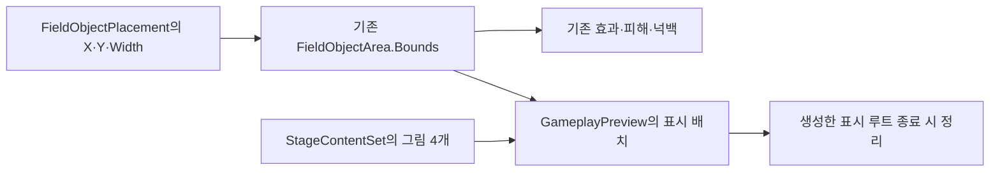
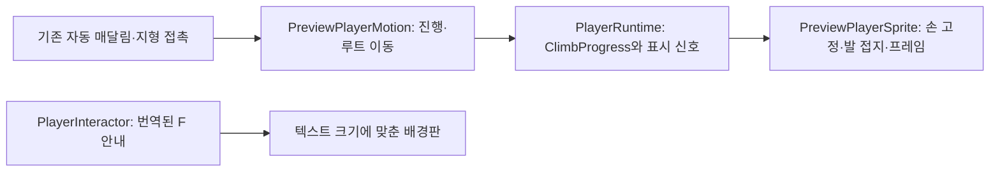

# 1115 리소스 연결과 QA 현황

2026-11-16 후속: [옹귀 테스트 개체](#1116-옹귀-테스트-개체)를 준비했습니다. 아래 이전 “수치 원본 미공급” 상태와 최신 공급/클라이언트 배포 상태를 구분합니다.

기준: 2026-11-15 / 클라이언트 `eac4256` 이후 G-103~G-105 통합 변경 / DataSheet `799f2be`. 이전 1114 검증을 이번 실행 결과에 합산하지 않습니다. 원본 그림 제작·공급은 아트 담당 기여이며, 이번 작업은 파생 Sprite·클립 생성과 연결입니다.

## 목차

1. Git 이후 변경과 요청 범위
2. 피격 효과
3. 잔불·빙판 표시
4. 옹귀 준비와 데이터 대기
5. QA와 재생성
6. 새 장부방 실내 배치
7. 최종 피드백 보완과 QA

## 1. Git 이후 변경과 요청 범위

`497a817`은 이전 엔딩·접지·사슬 수정 병합입니다. 이후 `0c2d123` 데이터 배포, `395cc59` 가마터·갈림길 원경 경로 정리, `53213c7` 갈림길 그림 보정, `23e19ff` C2·B12 검증 기록, `5bf9738` 보스 상체 피격 범위·타이틀 시험 버튼 숨김, `efc490c` 병합, `28cc285` 가마터 스폰 높이, `acbec5a` 잔불·빙판 그림, `eac4256` 1115 연결 요청을 확인했습니다. 이번 시작 시 로컬/원격 Develop·NYM/Work는 모두 `eac4256`, DataSheet main·NYM/Work는 `799f2be`였습니다.

사용자 요청은 피격 효과 교체·1115 요청 확인/연결·옹귀 애니메이션 준비·데이터에 따른 적용과 QA입니다. 추가 확정: 기획·MD·원본 시트에 값이 없으면 옹귀 전투 연결은 데이터 공급까지 보류합니다. 1115 요청 원문은 수정하지 않습니다.

## 2. 피격 효과

`newHitEffect.png`는 3열×2행의 416px 셀로 읽습니다. 기존 자동 분할은 광택이 이어진 두 동작을 묶거나 작은 불꽃을 개별 Sprite로 나누므로, 원본 PNG/meta를 보존하고 `5.Animation/Effects/NewHit/Sprites`에 셀 Sprite 6개를 생성했습니다. 전체 셀의 합집합이 공급된 16개 분할 영역을 모두 포함하는지 검사했습니다.

`EnemyHitImpact.prefab`은 기존 `SpriteClipEffect`를 그대로 사용합니다. 새 `NewHit.anim`은 20fps·6프레임·0.3초 단발이며 기존 9종 랜덤 변형 연결을 비웠습니다. 셀 규격에 맞춰 표시 배율은 0.6입니다. 풀·재사용·히트스톱·공격 판정과 사운드 코드는 변경하지 않습니다. 기존 공용 효과를 참조하던 사용처는 유지되므로 플레이어 다운 연출도 같은 프리팹을 사용합니다.

실제 플레이어 공격으로 허수귀 HP 75→60, `NewHit_01` 재생, 종료 시 비활성화와 재사용 시 첫 프레임 복귀를 확인했습니다.

## 3. 잔불·빙판 표시

[1115 요청 원문](개발요청_잔불빙판_그림연결_1115.md)을 적용했습니다. `StageContentSet`은 기존 스테이지 리소스 목록에 필드 그림 네 참조를 추가로 소유합니다. 새 데이터 표·문자열 경로 탐색·런타임 파일 읽기는 추가하지 않습니다.

`GameplayPreview.Fields.cs`의 `ShowFieldAreas`·`AddFieldSprite`만 그림을 구성합니다. 잔불은 자리 너비로 균일 확대하고 그림 아래를 기존 Bounds 바닥에 맞춥니다. 빙판 Middle은 Full Rect/Tiled/Continuous로 자리 너비를 반복하고 Left·Right를 범위 안에 겹칩니다. 그림 색은 흰색이며 기존 정렬 레이어·순서 정책을 사용합니다. 표시용 1×1 Sprite 생성·파기를 제거했고, 화면 연결 실패는 기존 표시 오류 경계에서 정리·보고합니다.

`ConnectFields`에서 만드는 판정과 `FieldObjectController`는 변경하지 않았습니다. 산길 22001·22003은 너비 2/높이 0.2, 협곡 22009·22010·22011은 너비 10/10/6·높이 0.2입니다. 실제 장면에서 그림 바닥·너비·색을 확인했고, 잔불 진입 피해 5와 다음 1000ms 피해 5, 빙판 안 넉백 100→200/밖 100을 확인했습니다. 별도 Light2D는 추가하지 않았습니다.

## 4. 옹귀 준비와 데이터 대기

**3004는 옹귀가 아닙니다.** 원본 Language.xlsx `Language!E210`은 30350을 옹귀 이름으로 두고 “Monster 3005 자리, Monster 행은 수치 확정 뒤 추가”라고 명시합니다. Monster.xlsx의 Monster 7~10행은 3001~3004뿐이며, 3004는 짐 던지는 지게귀/Unit 1005/이름 30005입니다. 현재 3005의 Monster·UnitStat·어그로·보상·처형 보상·스폰 공급은 없습니다.

Stage.xlsx `Stage!N12`에는 가마터의 옹귀4·지게귀4·허수귀1 계획이 있으나 현재 스폰은 허수귀1·지게귀8입니다. 계획 메모만으로 기존 배치를 바꾸지 않았습니다. 새 데이터 공급 뒤 옹귀4를 단순 추가하면 수량이 달라지므로 총수와 배치 교체 기준을 먼저 대조합니다. 혼 보상도 새 정의에 따라 18마리·54혼 조건을 다시 확인합니다.

| 클립 | 프레임 | fps·길이 | 현재 상태 |
| --- | --- | --- | --- |
| Onggwi_Idle | 5 | 10fps·0.5초, 반복 | 준비 완료 |
| Onggwi_Walk | 9 | 10fps·0.9초, 반복 | 준비 완료 |
| Onggwi_Hit | 5 | 10fps·0.5초, 단발 | 준비 완료 |
| Onggwi_Dead | 13 | 10fps·1.3초, 단발 | 준비 완료 |
| Onggwi_Ready | 1 | 0.1초, 정적 | 공급 Onggui.png 보존 연결용. 공격 모션 완료를 의미하지 않음 |
| Onggwi_Stone | 1 | 0.1초, 정적 | 공급 Stone.png 보존 연결용. 투사체 규칙 미확정 |

`Assets/5.Animation/Characters/Onggwi` 아래 파생 Sprite 34개를 생성했습니다. 피격 원본 자동 분할 15개는 몸체5+파편으로 구성돼 15동작으로 재생하면 안 됩니다. 셀별로 파편을 포함하고, 원본과 원본 meta를 변경하지 않았습니다. 전용 공격·투척·처형 그림은 별도로 공급되지 않았습니다. 정적 Ready나 사망 클립을 전용 공격·처형의 확정 구현으로 취급하지 않습니다.

현재 옹귀 게임 프리팹·3005 리소스 등록·스폰·전투 규칙은 보류입니다. 기존 3004 프리팹·달리기 리그·투사체·능력·보상은 보존했습니다. 미공급 수치를 3004에서 복사하지 않습니다.

## 5. QA와 재생성

| 구분 | 이번 실행 결과 |
| --- | --- |
| 원본 공급 검사 | DeployData --check: 37개 탭·JSON 17개·Unity 호환 통과. 원본 xlsx 전체 읽기에서 20파일/39워크시트를 열었으며 배포 대상 탭 수와 구분 |
| 데이터/코어 | 기존 검사 9,101개 / 코어 1,787개 통과 |
| 엔진 참조 컴파일 | 게임·에디터 소스 323개, 경고·오류 0 |
| 그림/클립 | 옹귀6+효과1, 총7클립/40셀. 프레임 순서·길이·반복·원본 분할 영역 누락 검사 통과 |
| 실제 필드/피격 | 잔불2·빙판3·실제 적중 및 효과 재사용 통과 |
| 실제 맵 조립 | 8001/8002/8006/8007/8003/8004/8005 순서. 일반몹 0/9/9/12/30/0/0으로 공급과 일치, 누락 스크립트 0 |
| 실제 엔딩 회귀 | 보스 사망·대사→Ending.mp4 자연 종료 15.047초→탐색→실제 오른쪽 출구 판정→검은 마무리→타이틀 3.521초. 스킵·영상 시간 주입·완료 이벤트 제거 없음 |

맵 검사는 격리 저장과 시트의 도착 앵커를 사용한 이동입니다. 모든 적 직접 사냥이나 모든 출구 물리 입력 완주를 의미하지 않습니다. 산길 입장을 위해 시험 진행에서 장부방 8005 클리어만 준비했습니다. 실제 사용자 저장·설정과 시험 저장은 분리했습니다.

이번 기존 코어 검사는 표준 Verify-Project.ps1 자체 실행과 구분합니다. SDK 대신 기존 Unity 내장 런타임·Roslyn 검사 진입점을 사용했습니다. 실행파일 빌드·통계 사이트·물리 장치/부스 검증은 별도입니다. 기존 EventSystem 중복 경고는 새 제품 오류와 구분하며 콘솔을 임의로 지우지 않습니다.

재생성 메뉴는 `Human Ghost > Animation > Rebuild 1115 Supplied Artwork`입니다. 이 메뉴는 클립·파생 Sprite·기존 피격 프리팹과 필드 리소스 네 참조를 갱신하며 원본을 다시 분할하지 않습니다. 새 그림의 셀 규격이 달라지면 `Content1115Builder`의 열·행·사용 셀 수와 클립 QA를 함께 바꿉니다. 옹귀 Monster 3005를 자동으로 생성·등록하는 메뉴는 없습니다.

### 추가 발견: 기존 3004 패턴의 기획 비고 불일치

원본 Monster.xlsx의 MonsterSkill!F7은 “변종 3004 짐 던지는 지게귀는 돌진이 없어 미포함”이라고 적고 Monster!P10은 내리찍기+짐 투척을 설명합니다. 기존 `JigegwiThrowerPatterns.asset`에는 내리찍기·돌진·투척 3개가 남아 있습니다. 실제 에셋의 `CreatePatterns()`에서도 IsCharge=true/Range600 패턴을 확인했고, MonsterActor는 거리 조건에 맞는 모든 패턴을 선택 후보로 넣습니다. 원본의 AIType은 CHARGER이며 비고에 개발 확인이 필요하다고 되어 있으므로, 기획 의도와 기존 설정의 불일치로 후속 전투 점검에 남깁니다. G-103 시점에는 해당 패턴 에셋이나 기존 3004 코어를 바꾸지 않았습니다. **G-105 최종 QA에서 원본의 돌진 없음 기준대로 패턴 에셋의 돌진 1개를 제거하고 재검증했습니다.** 아래 7장의 현재 결과가 이 과거 대기 기록보다 우선합니다.

## 6. 새 장부방 실내 배치 (G-104)

2026-11-15 사용자 요청으로 `Assets/4.Sprite/JangbuBangNew/1-2. 장부방`의 공급 그림 5종을 기존 Stage 8005에 적용했습니다. 원본 제작·공급은 아트 담당 기여이며, 이번 작업은 배치·파생 Sprite/클립·연결입니다. 원본 PNG와 meta는 변경하지 않았습니다.

기존 `Map_Jangbubang_K9.prefab`의 GUID와 StageContentSet 참조를 유지합니다. 이전 단색 Backdrop·외부 건물의 Fire/Smoke/WindowGlow·기존 촛불·깔개 표시를 끄고, `InteriorNew` 아래 새 배경과 책장·촛불2곳을 배치했습니다. 기존 책상·상자 SpriteRenderer는 새 그림으로 교체했습니다. 원본 오브젝트는 삭제하지 않았습니다.

| 표시 | 로컬 배치·설정 | 목적 |
| --- | --- | --- |
| InteriorBackdrop | 중심 (6.55, 4.7648), 배율0.6, order41 | 기존 바닥 그림(order39~40)을 덮으면서 실제 바닥선 y2와 새 벽/바닥 접점을 맞춤 |
| 장부 책상 | 중심x6.5·그림 하단y2, 배율0.6, order45 | Myeongbu 조사 표식과 책 위치 정렬 |
| 상자 | 중심x9.7·하단y2, 배율0.6, order45 | 오른쪽 수납 배치 |
| Bookshelf | 중심x11.1·하단y2, 배율0.62, order43 | 오른쪽 벽면 배치, 출입구 통로 유지 |
| DeskCandle / ChestCandle | 받침(5.55,2.78)/(9.7,2.9), 배율0.4, order46 | 책상·상자 위 반복 촛불 |

플레이어 표시 order61보다 낮게 두며 새 소품에는 Collider를 추가하지 않습니다. Ground_5 지형과 충돌, 방 루트 위치/크기, Markers의 Spawn_FromDohwagol·Myeongbu·Door_ToDohwagol·Anchor_Ground_5는 보존했습니다. Area는 원래 충돌체로 계산되므로 새 그림이 이동/카메라 경계를 늘리지 않습니다. 카메라 크기3.6·장부방 걷기/위아래 보기 정책도 그대로입니다.

촛불은 원본 768×768의 256px 셀 3×3을 9개 파생 Sprite로 만듭니다. 원본 자동 분할14개는 첫 셀의 광택/불티가 따로 잡혀 있으므로 번호순으로 재생하지 않습니다. 각 셀의 금속 받침 y44를 공통 피벗으로 사용해 번짐 때문에 흔들리지 않게 했습니다. `Assets/5.Animation/Environment/Jangbubang/CandleLoop.anim`은 10fps·0.9초 반복이며 단일 상태 AnimatorController를 촛불2곳에 공유합니다. 런타임 스크립트는 추가하지 않았습니다.

재생성 메뉴: `Human Ghost > Environment > Rebuild Jangbubang Interior`. 구현은 `Assets/3.Script/Editor/JangbubangInteriorBuilder.cs`입니다. 기존 표시를 덮고 같은 이름의 새 표시를 찾아 갱신하며, 원본을 재분할하거나 조사·문·지형을 만들지 않습니다.

이번 QA:

- 실제 8005 진입 화면에서 배경이 카메라를 덮고 새 책상·상자·책장·촛불이 보임. 촛불 실제9프레임 관측·받침 루트 이동0·신규 실내 Collider0·missing script0·플레이어 접지 확인.
- 실제 PlayerInteractor.Press 경로로 첫 조사 전 미클리어→장부방 클리어와 “결박 가르기를 익혔다” 안내. 실제 문 상호작용→마을8001→재입장8005→“이미 살펴본 명부다.” 확인. 물리 키보드 F 입력을 새로 검사한 것은 아닙니다.
- 원본 프리팹 fileID40개 유지, 표식 Transform5개 동일, 기존 방 Collider1개와 루트 변환 동일. 공급 파일13개 해시와 사용자 slot-1 동일.
- 엔진·에디터 소스324개 참조 컴파일 경고0/오류0. 마지막 Unity 원래 MapDohwagolTest/Edit/dirtyfalse, 콘솔 오류0/기존 EventSystem 경고2. 이번 데이터/코어 검사를 다시 실행한 것은 아니며 G-103의 9,101/1,787 결과와 구분합니다.

테스트는 workspace 별도 JsonSaveStore에서 실행했습니다. 새 운영 씬·원본 시트·스폰·실행 규칙 변경은 없고 기존 G-103 미커밋 작업과 옹귀3005 보류 상태도 유지합니다. 이번 커밋·푸시·빌드는 하지 않았습니다.

## 7. 최종 피드백 보완과 QA (G-105)

사용자 피드백은 턱에 매달렸다가 올라가기·내려오기, 상호작용 키 가독성, 약초 그림을 살짝 위로, 다른 애니메이션 점검입니다. 이어 사용자가 최종 QA·1115 요청 대조 후 커밋/푸시·Develop 병합·NYM/Work 리베이스와 PC 종료를 명시 요청했습니다. 옹귀 수치가 없으면 공급까지 보류하라는 앞선 확정은 유지합니다.

### 이동과 표시 책임

- 매달릴 때 1.4배로 커졌다가 올라가며 작아지던 표시를 기본 크기 1배로 통일했습니다. `MapDohwagolTest`의 표시 배율 두 값도 동일하게 갱신했습니다. 실제 루트 크기·모서리·충돌체는 변경하지 않았습니다.
- `PreviewPlayerMotion`의 턱 오르기 개발 설정을 680→1000ms로 조정했습니다. 처음 15%는 손잡기, 세로 이동은 15~80%, 가로 이동은 45~95%로 겹쳐 진행합니다. 입력 잠금·완료·피격 취소는 기존 경로를 사용합니다.
- 표시 소비자는 현재 몸 크기를 조립자에게 명시적으로 받고, 매달림 프레임의 위쪽 손 지점을 Sprite별로 캐시합니다. 올라가기 첫 절반에 고정 손 위치에서 서서히 풀고, 55~75%에 기존 서 있는 바닥 기준으로 발 접지를 섞어 마지막 웅크림→Idle의 높이 튐을 줄입니다. 표시에서 전투 명령을 호출하지 않습니다. 놓기는 기존 DropThrough 표시 신호를 써 점프 준비 자세가 아닌 공중 프레임부터 표시합니다.
- `InteractPrompt.prefab`의 글자 크기 0.0208→0.034, 굵은 밝은 글자와 어두운 배경판/테두리를 적용했습니다. `PlayerInteractor`가 보유한 텍스트·선택 키 아이콘 범위에 맞춰 판 크기를 계산합니다. KO/EN, F 바인딩과 기존 E 그림 억제 정책은 유지합니다. 원본 그림 수정 없이 `PromptStyle`의 1×1 흰 텍스처/파생 Sprite를 사용합니다. 재생성 메뉴는 `Human Ghost > UI > Rebuild Interaction Prompt Backplate`입니다.
- HUD는 `HerbArtwork`의 anchoredPosition.y만 0→3으로 올렸습니다. 틀·수량·키·가로 위치는 그대로입니다.

### 기존 투척 지게귀 3004

원본 MonsterSkill!F7의 돌진 없음, Monster!P10의 내리찍기+짐 투척 기준으로 `JigegwiThrowerPatterns.asset`에서 돌진 1개만 제거했습니다. 내리찍기·투척의 거리/시간/피해, UnitStat·보상·기존 3002 돌진과 시트의 AIType은 유지합니다. 실제 공용 Actor 선택에서 거리100→Attack1, 250→접근 Walk, 400→투사체 Attack2이며 IsCharge 패턴 0개를 확인했습니다. 이 수정은 옹귀3005 연결과 별개입니다.

### 최종 확인

| 검사 | G-105 결과 |
| --- | --- |
| 실제 가마터 턱6곳 | 좌우 접촉면, 손 위치 오차 최대0.000000239칸, 표시 배율 일정, 완료 지점/접지, 놓은 직후 재매달림 방지, 실제 피격 취소 모두 통과 |
| 오르기 전후 화면 | 1초 진행과 손/발 보정, 매달림→오르기→Idle→놓기 표시 비교 확인 |
| 전체 애니메이션 에셋 | 114클립·Sprite 키1,039개·리그 곡선217개. 키 시간·참조·유효성 오류0. 모든 포즈의 수동 미술 수용을 의미하지 않음 |
| 적 접지 회귀 | 56상태·723프레임, 바닥 오차 최대0.000000239칸 |
| 상호작용·약초 UI | 실제 1920×1080 KO/EN 화면 확인. 안내 전체가 배경판 안에 들어가고 약초 y3 적용. 물리 키보드 F 재검사는 아니며 기존 사용자 F 통과 이력 유지 |
| 실제 7맵 조립 재검사 | 8001/8002/8006/8007/8003/8004/8005, 스폰0/9/9/12/30/0/0·missing script0·도착 생존 |
| 기존 검사 재실행 | 데이터9,101·코어1,787, 자동화9·PNG 계약2 통과. 게임/에디터325소스 참조 컴파일 경고0·오류0 |
| 보존 | G-103 공급14파일·G-104 공급13파일 해시 동일, 사용자 slot-1 해시 동일. DataSheet799f2be 원본/배포 변경0 |

1115 요청 원문과 대조해 잔불1장/너비2/바닥 정렬, 빙판 Middle Tiled·양끝 내부 겹침, 흰색·기존 정렬·Bounds 높이0.2 유지 조건을 충족합니다. G-103 실제 필드 피해·넉백과 자연 엔딩, G-104 장부방 왕복/재조사 결과는 각 절의 실행 이력입니다. G-105에서는 해당 표시/상호작용 소스를 추가 변경하지 않았으며 과거 검사를 재실행했다고 합산하지 않습니다. 선택 사항인 Light2D와 미공급 옹귀 전투, 별도 실행파일·부스 장치·운영 집계 수용은 완료 범위에 넣지 않습니다.

시험 저장은 별도 workspace의 G105/SavesBefore·SavesAfter만 사용했고 원래 MapDohwagolTest/Edit/clean으로 복원했습니다. 최종 제품 콘솔 오류0, 기존 EventSystem 중복 경고2입니다. Git 최종 병합 SHA·원격 CI·정상 종료 확인은 완료 후 전달 보고서/비공개 AI 인수인계에 기록합니다. 팀 저장소에는 이 설계·기획 안내와 제품 자산만 포함하고 개인 HANDOFF는 포함하지 않습니다.

## 11/16 옹귀 테스트 개체

사용자가 수치·패턴 공급 전 범위를 “프리팹·애니 + 테스트 전용 임시 개체”로 확정했습니다. 기존5종 표시 클립을 연결한 OnggwiPreview.prefab과 Onggwi_Preview.controller를 추가했습니다. Editor 전용 OnggwiPreviewMenu가 활성 플레이어 앞 지면에 비활성 생성·설정 후 활성화하며, 상태별 재생과 제거를 제공합니다. 장면 전환·Play 종료 시 임시 개체는 장면과 함께 정리됩니다.

실제 Idle5·Walk9·Hit5·Dead13·Ready1프레임을 확인했습니다. 임시 개체에 MonsterRuntime·새 체력·AI·보상은 붙이지 않았고 운영 목록·맵 배치도 변경하지 않았습니다. 투척 지게귀의 돌 표시는 사용자22번 요청에 따라 공급 Stone_00을 재사용합니다.

이후 DataSheet `9c13bdd`의 Monster3005·UnitStat1007·능력3202·보상/처형/어그로·가마터 스폰이 Develop47c6fbb로 정식 배포됐습니다. 사용자 운영 확대 승인에 따라 OnggwiGameplay·팔 리그·실제 돌 발사·패링/처형/보상을 연결했습니다. 실제 가마터9개체 중 옹귀4개 로딩을 확인했습니다. 기존3004와 별개이며 맵/CSV/JSON을 직접 수정하지 않았습니다. [운영 연결 설계](캐릭터%20상태%20애니메이션%20연결%20설계.md#1116-옹귀-운영-연결과-공격-예고)를 기준으로 봅니다.
