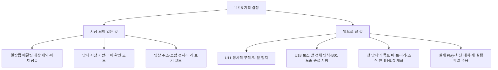
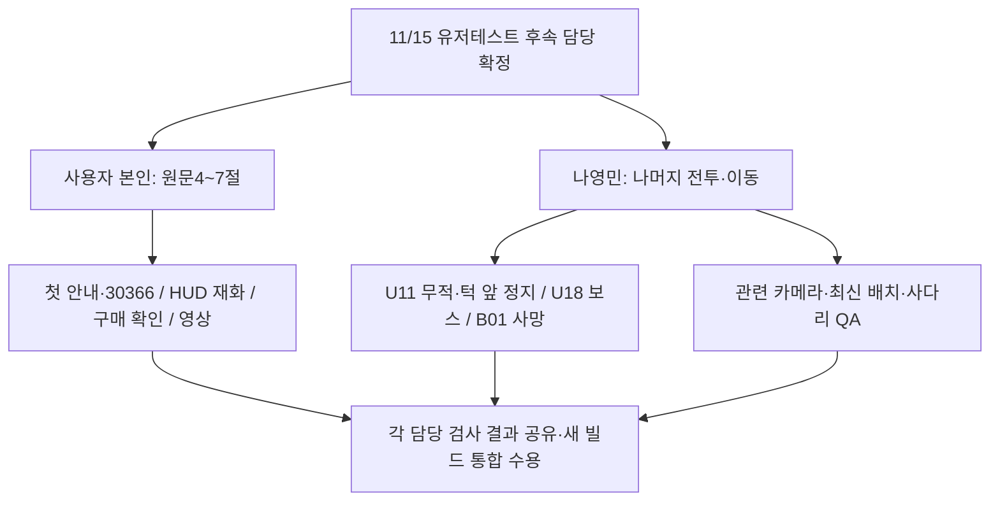

# 1115 유저테스트 기획 반영 현황과 사용자 작업 목록

확인일: 2026-11-16. 기획 원문은 사용자가 이 대화에 제공한 **「개발 요청: 유저테스트 반영 기획 결정 (11/15)」**이며 작성자는 기획 김현호다. 기준은 `fe5cf17`과 현재 로컬 감사 변경이다. 이번 문서는 원문 대조·현황·작업 목록만 작성하며, 이 요청을 근거로 추가 게임 코드·데이터·프리팹을 수정하지 않았다.

`유저테스트_피드백_통합정리_1115` 전체 자료, 별도 카메라 요청서, `shrine-confirm-1115/서낭당_확인창_개발요청_1115.md` 전문은 제공받지 않았다. 아래는 제공된 8개 절의 요구와 현재 소스·배포 파일을 비교한 결과이며 별도 문서 전문까지 충족했다고 단정하지 않는다. 담당은 2026-11-16 사용자 확정에 따라 아래처럼 배정한다. 이는 앞으로의 구현·수용 책임이며 기존 코드·데이터·아트의 제작 이력을 소급 변경하지 않는다.

## 목차

1. [현황 한눈에 보기](#1-현황-한눈에-보기)
2. [지금 되어 있는 것](#2-지금-되어-있는-것)
3. [앞으로 할 것](#3-앞으로-할-것)
4. [확정 담당과 작업 순서](#4-확정-담당과-작업-순서)
5. [변경하지 않을 결정](#5-변경하지-않을-결정)

## 1. 현황 한눈에 보기

‘코드 연결’은 실제 Play·새 실행파일 통과와 다르다. 과거 30마리 기준 QA를 현재 협곡23마리 배치의 검증으로 사용하지 않는다.

| 원문 항목 | 확정 담당 | 현재 판정 | 완료로 볼 수 없는 이유 |
| --- | --- | --- | --- |
| U11 매달림·턱 오르기 보호 | 나영민 | 부분 반영 | 일반몹 대상 제외는 있으나 플레이어 코어 무적과 턱 끝1칸 정지는 없다. |
| U18 보스 어그로 | 나영민 | 미충족 | 보스는 별도 경로지만 운영 씬의10칸 거리 조건을 다시 계산하며 방 전체·지속 인식이 아니다. |
| B01 처형 기회 종료 사망 | 나영민 | 미충족 | Exposed 종료 시 체세를 회복하고 일반 상태로 복귀한다. HP0/체세0의 표시도 구분해야 한다. |
| U13/U15/U16 첫 안내 | 사용자(본인) | 저장 기반·임시 연결 있음, 표현/트리거 미충족 | 현재 새 연결은 정지하는 대사창이다. 원문은 진행을 유지하는 위 가운데4초 목표 안내 띠다. 조작 안내30366도 미연결이다. |
| U15 HUD 재화 | 사용자(본인) | 미연결 | 현재 HUD에는 혼·엽전 상시 아이콘/숫자와 지갑 구독이 없다. |
| U16 구매 확인창 | 사용자(본인) | 코드 연결, 실제 수용 대기 | 데이터15009/15010과 공용 팝업을 연결했다. 아니오/ESC/예·연속 입력·KO/EN 실제 검증이 남는다. |
| B09 뿌연 영상 | 사용자(본인) | 빌드·주소 보완 있음, 원인/최종 화면 미확정 | 인트로/엔딩은 현재 모두 StreamingAssets다. 파일 검사만으로 출력·UI 겹침·Windows 재생 성공을 증명하지 못한다. |

## 2. 지금 되어 있는 것

### 이동·전투·배치

- `PreviewMonsterDriver.CanEngageTarget`는 매달림·등반 중인 플레이어를 일반몹 대상으로 삼지 않는다. 실제 화면·같은 발판·착지도 판단한다. **다른 피해 경로까지 막는 코어 무적과는 다르다.**
- 협곡/가마터 spawn8003·8006과 협곡 발판 앵커2개는 클라이언트에 반영되어 있다. 현재 총수는 협곡23·가마터9마리다. 최신 배치의 실제 통과 검증은 별도다.
- 처형 성공 여부와 처형 보상은 기존 `WasExecuted`·ExecutionRewardSession 경로로 구분한다. 보상을 구분하는 기반은 있으나 시간 종료 사망 요구가 구현된 것은 아니다.

### 안내·확인창·영상

- Language30363~30366, Popup15009/15010은 배포 파일에 있다.
- 이번 감사 작업에서 승인받은 `SaveSnapshot.ViewedNotices`, 이전 버전1 누락 항목 보완, 확인 이력만 저장하는 SaveSession 경로가 추가됐다. 진행 위치·체력·재화·저장 시각을 바꾸지 않는 파일 왕복·실패 회귀 검사가 있다.
- `GameplayPreview.FirstNotices.cs`에 중복 제거·표시 예약·확인 저장 연결이 있다. **원문을 받기 전에 연결한 대사창 방식으로, 목표 띠 요구 완료로 세지 않는다.**
- `ShrineScreen`은 구매 전 확인창을 열고 기본·취소를 아니오로 처리한다. 예 요청은 콜백에서 예약하고 Update에서 대상·단계·비용을 다시 확인한 뒤 기존 구매를 실행한다. 이 로컬 코드는 아직 실행파일에 배포한 상태가 아니다.
- 현재 CutsceneStep22103/22101은 각각 `streaming:Video/Intro.mp4`, `streaming:Video/Ending.mp4`다. 공용 준비·출력 경로와 파일 포함·영상 검사 도구가 있다. 예전 ‘인트로 Addressables’ 설명을 현재 공급값으로 해석하지 않는다.
- 카메라 코드에는 입력 유지500ms·위3칸·아래6칸이 있다. 별도 요청서 전문이 없어 카메라 기획 전체의 일치 여부는 미확정이다.

## 3. 앞으로 할 것

| 작업 | 확정 담당 | 실제 변경/확인 지점 | 완료 조건 |
| --- | --- | --- | --- |
| U11 매달림·턱 오르기 무적 | 나영민 | `Core/Characters/PlayerActor.cs`의 IsInvulnerable·피해 경로, `PreviewPlayerMotion.cs`의 Hang/Climb 종료 | 자동/수동 매달림·올라가는 동안 일반몹·보스·필드 피해를 일관되게 차단하고 서는 순간 복귀. 사망·놓기·강제 중단·비활성화에 무적 잔류 없음. 사다리를 포함할지는 원문 턱 이동과 구분. |
| U11 턱 끝1칸 앞 정지 | 나영민 | `PreviewMonsterDriver.cs`, 연결된 보행 구간·턱 관측 | 플레이어가 해당 턱을 사용 중일 때만 그 위 몬스터를1칸 앞에서 멈춤. 전체 맵의 고정1칸 축소로 대체하지 않고 일반 추적·공격·매달림 종료를 회귀 확인. |
| U18 보스 인식 | 나영민 | `PreviewBossDriver.cs`, `GameplayPreview._bossSightUnits`, 운영 씬 | 운영 씬은 현재1000(tile_x100=10칸), 예제 씬은0이다. 씬 차이만 땜질하지 말고 보스방 진입 이후 방 전체 인식·해제 없음의 범위/수명을 정해 검증. 일반몹 MonsterAggro 규칙은 유지. |
| B01 노출 종료 처리 | 나영민 | `MonsterActor.Tick`의 IsExposed 분기, MonsterPoiseView, 처형/보상 검사 | 현재 만료 시 Poise를 복구하고 EnterNeutral한다. 요구에 맞는 사망 경로와 일반 처치 보상을 연결하고 실제 F 처형 때만 회복·추가 처형 보상을 지급. HP/체세 표시를 함께 확인. |
| 첫 안내의 표시 방식 | 사용자(본인) | `GameplayPreview.FirstNotices.cs`, `TextboxScreen.ShowObjective` | 기존 목표 띠는 이미4000ms다. 대사창·입력 잠금·정지를 사용하지 않는 연결로 바꾸고 안내끼리/기존 목표 안내와 덮어쓰기 순서를 정한다. 저장 기반은 재사용. |
| 첫 안내의 발생 시점 | 사용자(본인) | `PlayerInteractor`, `ShrineInteract`, 진행/지갑/해금 연결 | 30363은 기도/저장 성공 뒤가 아니라 **처음 접근해 F 기도 안내가 보일 때**. 30364/30365는 첫 획득, 30366은30023 해금 안내 다음. 기존 저장에 재화가 있을 때의 보완 정책은 신규 획득과 구분. |
| 조작 안내30366 | 사용자(본인) | `Presentation/PauseScreen.cs`의 RefreshControls | 두 키 배치·KO/EN에서 결박 가르기 줄 아래에 Language30366 설명을 표시. 레이아웃 넘침 확인. |
| U15 HUD 재화 | 사용자(본인) | `HudScreen.cs`, `HudScreen.prefab`, 기존 CurrencyWallet | 체력바 아래 혼/엽전 아이콘+현재 잔액을 상시 표시. 최초 동기화·Changed 구독·해제·재연결·언어30218/30219·증감/복원 검사. 아트 최종 아이콘 공급과 임시 기존 아이콘 재사용 승인은 구분. |
| U16 확인창 수용 | 사용자(본인) | ShrineScreen·공용 ConfirmationPopupScreen | 기본 아니오·ESC 취소·예 한 번당 구매 한 번·부족 잔액·최대 단계·재열기·마우스·두 키 배치·KO/EN 실제 확인. 별도 요청서 전문도 확인. |
| B09 영상 조사/수용 | 사용자(본인) | CutsceneScreen·VideoPlayer·화면 캔버스·새 Windows 실행파일 | 같은 리비전의 영상 포함/해시 확인 → 실제 출력 텍스처의 프레임 → 알파/캔버스 겹침 → H.264 Windows 재생 → 인트로/엔딩 자연 종료·스킵·복귀 순서로 원인을 좁힘. 뿌연 증상의 원인은 아직 단정하지 않음. |

B01의 ‘HP0처럼 보임’을 실제 HP0 부활로 확정하면 안 된다. 현재 `MonsterActor.IsDead`는 Health0이고 HP0 피해는 즉시 Dead로 간다. 몬스터 위 게이지는 `MonsterPoiseView`가 **Poise**를 표시하며 Exposed 만료가 체세를 회복한다. 실제 화면에서 본0%가 어느 값인지 먼저 확인하되, 노출 만료 후 사망이라는 새 기획과 기존 HP 정책의 차이는 분명히 기록한다.

## 4. 확정 담당과 작업 순서

2026-11-16 사용자 확정이다. **원문4~7절(첫 안내부터 영상까지)은 사용자(본인), 나머지 전투·이동 및 관련 카메라·배치 확인은 나영민**이 담당한다. 담당 변경은 구현 완료나 기존 작업 저자 변경을 뜻하지 않는다. 원본 데이터 공급은 기획, 원본 아트 제작·공급은 아트 담당의 기존 책임을 유지한다.

| 확정 담당 | 범위 | 현재 기반을 재사용해 할 일 |
| --- | --- | --- |
| 사용자(본인) | 첫 안내·조작 안내30366 | ViewedNotices 저장 기반을 유지하고 목표 띠4초·접근/획득/해금 시점·슬롯별 중복 방지를 맞춘다. |
| 사용자(본인) | HUD 재화 | 지갑 변경 구독과 최초 잔액 동기화, 혼·엽전 아이콘/숫자·언어·수명 연결을 구현한다. |
| 사용자(본인) | 서낭당 구매 확인 | 현재 확인창 코드를 바탕으로 별도 요청서와 대조하고 실제 입력·중복 구매·잔액 부족·KO/EN을 검증한다. |
| 사용자(본인) | 인트로·엔딩 영상 | 현재 StreamingAssets·포함 검사 기반을 유지하고 뿌연 출력의 원인 조사 및 새 Windows 실행파일 수용을 맡는다. |
| 나영민 | U11·U18·B01 | 매달림/턱 오르기 무적·턱 끝1칸 정지, 방 전체 보스 인식, 노출 만료 사망과 보상 구분을 맡는다. |
| 나영민 | 관련 카메라·맵/사다리 배치 QA | 별도 카메라 요청서 대조, 최신 협곡23마리·가마터·사다리 정렬과 이동/전투 회귀를 맡는다. |

사용자 작업의 권장 순서는 HUD 재화 → 조작 안내30366 → 첫 안내의 목표 띠·시점 → 구매 확인·영상 수용이다. 나영민 작업은 전투 필수 항목을 병행한다. 통합 시 각 담당이 자기 기능의 구현·검사 결과를 공유하고 상호 영향은 함께 확인한다. 공통 계약 변경의 사전 확인 규칙은 유지한다.

## 5. 변경하지 않을 결정

| 항목 | 그대로 유지할 내용 |
| --- | --- |
| 낙사 | 즉사 유지, 낙사 구간 표시 추가하지 않음. |
| U14 약초 | 사용 중 피격 취소·소모 유지. |
| U23 평타 | 기본 리치 유지. 그림 불일치는 아트 베기 궤적에서 보완. |
| I11 강화 난이도 | 지스타에서는 유지. |
| U17 완전회피 | 현재 반응 시간 유지, 지스타 이후 검토. |

시험 공격 배율의 정수화·비정상 값 거부는 기본 평타 리치를 바꾼 작업이 아니다. 이번 현황 문서 작성에서도 위 정책을 변경하지 않았다. 감사에서 이미 변경한 코드와 이번 문서 전용 대조 작업은 [감사 보고서](2026-11-16%20설계·수명·테스트%20감사와%20리소스%20점검.md)로 구분한다.
