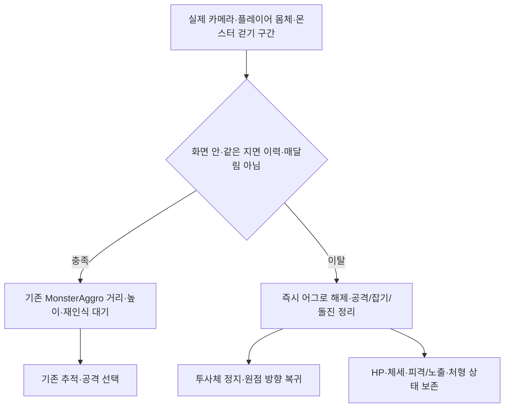

# 화면·발판 인식과 이동 피드백 보완

2026-11-16 후속 상태: 아래 일반몹 대상 제외는 U11 명시적 무적·턱 끝1칸 정지까지 구현한 것이 아닙니다. U11·U18·B01 및 관련 카메라/최신 맵·사다리 QA는 나영민 담당입니다. [현재 미완료·담당](1115%20유저테스트%20기획%20반영%20현황과%20사용자%20작업%20목록.md)을 우선하며, 아래 협곡30마리 QA를 최종23마리 배치의 통과로 확대하지 않습니다.

2026-11-15 G-106. 시작 게임45bbff3·DataSheet7728665. 사용자가 제공한 세 피드백 이미지와 명시 요청을 기준으로 일반몹의 화면·발판 인식, 매달림 보호, 사다리 정렬·표시, 처형 F 안내와 아래 보기를 보완했습니다. 원본 그림 제작·공급은 아트 담당 기여이며 새 그림을 제작하지 않았습니다.

## 목차

1. 최신 업데이트와 재현 원인
2. 어그로 관측과 공격 해제
3. 사다리·발판·카메라와 F 안내
4. 검증 결과와 범위
5. 다음 작업과 통합

## 1. 최신 업데이트와 재현 원인

G-105 병합b9a67bb 이후 갈림길/협곡 입구, 잔불 바닥, 빌드 오류·인트로 StreamingAssets/타이틀 흐름, 정수화45bbff3까지 반영된 상태를 보존했습니다. 시간ms·거리tile_x100·비율분모10000과 Unity 경계 변환 원칙을 유지합니다.

DataSheet7728665는 협곡 네 점(x55→58,57→60,59→61,107→109)과 가마터 두 점(x52→57,96→93)을 턱에서 떨어뜨린 공급 변경입니다. 클라이언트에는 아직 이전 좌표가 남아 있어 공식 DeployData --check/--deploy로 연결했습니다. 실제 의미가 바뀐 배포 파일은 spawn/8003.json·8006.json 두 개입니다. 원본 시트·스폰을 임의로 다시 설계하지 않았고 몬스터 총수/수치/보상은 유지합니다.

기존 MonsterAwareness는 시트의 가로·높이·해제 시간만 관찰했습니다. 높이3칸 안이면 위층에 아직 착지하지 않았거나 매달려 있어도 추적할 수 있었고, 화면 이탈도 거리 대기/공격 보호로 유지될 수 있었습니다. 새 배치만으로 이 규칙 문제를 해결했다고 보지 않습니다.

## 2. 어그로 관측과 공격 해제

`PreviewMonsterDriver`는 조립자가 명시 주입한 카메라와 기존 걷기 구간의 양끝·바닥 높이만 사용합니다. 매 프레임 장면 전체 검색이나 별도 Raycast 전체 조회는 추가하지 않았습니다.

- **화면**: 실제 게임 Camera.WorldToViewportPoint 기준 플레이어 판정 몸체 중심과 적 판정 몸체 중심이 모두 화면 안이어야 합니다. 단순 거리 축소나 SpriteRenderer.isVisible(에디터 Scene 카메라 영향 포함)을 쓰지 않습니다. 배경 그림에 가려지는 픽셀 단위 가림 판정은 추가 범위가 아닙니다.
- **같은 발판**: 플레이어가 실제 접지한 발의 높이(허용0.12칸)와 그 몬스터의 끊기지 않은 걷기 구간을 비교합니다. 같은 바닥을 여러 콜라이더 조각으로 나눴다는 이유로 해제하지 않습니다. 같은 높이라도 끊긴 구간 밖이면 해제합니다.
- **점프**: 마지막 접지면이 그 구간이고 여전히 구간 위에 있는 일반 점프는 유지합니다. 다른 층의 적은 새 플랫폼에 실제 접지하기 전에는 인식하지 않습니다. 단순히 점프할 때마다 모든 적 공격을 취소하는 규칙으로 만들지 않았습니다. 구간 밖/바닥 아래로 떨어지면 이력을 잃습니다.
- **매달림·오르기·사다리**: 기존 Hang/ClimbProgress 관측에서 구간 이력을 지우고 차단합니다. 올라선 뒤에는 실제 접지·화면·시트 조건을 다시 충족해야 합니다.

코어에는 `Observe(..., bool targetEligible = true)` 관측을 추가했습니다. 기존 호출은 기본값으로 유지하고 Unity 객체를 코어에 전달하지 않습니다. 공간 이탈은 시트 LoseTime이나 공격 보호보다 우선하며, 거부된 대상은 피격만으로 재인식할 수 없습니다. 시트의 SightRange/SightHeight/LoseRange/LoseHeight/Leash/ReacquireDelay 자체는 바꾸지 않습니다.

MonsterActor는 이탈 시 패턴·공격 창·구속을 정리하되 HP·체세·피격 시간·노출/처형 기회를 초기화하지 않습니다. 일반 거리 해제에 따른 기존 체세 회복 정책과 구분합니다. 투사체는 같은 해제 경로에서 정지합니다. Update 순서상 공격 창이 다음 관측보다 먼저 열려도 실제 타격/투사체 생성 직전에 공간 조건을 다시 검사합니다.

이 변경은 일반몹3001~3004 공용 경로입니다. 보스의 전용 페이즈·도약·보스전 상태 기계는 변경하지 않았습니다. 옹귀3005의 미공급 수치/전투/배치는 기존 사용자 확정대로 대기합니다.

## 3. 사다리·발판·카메라와 F 안내

| 피드백 | 반영 |
| --- | --- |
| 사다리 자세가 이상함 | 공급 PlayerClimb 10프레임 뒷모습은 사다리에서 이전 좌우 시선에 따라 뒤집지 않음. 몸통 표시 축을 조금 왼쪽으로 정렬. 정지/역재생·기존 속도 유지 |
| 가마터 사다리에서 몸이 오른쪽으로 빗나감 | 두 사다리의 진입 Box 중심이 그림보다0.5칸 오른쪽. LadderClimbArea에 선택적 정수 Axis 보정을 추가하고 해당 두 개만-50 적용. 진입 범위·속도·원본 그림은 유지, 다른 사다리는 기본0 |
| 발판/장식 구분 애매함 | 실제 단방향 발판 윗면에 얇은 따뜻한 선, 활성 사다리 양끝에 작은 밝은 가로대. 비활성/장식 사다리를 새 이동 경로로 바꾸지 않음 |
| 절벽 아래가 안 보임 | 500ms 유지 후 위3칸은 보존, 아래6칸으로 확대. 별도 `_lookDownDistanceUnits=600`, 키 해제 복귀·공중/잠금/장부방 제외 유지 |
| 처형 안내 E/F 혼용 | 현재 명령/글자는F였으나 프리팹 KeyIcon에 E Sprite/활성 상태가 남아 있었음. 레거시 참조를 비우고 기본 비활성화, 연결 시에도 선택F 그림이 없으면 Sprite를 지움. 재현 확정 원인으로 단정하지 않고 초기화/재활성화 노출 경로를 제거·반복 검사 |

`PreviewTraversalGuide`는 맵 조립 후 실제 BoxCollider2D.usedByEffector와 활성 LadderClimbArea만 읽고 표시를 맵 하위에 만듭니다. 원본 PNG·원본 meta·콜라이더·데이터를 수정하거나, 장식 건물의 사다리처럼 보이는 부분에 이동 판정을 추가하지 않습니다. 맵 종료와 함께 제거됩니다. 화면 안에 개발용 라벨은 추가하지 않습니다.

## 4. 검증 결과와 범위

| 검사 | 결과 |
| --- | --- |
| 원본 공급 | DeployData --check/--deploy 37탭·JSON17·Unity호환 통과. 원본 변경0 |
| 기존 데이터/코어 | 데이터9,101·코어2,201 통과. 어그로 경계/공격 취소/피격·체세 보존 회귀12개 추가 |
| 엔진 참조 | 게임/에디터329소스, 경고/오류0 |
| 실제 두 맵 인식 | 가마터9·협곡30개체, 공간 관측392체크. 같은 구간·일반 점프 유지/다른 층·착지 전·매달림·화면 밖 차단/실제 접지 재인식 |
| 공격 열림 순서 | 가마터18·협곡60개 공급 패턴. 실제 공격 창을 다음 공간 관측보다 먼저 열어 매달림 피해/구속 차단·창 정리 통과 |
| 투척형 | 실제3004 프리팹 별도 시험 개체로 돌 생성 양성 대조→화면 이탈 시 정지, 매달림에서 관측 전 판정 창이 열려도 생성/피해 차단 |
| 사다리 | 산길1·가마터2·갈림길 활성6곳의 진입·실제±300속도·10프레임·정지·방향/배율·축 확인. 비활성 Mine1은 기존 이동 정책대로 제외 |
| 턱6곳 | 매달림 손/크기·완료 접지·놓은 직후 재잡기 방지·피격 취소 회귀 통과 |
| 카메라/처형 |499ms0·500ms위3/아래6·키 해제 복귀. KO/EN 각20회 재활성화에서F·레거시 그림0, 실제 PlayerInteractor.Press→Execute |
| 실제7맵 | 8001/8002/8006/8007/8003/8004/8005, 스폰0/9/9/12/30/0/0·missing script0·도착 생존 |
| 기존 도구 | 자동화9·PNG 계약2 통과 |

검사는 격리 저장을 주입한 실제 게임 조립과 제어된 관측/정수 시간 진행으로 재현했습니다. 물리 키보드·전 적 사냥·전체 출구 완주와 구분합니다. 투척형 별도 시험 개체는 운영 스폰/보상에 등록하지 않고 제거했습니다. 시험 중 잘못 지정한 도착 앵커/비활성 사다리 기대값·정지 화면의 그림자 갱신 누락을 수정했으며 제품 수정 근거로 삼지 않았습니다. 최종 Play 콘솔 오류0·기존 EventSystem 중복 경고2입니다.

## 5. 다음 작업과 통합

사용자 요청은 최종 검사 후 NYM/Work 커밋/푸시→Develop 병합→최신 Develop으로 NYM/Work 리베이스/푸시입니다. 이번 요청에는 PC 종료가 없습니다. 실제 Git SHA·해당 커밋 CI 결과는 완료 보고서와 비공개 인수인계에 별도 기록합니다. 기존 미추적 Player_Hit_Edit/Player_Jump_Edit 원본4파일은 이번 피드백 범위와 구분해 그대로 보존하고 커밋하지 않습니다. 개인 HANDOFF/WORK_AGREEMENTS는 저장소 밖에만 둡니다.
