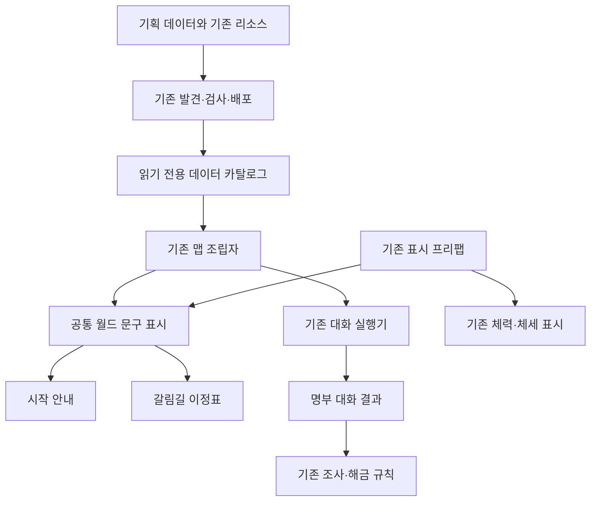
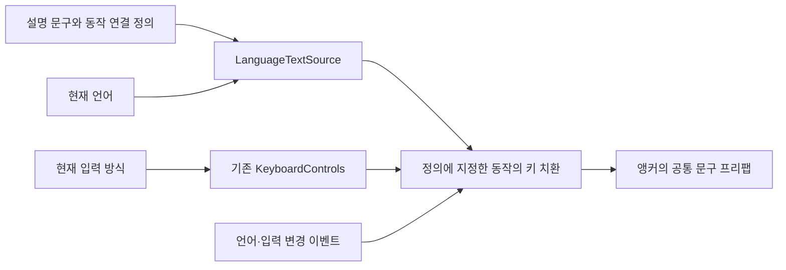
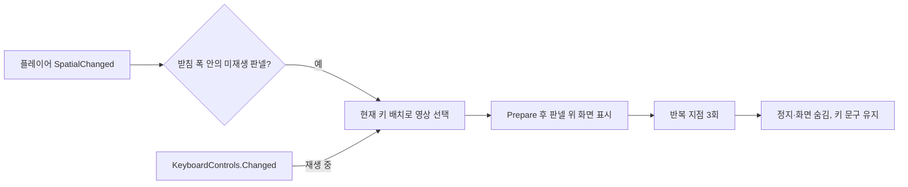
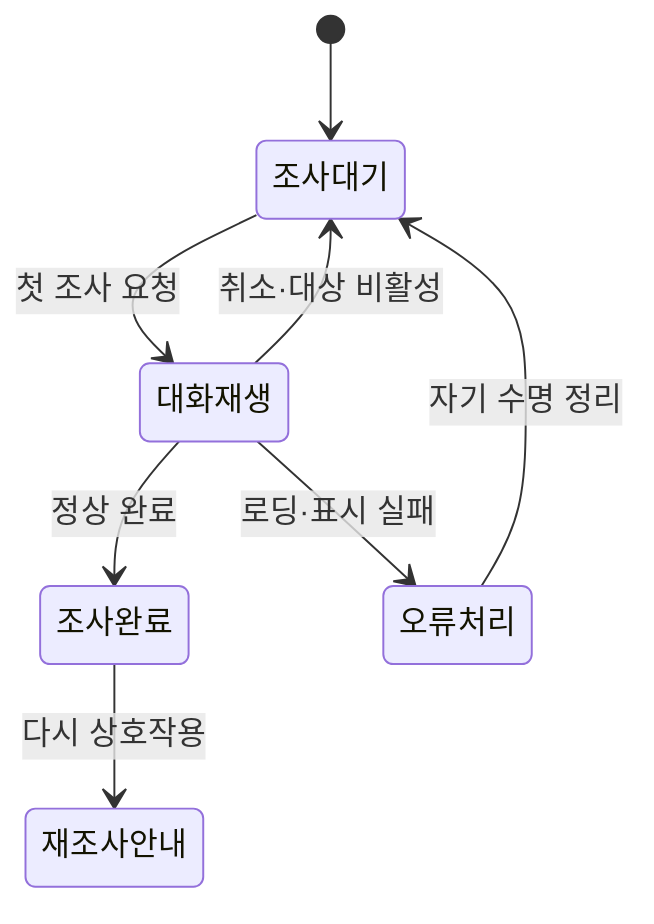
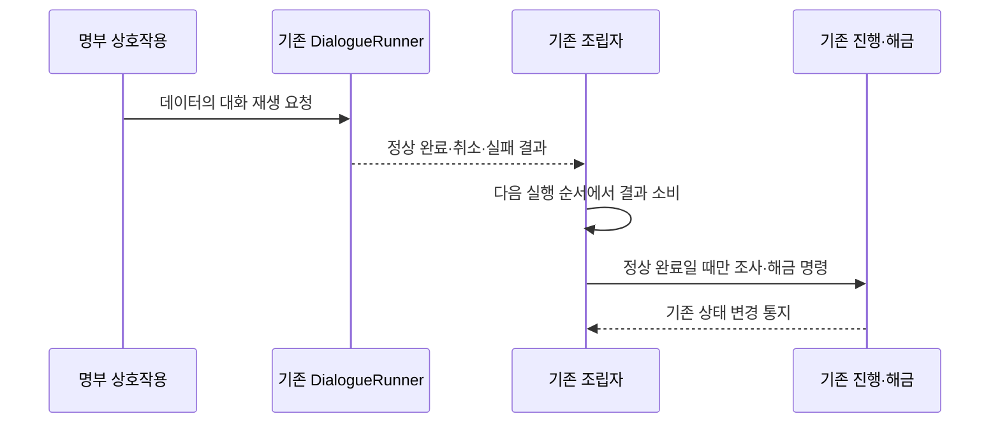
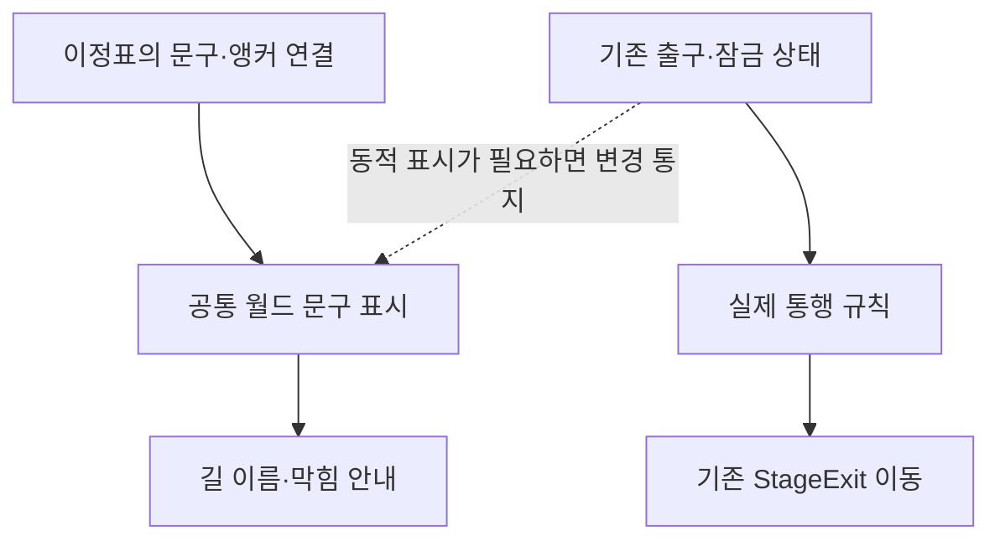

# 1116 남은 개발 요청과 연결 설계

2026-11-16 후속: [통합 요청 적용 상태](#1116-통합-요청-적용-상태)에 명부·이정표 연결 완료와 남은 아트 범위를 구분했습니다. 아래 계획·공급 시점의 미구현 기록보다 우선합니다.

기준일: 2026-11-16. 대상은 사용자 담당으로 남은 개발 연결입니다. 시작 안내는 기존 UI_Lang 8행 추가를 승인받아 구현·배포했습니다. 나머지 제안 구조는 미구현이며 실제 플레이 테스트는 사용자 담당입니다.

## 목차

1. [남은 범위와 공급 상태](#1-남은-범위와-공급-상태)
2. [전체 설계와 공통화 이유](#2-전체-설계와-공통화-이유)
3. [시작 안내의 기능 설명](#3-시작-안내의-기능-설명)
4. [명부 대화와 조사 완료](#4-명부-대화와-조사-완료)
5. [갈림길 이정표](#5-갈림길-이정표)
6. [최종 UI 아트 연결](#6-최종-ui-아트-연결)
7. [수명·오류·확장 계약](#7-수명오류확장-계약)
8. [작업 순서와 담당](#8-작업-순서와-담당)

## 1. 남은 범위와 공급 상태

| 순서 | 개발 작업 | 현재 근거 | 아직 필요한 것 |
| --- | --- | --- | --- |
| 1 | 시작 안내 상세 설명 연결 | UI_Lang 52201~52208과 Language 30368~30375 연결·배포, 이벤트 갱신 구현 | 실제 화면 가독성 확인 |
| 2 | 명부 대화 연결 | 승인된 전체 배포로 Dialogue 24005·문구·JSON 공급 완료 | 조사 대상과 대화 연결, 완료 후 기존 해금 실행 |
| 3 | 갈림길 이정표 연결 | 클라이언트 Language 30376~30379 존재 | 앵커·문구·표시 리소스 연결, 출구와 시각 위치 정렬 |
| 4 | 최종 UI 아트 교체 연결 | 현재 임시 받침·단색 막대로 동작 | 원본 아트 공급 후 기존 표시 프리팹 교체 연결 |

시작 설명과 이정표 문구를 더 이상 공급 대기로 묶지 않습니다. 명부는 데이터 배포와 실행 연결을 구분합니다. 새 영상 파일이 필요한 영상 컷씬 작업과도 구분합니다.

NPC 상호작용, 기존 엔딩·옵션·HUD·구매 확인·어그로·주요 UI 언어·경로 선택 통계는 신규 구현 목록에서 제외합니다. 협곡 배포는 사용자 완료 확인을 반영합니다. 랜덤박스·구간별 리스폰은 추후 계획이며 이번 네 작업에 포함하지 않습니다.

## 2. 전체 설계와 공통화 이유

시작 안내와 이정표는 모두 앵커에 번역 문구를 표시합니다. 각자 번역·키 치환·이벤트 구독·텍스트 생성을 복제하지 않는 방향입니다. 명부는 대화 완료가 게임 진행을 바꾸므로 표시 기능과 조사 규칙을 합치지 않습니다.

기존 LanguageTextSource·KeyboardControls·DialogueRunner·LedgerInteract·SpawnAnchors·SubscriptionScope를 먼저 사용합니다. 새로운 번역 서비스·대화 관리자·저장 관리자·전역 이벤트 버스를 만들지 않습니다. 기술 입력 동작과 콘텐츠 문구 매핑은 분리하며 숫자 ID별 콘텐츠 분기를 추가하지 않습니다.

### 공통 월드 문구에 필요한 연결 정보 — 제안

아래는 **필요한 정보의 설계안**입니다. 현재 공급된 새 시트나 확정 컬럼이 아닙니다.

| 정보 | 역할 |
| --- | --- |
| 고정 식별자 | 배치·오류 보고에서 대상 구분 |
| 소속 공간 | 현재 맵의 정의만 선택 |
| 앵커 이름 | 호출자가 전달한 맵·프리팹 범위 안에서 위치 선택 |
| Language 문구 ID 또는 기존 기능별 문구 참조 | 번역 원본 조회 |
| 선택적 입력 동작 키 | 이동·점프 등의 현재 키를 문구에 넣을 때만 사용 |
| 사용 여부 | 기획자가 표시 켜기·끄기 |

기존 데이터로 이 정보를 표현할 수 있으면 재사용합니다. UI_Lang은 현재 ID·Key·TextID만 있어 배치 위치나 입력 동작 매핑까지 이미 지원한다고 볼 수 없습니다. 기존 스폰 Objects도 현재 NPC 전용 실행이므로 문구·명부 타입을 넣기만 하면 동작하지 않습니다. **새 표 또는 기존 스폰 정의 확장이 필요하면 중복·소유 범위를 비교해 사용자 확인 후 확정**합니다. 세 기능마다 별도 로더·비슷한 설정표를 만들지 않습니다.

## 3. 시작 안내의 기능 설명

### 3.1 왜 바꾸는가

현재는 동작 이름과 키만 있어 플레이어가 기능의 의미를 알기 어렵습니다. 새 문구는 기능 설명과 `{0}` 자리표시자를 포함하므로 기획 설명을 원본 그대로 사용하고 현재 조작 방식의 키를 주입해야 합니다.

### 3.2 실제 공급 데이터

| 실제 Language ID | 내용 |
| --- | --- |
| 30368 | 이동 |
| 30369 | 점프·아래 발판 이동 |
| 30370 | 공격 |
| 30371 | 약초·중단 조건 |
| 30372 | 결박 가르기 |
| 30373 | 처형·회복 |
| 30374 | 패링·불가 공격 설명 |
| 30375 | 서낭당·기록·복귀 |

**실제 원본 예시:** 30368의 한국어는 `{0} 이동`입니다. 현재 이동 입력을 조회해 치환합니다. 실제 키 문자열을 문장이나 코드에 다시 고정하지 않습니다. 공급된 설명 8개와 기존 표시 9개를 배열 순서만으로 짝짓지 않습니다. 구르기·상호작용 등 기존 항목의 유지 여부와 새 설명의 대응은 동작 의미로 정합니다.

### 3.3 구현 위치와 의도

현재 구현은 새 표 없이 UI_Lang의 `StartGuide.` 접두어를 조회하고 ID 오름차순으로 표시합니다. Key의 동작 이름으로 KeyboardControls.ReadActionKey를 호출하므로 기존 9개 키 배열과 새 8개 문장을 순서로 짝짓지 않습니다. 구르기·하강은 별도 행이 아닌 공급된 8개 설명 구성에 따릅니다. 내용·순서는 데이터, 키 배치는 기존 입력 설정이 소유합니다. [기획자 설정 안내](../기획자용%20안내문서/기획자용%20언어%20선택과%20문구%20작성%20안내.md#5-시작-맵의-상세-조작-안내)를 봅니다.

| 이전 | 현재 | 변경 이유 |
| --- | --- | --- |
| 코드에 문구 ID 배열·임시 패링 번역 | UI_Lang Key와 Language 참조 | 기획자가 문구·표시 순서 관리 |
| 키 배열의 순서에 의존 | 동작 이름으로 공통 키 조회 | 행 수·순서 변경에 따른 잘못된 키 방지 |
| 짧은 이름 표시 | 상세 문장 줄바꿈·영역 내 축소 | 긴 한국어·영어 설명 지원 |
| 맵 생성 때 갱신 | 생성·언어·키 변경 이벤트 때 갱신 | 매 프레임 호출 없이 설정 반영 |

생성 전 양쪽 언어·동작 연결을 확인합니다. 비활성 상태에서 설정한 후 활성화하며 SubscriptionScope가 비활성 시 구독을 해제합니다. 변경 이벤트 안의 표시 예외는 표시 담당이 ErrorPopupHost.WriteError로 기록해 다른 소비자 갱신을 막지 않습니다. 시작 안내의 기존 PlayerStart 기준 간격 배치는 유지했습니다. 개별 앵커 데이터화와 다른 월드 문구 표시의 통합은 별도 제안이며 이번에 완료했다고 보지 않습니다.

#### 3.3.1 판넬별 안내 영상 (2026-11-16)

이동 판넬(52201 StartGuide.Move)은 원본 UI_Lang에서 삭제했습니다(클라이언트 반영은 배포 후). 남은 7개 판넬은 플레이어가 처음 지나갈 때 영상을 재생합니다.

| 항목 | 계약 |
| --- | --- |
| 영상 선택 | Key 동작 이름 + 배치 접미사. A(방향키)=`_A`, B(WASD)=`_B`. 두 배치의 키가 같은 처형·서낭당은 접미사 없는 파일. 예: `StartGuide.Jump` + B → `StreamingAssets/Video/StartGuide_Jump_B.mp4` |
| 사전 검사 | 생성 전에 판넬마다 두 배치 영상이 모두 있는지 확인하고 없으면 조립 실패 |
| 재생 | 판넬당 한 번. 다른 판넬로 넘어가면 이전 영상 정지. 비활성으로 끝까지 보지 못한 판넬은 재활성 후 다시 재생 가능 |
| 횟수 | `loopPointReached` 도달 횟수(정수)로 3회. 실수 시간 누적 없음 |
| 판정 | 매 프레임 조회 없이 플레이어 위치 변경 통지 때 정수 좌표로 비교 |
| 표시 | VideoPlayer 하나(APIOnly·URL)를 판넬이 차례로 사용. 검정 받침 없이 문구만 표시하고, 영상은 문구 윗변 바로 위(여백 0.1) World Space Canvas RawImage. 문구 크기가 바뀌면 위치도 다시 맞춤. 재생 오류는 화면을 숨기고 ErrorPopupHost.WriteError로 기록 |
| 빌드 | `verify_build.py`가 `StartGuide_*.mp4`를 모두 형식 검사·결과물 일치 검사 대상에 포함. UI_Lang의 StartGuide Key마다 A·B 두 배치 영상이 위 규칙으로 연결되는지도 Unity 빌드 전에 검사(Linux 대소문자 구분 기준) |

2026-11-16 빌드 준비: 공급된 StartGuide 12개와 교체된 Intro.mp4는 B프레임 사용·색 정보 없음 상태여서 GitHub 빌드의 영상 검사에서 실패했습니다. `normalize_video.py`(FFmpeg 8.1)로 변환해 내용을 교체하고 `.meta`는 유지했습니다. 해상도·프레임률·프레임 수·길이는 원본과 같고 B프레임 0·BT.709를 확인했습니다. 원본은 Git 이력에 남아 있습니다. 실제 화면 크기·위치와 재생은 Play·새 빌드 확인 대상입니다.

- 기존 StartMapControlsView는 시작 맵의 연결·배치 수명을 담당합니다.
- LanguageTextSource는 기존 번역 조회, KeyboardControls는 현재 동작의 키 조회를 유지합니다.
- 공통 문구 표시가 필요하면 Presentation/Preview의 표현 경계에 최소 책임으로 둡니다. 게임 규칙으로 넣지 않습니다.
- 기존 코드는 PlayerStart 기준 간격 배치입니다. 앵커 설정을 데이터화하는 변경과 문장만 교체하는 변경을 구분합니다. 새 절대 좌표를 코드에 더 넣지 않습니다.
- 긴 문구는 공통 줄바꿈·표시 영역을 사용합니다. 키 변경·언어 변경 때만 다시 만들고 매 프레임 문자열을 생성하지 않습니다.

**원래 요구 대비:** 기존 동작 이름·키 안내에서 상세 기능 설명으로 보강했습니다. 동작의 피해·거리·입력 규칙은 바꾸지 않았고 임시 패링 문자열을 제거했습니다. 이번 원본 8행과 연결 코드 작업은 사용자 요청으로 진행했으며 기존 기획 문구의 원저작과 구분합니다. 공급된 아트·글꼴을 재사용했고 아트 담당자의 외부 원본 공급 기여는 유지합니다. 새 변경은 아직 커밋 전이므로 Git 작업자 이력을 확정하지 않습니다.

### 3.4 검증 상태

원본 37개 탭·JSON 18개와 Unity 호환 생성 코드 검사를 통과한 뒤 배포했습니다. 원본 Language.xlsx는 기존 파일과 ZIP 내부 항목을 비교해 UI_Lang 워크시트만 변경됐음을 확인했습니다. 기존 Language 탭·다른 원본 행은 유지합니다. 클라이언트 데이터 9,570개·코어 2,222개 검사와 엔진 참조 컴파일은 통과했습니다. 실제 시작 맵의 줄바꿈·가독성·언어 전환은 사용자 화면 확인 대상으로 남습니다.

승인된 전체 데이터 배포에는 기존 원본의 명부 Dialogue 24005, Language 30380~30388과 30262 수정도 포함됩니다. 이번에 그 원문을 새로 작성한 것은 아니며 명부 실행 연결까지 완료됐다는 의미도 아닙니다.

## 4. 명부 대화와 조사 완료

구체적인 현재 코드 대조·데이터 연결 제안·완료 및 수명 계약은 [명부 대화와 조사 완료 연결 설계](명부%20대화와%20조사%20완료%20연결%20설계.md)에 분리했습니다. 아래는 구현 전 전체 범위 요약입니다. **2026-11-16 구현됨(자동 검사 통과, 실제 Play 확인 전).** 현재 구현·설계안 대비 개선은 해당 문서를 기준으로 합니다.

### 4.1 현재와 목표

현재 LedgerInteract는 조사 시 기존 클리어·스킬 해금 처리로 갑니다. 준비된 원본 24005는 영상이 아닌 줄별 대화입니다. 이를 별도 대화창으로 복제하지 않고 기존 DialogueRunner에 연결합니다.

### 4.2 데이터와 재사용 경계

실제 원본은 DialogueID 24005, Lines의 SpeakerTextID·TextID를 사용합니다. 화자 30380과 본문 30381~30388이 필요합니다. 최신 원본의 정의·문장·JSON을 한 묶음으로 검사·배포하고 일반 정의 파일의 기존 소유 규칙을 지킵니다. 24005를 명부라는 이유로 실행 코드 상수에 직접 넣지 않습니다.

**아직 확정할 연결:** 현재 명부 배치와 이 DialogueID를 어떤 기존 정의로 연결할지 확인합니다. 새 Npc 대화 행이 존재한다는 사실만으로 현재 LedgerInteract가 자동 실행하지는 않습니다. 기획 데이터의 대상 연결을 재사용하고, 부족하면 공통 상호작용 연결 정보의 확장이 필요합니다. 대화를 완성하기 위해 스테이지 클리어·해금을 표시 컴포넌트로 옮기지 않습니다.

**예정 코드 위치:** 조사는 기존 Adapters/Interaction/LedgerInteract, 재생은 기존 DialogueRunner, 실행 결과 소비·진행 연결은 GameplayPreview.Dialogues와 기존 명부 조립 경계입니다. 대화 도중 맵 이동·사망·화면 비활성이 생기면 해당 요청을 취소하고 구독·자기 정지를 해제합니다.

**원래 요구 대비:** 기존 즉시 조사 완료 앞에 데이터 대화가 들어갑니다. 완료 이력과 조사 완료 기록을 별도 중복 저장하지 않습니다. Dialogue의 ONCE는 실행기 수명이므로 영구 완료 여부는 기존 장부 조사 진행 기록으로 판정합니다. 취소·실패를 조사 완료로 간주하지 않습니다. 재조사 문구 30262의 최신 내용도 함께 배포합니다. Enter의 기존 줄 진행 규칙을 유지합니다.

## 5. 갈림길 이정표

### 5.1 안내와 실제 통행을 분리하는 이유

표지판은 갈 길을 설명하는 표시이며 출구 잠금이나 경로 선택 권한을 바꾸는 기능이 아닙니다. 그림과 이동 영역이 어긋나는 문제는 실제 출구 위치와 이정표 위치를 함께 검토해야 해결됩니다.

실제 공급 문구는 30376 바위 협곡, 30377 폐광, 30378 산사, 30379 막힘입니다. 새 키나 ID를 임의 발급하지 않습니다. 공간과 앵커 연결은 기획자가 정하고 같은 프리팹을 여러 위치에서 재사용합니다. 대상 앵커 묶음 안에서만 찾으며 누락 시 원점에 표시하지 않습니다.

현재 닫힌 길은 기존 잠금·충돌 정책을 유지합니다. 임시로 `막힘` 글자를 숨겼다고 통행을 허용하지 않습니다. 열림/닫힘이 바뀌는 요구가 생기면 기존 상태의 완료 이벤트를 구독해 문구를 바꾸고, 정적 표시만 필요한 현재 구간에 새 상태머신을 만들지 않습니다.

**예정 코드 위치:** 기존 맵 조립자는 바인딩을 공급하고 시작 안내와 같은 표현 모듈을 재사용합니다. 월드 표시가 UI 입력·상호작용 우선순위를 차지하지 않게 합니다. 최종 이정표 그림·앵커 위치가 미공급이면 연결 위치를 먼저 합의합니다.

**원래 요구 대비:** 출구 이동 기능 추가가 아니라 길의 의미와 실제 경로를 일치시키는 보강입니다. 경로 선택 통계는 기존 이동 승인 결과를 계속 사용합니다. 표지판 노출을 경로 선택으로 기록하지 않습니다.

## 6. 최종 UI 아트 연결

안내 받침·체력/체세 막대의 원본을 공급받아 기존 프리팹에 연결합니다. 아트 공급 전에는 현재 임시 표시를 사용할 수 있으며, 표시 교체 때문에 전투 수치나 도메인 이벤트를 수정하지 않습니다. 글자가 포함된 그림으로 문구를 대체해 다국어 연결을 끊지 않습니다. 원본 PNG·meta·기존 참조의 보존 범위를 확인합니다.

개발자는 리소스 연결·표현 경계를 담당하고 원본 이미지 제작·공급에는 아트 담당자가 함께 참여합니다. 원본 제작과 Git 가공·통합의 기여를 구분합니다.

## 7. 수명·오류·확장 계약

- 비활성 생성 → 정의·대상·앵커 연결 → 활성 등록을 지킵니다. 비활성 준비를 등록 완료로 기록했던 NPC 문제를 반복하지 않습니다.
- 언어·키 변경 구독은 표시 수명에 한정합니다. 명부 대화는 대상 수명과 실행기 수명 모두 확인합니다.
- 표시 실패는 표시 경계에서 기존 오류 보고로 전달하고 자기 정리를 끝냅니다. 필수 데이터·대상 연결 실패는 조립자에게 전달합니다. 기존 Firebase 오류 수집 경계를 재사용하며 새 전송기를 만들지 않습니다.
- 시간을 새로 사용하면 기존 MillisecondClock·정수 ms를 사용합니다. 배치·거리 규칙은 기존 정수 계약을 확인하고 실수는 최종 Transform·표현 경계에서만 씁니다.
- 정의를 수정하지 않고 실행 상태·요청 토큰·필요한 사본을 별도로 소유합니다. 이전 대화의 늦은 완료를 새 맵에 적용하지 않습니다.
- 네트워크가 추가되면 조사 완료 명령의 권한과 순서 검증이 필요합니다. 문구·키 표시는 로컬 소비자이며 전송하지 않습니다. 이번 설계만으로 네트워크·리플레이가 완성됐다고 보지 않습니다.

## 8. 작업 순서와 담당

| 역할 | 필요한 작업 |
| --- | --- |
| 사용자 담당 개발 | 기존 실행·표시 모듈 조립, 데이터 소비 연결, 수명 정리, 개발자·기획자 문서 갱신 |
| 기획자 | 문장·연결 대상·앵커·열림/막힘 의도 확정, 필요 스키마 합의 |
| 아트 담당자 | 원본 받침·표지판·막대 등의 제작·공급에 참여 |
| 다른 개발자 | 담당 전투·애니메이션의 기존 계약 유지. 공통 변경 영향 협의 |
| 사용자 테스트 | 실제 입력·대화·배치·흐름 확인. 이번 문서에 통과 결과를 임의 추가하지 않음 |

담당은 사용자 확정 범위를 기준으로 하며 커밋 작성자만으로 새 담당을 추정하지 않습니다. 이번 공급 근거는 클라이언트 e7d39132의 설명·이정표 Language 반영과 DataSheet 1d6d43b의 명부 대화 원본입니다. DataSheet의 원래 Git 작성자 Claude는 사용자 확정에 따라 Kim Hyun Ho의 작업으로 귀속합니다. 이 이력은 데이터 공급 근거이며 이번 연결 코드가 구현됐다는 근거가 아닙니다.

기능 단위로 이유·재사용 범위·위치를 설명하고 확인 후 구현합니다. 새 스키마·공통 계약은 사전 확인이 필요합니다. 새 사용법은 구현 후 기획자 문서에 작성하고 설계안을 현재 사용 가능한 기능처럼 안내하지 않습니다.

관련 문서: [기존 담당 설계](담당%20예정%20기능%20설계와%20연결%20기준.md), [NPC 설계](NPC%20데이터%20배포%20준비%20설계.md), [언어 설계](언어%20선택%20설정%20설계.md), [맵 출구 설계](맵%20출구와%20도착%20앵커%20연결%20설계.md).

## 11/16 통합 요청 적용 상태

위 구현 전 계획보다 이번 상태를 우선합니다. 명부24005는 수신 Develop03046c1의 LEDGER_INVESTIGATE 매핑을 재사용하며 실제8줄·해금·왕복을 확인했습니다. 별도 대화 관리자나 새 데이터 표는 추가하지 않았습니다.

갈림길은 StageContentSet.StageEntry.WorldTexts의 앵커·문구ID·정수 표시 여백을 WorldGuideLabels에 전달합니다.8007의 기존 Route_Up/Mid/Low에30376,30377+30379,30378+30379를 연결합니다. 생성 전 앵커·문구를 검사하고 비활성 생성→연결→활성화합니다. 언어 변경 이벤트만 구독하고 비활성/장면 종료 때 해제합니다. 오류는 표시 경계에서 기록합니다. 시작 설명의 키 치환 전용 StartMapControlsView는 유지하며 번역 조회와 글꼴 자산을 재사용합니다.

추천 위치 파일은 로컬 미확인, 팻말 원화는 대기입니다. 기존 경로 앵커를 사용했으며 위치와 출구/잠금/보상 규칙은 바꾸지 않았습니다. 최종 미술 배치는 담당 확인이 남습니다. 설정·확인은 [기획자 안내](../기획자용%20안내문서/임시%20게임플레이%20확인%20안내.md#1116-통합본-사망-복귀와-이정표-확인), 결과는 [통합 QA](1116%20엄격%20QA와%20자체%20피드백.md#1116-통합-요청-최종-검증)를 봅니다.
