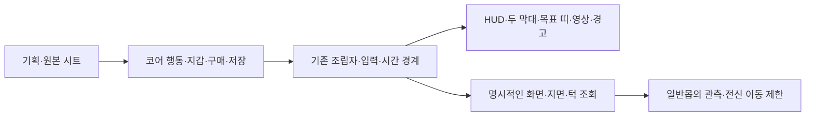

# 1116 최우선 요청 반영 및 QA

2026-11-16 후속: [통합본 우선 변경](#1116-통합본-우선-변경)이 아래 새벽 사망 복귀·공급 대기 기록보다 우선합니다.

기준: G-108, 게임9943d3b/DataSheet03ca05b 이후. 사용자가 두1116 MD를 최우선으로 지정하고 구현·QA·커밋/통합까지 승인했습니다. 낙사 충돌은 더 늦은 **개발요청_추가결정_1116(01:42)**와 사용자의 최신 파일 기준 답변에 따라 즉사 유지입니다. 노출 만료 자동 사망은 두 문서 모두 취소입니다. 원문 파일은 수정하지 않았습니다.

## 목차

1. [요청19항목](#1-요청19항목)
2. [책임과 수명](#2-책임과-수명)
3. [콘텐츠 공급 대기](#3-콘텐츠-공급-대기)
4. [검증 범위](#4-검증-범위)

## 1. 요청19항목

| 번호 | 대상 | 반영 | 검증 |
| --- | --- | --- | --- |
| 1 · B09 | 영상 출력 | UV0×0으로 한 픽셀 확대 재현. 전체UV·화면비·시작/재개 시간 수정 | 실제 원본 디코더/화면 비교 및 인트로·엔딩 자연 종료 |
| 2 · U10·U26 | 카메라 | -200·일반5.0·대기250ms·보기보간300ms, 장부방3.6 | 249/250ms 경계·위3/아래6칸·장부방3.6 |
| 3 · U11 | 턱 보호 | TryHang 명시 보호 인수. 종료 시 제거. 필드/보스 피해도 차단, 사다리 구분 | 실제 가마터6곳·코어 시작/종료/사다리/낙사 |
| 4 · U24·B01 | 적 두 줄 막대 | 붉은HP/흰체세. 노출 만료 체세만 복구 | 실제 피해 비율·색/위치·HP/사망/처형 보상 구분 |
| 5 · U31 | 낙사 | 최신 추가결정 우선: 즉사·마지막 서낭당 유지 | 실제 구덩이→사망→장면 재로딩→서낭당 |
| 6 · U21·B06 | 보스 판정/경고 | 3연타 전진 예고·부모 배율 보상으로 같은 월드 폭 | 2페이즈6종·가능한 타격별 경고/사거리 경계 |
| 7 · U18 | 보스 인식 | 방 내 거리/화면 해제 없음 | 방 양 끝 추적 유지 |
| 8 · U15 | HUD 재화 | 공급 아이콘+잔액, 기존 지갑 구독/초기 동기화 | 획득/구매/복원·언어 무관 숫자 표시 |
| 9 · U13·15·16 | 첫 안내/30366 | 비정지4초·기도 첫 접근·획득·해금 알림 뒤·조작표 | 이력 중복 방지·접근·표시4000ms·움직임 유지 |
| 10 · U16 | 구매 확인 | 기존 확인 단계 재사용, 기본/취소 아니오 | KO/EN 양 상점, No/취소/Yes/연속/부족 잔액 |
| 11 · U29 | 시작 안내 | 9개 동작 이름+현재A/B 키, 실시간 언어 변경 | KO/EN×A/B, 미공급 설명30368+는 콘텐츠 대기 |
| 12 · B10 | 나가기 매핑 | 30367→51905 명시 | 장부방 실제 F 나가기/F Exit |
| 13 · B05 | 적 지형 | 상자 이동 검사·전신 폭을 보행 경계에 반영 | 협곡23개체46경계·벽 상자 검사·공간 인식 회귀 |
| 14 · U28 | 패링 소리 | GameAudio 프리팹 누락 항목에 Player_Parry 연결 | 실제 cue 조회/클립/출력. 실기 청취와 구분 |
| 15 · B02 | 사망 약초 | 강화 적용 뒤 부활 수량을 최대치로 초기화 | 실제 강화5 저장→구덩이→복귀 즉시5/5 |
| 16 · B03·B13 | 보스 대사 | 전환 대사 단일 소유·정지 중 글자 출력 | 입장 대사·전환9줄·종료 잠금 해제 |
| 17 · B04 | 사다리 밀림 | 축 정렬·상단 이탈에도 상자 충돌 | 갈림길 활성6개×3높이×양방향36경로 |
| 18 · B12 | 소품 깜빡임 | LanternPost32·WarDrum33, 다른 소품31과 구분 | 현재 프리팹 순서/렌더 확인, 무관 재직렬화 제거 |
| 19 · 최신 배치 | 맵 회귀 | 협곡23·가마터9 및 현재 사다리/발판 사용 | 7맵 스폰0/9/9/12/23/0/0, 누락0, 도착 생존 |

가능하면 항목: U12 보스 피격 히트스톱90→50ms, U25 기존 아래 키 놓기 유지/회귀, U26 상하 보기 세로 보간을 반영했습니다. 새 점프·피격 원본은 요청대로 별도 적용했습니다.

## 2. 책임과 수명

- PlayerActor의 턱 보호는 Hang 상태와 명시 플래그가 모두 맞을 때만 유효합니다. EndHang이 플래그를 정리하고 사망/다른 상태에서는 남아 있어도 무효입니다. 사다리의 기본 TryHang은 보호를 요청하지 않습니다. 낙사 고정 즉사 경로는 별도입니다.
- 몬스터 보행/턱 경계는 이동 조립자가 공급합니다. 카메라·턱 조회는 명시 주입이며 프레임마다 전역 객체를 찾지 않습니다. 지형 상자 검사는 기존 PreviewCollision을 재사용합니다.
- HP/체세 표시와 경고 원은 수치를 변경하지 않습니다. 경고 원은 다음 타격 원점과 실제 월드 크기를 사용해 리그 배율에 영향받지 않습니다.
- HUD는 같은 CurrencyWallet을 구독하고 비활성/재연결 때 해제합니다. 구매 로직·저장 슬롯을 복제하지 않습니다.
- 첫 안내는 기존 큐/ViewedNotices를 재사용합니다. 기존 목표/해금 알림/메뉴/대화/영상을 덮지 않고 기다립니다.4초 완료 후 확인 이력만 저장하며 진행 위치/HP/재화를 안내 때문에 저장하지 않습니다. 이전 슬롯의 재화·해금은 미확인 안내만 보완합니다.
- 보스 전환 대사는 일반 대화 큐에서 제외해 StepBossPhase가 포효/무적/대사 완료를 한곳에서 소유합니다. 일반 보스 입장/사망 대화는 기존 DialogueRunner가 맡습니다.
- 영상의 UI 영역은 프리팹 Rect 직렬화와 런타임 시작 양쪽에서1×1을 보장합니다. 화면비 보존은 표현 경계입니다. 첫 갱신/정지 재개 전 경과 시간은 준비 제한 시간에 더하지 않습니다. 완료·취소·실패의 자원 해제 흐름은 유지합니다.

## 3. 콘텐츠 공급 대기

시작 안내 설명30368+, 패링 이름 전용 언어ID, 글자 없는 최종 받침/막대 아트, 추가 보스 연출, 별도 옹귀 런타임 수치는 원본 공급 대기입니다. 없는 행·수치·원본을 임의 생성하지 않습니다. 자세 만료 사망·HP20 근거리 낙사 복귀는 최신 결정상 취소된 요구입니다.

## 4. 검증 범위

[엄격 QA와 자체 피드백](1116%20엄격%20QA와%20자체%20피드백.md)에 실제 재현·증거·한계를 기록합니다. 도구 기반 실제 Unity 행동 검사와 사람이 키보드/패드로 한 번에 완주한 체감 검사는 다릅니다. 소스 검사 통과를 모든 적·갈림길 전 루트 장시간 완주로 바꾸지 않습니다. 최종 빌드/통합 결과는 문서 말미에 갱신합니다.

## 최종 로컬 수용 결과 · G-108

- 인트로60.129초 자연 완주. 실제 보스 처치·사망 대사→엔딩15.048초 자연 종료→탐색→실제 우측 출구→마무리3.525초→타이틀 회귀 통과. 시간/완료 이벤트 주입이나 영상 스킵을 사용하지 않았습니다.
- 최종 조작표 KO/EN×A/B 네 화면에서174/171/275/265자가 모두 생성됐습니다. 내용 영역820×460,28px로 패널 안 여백을 확보했고 수직 넘침을 차단했습니다. 화면 렌더도 확인했습니다.
- 새 Windows 개발 빌드 성공·오류0. 경고1은 Unity 클라우드 심볼 업로드403으로, 실행파일 생성·게임 초기화 실패가 아닙니다. 원본/포함 영상 해시·시작/복귀 씬 검사 통과. 별도 시험 실행파일의 타이틀 데이터 초기화도 통과했습니다.
- 시험 실행파일은 숨긴 창에서 CloseMainWindow를 받지 않아 직접 시작한 해당 프로세스만 경로 확인 후 정리했습니다. 실제 Unity Editor의 저장/정상 종료와 구분합니다.
- 데이터9241·코어2222·334소스 컴파일 경고/오류0, 자동화9·빌드 검사 회귀8·PNG 계약2 통과. 사용자 저장·공급 PNG/meta4개·입력 MD3개·기존 클립GUID를 보존했습니다.
- 읽기 전용 F8 QA 진단을 추가했습니다. 새 문구30368+·최종 아트·옹귀 수치는 공급 대기이며 시트에 없는 값을 임의 추가하지 않았습니다.
- Git 통합의 최종 커밋·원격 검사 상태는 해당 병합 커밋과 별도 최종 전달 기록을 기준으로 확인합니다. 로컬 수용과 원격 자동 검사를 구분합니다.

## 11/16 통합본 우선 변경

`개발요청_통합_1116.md`(12:52 수신)가 새벽 추가결정을 대체합니다. 위 G-108 표·검증은 당시 이력입니다. 이번 일반/낙사 복귀는 **죽은 맵의 들어온 입구**, 보스방만 마지막 서낭당입니다. 낙사 즉사·재화50% 손실·약초 최대치 복원은 유지합니다.

GameProgressState가 StageEntrance를 소유하고 실제 도착 앵커를 조립자가 기록합니다. 필드 사망 재시작은 이를 유지하고, 보스 복귀는 서낭당으로 바꾸면서 이전 맵 입구를 비웁니다. 저장 스키마는 변경하지 않았으며 이전 저장처럼 입구 기록이 없으면 해당 맵의 기본 시작점을 사용합니다. 장부 조사 뒤 초반 사망의 다음 맵 이동은 유지합니다. FallRespawn 구덩이 앞 복귀는 사용하지 않습니다.

추가 완료: 흰색/붉은색 예비 동작·지게귀 돌진 패링 불가, 수신된 명부24005 연결 회귀 확인, 갈림길30376~30379, 운영 옹귀·돌 투척 리그, HUD100%와 게이지 정렬입니다. 카메라 일반5/장부3.6을 유지합니다. 앞 가림 실루엣 원근은 선택 사항이며 필요한 SILHOUETTE 데이터·아트가 미공급이므로 추가하지 않았습니다.

[통합 QA](1116%20엄격%20QA와%20자체%20피드백.md#1116-통합-요청-최종-검증), [기획자 확인 순서](../기획자용%20안내문서/임시%20게임플레이%20확인%20안내.md#1116-통합본-사망-복귀와-이정표-확인)를 봅니다.
