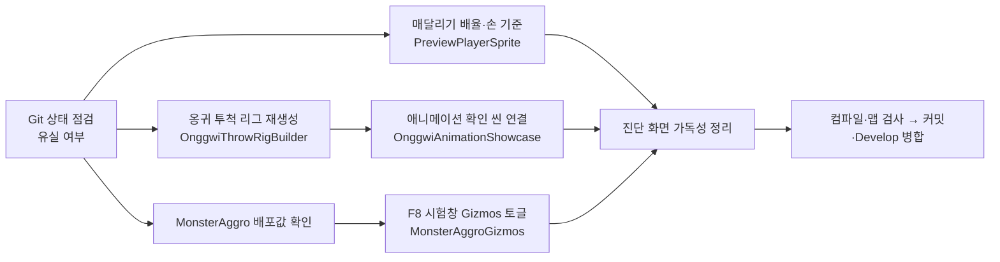

# 1117 매달리기·옹귀 투척·어그로 시험 QA와 인수인계

2026-11-17. 1117 작업 체크리스트(매달리기 배율 재발, 매달리기 연결, 옹귀 투척 리깅 피드백, 확인 씬 연결, 어그로 수치 점검, 인식 범위 Gizmos)의 반영 결과와 검증 근거, 다음 작업자가 이어받을 항목을 정리합니다. 구현 완료와 미검증 항목을 구분합니다.

## 목차

1. [작업 흐름](#1-작업-흐름)
2. [반영 항목](#2-반영-항목)
3. [검증 결과](#3-검증-결과)
4. [검증 한계와 인수인계](#4-검증-한계와-인수인계)

## 1. 작업 흐름

Git 점검 결과: 리베이스로 유실된 커밋은 없었습니다. 작업물은 `NYM/Work`의 미커밋 변경으로 남아 있었고, `NYM/Work`는 당시 `Develop`(8f5160e)과 같은 위치였습니다.

## 2. 반영 항목

| 항목 | 원인·변경 | 위치 |
| --- | --- | --- |
| 매달리기 시 캐릭터가 작아짐 | 오르기 중 배율을 `_climbStartScale × _hangScale`에서 1로 보간해 오르는 동안 몸이 줄었습니다. 오르기 중에는 `_climbStartScale`(1)로 고정하고, 매달림 원화의 작은 비율은 `_hangScale` 1 → 1.25로 보정했습니다. | `Assets/3.Script/Preview/PreviewPlayerSprite.cs`, `MapDohwagolTest.unity` |
| 매달림 손 위치 | 매달림·오르기 원화마다 가장 위 불투명 픽셀을 손 기준으로 구워 `_traversalAnchors`에 직렬화합니다. 메뉴 `인귀/애니메이션/매달리기 손 기준 굽기`(도화골 장면, Play 종료 상태). | `Assets/3.Script/Editor/TraversalFeedback1117Builder.cs` |
| 매달림 이탈 연결 | 턱에서 Jump·Idle·Walk로 빠질 때 표시 위치가 한 프레임에 튀었습니다. 이전 표시 위치와의 차이를 120ms 동안 SmoothStep으로 줄입니다. 정수 ms(`MillisecondClock`) 기준이며 판정 위치는 바꾸지 않습니다. | `PreviewPlayerSprite.cs` |
| 옹귀 투척 리깅 이상 | ① 관절 위치를 원화 팔에 맞게 수정. ② 팔 윤곽 다각형으로 팔·몸통 정점을 분리해 팔을 돌려도 항아리가 늘어나지 않게 함. ③ 도달 불가능한 IK 목표 때문에 팔꿈치가 뒤집히던 경로를 관절 회전 키 7개(`localEulerAnglesRaw.z`, ClampedAuto)로 교체. 메뉴 `인귀/애니메이션/옹귀 투척 리그 재생성`은 기존 GUID를 유지하고 PNG·Importer·전투 설정은 건드리지 않습니다. | `Assets/3.Script/Editor/OnggwiThrowRigBuilder.cs`, `Onggwi/Throw/*` |
| 옹귀 메시 정점 수 | 팔 주변만 2px 격자, 움직이지 않는 몸통은 8px 격자로 줄였습니다. 커밋본 729 → 수정 중 17,556 → 최종 5,151 정점. | `Onggwi_ThrowSprite.asset` |
| 확인 씬 연동 | 메뉴 `인귀/애니메이션/옹귀 투척 확인 씬 연결`이 `CharacterAnimationPreview.unity`에 좌/우 리그 2개와 이름표를 배치합니다. `OnggwiAnimationShowcase`가 실제 클립을 정수 ms로 샘플합니다(2200ms 반복, 돌은 0~500ms·1700ms 이후 표시). AI·피해·저장과 연결하지 않습니다. | `Assets/3.Script/Preview/OnggwiAnimationShowcase.cs` |
| 어그로 수치 | 배포 `Assets/Data/Csv/MonsterAggro.csv` 3401~3405가 커밋 4f85430(Monster.xlsx 임시책)과 일치: FrontRange 600, Back·Up·대각 4방향 400, DownRange 0. `origin/Develop`과 동일합니다. | 데이터 공급값 |
| 인식 범위 Gizmos | F8 시험창 토글 또는 메뉴 `인귀/테스트/몬스터 인식 범위 Gizmos`. Scene 뷰에서 **선택한** 몬스터의 정면·후면·위·아래·대각 범위와 추적 해제 상자를 그립니다. 주입된 읽기 전용 행만 표시하며 판정·상태를 바꾸지 않습니다. 에디터 전용(`EditorPrefs`). | `Assets/3.Script/Editor/MonsterAggroGizmos.cs`, `GameplayPreview.AggroTests.cs` |
| 진단 화면 가독성 | F8 창의 토글이 기본 스킨 글꼴로 작게 보여 버튼·라벨과 같은 18px 스타일을 적용했습니다. 피드백 QA의 적별 8항목 한 줄을 상태 / 거리·범위 / 보행 구간 3줄로 나눴습니다. 복사 기록도 같은 형식입니다. | `GameplayPreview.BossTests.cs`, `PreviewMonsterDriver.cs` |

## 3. 검증 결과

| 범위 | 결과 | 수행 |
| --- | --- | --- |
| 7맵 조립 | 로딩·스폰 수·누락 스크립트 검사 통과 | 작업 세션(Unity 에디터 MCP) |
| 옹귀 메시 재검사 | 5,151정점 재생성 후 재검사 통과 | 작업 세션 |
| 게임·에디터 코드 컴파일 | 최종 변경 포함 `Assembly-CSharp`·`Assembly-CSharp-Editor` 오류 0·경고 0 | Unity 내장 Roslyn, 에디터 생성 응답 파일 재사용 |
| 어그로 배포값 | 3401~3405 행이 시트 커밋 의도와 일치 | CSV 직접 대조 |
| 데이터·코어 검사 | 원격 `프로젝트 자동 검사`(Develop push)로 확인 | 이 PC에 `dotnet`이 없어 `Tools/Verify-Project.ps1`은 로컬 실행 불가 |

## 4. 검증 한계와 인수인계

- 사람이 직접 조작한 매달리기·오르기·이탈 체감, 옹귀 투척의 리깅 품질은 다음 Play에서 확인합니다. 숫자 검사 통과를 아트 합격으로 쓰지 않습니다.
- 진단 화면 정리는 코드 컴파일까지 확인했습니다. 실제 F8 창 배치는 다음 Play에서 봅니다.
- Gizmos는 Scene 뷰 + 몬스터 선택 상태에서만 보입니다. Game 뷰에는 그리지 않습니다.
- `Tools/Verify-Project.ps1`은 BOM 없는 UTF-8이라 Windows PowerShell 5.1에서 구문 오류가 납니다. PowerShell 7 또는 BOM 추가가 필요합니다(이번 작업에서 수정하지 않음).
- 기획자 사용 순서: [몬스터 인식과 추적 데이터 사용 안내 5.4](../기획자용%20안내문서/몬스터%20인식과%20추적%20데이터%20사용%20안내.md#54-인식-범위-gizmos-보기). 이전 QA 기준: [1116 엄격 QA와 자체 피드백](1116%20엄격%20QA와%20자체%20피드백.md).
