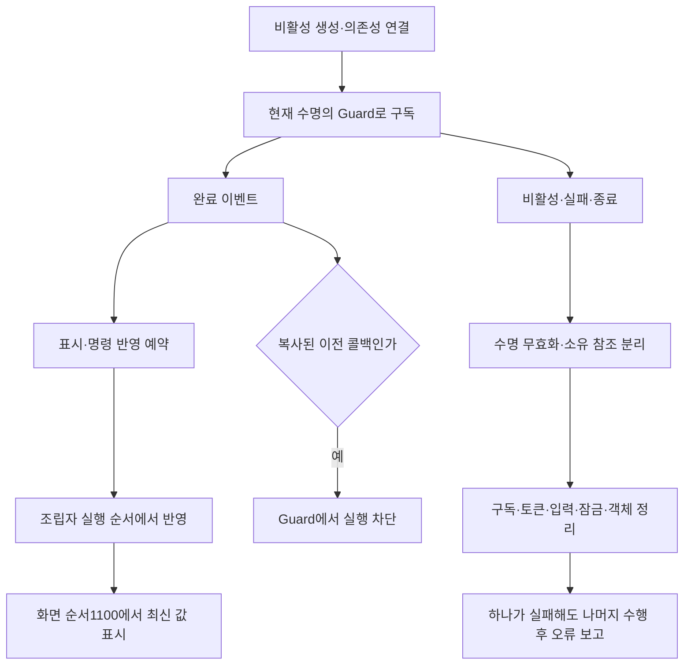
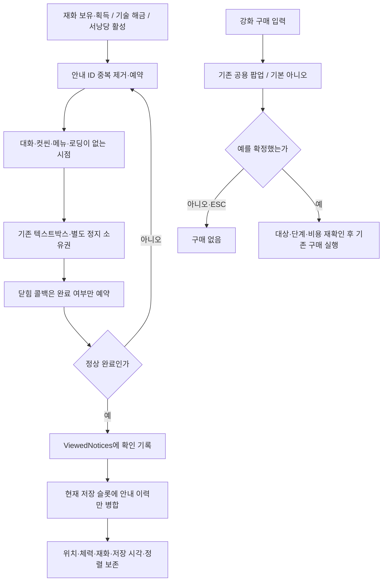

# 2026-11-16 설계·수명·테스트 감사와 리소스 점검

기준: 클라이언트 `fe5cf17` 위 로컬 변경. 사용자 요청으로 정수화·책임 분리·어댑터·이벤트 수명·패턴·재귀·테스트 기능을 점검했다. 첫 안내의 저장 계약 확장은 사용자가 별도로 승인했다. 이전 대화에서 작성한 13시23분 이후 이력 문서는 과거 스냅샷으로 보존한다. 이번 변경은 아직 커밋·푸시·실행파일 배포 결과가 아니다.

## 목차

1. [발견 원인과 수정](#1-발견-원인과-수정)
2. [수명과 명령 순서](#2-수명과-명령-순서)
3. [디자인 패턴 판단](#3-디자인-패턴-판단)
4. [재귀와 재진입 구분](#4-재귀와-재진입-구분)
5. [첫 안내와 구매 확인 연결](#5-첫-안내와-구매-확인-연결)
6. [테스트 기능과 검증 범위](#6-테스트-기능과-검증-범위)
7. [리소스 압축과 아틀라스](#7-리소스-압축과-아틀라스)

## 1. 발견 원인과 수정

| 문제·발생 조건 | 왜 문제가 되는가 | 수정 위치·방식 |
| --- | --- | --- |
| 준비 리소스의 취소 콜백 또는 반환이 예외를 냄 | 순차 Dispose가 중단돼 이후 리소스가 반환되지 않는다. | `Adapters/PreparedAssetStore.cs`: 먼저 저장소를 종료하고 기존 SubscriptionScope로 취소·토큰 해제·모든 반환을 끝낸 뒤 오류를 모아 전달한다. |
| 게임·저장·대화·서낭당·체력 표시의 중간 종료 실패 | 뒤의 입력·잠금·이벤트·생성 객체 정리가 건너뛰어진다. | GameplayPreview 및 각 종료 담당, HealthDisplayGroup/Host: 새 명령을 막고 소유 참조를 먼저 분리한다. 기존 공통 Cleanup으로 독립 종료 단계를 모두 수행한다. |
| 이벤트 발행 중 앞선 소비자가 대상을 해제·재연결 | C# 이벤트는 발행 시작 시 복사한 호출 목록을 계속 실행하므로 단순 `-=`만으로 이전 콜백이 사라지지 않는다. | 일반몹·보스 드라이버, 플레이어/일반몹 소리·회복·동작 표시: 활성 수명마다 SubscriptionScope.Guard를 만들고 종료 시 무효화한다. |
| 레벨·강화 완료 이벤트에서 ApplyLevel/ApplyUpgrades 호출 | 완료 통지 중 새 코어 변경·체력/표시 통지가 중첩된다. 소비자 순서에 따라 다른 소비자가 변경 중간 값을 보거나 예외가 재진입할 수 있다. | `GameplayPreview.Saves.cs`: 이벤트는 예약만 한다. 조립자 LateUpdate와 저장 Capture에서 반영한다. ShrineScreen은 그 뒤 순서1100에서 표시를 갱신한다. |
| 새 확인창·첫 안내가 데이터에만 존재 | 공급·배포 성공과 실제 게임 소비 연결이 다르다. | 기존 ShrineScreen/ConfirmationPopupScreen/TextboxScreen/SaveSession을 재사용해 연결했다. 세부 흐름은 5장. |
| H 피해 시험 입력이 출시 코드에도 존재 | 사용자가 출시 실행파일에서 H를 누르면 시험용 피해를 받을 수 있다. | `GameplayPreview.HandlePreviewKeys`: UNITY_EDITOR 또는 DEVELOPMENT_BUILD에서만 처리한다. |
| 처형 시험 객체의 현재 부모를 삭제 | 재배치·부모 변경 시 외부 소유 오브젝트를 삭제할 수 있다. | `GameplayPreview.EditorExecutionDummy.cs`: 생성 당시 소유 루트를 따로 보관하고 그 루트만 회수한다. 한 시험 객체 정리 실패에도 다른 객체를 정리한다. |
| 시험 공격 배율이 실수 상태, 비정상 배율 입력 가능 | 시험이라는 이름으로 게임 판정 배율의 정수 원칙을 우회하고 NaN이 Transform으로 퍼질 수 있다. | 공격 배율 상태는 분모10000 정수로 저장하고 최종 Transform 경계에서 변환한다. 공격·카메라 시험 배율의 NaN/무한대를 거부한다. |
| 에디터 조건 컴파일의 2D Animation 참조 누락 | 기존 JigegwiRunRigBuilder의 Bone 관련 코드까지 포함하면 검사 도구가 실패한다. | `Tools/Verify-Data.ps1`: UNITY_EDITOR 검사에 기존 Unity.2D.Animation.Runtime 참조를 추가했다. |

코어 전체의 직접 작성 소스는 기존 IntegerPolicyChecks로 실수형 재도입을 검사한다. Bounds·Transform 관측, 보간·색·오디오·클립 샘플링의 실수는 엔진 경계로 구분한다. 시트 정의·생성 enum·로딩 계획·원본 아트·콘텐츠 수치를 임의로 수정하지 않았다. 정수 사용만으로 엔진 물리·리플레이 결정성을 보장하지 않는다.

## 2. 수명과 명령 순서

게임플레이 명령·완료 이벤트 자체의 예외는 기존처럼 호출자에게 전달한다. 종료 작업을 모두 시도한 뒤 오류를 모으는 것과, 정상 게임 이벤트의 소비자 예외를 숨기는 것은 다르다. 새 전역 이벤트 버스·자동 객체 검색·별도 수명 관리자는 도입하지 않았다.

## 3. 디자인 패턴 판단

| 대상 | 판단 | 이유 |
| --- | --- | --- |
| Observer + SubscriptionScope | 유지·사용 누락 보완 | 독립 표시 소비자에 적합하다. 구독 해제와 지난 호출 차단을 기능마다 다시 구현하지 않는다. |
| AssetLease/PreparedAssetStore | 유지 | 준비 수명과 리소스 반환 책임이 명확하다. 반환 실패의 연쇄 누락만 수정했다. |
| UpgradePurchases 템플릿 메서드 | 유지 | 구매 종류별 준비와 공통 차감·확정·완료 통지를 분리한다. UI에서 지갑 차감 공식을 복제하지 않는다. |
| EffectStateFactory/효과 전략 | 유지 | 즉시·주기·유지 효과의 실제 실행 차이가 있어 팩토리·전략에 근거가 있다. |
| ActorStateMachine과 짧은 상태 타입 | 유지 | 진입·진행·종료 계약과 기존 캐릭터 호출부를 공유한다. 타입이 짧다는 이유만으로 전면 교체하지 않았다. |
| GameplayPreview 조립자·partial | 기존 구조 안에서 보완 | 기능 조립·순서·수명은 조립자 책임이다. 새 안내 흐름은 기능별 partial로 분리하고 구매·저장은 기존 모듈을 사용한다. partial 파일 분리가 독립 객체로 완전히 분리됐다는 뜻은 아니다. |
| 지역 종료 코드를 새 관리자/팩토리로 대체 | 도입하지 않음 | 이미 있는 Cleanup 재사용으로 해결된다. 패턴을 추가하면 전달 단계와 소유자만 늘어난다. |

## 4. 재귀와 재진입 구분

| 호출 | 분류·판단 |
| --- | --- |
| JsonSaveStore.CheckIntegerValues의 자식 토큰 탐색 | 계층 데이터의 정수 말단 검증에 필요한 재귀다. 파서는 기존 MaxDepth16을 사용한다. 순환 호출로 보지 않는다. |
| FirebaseRestTransport.EncodeFields의 하위 JObject 인코딩 | 트리형 문서를 전송 형식으로 바꾸는 구조 재귀다. 현재 통계 레코드의 중첩 구조와 함께 확인했으며 일반 명령 재호출과 구분한다. |
| 에디터의 EnsureFolder | 부모 폴더를 먼저 만드는 제한된 경로 재귀다. 고정 Assets 하위 경로에서 사용한다. 짧은 에디터 헬퍼를 합치기 위해 런타임 팩토리를 추가하지 않았다. |
| 완료 이벤트 → ApplyLevel/ApplyUpgrades → HealthChanged/DisplayChanged | 트리 탐색이 아닌 이벤트 재진입이다. 이번에 예약 후 반영으로 변경했다. |
| 팝업 Accepted → 구매 명령 | 소비자 안에서 바로 구매하지 않고 요청을 보관한다. ShrineScreen.Update가 구매를 실행한다. |
| Hide → SetActive(false) → OnDisable → Hide 후보 | Unity 수명 콜백의 간접 재진입이다. 상태·참조를 먼저 비우고 IsOpen/종료 여부로 반복을 끊는다. 모든 유사 메서드 이름을 실제 재귀로 판정하지 않는다. |

직접 작성 C#의 동일 이름 재호출 후보를 추출한 뒤 실제 수신 객체·오버로드·기반 클래스 호출을 확인했다. `actor.Tick`, `base.OnEnable`, 다른 객체의 Dispose 등은 자기 재귀가 아니다. 이번 근거에서 무한한 직접 재귀를 확인한 것은 아니며, 확인된 문제는 위 이벤트 재진입과 종료 실패 경로다.

## 5. 첫 안내와 구매 확인 연결

**원문 수신 후 상태 구분:** 아래는 원문을 받기 전에 감사 범위에서 연결한 현재 코드다. 이후 사용자가 제공한11/15 결정은 첫 안내를 ‘위 가운데 목표 안내 띠4초’로 요구하며30363은 첫 접근 시점,30366은 해금 안내 다음 및 조작 안내에 연결하도록 한다. 현재 대사창·정지 방식과 트리거는 해당 기획의 완료가 아니다. 사용자의 ‘리스트/현황 문서화만’ 지시에 따라 이 차이를 추가 구현하지 않고 [앞으로 할 것](1115%20유저테스트%20기획%20반영%20현황과%20사용자%20작업%20목록.md#3-앞으로-할-것)에 기록했다.

- 첫 안내 Language30363~30366을 기존 데이터에서 읽는다. 화면 문자열을 새로 하드코딩하지 않는다. 완료 전 강제 닫힘은 확인 처리하지 않는다.
- 저장 확장 `SaveSnapshot.ViewedNotices`는 양의 정수 ID 사본이다. 기존 버전1 파일에 해당 필드가 없으면 메모리에서 빈 목록을 보완한다. 읽기만 해서 파일을 덮어쓰지 않는다. 명시된 null·문자열·소수는 기존 엄격 검사에 따라 거부한다.
- `SaveSession.SaveNoticeHistoryAsync`는 현재 파일의 진행 스냅샷을 유지하고 안내 목록만 합친다. SaveKind.NoticeHistory를 별도로 통지한다. 실패하면 이전 슬롯을 보존하고 저장 잠금을 반환한다. 새 위치나 재화를 몰래 자동 저장하지 않는다.
- 서낭당은 Popup15009/15010의 문구·버튼·기본/취소 정책을 사용한다. 예를 누르기 전에는 차감하지 않으며, 확정 시 바뀐 단계·비용의 이전 요청을 재사용하지 않는다. 실제 표시·키보드·마우스 수용은 아래 제한을 따른다.

## 6. 테스트 기능과 검증 범위

이번 실행 결과: 데이터9,220개·코어2,215개, 출시 및 UNITY_EDITOR/DEVELOPMENT_BUILD 조건 엔진 참조 컴파일(컴파일 경고·오류0), 빌드 회귀8개·공지 회귀9개·PNG 압축 계약2개 통과. 이 숫자는 서로 다른 종류의 검사이므로 Play 수용 건수로 합산하지 않는다.

현재 검사 수치와 실행 제한은 [현재 구현과 검증 현황](현재%20구현과%20검증%20현황.md)의 이번 감사 항목을 기준으로 한다. 이번 회귀에는 반환·취소 동시 실패, 저장 확인 이력의 파일 왕복/이전 파일 보완/진행 보존/기록 실패, 기존 정수·수명·저장 검사를 포함한다.

`Assets/Editor/Preview/LifetimeAuditVerification.cs`는 별도 Unity 배치에서 실제 프리팹·종료 후 보관 콜백·재연결·진행 반영·종료 실패·시험 배율을 검사하도록 준비했다. 실제 저장 폴더·통계 연결은 생성하지 않는다. 실행 명령은 `-batchmode -nographics -projectPath <프로젝트> -executeMethod HumanGhost.EditorTools.LifetimeAuditVerification.Run -logFile <로그>`다.

이번 PC에서는 Unity6000.2.8f1이 유효한 Editor 라이선스를 찾지 못해 종료 코드198로 검사 실행 전에 종료했다. 따라서 준비한 실제 프리팹 검사·Play·새 UI 표시·실행파일 테스트는 통과로 기록하지 않는다. 검사 코드의 엔진 참조 컴파일과 실제 엔진 실행은 구분한다. NuGet 취약성 메타데이터 조회의 NU1900 경고도 컴파일 경고0과 구분한다.

F5 수동 저장·F8 보스 시험·F12 기록 삭제는 기존 에디터/개발 빌드 정책을 따른다. F8 처치·F5 저장은 의도적으로 현재 진행을 바꿀 수 있으므로 ‘사용자 기록을 전혀 건드리지 않는 자동 검사’와 다르다. F12는 사용자 확정대로 확인 후 최신 슬롯 하나를 지운다. 모든 시험 기능을 무해한 표시 기능으로 묶어 설명하지 않는다.

## 7. 리소스 압축과 아틀라스

기존 `Tools/Resources/Optimize-Png.py`의 무손실 IDAT 재압축을 사용한다. 픽셀/필터 데이터와 IDAT 외 청크가 같고 실제 더 작은 파일만 교체한다. meta·슬라이스·해상도·피벗·그림 내용을 바꾸지 않는다. 원본 아트 제작·공급은 아트 담당자의 기여이며 이번 압축·참조 점검과 구분한다.

아틀라스는 현재 OptionsUI 1개이며 Include in Build가 켜져 있다. 기존 옵션 묶음의 중복 편입은 피한다. 실제 UI 프리팹과 PNG/파생 Sprite 참조를 대조했다.

| 후보 | 판단 |
| --- | --- |
| 서낭당 화살표·커서·구분선·재화 아이콘·키캡·Pip·행 선택 10종 | ShrineScreen에서 사용하며 기존 아틀라스에 없다. 작고 함께 사용하는 UI의 우선 묶음 후보다. |
| 타이틀 버튼 4종 | TitleScreen 참조가 있는 별도 묶음 후보다. 미사용 start_pressed는 함께 넣을 근거가 없다. |
| HUD 파생 스프라이트·아이콘 | 원본 PNG 참조와 파생 Sprite를 함께 추적해야 한다. 원본 파일만 묶어 중복 텍스처가 줄었다고 단정하지 않는다. |
| 큰 배경·패널·반복 지형 | 페이지 점유·읽기 방식·타일 반복과 로딩 수명을 먼저 검토한다. 큰 그림을 무조건 묶지 않는다. |
| 캐릭터 전체 | SpriteSilhouette가 원본 sprite.rect로 새 Sprite를 만들고 textureRect로 UV를 계산한다. EnemyGroundingBaker도 원본 텍스처 좌표를 읽는다. 패킹·회전·타이트 메시 변경 시 이 경계를 함께 검증해야 한다. |

아틀라스 생성·패킹·런타임 자동 바인딩·화면 검증은 Editor 라이선스 복구 후 수행할 조건으로 남긴다. 검증하지 않은 묶음을 활성 아틀라스로 추가하지 않았다. PNG 파일 절감은 빌드 용량·VRAM·드로콜 개선 수치가 아니다. 실제 압축 실행 결과는 아래와 같다.

### 이번 무손실 압축 결과

| 범위 | 점검 | 변경 | 이전 바이트 | 이후 바이트 | 절감 바이트 |
| --- | ---: | ---: | ---: | ---: | ---: |
| Assets/4.Sprite | 782 | 170 | 597,411,821 | 577,406,476 | 20,005,345 |
| Assets/5.Animation | 65 | 55 | 18,351,346 | 16,270,080 | 2,081,266 |
| 합계 | 847 | 225 | 615,763,167 | 593,676,556 | 22,086,611 |

총 21.06MiB(3.59%) 절감했다. 최종 파일847개의 크기를 결과와 대조했고, 변경225개는 최종 IDAT를 다시 해제한 SHA-256이 압축 전 영상 데이터 해시와 일치했다. 제외 파일은0개다. 기존 도구가 각 파일의 IDAT 외 청크 동일성을 확인했고 추적 중 meta·ProjectSettings·Packages 변경도 없다. 외부 패키지·검증 캡처·오디오·영상은 이번 PNG 압축 범위에 포함하지 않았다.

절감량이 큰 파일10개:

| 파일 | 이전 | 이후 | 절감 바이트 |
| --- | ---: | ---: | ---: |
| Assets/4.Sprite/LodingImage/Background_KeyArt5_1920x1080.png | 17,916,526 | 16,445,664 | 1,470,862 |
| Assets/4.Sprite/LodingImage/loding6.png | 17,916,526 | 16,445,664 | 1,470,862 |
| Assets/4.Sprite/LodingImage/Background_KeyArt4_1920x1080.png | 18,329,861 | 16,895,559 | 1,434,302 |
| Assets/4.Sprite/LodingImage/loding3.png | 18,329,861 | 16,895,559 | 1,434,302 |
| Assets/4.Sprite/LodingImage/Background_KeyArt3_1920x1080.png | 18,304,024 | 16,877,671 | 1,426,353 |
| Assets/4.Sprite/LodingImage/loding5.png | 18,304,024 | 16,877,671 | 1,426,353 |
| Assets/4.Sprite/LodingImage/Background_KeyArt6_1920x1080.png | 19,250,448 | 17,871,171 | 1,379,277 |
| Assets/4.Sprite/LodingImage/loding4.png | 19,250,448 | 17,871,171 | 1,379,277 |
| Assets/4.Sprite/Map/Art/Backgrounds/ST01_BG_Sky.png | 9,025,259 | 8,360,108 | 665,151 |
| Assets/4.Sprite/Map/Art/Backgrounds/ST01_BG_Mountains.png | 12,882,368 | 12,363,473 | 518,895 |
