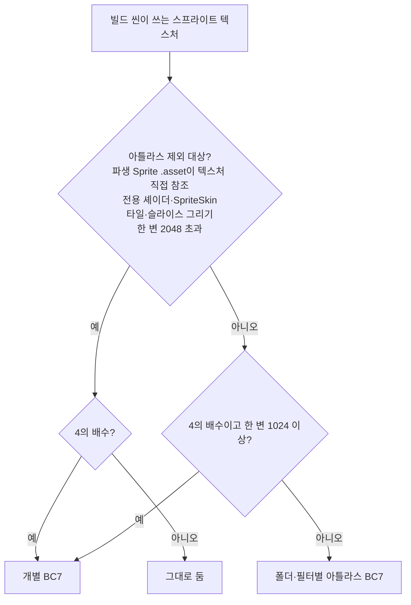

# 텍스처 압축과 스프라이트 아틀라스 적용 (2026-11-20)

대상: 리소스·프리팹 최적화를 이어받는 개발자. 미사용 리소스 정리([미사용 리소스 참조 확인 결과](미사용%20리소스%20참조%20확인%20결과.md)) 뒤 남은 리소스를 확정 리소스로 보고 압축과 아틀라스를 적용한 기록입니다. 작업 규칙은 [리소스·프리팹 최적화 인수인계](다른%20개발자%20리소스·프리팹%20최적화%20작업%20인수인계.md)를 따랐습니다.

## 목차

1. [요약](#1-요약)
2. [왜 했나 — 측정](#2-왜-했나--측정)
3. [분류 규칙](#3-분류-규칙)
4. [아틀라스 목록](#4-아틀라스-목록)
5. [그대로 둔 34장](#5-그대로-둔-34장)
6. [검증](#6-검증)
7. [새 스프라이트를 추가할 때](#7-새-스프라이트를-추가할-때)

## 1. 요약

| 항목 | 전 | 후 |
| --- | --- | --- |
| 빌드 씬(Title·MapDohwagolTest)이 쓰는 텍스처 메모리 추정 | 1,501.7 MiB | 591.0 MiB |
| 그중 개별 텍스처 | 500장 | 131장(295.0 MiB) |
| 스프라이트 아틀라스 | 1개(OptionsUI) | 21개(296.0 MiB) |

- 숫자는 에디터의 텍스처 저장 메모리 추정(`TextureUtil.GetStorageMemorySizeLong`)입니다. 빌드 파일 크기·실제 GPU 메모리는 측정하지 않았습니다(빌드는 사용자 승인 대상).
- PNG 원본·GUID·pivot·PPU·필터는 바꾸지 않았습니다. 바뀐 것은 `.meta`의 임포트 설정과 새 `.spriteatlasv2`입니다.
- 커밋: `cbc6e3c`(개별 압축), 아틀라스 커밋(아래 4장).

## 2. 왜 했나 — 측정

작업 전 빌드 텍스처의 실제 포맷:

| 설정 → 실제 포맷 | 장 | 메모리 |
| --- | --- | --- |
| Compressed → **RGBA32** | 96 | 655.0 MiB |
| Uncompressed → RGBA32 | 301 | 577.8 MiB |
| Uncompressed → RGB24 | 15 | 143.2 MiB |
| Compressed → DXT5 | 81 | 85.2 MiB |
| Compressed → RGB24 | 7 | 40.3 MiB |

- 압축 설정이어도 가로·세로가 **4의 배수가 아니면** BC/DXT로 압축되지 않고 RGBA32로 들어갑니다. 빌드 텍스처 500장 중 329장이 4의 배수가 아니었습니다.
- Point 필터 지형·소품 조각은 대부분 무압축이었습니다.

## 3. 분류 규칙

- **개별 BC7(96장):** Standalone 재정의 BC7, 품질 50, 최대 크기는 기존 값 유지, 크런치 없음.
- **아틀라스(362장):** 폴더·필터(Point/Bilinear)별로 묶습니다. 필터가 다른 그림을 한 아틀라스에 넣으면 필터가 바뀌므로 나눴습니다. 여백 4, 회전·타이트 패킹 끔, 밉맵 없음, 알파 확장 켬, Standalone BC7.
- 아틀라스 원본 텍스처는 **무압축**으로 바꿨습니다. 원본이 이미 압축돼 있으면 아틀라스에서 다시 압축되며 화질이 떨어집니다(Unity 경고). 아틀라스에 들어간 원본은 빌드에 따로 들어가지 않습니다.
- 캐릭터 시트 중 파생 Sprite `.asset`(처형·공격 프레임 등)이 쓰는 텍스처는 아틀라스에 넣지 않았습니다. 이 `.asset`은 텍스처를 직접 참조합니다.
- 캐릭터 렌더러의 `HumanGhost/Boss Phase Two Flash` 셰이더는 일반 UV와 주변 2텍셀만 샘플하므로(여백 4 안) 아틀라스에 들어간 시트도 안전합니다.

## 4. 아틀라스 목록

위치: `Assets/4.Sprite/Atlases/`

| 아틀라스 | 스프라이트 | 페이지 | 메모리 |
| --- | --- | --- | --- |
| Atlas_Map_Ground_R7_Bilinear | 65 | 8192² × 3 | 192.0 MiB |
| Atlas_Misc_Player_Bilinear | 223 | 4096² | 16.0 MiB |
| Atlas_UI_Bilinear | 45 | 4096² | 16.0 MiB |
| Atlas_Loading_Bilinear | 5 | 2048×4096 × 2 | 16.0 MiB |
| Atlas_Map_01_Dohwagol_Point | 39 | 4096×2048 | 8.0 MiB |
| Atlas_Map_03_Hyeopgok_Point | 82 | 4096×2048 | 8.0 MiB |
| Atlas_Misc_Heosugui_Bilinear | 195 | 4096×2048 | 8.0 MiB |
| Atlas_Map_Art_Bilinear | 7 | 2048×4096 | 8.0 MiB |
| Atlas_Map_02_Sangil_Point | 31 | 2048² | 4.0 MiB |
| Atlas_Map_04_BossRoom_Point | 34 | 2048² | 4.0 MiB |
| Atlas_Misc_Test_Bilinear | 24 | 2048² | 4.0 MiB |
| 나머지 9개(작은 묶음) | | | 약 8 MiB |

- `Map_Ground_R7` 조각은 2048×2047이라 4096 아틀라스에 한 장씩밖에 안 들어가 8192로 만들었습니다.
- 기존 `OptionsUI` 아틀라스(RGBA32, 4 MiB)는 건드리지 않았습니다.

## 5. 그대로 둔 34장

4의 배수가 아니면서 아틀라스 제외 조건에 걸린 텍스처입니다(무압축, 약 72 MiB).

| 이유 | 예 | 해결 방법(후속) |
| --- | --- | --- |
| SpriteRenderer 타일 그리기(가로 반복 배경·땅 채움 등 27장) | `Kits9/*/2_산맥_중경/*_가로반복.png`, `4_땅TILE/*` | 원본 크기를 4의 배수로 맞춘 그림을 아트 담당에게 받거나, 타일 그리기를 아틀라스에서 확인한 뒤 넣기 |
| 파생 Sprite `.asset`이 직접 참조(5장) | `Player_4Attack.png`, `Heosugui_exc_.png`, `01_player_hud.png` | 원본 4의 배수 공급 |
| 한 변 2048 초과(2장) | `ST01_JB_BackWall.png`(2516×1107), `ST01_JB_Floor.png` | 원본 4의 배수 공급 |

원본 그림의 크기 변경은 아트 원본 수정이라 이번에 하지 않았습니다.

## 6. 검증

- 압축 전후 같은 순서로 7맵 도착 화면을 찍어 비교(`Temp/QaShots/cmp`, Git 미추적): 8002·8003·8004·8005·8007 평균 차이 0.2~0.6(0~255). 8001·8006은 불꽃·연기 애니메이션과 피격 화면 효과 시점 차이로 컸고, 화면을 직접 봐서 압축 손상이 없는 것을 확인했습니다.
- 아틀라스 패킹 경고 0(원본 무압축 전환 뒤), 컴파일 오류 0, 프리팹 153개 누락 스크립트 0.
- 7맵 순회 Play 오류 0.
- 미확인: 빌드 크기·실행 파일 Play, `Verify-Project.ps1`(원격 CI로 확인).

## 7. 새 스프라이트를 추가할 때

- 가능하면 가로·세로를 4의 배수로 만듭니다. 아니면 압축되지 않습니다.
- 같은 맵·같은 필터의 작은 조각은 해당 아틀라스(`Atlas_Map_<맵>_Point` 등)의 목록에 텍스처를 추가합니다. 원본 텍스처는 무압축으로 둡니다.
- 아틀라스에 넣지 않는 큰 그림은 Standalone 재정의 BC7로 둡니다.
- 파생 Sprite `.asset`·전용 셰이더·SpriteSkin·타일 그리기에 쓰는 그림은 아틀라스에 넣기 전에 화면을 확인합니다.
