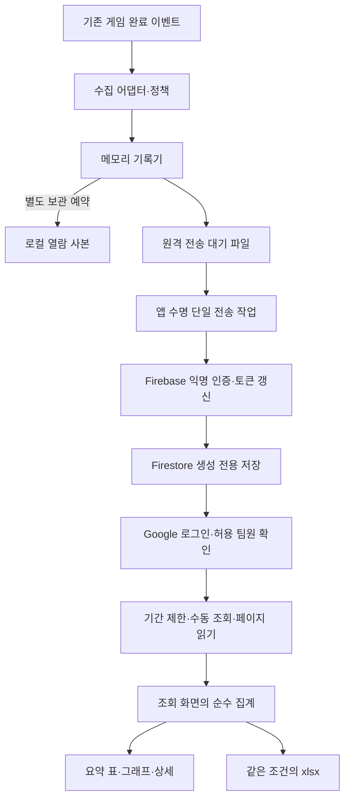
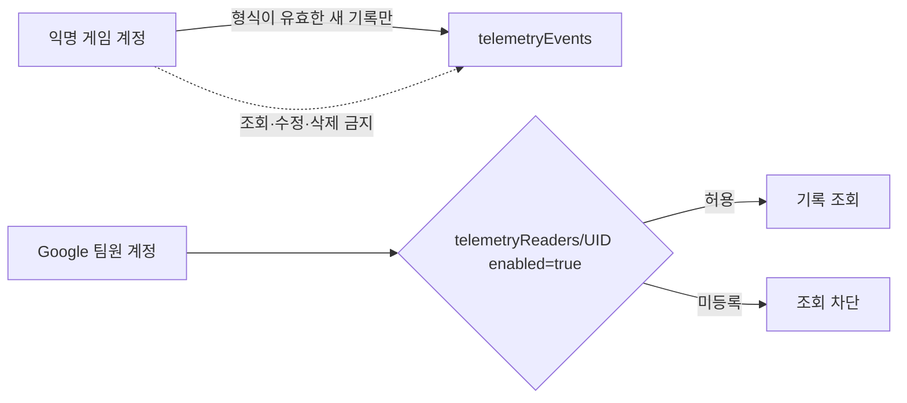

# Firebase 통계 인증·전송·조회 설계

기준일: 2026-11-12. 프로젝트는 `humanghost-f85de`, 요금제는 Spark입니다. 무료 유지·조회 화면 집계 승인을 받아 [조회 사이트](https://humanghost-f85de.web.app)와 운영 규칙을 배포했습니다. 기존 game_logs 계약을 유지했고 관리자와 동일한 검증된 Google 계정 한 개에 조회 권한을 등록했습니다. `firebase.enabled`는 true이며 새 게임 빌드부터 적용됩니다. [기획자 조회 안내](../기획자용%20안내문서/통계%20콘솔%20조회와%20엑셀%20다운로드%20안내.md)를 함께 봅니다.

## 목차

1. [왜 이 구조인가](#1-왜-이-구조인가)
2. [책임과 위치를 정한 이유](#2-책임과-위치를-정한-이유)
3. [인증·재전송·중복 처리](#3-인증재전송중복-처리)
4. [저장 규칙과 팀원 조회 권한](#4-저장-규칙과-팀원-조회-권한)
5. [집계 기준과 부분 조회](#5-집계-기준과-부분-조회)
6. [확장·변경 절차](#6-확장변경-절차)
7. [관리자 배포 순서](#7-관리자-배포-순서)
8. [검증과 한계](#8-검증과-한계)

## 1. 왜 이 구조인가

Windows 빌드에는 Firebase Analytics·Crashlytics의 데스크톱 자동 수집을 적용하지 않습니다. 기존 게임 이벤트에서 수집한 기본값을 Firebase Auth와 Firestore REST로 전송합니다. Cloud Functions 집계는 Spark에서 배포할 수 없어 사용하지 않으며, 무료 범위의 정적 Hosting 화면이 조회한 기록을 집계합니다. 게임 도메인은 인증·전송·통계를 알지 않습니다.



서버 저장은 Firebase가 담당하고 집계는 조회 브라우저가 담당합니다. 서버 사전 집계가 구현됐다고 표현하지 않습니다. Spark 무료 할당량을 넘기면 서비스가 제한될 수 있으며 무제한·무비용 보장은 아닙니다.

## 2. 책임과 위치를 정한 이유

| 코드·설정 | 책임 | 이 위치를 선택한 이유 |
| --- | --- | --- |
| Assets/3.Script/FireBase/FirebaseRestTransport.cs | Auth REST·갱신·Firestore 값 변환·중복 확인 | 외부 서비스 계약을 수집 경계에 격리. 게임 기능에서 Firebase 호출 금지 |
| 같은 폴더의 TelemetryOutbox.cs | 파일 대기열·서버 확인 후 제거·단일 전송 작업 | 로컬 보관 성공과 원격 저장 성공을 구분. 재실행에도 ID 유지 |
| 같은 폴더의 TelemetryHost.cs | 앱 수명의 인증·통신 객체 소유와 취소 | 씬 이동마다 인증·전송 작업을 만들지 않음 |
| Assets/StreamingAssets/Telemetry.json | 공개 프로젝트 설정·수집 정책·필드 형식 | 게임·규칙·웹 설정의 원본을 한곳에서 관리 |
| Tools/TelemetryConsole/scripts/sync.mjs | 공개 웹 설정·Firestore 규칙 생성 | 같은 필드 형식을 코드·규칙에 반복 입력하지 않음 |
| Tools/TelemetryConsole/src/metrics.js | 순수 집계·표 행 변환 | 그래프·표·다운로드 계산을 복제하지 않음 |
| 같은 폴더의 workbook.js | 실제 xlsx 작성 | 다운로드 시에만 라이브러리 로드. 게임·기본 조회에서 제외 |
| 같은 폴더의 main.js | 로그인·페이지 조회·현재 조건·화면 조립 | 통계 계산을 Firebase SDK·화면 수명과 분리 |

Firebase 공개 웹 설정에는 서비스 계정·관리자 비밀키를 넣지 않습니다. API 키는 프로젝트 식별용 공개 설정이며 접근 권한은 규칙에서 강제합니다. 현재 설정의 projectId를 기준으로 사용하며 채팅에 함께 적힌 다른 이름을 별도 프로젝트로 추정하지 않았습니다.

## 3. 인증·재전송·중복 처리

```mermaid
sequenceDiagram
    participant Host as 앱 수명 담당
    participant Box as 파일 대기열
    participant Auth as Firebase 인증
    participant DB as Firestore
    Host->>Box: 같은 이벤트 ID로 원자적 파일 준비
    Box-->>Host: 전송할 기록 있음
    Host->>Auth: 최초 익명 로그인
    Auth-->>Host: ID 토큰·갱신 토큰
    loop 대기 파일의 기록
      Host->>DB: 문서 ID=EventId 생성 요청
      DB-->>Host: 저장 성공 또는 이미 존재
    end
    Host->>Box: 묶음 전체 확인 후 파일 제거
    Note over Host,DB: 실패·취소는 파일 유지, 앱 재실행 후 재시도
```

네트워크에만 비동기를 사용합니다. 이벤트 콜백은 메모리 기록을 쌓고 보관 예약을 요청합니다. 전송 작업은 새 기록 통지로 깨어나며, 실패 중일 때만 2초부터 최대 60초까지 늘려 재시도합니다. 작업은 앱당 하나이며 종료 시 취소합니다. 전송 타임아웃 기본값은 15000ms입니다. 토큰은 메모리에만 보관하고 만료 60초 전 갱신합니다. 401 응답에서는 갱신 후 한 번 재요청합니다. 프로세스 재실행 때 새 익명 인증 UID가 생길 수 있으나 통계의 설치 ID·세션 ID는 별도입니다.

JSON 문자열을 직접 이어 붙이지 않고 구조화한 뒤 Firestore 형식으로 변환합니다. 정수는 integerValue의 십진 문자열, 하위 필드는 mapValue로 보냅니다. 서비스 응답 전체·인증 토큰·키가 포함된 URL은 오류 로그에 출력하지 않습니다. 서버 규칙은 생성만 허용하며 수정·삭제는 금지합니다. 같은 문서 생성의 ALREADY_EXISTS를 재전송 확인으로 처리하고 덮어쓰지 않습니다. 이벤트 ID를 수신 확인 키로 사용하는 방식이므로 데이터는 클라이언트의 관측 자료이며 권위 있는 게임 상태 증명으로 보지 않습니다.

전송 대기 파일은 Telemetry/Pending 아래에 임시 파일 작성 후 이름 이동으로 준비합니다. 로컬 열람 사본 쓰기가 실패해도 이미 준비된 대기열의 전송을 막지 않습니다. ArchiveFailure로 사본 실패를 확인합니다. 대기열 자체 저장 실패는 기록기에서 실패로 처리해 메모리에 유지합니다. 손상 JSON은 삭제하지 않고 Pending/Rejected로 옮겨 다음 기록을 막지 않습니다. 네트워크·권한 실패는 파일을 유지합니다. 영구적인 정책 불일치나 권한 오류는 설정을 수정하기 전까지 재시도하며 운영자가 점검해야 합니다.

기본 Pending 한도는 20MiB이며 로컬 열람 사본 한도와 별도입니다. 업로드 성공을 기다리며 게임 종료를 막지 않고, 남은 파일은 다음 실행에 다시 전송합니다. 앱 종료 이후 Unity 객체를 참조하는 후속 작업은 없습니다. 업로드 실패는 오류 로그를 다시 발생시키지 않아 자기 수집 순환을 막습니다.

## 4. 저장 규칙과 팀원 조회 권한



생성 규칙은 소유 UID·32자리 이벤트/설치/세션 ID·허용 메타데이터·형식 버전·필드·정수 범위·문자열 길이와 과도한 미래 시각을 확인합니다. Google 이메일 인증과 관리자 허용 문서가 모두 있어야 통계를 조회할 수 있습니다. 게임 익명 사용자는 다른 사람의 기록이나 자기 기록을 조회할 수 없습니다. 조회자는 기록을 수정하지 못하며, 클라이언트는 자기 권한 문서를 만들 수 없습니다.

`telemetryReaders/{Firebase UID}`에 `{ enabled: true }`를 등록하는 작업은 Firebase 프로젝트 관리자만 수행합니다. Google 계정의 이메일 문자열이 아니라 Firebase Authentication의 UID를 사용합니다. CLI 프로젝트 권한과 웹 조회자 권한은 별개입니다.

생성된 firestore.rules는 통계용 기본 규칙입니다. 기존 운영 규칙을 확인하지 않고 전체 파일로 덮어쓰지 않습니다. 기본 npm deploy는 Hosting만 대상으로 하며 운영 규칙을 자동 교체하지 않습니다. 공개 API 키·익명 인증만으로 악성 사용자의 할당량 소모를 완전히 차단하는 구조는 아니며, 공개 대규모 배포 전 수집량·보관·인증 정책을 다시 검토해야 합니다.

## 5. 집계 기준과 부분 조회

| 통계 | 계산 기준 |
| --- | --- |
| 사망 | 스테이지별 사망 횟수, 고유 사망 세션. 비율은 조회 범위 내 진입 세션 중 사망 기록이 있는 비율 |
| 재화 | 양수 delta 합계=획득, 음수 delta 절댓값 합계=소비, 전체 delta 합계=순증감. 초기 잔액은 획득으로 더하지 않음 |
| 레벨 | 스테이지 진입 시점의 레벨별 횟수·세션 수 |
| 몬스터 | 보상 완료 기록의 스테이지·몬스터별 횟수 |
| 아이템 | 획득·소비 실제 quantity 합계로 순위. 현재 게임 이벤트 미연결 |
| 갈림길 | 같은 갈림길의 전체 선택 횟수를 분모로 경로별 비율. 현재 실제 선택 이벤트 미연결 |
| 마지막 관측 | 세션마다 마지막 stage_enter 하나. 정상 종료 기록 유무를 구분하며 이탈 원인을 확정하지 않음 |
| 오류 | 종류·문구·스택이 같은 기록을 묶고 횟수·영향 세션 계산 |

같은 EventId는 한 번만 집계합니다. 필터는 한국 시간 날짜 범위와 빌드·데이터·빌드 종류·형식 버전입니다. 기간은 최대 31일, 한 번에 500개, 한 조회 최대 5000개입니다. 실시간 구독 없이 버튼으로 읽습니다. Firebase 날짜 조건으로 읽은 뒤 나머지 필터는 브라우저에서 적용하므로 빌드 필터를 좁혀도 해당 날짜의 읽기 수가 줄어드는 것은 아닙니다.

조회 전용 화면에는 Firestore Lite를 사용합니다. 실시간 구독·오프라인 캐시가 필요하지 않아 일반 SDK의 해당 기능을 포함하지 않는 쪽이 적합합니다. 기본 조회 JS는 빌드 결과 약 552.09KB에서 198.18KB로 줄었고 gzip 기준 약 167.00KB에서 61.59KB로 줄었습니다. Google 인증과 읽기·페이지 조회는 유지합니다. [공식 Lite 지원 범위](https://firebase.google.com/docs/firestore/solutions/firestore-lite)를 기준으로 선택했습니다.

추가 페이지가 남거나 기간 조건이 실제 읽은 범위를 벗어나면 부분 집계로 표시합니다. 한도에 걸리면 기간을 줄여 다시 조회합니다. 원격 조회는 서버 데이터를 직접 읽고, 이전 사용자 조회 결과가 로그인·로그아웃 뒤 덮어쓰지 않도록 수명 번호를 확인합니다. 게임에서 수집하지 못한 기록이나 구간 진입 기록이 없으면 비율을 확정하지 않습니다.

xlsx는 화면과 같은 순수 집계를 사용하며 조회 조건·집계·상세 세 시트를 만듭니다. 전체/부분 상태와 기간·버전을 함께 내보냅니다. 문자열과 객체를 수식으로 쓰지 않으며 숫자와 한글은 원래 값으로 보존합니다. 화면 상세는 처음 100개만 표시하지만 다운로드는 현재 집계에 포함된 전체 상세를 담습니다. 다운로드 시점에만 ExcelJS를 로드합니다.

다운로드 시작 시 조건·자료·파일명을 고정합니다. 라이브러리 로드와 파일 생성 이후 각각 로그인/조회 수명과 현재 조건을 다시 확인해 로그아웃·자료 교체·조건 변경 뒤 이전 작업이 파일을 내보내지 않게 합니다. 생성 중 중복 클릭도 차단합니다.

## 6. 확장·변경 절차

수집 정책·필드 형식의 원본은 Telemetry.json입니다. 새 필드는 fieldDefinitions에 형식과 표시 이름을 추가하고 기존 이벤트 fields에서 허용합니다. 새 이벤트는 수집 어댑터가 실제 완료 이벤트에 연결해야 합니다. 집계 항목은 metrics.js의 선언을 추가하며 복잡한 신규 지표만 별도 계산을 구현합니다. 기록 필드 추가와 통계 지표 추가는 같은 작업이 아닙니다.

`npm run prepare-config` 또는 build가 공개 웹 설정과 규칙을 생성합니다. 필드 의미·단위가 바뀌면 version을 올립니다. 이전 전송 대기 파일을 계속 받을 필요가 있으면 legacyEvents에 이전 형식을 남깁니다. 예: `"legacyEvents": { "death_v1": { "eventName": "player_death", "category": "statistics", "version": 1, "fields": ["stage_id", "level"] } }`. 기존 fieldDefinitions도 필요한 기간 유지합니다. 수집에서 지운 필드를 과거 양식에서 즉시 제거하면 대기 파일이 거부될 수 있습니다.

## 7. 관리자 배포 순서

1. Tools/TelemetryConsole에서 npm ci, npm test, npm run build를 실행합니다.
2. `npm run firebase -- login`으로 프로젝트 권한이 있는 계정에 로그인합니다. 브라우저 웹 콘솔 로그인과 별개입니다.
3. Firebase Authentication에서 익명·Google 제공자를 확인하고 Firestore 데이터베이스를 준비합니다. Spark를 유지합니다.
4. 기존 운영 규칙을 백업·대조하고 통계용 규칙을 병합합니다. 새 테스트 프로젝트라면 생성 규칙을 기준으로 확인합니다.
5. 규칙 검증 후 콘솔 또는 명시적인 `npm run firebase -- deploy --only firestore:rules --project humanghost-f85de`로 게시합니다. 기존 컬렉션 접근을 훼손하지 않아야 합니다.
6. `npm run deploy`는 빌드 후 Hosting만 게시합니다. 대상 사이트에 기존 웹사이트가 있다면 덮어쓰기 전에 별도 사이트·대상을 설정합니다.
7. 접속한 팀원의 Firebase UID로 telemetryReaders 허용 문서를 등록합니다. 허용하지 않은 계정의 조회 거부도 확인합니다.
8. 규칙 게시·권한 확인 뒤 Telemetry.json의 firebase.enabled를 true로 바꾸고 새 게임 빌드를 만듭니다. 수집 enabled와 별개입니다.
9. 소량 플레이 → Pending 감소 → Firestore 문서 → 웹 집계 → 같은 조건 xlsx를 확인합니다. 실패하면 설정·규칙을 확인하고 기존 기록을 임의로 지우지 않습니다.

초기에는 사용자 요청으로 배포를 보류했으며, 이후 명시적인 배포 요청을 받아 2026-11-12에 완료했습니다. CLI 프로젝트 확인, 기존 Hosting 배포 없음 확인, 운영 규칙 사본 보관 후 game_logs 블록 보존 병합, 규칙·Hosting 게시를 순서대로 수행했습니다. Google 제공자는 사용자가 활성화했고, CLI 관리자 이메일과 동일하며 Google 제공자·인증된 이메일이 확인된 Firebase UID에만 telemetryReaders의 enabled를 true로 등록했습니다. 임의 계정이나 기록 수정·삭제 권한은 부여하지 않았습니다.

## 8. 검증과 한계

게임 코어·전송 검사는 익명 인증·401 갱신·중복 응답, 정수 변환, 재실행 대기열, 종료 취소 시 보존, 손상 격리, 로컬 사본 실패를 확인합니다. Node 검사는 사망 분모·재화 수급·경로 선택률·마지막 관측·오류 그룹·xlsx 실제 왕복을 확인합니다. 별도 Firestore 에뮬레이터로 생성·조회 권한·잘못된 필드·REST 재시도를 검사합니다.

Hosting의 HTTP 200과 최신 HTML·스크립트 경로, 실서버 익명 인증·생성 200·같은 ID 재전송 409·익명 읽기 거부 403을 확인했습니다. 검증 기록은 deployment-check-20261112 빌드 버전의 session_start 한 개이며 실제 플레이 통계와 구분합니다. 사용자의 Google 로그인 성공 후 관리자 조회 문서가 true로 저장된 것을 확인했습니다. Unity 실제 플레이→전송→브라우저 집계·다운로드의 전체 왕복은 아직 별도 확인 대상입니다. 무료 할당량은 [Firestore 공식 안내](https://firebase.google.com/docs/firestore/quotas), REST 인증은 [공식 API](https://firebase.google.com/docs/reference/rest/auth), 접근 규칙은 [공식 필드 검사](https://firebase.google.com/docs/firestore/security/rules-fields)를 참고합니다.

이전 배포 준비 검사에서 게임 데이터 5,529개·코어/전송 1,330개·엔진 참조 컴파일과 집계·xlsx Node 8개가 통과했습니다. 규칙 검사는 기존 game_logs 보존을 포함해 5개이며 당시 실행 기록입니다. 이번 7d13442 문서 점검에서는 데이터 5,720개·코어 1,361개·컴파일·Node 8개를 다시 확인했고 규칙 에뮬레이터는 재실행하지 않았습니다. 에뮬레이터에서는 익명 쓰기와 Google 허용자 조회를 분리하고 잘못된 필드·UID 위조·실수 레벨·미래 시각·REST 중복 생성을 확인했습니다. 실행 의존성 보안 점검에서 알려진 취약점은 0개였습니다. 기본 조회 묶음은 Lite로 줄였고 다운로드 시에만 읽는 약 937.31KB 엑셀 묶음의 크기 경고는 남습니다.

프로젝트 자동 검사에는 별도 통계 작업을 추가했습니다. Node 24·Java 17에서 npm ci → 집계/xlsx 검사 → 정책·웹 빌드 → demo-humanghost 에뮬레이터 규칙 검사를 순서대로 실행합니다. 실제 Firebase 비밀값이나 운영 로그인을 사용하지 않습니다. 로컬도 조회 도구 폴더에서 `npm run firebase -- emulators:exec --only firestore --project demo-humanghost "node --test tests/rules.emulator.mjs"`로 실행할 수 있습니다. Java가 PATH에 없으면 Unity Android 모듈의 OpenJDK 등 검증된 Java 17을 JAVA_HOME에 지정합니다. CLI는 검증한 14.27.0으로 고정했습니다. 이후 CLI를 올릴 때 요구 Java 버전도 함께 확인합니다.
