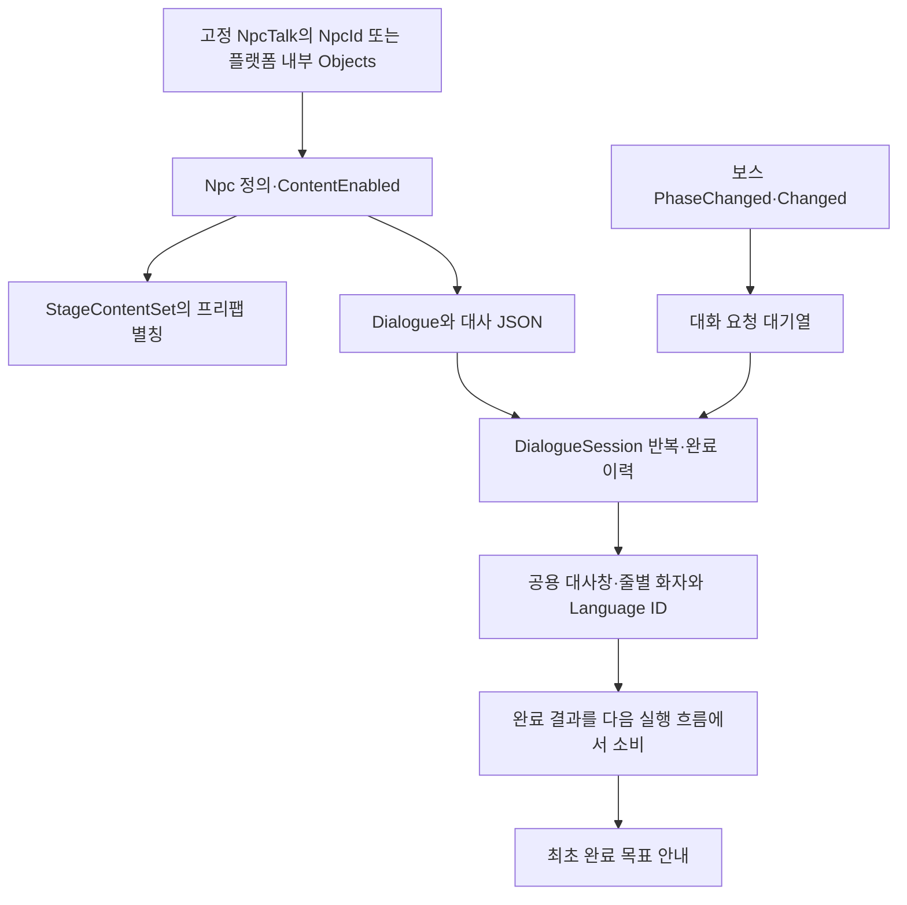
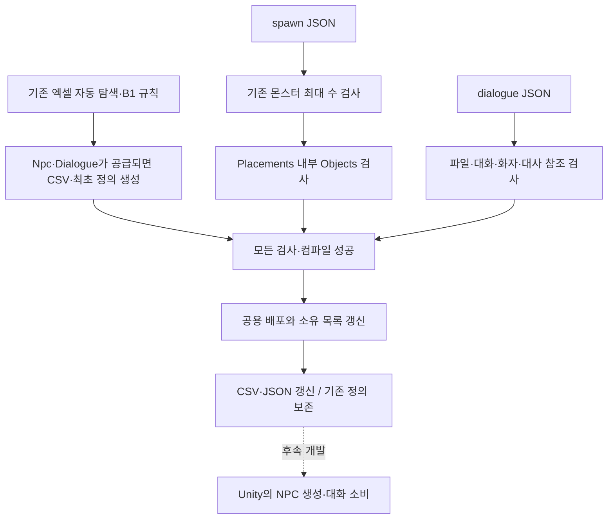

# NPC 데이터 배포 준비 설계

기준일: 2026-11-13. 배포 기반에 이어 고정 NPC·플랫폼 Objects 생성, Npc·Dialogue·대사 JSON 소비와 보스 대화 사건을 연결했습니다. 이번 구현은 아래 새 절을 우선하며 나머지 배포 준비 기록은 당시 경계입니다. 실제 Play·실행파일 수용은 별도입니다. [기획자 안내](../기획자용%20안내문서/NPC%20데이터%20작성과%20배포%20준비%20안내.md)를 함께 봅니다.

## 목차

- [NPC 실행 연결과 대화 수명](#npc-실행-연결과-대화-수명--2026-11-13)

1. [왜 먼저 배포 경계를 준비했는가](#1-왜-먼저-배포-경계를-준비했는가)
2. [기존과 달라진 점](#2-기존과-달라진-점)
3. [코드 위치와 재사용 이유](#3-코드-위치와-재사용-이유)
4. [입력 계약](#4-입력-계약)
5. [아직 구현하지 않은 경계](#5-아직-구현하지-않은-경계)
6. [검증과 실행파일](#6-검증과-실행파일)
7. [다음 작업](#7-다음-작업)

## NPC 실행 연결과 대화 수명 — 2026-11-13

### 왜 기존 기능에 연결했는가

시트가 배포돼도 기존 NpcTalk는 Inspector 임시 문자열만 사용했고 줄별 화자·반복·정지 규칙을 소비하지 못했습니다. 기존 상호작용·TextboxPlayback·TextboxScreen과 LanguageTextSource를 확장하고 NPC 전용 입력·팝업·재생기를 복제하지 않았습니다. 기존 임시 Configure 호출과 단일 화자 화면 계약도 유지했습니다.

| 위치 | 책임·배치 이유 |
| --- | --- |
| Core/Interaction/DialogueSession | ALL·LAST_LINE·ONCE와 정상 완료·중단 구분. 원본을 복사해 실행하며 영구 저장에 새 항목을 만들지 않음 |
| Adapters/DialogueRunner | 초기화된 GameDataAssets의 JSON을 한 번 읽고 세션·화면·정지 연결. 런타임 Assets 파일 탐색·새 비동기 없음 |
| Adapters/Interaction/NpcTalk | 기존 등록 계약을 상속. NpcID·이름·말 걸기와 소유자 해제 시 대화 취소 |
| Presentation/TextboxScreen·Core/Interaction/TextboxPlayback | 기존 진행에 줄별 화자 ID와 정지 대화의 비배율 시간 표시만 추가 |
| Preview/GameplayPreview.Dialogues | 사건 구독·대기열·명시적인 조립·실패 보고. NPC나 화면은 보스·엔딩을 직접 호출하지 않음 |
| Preview/PreviewStage·StageContentSet | 비활성 맵 안에서 고정 표시·플랫폼 내부 앵커 생성. 실제 프리팹 매핑은 기존 목록에 추가 |

도화골 K9 맵의 기존 NPC_Refugee 표식에 NpcTalk·NpcID 25001을 연결하고 정의의 NPC_Refugee 별칭을 기존 NPC1 프리팹에 연결했습니다. 원본 NPC1 프리팹·애니메이션은 변경하지 않았습니다. 플랫폼 Objects는 부모 플랫폼 내부 Anchor만 사용합니다. ContentEnabled가 꺼진 NPC는 표시·상호작용을 사용하지 않습니다. 이름 표시는 기존 월드 TextMesh 표시를 복사해 사용하며 전용 명찰 아트를 새로 만들지 않았습니다. 모델 원본·애니메이션 제작과 이번 데이터 연결의 기여는 구분합니다.

상호작용 탐색 범위는 스테이지 MapRoot로 제한해 고정 NPC와 플랫폼 자식 NPC, 기존 Interactables가 같은 등록·해제 계약을 사용합니다. 전체 장면 검색이나 매 프레임 NPC 검색은 추가하지 않았습니다. SHOP은 이름·콘텐츠 준비만 가능하며 상점 실행은 후속입니다.

보스 상태 진입은 BossState ID, 처치는 UnitStat ID로 Dialogue 행을 선택합니다. 이벤트 콜백은 요청만 대기열에 넣고 게임 명령을 재호출하지 않습니다. 해체 중에는 대화를 시작하지 않습니다. 처치 대화가 끝나기 전 엔딩을 시작하지 않으며 패링·보스 패턴 내부는 변경하지 않았습니다. 기존 공개 사건만 구독합니다.

PauseGame은 GameSpeedState의 소유자별 정지 요청으로 적용합니다. 다른 정지 요청은 해제하지 않습니다. 이 대화의 글자 표시는 비배율 시간으로 진행하고 오류·메뉴가 겹치면 표시도 멈춥니다. Enter 한 번은 현재 줄을 완성하고 다음 줄로 이동합니다. 완료·취소 결과는 다음 실행 흐름에서 처리하고 목표 문구는 최초 정상 완료 때만 보여 줍니다.

NpcTalk의 완료 알림 구독은 활성 수명에만 유지합니다. 비활성·장면 종료는 해당 소유자 대화·대기열·구독·정지 요청을 정리합니다. 표시 실패는 기존 오류 보고로 전달하며 실패한 대화를 정상 완료나 엔딩 통과로 숨기지 않습니다.

현재 맵 조립은 한국어를 공급하며 DialogueRunner는 명시적인 언어 인자를 받습니다. 옵션 언어 선택·전체 UI 변경 통지는 이번 NPC 작업의 구현 범위가 아닙니다. UI_Lang 배포도 하지 않았습니다. 원래의 임시 문자열 경로는 다른 호출부 호환용으로 남겼고 새 데이터 NPC에서는 사용하지 않습니다.

## 1. 왜 먼저 배포 경계를 준비했는가

다음은 실행 연결 이전의 배포 준비 기록입니다. 현재 소비 구현은 위 절을 우선합니다.

기획자가 새 엑셀 파일과 JSON을 올린 뒤에도 같은 실행파일로 검사·배포할 수 있어야 합니다. 기존 신규 파일·탭 자동 탐색과 B1 인라인 규칙을 유지하고, JSON 자동 탐색·검사 클래스 연결·공통 경로와 배포로 통합했습니다. 실제 예시 시트나 배포 데이터를 미리 넣어 확정 데이터처럼 취급하지 않습니다.

## 2. 기존과 달라진 점

| 책임 | 이전 | 준비 후 |
| --- | --- | --- |
| 신규 Npc·Dialogue 탭 | 기존 자동 탐색·생성 기능 사용 가능 | 그대로 재사용. 실제 파일은 아직 없음 |
| 스폰 오브젝트 | 몬스터 수 검사만 수행해 Objects가 검증되지 않음 | 중첩 Objects·양수 ID·스테이지 내 ObjectID 중복·Npc 참조·영문 앵커·지원 Type 검사 |
| 구형 배치 | 최상위 Objects 등이 별도 확인되지 않음 | 최상위 Objects와 ParentPlacementID를 전환 안내와 함께 거부 |
| 대사 JSON | 독립 dialogue 폴더가 배포 대상 아님 | 검사 후 Assets/Data/Json/dialogue로 배포 가능 |
| 변경·삭제·실패 | 기존 소유 목록·원복 정책 | 대사도 같은 정책 사용. 기존 정의 C# 덮어쓰기 금지 유지 |
| 원본 미공급 | 기존 배포 가능 | Npc·Dialogue·dialogue 폴더가 없어도 기존 배포 유지 |

## 3. 코드 위치와 재사용 이유

| 위치 | 역할과 선택 이유 |
| --- | --- |
| DataSheet/Tools/DataExporter/Validation/DialogueJsonRule.cs | 대사 파일의 의미 검사와 수집 연결. 기존 JsonAssetCollector가 UTF-8·문법·스냅샷을 처리하므로 파일 입출력 중복 없음 |
| 같은 프로젝트 Validation/SpawnObjectValidator.cs | 플랫폼 내부 Objects의 데이터 의미만 검사. Unity 객체와 프리팹 생성 책임 없음 |
| Validation/SpawnJsonRule.cs | 기존 최대 수 검사 다음 오브젝트 검사 호출. 실제 몬스터 배치 값 보존 |
| Infrastructure/OutputCatalog.cs | 공통 상대 경로·소유권 판단. 새 기능의 경로 조건을 별도로 추가하지 않음 |
| Infrastructure/JsonAssetFields.cs | 기존 정수·문자열·배열·참조 검사 재사용. 배열의 부모가 객체인지 공통 경계에서 확인 |
| Program.cs | JsonAssetPipeline과 UnityCodeOutput을 한 번씩 호출한 뒤 공용 배포로 전달 |
| Tools/DataExporter.Checks/NpcDeploymentChecks.cs | 실제 원본을 바꾸지 않는 임시 정의·JSON으로 계약 검사 |

기존 DeploymentService의 신규 생성·수정·소유 파일 삭제·실패 원복과 `.meta` 보존을 그대로 사용합니다. 별도 NPC 배포기·별도 JSON 로더·전역 이벤트 버스는 추가하지 않았습니다.

## 4. 입력 계약

### 플랫폼 내부 Objects

최상위 Objects는 허용하지 않습니다. 각 Placements 항목 안의 Objects만 사용하며 없거나 빈 배열이면 NPC를 생성할 데이터가 없는 것으로 처리합니다. 내용이 있으면 부모 PlacementID가 양수여야 합니다. 전달된 스폰 파일 안에서 플랫폼 ID와 NPC ObjectID의 중복을 확인합니다.

각 오브젝트는 ObjectID·Type·NpcID·Anchor를 사용합니다. Type은 현재 `NPC`이며 `SHOP`은 이 배치 Type으로 지원하지 않습니다. 향후 Npc 표의 기능 종류인 NPC/SHOP과 배치 처리 종류를 혼동하지 않습니다. NpcID는 공급된 Npc 표의 ID여야 합니다. 표가 없는데 오브젝트만 들어오면 배포 전에 실패합니다.

Anchor는 영문·숫자·밑줄 식별자이며 첫 글자는 영문 또는 밑줄입니다. 실제 앵커 존재·이름 유일성·비활성 조립·수명은 Unity 후속 작업입니다. 같은 NPC 종류나 앵커 이름을 다른 플랫폼에서 재사용할 수 있습니다. 오브젝트 행에 ParentPlacementID가 남아 있으면 거부합니다.

### 대화와 대사 파일

- Dialogue.ID는 양수이며 LineFile은 `{ID}.json`과 정확히 같고 중복되지 않아야 합니다.
- TALK의 TriggerTargetID는 0, BOSS_STATE_ENTER는 BossState ID, BOSS_DEFEATED는 UnitStat ID를 참조합니다.
- `dialogue/{ID}.json`의 DialogueID·파일명·Dialogue.LineFile이 일치해야 합니다.
- Lines는 한 줄 이상이며 각 SpeakerTextID·TextID는 양의 정수이고 Language에 있어야 합니다.
- 대사 파일만 있고 Dialogue 행이 없거나, Dialogue 행만 있고 파일이 없으면 실패합니다. 아직 Dialogue 행이 없고 파일도 없으면 정상입니다.
- `_note`는 메모로 허용하고 원문을 배포합니다. 문구를 코드에 하드코딩하거나 원본을 재작성하지 않습니다.

기존 JsonAssetCollector를 통해 UTF-8/BOM·JSON 문법·경로를 확인하고, JSON 파일명 충돌은 기존 전역 이름 검사에 포함합니다. 서로 다른 폴더라도 같은 파일 이름의 로딩 키가 겹치면 배포하지 않습니다.

## 5. 아직 구현하지 않은 경계

Npc·Dialogue의 형식·범위·일반 참조 규칙은 공급된 시트의 B1 규칙을 사용했습니다. 현재 Npc 1행·Dialogue 4행을 CSV로 배포하고 자동 로딩 계획에 반영했습니다. 임의 예시 행을 추가하지 않았습니다. 기존 클래스가 있으면 보존하며 스키마 차이는 개발자가 확인합니다.

대사 파일을 복사하는 것과 클라이언트에서 대화 정의로 등록·실행하는 것은 다릅니다. 이번에는 대사 전용 런타임 리더나 자동 로딩 계획의 대사 정의 등록을 추가하지 않았습니다. Unity의 기존 텍스트 파일 수집 여부와 실제 소비 연결은 시트 공급 후 확인해야 합니다.

스폰 FormatVersion 정책도 바꾸지 않았습니다. 배포 도구가 중첩 Objects를 검사할 수 있어도 기존 클라이언트가 NPC를 생성한다는 뜻이 아닙니다. 실제 배포 전 클라이언트의 구조 지원과 버전 전환을 함께 맞춰야 합니다.

공용 수집은 동기 검사·파일 배포이므로 비동기나 게임 이벤트를 추가할 이유가 없습니다. ID·정의·배포 경로는 직렬화 가능한 값이며 게임 권한·네트워크 구현은 포함하지 않습니다.

## 6. 검증과 실행파일

최근 전체 도구 검사 193개에 NPC·대사와 공통 배포 경계가 포함됩니다. 누락·불일치 파일, Language·NPC·보스 참조, 구형 배치·중복 배치 거부, 신규·수정·삭제와 실패 원복을 검사합니다. 실제 플레이 검증 결과는 아닙니다.

현재 전체 공급은 34개 탭·별도 JSON 15개이며 대사 4개를 포함합니다. 일반 정의는 보존하고 생성 enum은 매번 갱신합니다. Cutscene.cs의 SkipHoldMs 제거 등 기존 정의 스키마 변경은 개발자가 함께 맞춘 작업입니다. 도구 소스 변경 시 실행파일도 함께 빌드해 공유해야 하며 최신 검증과 작업자 이력은 [현황](현재%20구현과%20검증%20현황.md)을 봅니다.

## 7. 다음 작업

기획자 공급 원본 검사와 배포는 완료했습니다. 다음에는 기존 공용 NPC·대화 모듈에 정의를 연결하고 직접 배치와 플랫폼 생성 경로가 같은 기능을 사용하도록 조립합니다. 원안의 대화·보스 시점·저장 미결 사항은 이번 배포 기반 작업으로 확정하지 않습니다.
