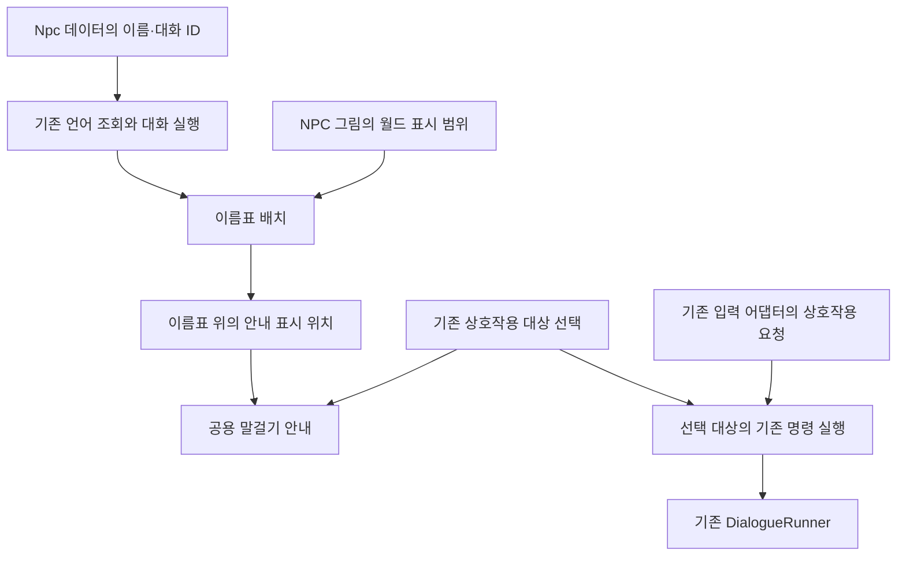
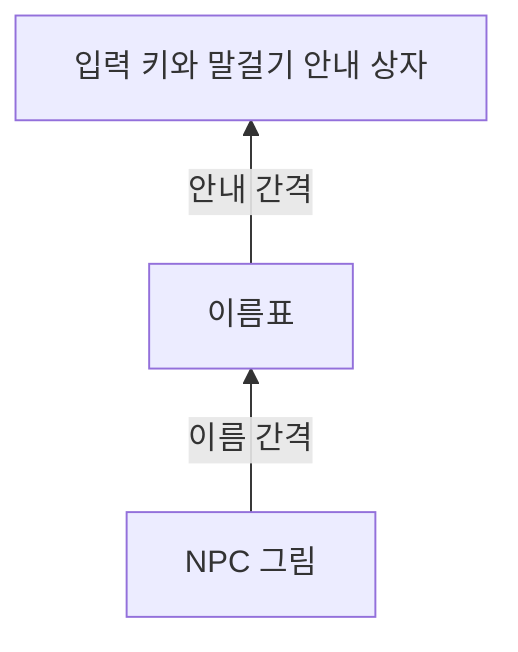
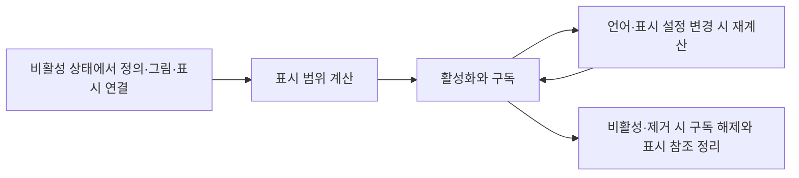
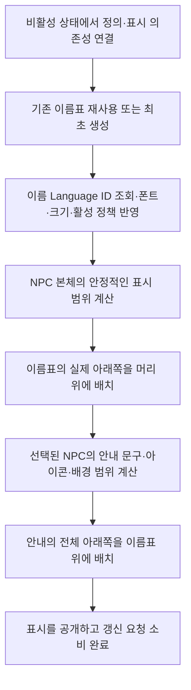
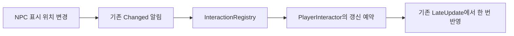
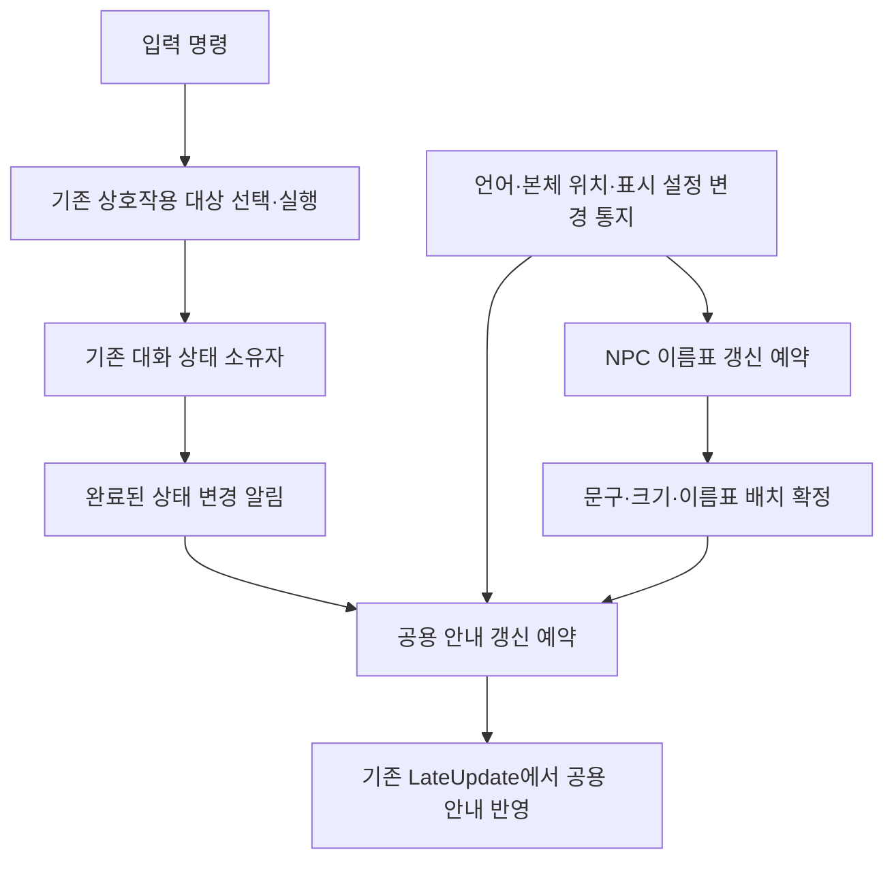
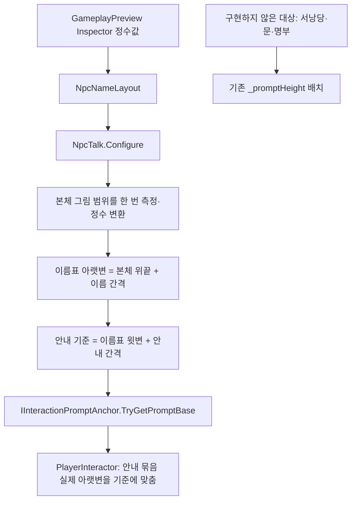

# NPC 이름표와 말걸기 안내 배치 설계

기준일: 2026-11-17. **구현 완료(컴파일 확인), 실제 Play 미확인.** 데이터·프리팹은 변경하지 않았습니다. 구현 결과는 [8장](#8-구현-결과-2026-11-17)을 봅니다.

문서 위치 확인: 현재 파일은 Git 추적 대상이며 `98afeba2` 이력과 [문서 목차](../문서%20안내.md)에 남아 있습니다. NPC의 데이터·대화 실행은 [기존 NPC 설계](NPC%20데이터%20배포%20준비%20설계.md), 작성·배포 절차는 [기획자 안내](../기획자용%20안내문서/NPC%20데이터%20작성과%20배포%20준비%20안내.md)를 재사용합니다. 이 문서는 이름표와 말걸기 표시 개선만 담당합니다.

## 목차

1. [목표와 현재 상태](#1-목표와-현재-상태)
2. [표시 구조와 책임](#2-표시-구조와-책임)
3. [데이터와 배치 계약](#3-데이터와-배치-계약)
4. [갱신과 객체 수명](#4-갱신과-객체-수명)
5. [검증과 담당](#5-검증과-담당)
6. [설계 점검 결과와 보완 계약](#6-설계-점검-결과와-보완-계약)
7. [프로젝트 설계원칙 적용과 설정 공급](#7-프로젝트-설계원칙-적용과-설정-공급)
8. [구현 결과 (2026-11-17)](#8-구현-결과-2026-11-17)

## 1. 목표와 현재 상태

NPC 이름이 머리와 멀어지거나 말걸기 안내가 몸을 가리는 문제를 해결하는 설계입니다. 대화 실행·상호작용 거리·저장 규칙은 유지하고 표시 위치만 독립적으로 계산합니다.

원본 요청: [NPC 이름표·말걸기 요청](../../../DataSheet/Docs/개발요청_NPC이름표_말걸기_1116.md).

현재 `NpcTalk.Configure`에는 글자 크기·폰트 지정이 추가되어 있고, `PlayerInteractor`에는 NPC일 때 안내 높이를 더하는 분기가 있습니다. Git `8a967f99`의 작성자는 `LEEGEONHO`이며 커밋 설명에 피난민 이름 위치·크기와 말걸기 위치 수정이 포함되어 있습니다. 이 문서는 해당 작업을 미구현으로 취급하거나 되돌리지 않습니다. 파일 확인은 실제 화면 수용 확인과 구분합니다.

| 구분 | 현재 코드 | 제안 구조와 이유 |
| --- | --- | --- |
| 이름 위치 | NPC 자식의 로컬 높이 2.5 | 그림의 월드 위쪽 경계를 기준으로 계산하여 부모 배율의 영향 감소 |
| 이름 크기 | 코드에서 글자 크기·폰트 지정 | 기존 조정 결과를 기준으로 재사용할 표시 설정에 모아 관리 |
| 말걸기 위치 | 공통 높이에 NPC 보정 0.6 추가 | 이름표와 안내 상자의 실제 표시 범위를 사용하여 겹침 방지 |
| 다른 상호작용 | 같은 공통 안내 사용 | 서낭당·문·명부의 기존 배치는 유지 |

## 2. 표시 구조와 책임



화면의 아래에서 위 순서는 다음과 같습니다. 이름을 숨기는 대안은 이번 기본 설계에 포함하지 않습니다.



`NpcTalk`는 기존 NPC 정의·대화 연결을 담당합니다. 배치 계산은 표시 책임이며 대화 실행 규칙에 포함하지 않습니다. `PlayerInteractor`는 기존 대상 선택과 공용 안내를 재사용합니다. 새 대화 실행기나 NPC 전용 입력 처리기를 만들지 않습니다.

## 3. 데이터와 배치 계약

- 이름은 기존 `Npc.NameTextID`와 Language 조회를 사용합니다. 말걸기 문구도 기존 언어 연결을 사용합니다.
- 상호작용 거리의 기준인 `IInteractable.Position`은 변경하지 않습니다. 안내를 올리려고 대상의 실제 위치를 바꾸면 상호작용 범위까지 달라집니다.
- NPC가 표시용 위치를 제공하고 공용 안내가 선택적으로 사용하는 계약을 제안합니다. 제공하지 않는 대상은 현재 배치로 돌아갑니다. 구체적인 인터페이스 추가는 구현 전에 공통 사용처의 영향을 확인합니다.
- 그림 범위에는 NPC 본체만 포함합니다. 이름표·이펙트·안내 상자를 다시 범위 계산에 넣으면 표시할수록 높이가 커질 수 있습니다.
- 이름표의 위쪽과 안내 상자의 아래쪽을 기준으로 간격을 확보합니다. 프리팹 자체의 위치 보정이 두 번 더해지지 않도록 최종 위치 계산 책임을 한곳에 둡니다.
- 월드 위치 보정과 글자 크기 보정은 별개입니다. 부모 크기가 달라도 표시 크기가 의도대로 유지되는지 함께 확인합니다.

원본의 머리 위 0.3타일·기존 대비 2배 크기는 **제안값**이며 확정 공급값이나 새 코드 상수가 아닙니다. 표시 간격·크기는 기존 표시 설정의 재사용 가능성을 먼저 확인하고, 신규 테이블이나 임의의 열을 이 문서에서 추가하지 않습니다. 데이터화할 경우 간격은 기존 `tile_x100` 정수 계약을 따릅니다.

TextMesh를 유지한다면 그에 맞는 재질·그림자 표현을 검토합니다. UGUI용 외곽선 컴포넌트를 그대로 붙일 수 있다고 가정하지 않습니다. 이 문제만을 이유로 전체 글자 시스템을 교체하지 않습니다.

## 4. 갱신과 객체 수명



정지 NPC는 초기 연결·언어 변경·그림이나 크기 변경 통지 때 갱신합니다. 매 프레임 장면 전체를 탐색하지 않습니다. 이동 NPC를 도입하면 이동 담당의 변경 통지와 연결하고, 애니메이션 프레임마다 머리 높이가 흔들리지 않도록 안정적인 본체 기준 범위를 정합니다.

기존 `SubscriptionScope`를 재사용하고 발행자인 언어·대화 담당과 소비자인 NPC·안내의 수명을 모두 확인합니다. 선택 대상 제거 시 공용 안내를 숨깁니다. 표시 오류는 표시 경계에서 기존 오류 보고를 이용하며 상호작용 등록·해제 정리를 막지 않습니다.

## 5. 검증과 담당

| 검증 대상 | 완료 조건 |
| --- | --- |
| 이름과 안내 | NPC 몸을 가리지 않고 서로 겹치지 않음 |
| 다양한 크기·언어 | 부모 배율·긴 영문 이름에서도 의도한 간격과 크기 유지 |
| 공통 사용처 | 서낭당·문·명부의 거리와 안내 배치 유지 |
| 수명 | 비활성·재활성·대상 제거·언어 변경 후 중복 구독과 빈 참조 없음 |
| 기존 수정 | 최신 폰트·크기 조정과 충돌하거나 보정이 중복되지 않음 |

기획 요청은 김현호, 이번 설계 검토와 향후 작업 담당은 사용자입니다. 기존 코드 기여는 위 Git 근거로 구분합니다. 아트 담당자는 Git 외부에서 원본 제작·공급에 함께 참여했으며 표시 연결 개발과 별도 기여입니다. 보스 판정·패턴은 다른 개발자 담당으로 이번 범위에서 제외합니다.

구현과 실제 Play 검증은 아직 진행하지 않았습니다. 구현 후 확정된 설정 절차는 기획자용 안내에 기록하고 이 설계 문서로 연결합니다.

## 6. 설계 점검 결과와 보완 계약

### 6.1 점검 결론과 범위

2026-11-17 현재 `NpcTalk`·`PlayerInteractor`·`InteractableBehaviour`·`InteractionRegistry`·`SubscriptionScope`와 `GameplayPreview.ConnectDialogues`의 연결을 확인했습니다. **기존 대화·등록·입력은 재사용하고 표시 배치만 개선하는 방향은 적합합니다.** 다만 아래 항목을 보완해야 다른 NPC·언어·재연결에서도 같은 결과를 낼 수 있습니다. 이번 점검은 파일과 설계 대조이며 실행 검증은 아닙니다.

| 항목 | 확인한 원인 또는 설계의 빈 부분 | 보완 방향 |
| --- | --- | --- |
| 배율에 따른 높이·크기 변화 | 로컬 높이 2.5와 부모 배율이 함께 적용됨. 월드 위치만 고쳐도 글자 배율은 남음 | 위치와 표시 크기를 각각 월드 기준으로 계산하고 부모 배율 중복 적용 방지 |
| 안내 상자의 전체 크기 | `ShowPrompt`에서 문구·아이콘 배치 후 배경 크기를 계산함 | 글자·아이콘·테두리를 포함한 범위가 확정된 뒤 최종 세로 배치 |
| 위치 보정 중복 | NPC 보정 0.6과 프리팹의 로컬 Y가 함께 더해짐 | NPC 자동 배치 경로에서는 최종 위치를 한곳에서 계산. 다른 대상의 기존 경로는 유지 |
| 동일 객체 재연결 | `NpcTalk.Configure`는 이름표 생성 분기 안에서만 최초 문구·활성·폰트를 설정함 | 생성과 갱신을 분리. 기존 이름표라도 새 정의·언어·활성 상태·폰트·배치를 즉시 반영 |
| 글자 폭과 렌더 범위 준비 | 새 문구·폰트를 설정한 직후 범위가 최종 결과인지 확인 절차가 없음 | 기존 갱신 주기 안에서 유효한 글자 범위를 확인한 뒤 배치. 무기한 대기나 매 프레임 재시도 금지 |
| 표시 변경의 통지 경로 | 언어·대화 상태는 통지되지만 임의의 Transform·그림 변경은 자동 통지되지 않음 | 해당 변경의 소유자가 배치 갱신을 명시적으로 요청. 선언만으로 자동 갱신된다고 가정하지 않음 |
| 설정의 공급 위치 | 기존 문서는 표시 설정 재사용만 제안하고 공급 위치는 미정 | 기존 설정·데이터 공급을 먼저 조사. 신규 시트·공통 계약은 구현 전에 확정 |

동일 객체의 재연결 문제는 현재 생성 분기에서 확인한 구조적 위험입니다. 모든 NPC에서 현재 잘못 표시된다는 뜻은 아니며, 정의 변경·콘텐츠 비활성·폰트 교체를 같은 객체에 재적용할 때 확인해야 합니다.

### 6.2 배치 계산 순서



위 도식의 활성 정책 반영은 최종 표시 여부를 결정하는 단계이며, 준비 전에 사용자에게 이름표를 노출하라는 뜻이 아닙니다. TextMesh 측정을 위해 활성 상태가 필요한지는 구현 시 확인하고, 필요하면 표시를 가린 준비 단계에서 측정합니다. 빈 문구·유효하지 않은 표시 범위는 준비 완료로 처리하지 않습니다.

배치의 개념식은 다음과 같습니다. 실제 코드나 확정 공급값이 아닙니다.

```text
이름표 아래쪽 = NPC 본체 위쪽 + 이름 간격
안내 전체 아래쪽 = 이름표 위쪽 + 안내 간격
```

TextMesh의 중심점이 항상 아래쪽이라는 가정은 하지 않습니다. 정렬·피벗에 따라 실제 범위와 Transform 위치 사이의 차이를 반영합니다. 가로 위치도 글자 중심만이 아니라 키 아이콘을 포함한 묶음 전체가 NPC 중심에 맞는지 확인합니다.

### 6.3 공용 계약과 갱신 순서



현재 `PlayerInteractor.LateUpdate`는 매번 전체 대상을 다시 계산하는 것이 아니라 `SubscriptionScope.TryConsumeRefresh`가 있을 때만 갱신합니다. 이 구조를 유지하고 표시용 위치 변경도 같은 무효화 경로로 전달합니다. 새 전역 이벤트 버스나 NPC 전용 매 프레임 탐색은 필요하지 않습니다.

언어 변경 때 이름표와 공용 안내가 각각 갱신되므로, **문구 갱신 → 범위 계산 → 최종 배치** 순서를 보장해야 합니다. 이름표 갱신이 끝나기 전에 안내 높이를 확정하지 않습니다. 표시 계산 중 같은 갱신을 다시 예약하는 순환도 만들지 않습니다.

상호작용 범위를 위한 `Position`은 현재 비가상 프로퍼티이며 그대로 유지합니다. 선택적인 표시 위치 공급 계약은 별개로 제안하되, 기존 유사 계약의 존재를 구현 전에 검색하고 중복 인터페이스를 만들지 않습니다. 공급 계약이 없는 대상은 기존 배치를 사용하지만, 계약이 있다고 선언한 NPC의 필수 본체 참조가 없으면 조립 오류로 드러내고 원점에 임의 표시하지 않습니다.

언어·대화 이벤트 안에서는 표시 갱신과 갱신 요청만 수행합니다. 표시 오류를 다루는 예외 처리에 도메인 명령·게임플레이 이벤트 전체를 함께 감싸 소비자 실패를 숨기지 않습니다. 기존 오류 보고 경로와 공통 이벤트 계약의 적용 범위를 구현 전에 확인합니다.

### 6.4 소유권과 정리

| 자원 | 소유자와 정리 계약 |
| --- | --- |
| NPC 이름표 | NPC 표시 담당이 생성·재사용·숨김·제거를 책임짐 |
| 공용 말걸기 안내 | 기존 `PlayerInteractor`가 소유. NPC 하나를 제거해도 공용 프리팹·다른 대상 안내를 삭제하지 않음 |
| NPC 본체·배치 앵커 | 조립자가 공급한 외부 참조. 표시 담당이 제거하지 않음 |
| 언어·대화 구독 | 기존 구독 범위에서 해제. 재연결 시 이전 구독을 먼저 종료 |
| 선택된 NPC | 등록 해제·비활성·제거 시 선택 무효화 후 공용 안내 숨김 |

구독 해제나 대화 취소에서 오류가 나도 상호작용 등록 해제가 생략되지 않도록 정리 순서를 설계합니다. 현재 `NpcTalk.OnDisable`의 순차 호출을 그대로 안전 보장으로 간주하지 않습니다. 단, 실제 정리 코드 변경은 이번 문서 작업에 포함하지 않습니다.

### 6.5 추가 확인과 확정 대기

- 한국어·영어 전환 후 글자 길이가 달라도 겹침이 없어야 합니다.
- 재연결 때 이전 이름·폰트·활성 상태가 남지 않아야 합니다.
- 본체 그림의 범위에서 글자·불꽃·그림자·말걸기 배경을 제외해야 합니다. 애니메이션 프레임마다 기준 높이가 흔들리지 않도록 본체 기준 범위를 정합니다.
- 이름표의 생성 완료와 상호작용 등록 순서를 확인하여 준비 전 참조를 읽지 않게 합니다.
- 화면 위쪽에 가까운 NPC, 두 NPC의 이름이 가까이 놓이는 상황은 별도 화면 확인 대상으로 남깁니다. 화면 경계 보정이나 NPC 사이의 자동 겹침 회피는 이번 설계에서 구현하기로 확정한 기능이 아닙니다.
- 새 간격·크기 데이터의 공급 위치와 표시용 공통 계약의 구체적인 형태는 아직 미확정입니다. 기존 NPC 시트에 관련 열이 있는 것으로 안내하지 않습니다.

**점검 결과:** 배치 책임 분리와 기존 이벤트 재사용 방향은 유지하고, 재연결·범위 측정·갱신 순서·정리 보장을 설계에 추가했습니다. 코드·프리팹·시트 수정 및 실행 시험은 하지 않았습니다. 비탈길·보스 판정·패턴은 이번 점검 범위에서 제외했습니다.

## 7. 프로젝트 설계원칙 적용과 설정 공급

### 7.1 책임을 나누되 불필요하게 세분화하지 않기

| 책임 | 재사용할 현재 구조 | 설계 기준 |
| --- | --- | --- |
| 이름·대화 정의 | `Npc`·Language·Dialogue | 읽기 전용 정의 유지. 표시 배치를 위해 원본 행을 변경하지 않음 |
| 실행 상태 | 기존 대화 세션·선택 대상, 표시 담당의 측정 결과·갱신 상태 | 공유 정의와 분리. 개체별 표시 상태가 다른 NPC에 영향을 주지 않음 |
| 대화 실행 | `NpcTalk` → 기존 `DialogueRunner` | 새 재생기·입력 관리자·전용 이벤트 버스 추가 금지 |
| 이름표 표시 | 기존 TextMesh와 표시 책임 | 공통 배치 계산을 필요한 범위에서 묶고 작은 전달용 클래스 남발 방지 |
| 공용 안내 | `PlayerInteractor` | NPC 분기마다 표시 코드를 복제하지 않고 선택적인 표시 위치 계약 소비 |
| 생성·연결 | 기존 스테이지 조립자 | 본체·글자·설정 참조를 명시적으로 공급하고 준비 후 활성화 |

`NpcTalk : InteractableBehaviour`의 기존 상속과 등록 계약을 유지합니다. 새 타입은 같은 책임을 실제로 재사용하거나 교체해야 할 때만 도입하며 상속·인터페이스·팩토리를 형식적으로 추가하지 않습니다. 배치 계산과 공용 안내의 연결 계약은 구현 전에 사용처 영향을 확인합니다.

### 7.2 데이터 기반 표시와 프리팹의 구분

이전 절의 설정 공급 미정을 명확히 하기 위해 아래 구분을 권장합니다. **제안이며 신규 스키마·값·배포 승인이 아닙니다.**

| 공급 대상 | 권장 원본 | 이유 |
| --- | --- | --- |
| NPC 이름·대화·콘텐츠 활성 | 기존 NPC·Language·Dialogue 데이터 | 기획자가 콘텐츠를 코드 수정 없이 변경 |
| 이름 간격·안내 간격·표시 배율 | 기존 공용 표시 설정 재사용 우선, 없으면 공용 표시 데이터 정의 협의 | NPC마다 같은 Inspector 값을 반복하거나 코드 상수로 분기하는 것을 방지 |
| 폰트·재질·그림자·아이콘·배경 | 기존 공용 프리팹과 리소스 공급 | 시각 리소스 교체와 데이터 규칙 분리 |
| NPC 본체 범위·표시 위치 | 공급된 본체 참조에서 자동 계산 | 기획자가 NPC마다 새 앵커나 높이를 수동 배치하지 않도록 함 |

일반 프리팹 스폰의 앵커 정책은 유지하지만 이름표 배치를 위해 수동 앵커를 추가하도록 강제하지 않습니다. 조립자가 전달한 NPC 본체 범위에서만 계산하고 장면 전체를 검색하지 않습니다. 본체 선택이 모호하면 원점·임의 첫 Renderer로 대체하지 않고 필수 연결 오류로 전달합니다.

간격은 `tile_x100`, 배율은 분모 10000의 정수 후보로 정의합니다. 폰트의 글자 크기 등 Unity API 변환은 표시 경계가 담당합니다. 예를 들어 원본 제안의 0.3타일은 `tile_x100`의 30으로 표현할 수 있지만 **현재 공급값으로 확정된 것은 아닙니다.** 양수·0 허용 범위와 각 항목의 의미를 스키마 확정 시 함께 정의합니다.

공유 정의를 표시 중 수정하지 않습니다. 언어·이름·폰트 변경 후 필요한 측정 결과는 NPC별 표시 상태에 보관하고, 편집 가능한 시험값이 필요하면 원본과 분리한 사본을 사용합니다. 신규 설정은 필수값·단위·중복 키·Language/리소스 참조와 기존 사용처를 검증하며 정의 생성·배포 소유 정책을 따릅니다.

### 7.3 명령·결과 이벤트·표시 갱신의 구분



화면 표시가 대화 명령을 발생시키지 않습니다. 표시 소비자는 이벤트 안에서 코어 명령을 다시 호출하지 않고 자기 표시 상태와 갱신 요청만 변경합니다. 필요한 순서는 명시적인 준비·배치 단계로 보장하며 이벤트 등록 순서에 우연히 기대지 않습니다.

새 비동기나 코루틴은 도입할 이유가 없습니다. 필요한 표시 변경만 예약해 합치고, 동일한 범위·문구의 반복 측정과 매 프레임 장면 탐색을 피합니다. 이동 NPC 지원 시에는 이동 담당의 명시적 통지가 선행 조건입니다.

### 7.4 수명·실패와 향후 확장

비활성 생성 → 필수 연결 검증 → 표시 준비 → 활성화·구독 순서를 유지합니다. 재연결은 이전 구독·소유 대화를 정리한 뒤 새 정의와 표시를 적용합니다. 소비자인 NPC·안내뿐 아니라 발행자인 언어·대화 담당과 공급된 본체의 수명도 확인합니다.

필수 데이터·본체·조립 연결 누락은 조립자에게 실패로 전달합니다. 선택 기능인 이름표의 표시 오류는 표시 경계에서 기존 오류 보고·Firebase 연결을 재사용하고 잘못된 표시를 숨깁니다. 정상적으로 유지할 수 있는 대화·상호작용까지 표시 오류만으로 중지하지 않습니다. 오류 보고 자체가 구독 해제·등록 해제·대화 소유 잠금 정리를 막지 않도록 합니다.

향후 네트워크·리플레이에서는 대화 요청·완료와 NPC ID를 경계로 사용하고 TextMesh·Renderer·Transform 참조나 표시 크기를 전송 상태로 사용하지 않습니다. 현재는 싱글플레이 표시 개선이며 권한·동기화·리플레이 구현을 추가하는 범위가 아닙니다.

### 7.5 현재 준수 상태와 남은 결정

| 원칙 | 현재 확인 결과 | 문서에서 정한 후속 |
| --- | --- | --- |
| 공통화·독립 모듈 | 기존 등록·대화·언어·안내 재사용 가능 | 표시 계산만 분리하고 도메인·입력 유지 |
| 이벤트 기반 | 기존 갱신 예약과 구독 범위 있음 | 본체·설정 변경 통지와 갱신 순서 명시 |
| 데이터 기반 | 이름·대화는 기존 데이터, 위치·크기에 코드 고정값 남음 | 공용 표시 데이터 공급 방식 협의 후 대체 |
| 정수 단위 | 기존 높이는 Unity 실수 표시값 | 새 저장 설정은 정수, Unity 변환은 표시 경계 |
| 수명·원본 보존 | 기존 구독 구조 사용, 재연결·정리 보완 필요 | 생성/갱신 분리, 모든 정리 보장, 정의 불변 유지 |
| 자동화 | NPC별 수동 높이 보정은 크기 변화에 취약 | 본체 범위로 자동 배치, 필수 누락 검증 |

따라서 설계 방향은 프로젝트 원칙에 맞지만 **현재 코드가 개선 설계를 모두 구현했다고 판단하지 않습니다.** 구현 전에 확정할 사항은 공용 표시 설정 공급 위치, 본체 기준 범위 선택, 선택적 표시 위치 계약입니다. 실제 사용 안내는 구현·검증 후 기존 기획자 문서에 연결하며 지금 동작하는 설정처럼 작성하지 않습니다.

## 8. 구현 결과 (2026-11-17)

### 8.1 사용자 결정

| 결정 | 선택 |
| --- | --- |
| 간격·배율 공급 | 조립자(`GameplayPreview`) Inspector 공용 정수값. 모든 NPC 공통 |
| 안내 위치 계약 | 새 선택 인터페이스 `IInteractionPromptAnchor` |
| 가독성 | 그림자(어두운 같은 글자 1장) |
| 수명 보강 | 생성·갱신 분리와 정리 실패 격리를 함께 수정 |

### 8.2 구조



| 위치 | 변경 |
| --- | --- |
| `Adapters/Interaction/IInteractionPromptAnchor.cs`(신규) | `TryGetPromptBase(out Vector2)`. 준비 전이면 false로 기존 배치 사용 |
| `NpcTalk.cs` | 인터페이스 구현. 이름표 생성·갱신 분리, 본체 범위 측정, 정수 배치, 그림자, 부모 Scale 보정, 정리 실패 격리(`SubscriptionScope.Cleanup`) |
| 같은 파일 `NpcNameLayout`(신규 구조체) | 이름 간격·글자 배율·안내 간격·타일당 화면 거리 검증 묶음 |
| `PlayerInteractor.cs` | NPC 전용 `+0.6` 분기 제거. 인터페이스 대상은 배경·테두리까지 배치한 뒤 실제 아랫변을 맞춤(프리팹 높이 보정은 더하지 않음) |
| `GameplayPreview.Dialogues.cs` | Inspector `NPC 이름표 머리 위 간격`(30)·`글자 배율`(20000)·`말걸기 안내 간격`(10) 공급 |

기본값은 원본 요청 제안값(0.3칸·2배)이며 확정 공급값이 아닙니다. 안내 간격 0.1칸은 이번에 정한 시작값입니다.

### 8.3 설계 점검에서 보완한 점

| 문서의 빈 부분 | 구현 |
| --- | --- |
| 본체가 여러 렌더러면 오류로 본다고 했으나 리깅 NPC는 정상적으로 여러 장 | 이름표·그림자를 뺀 본체 SpriteRenderer 전체를 묶은 범위 사용. 0개면 이름표를 숨기고 안내는 기존 배치 |
| 안정적인 본체 범위 기준 없음 | 연결 시점에 한 번 측정(애니메이터 실행 전 기본 그림). 프레임마다 다시 재지 않음 |
| 글자 크기 부모 Scale 보정 방법 없음 | `characterSize`를 NPC의 월드 Scale로 나눠 월드 크기 유지 |
| `tile_x100`→월드 변환 배율 공급자 없음 | 조립자가 기존 `타일당 화면 거리`를 함께 전달, `SpatialRuntime` 변환 재사용 |
| 언어 변경 시 이름표→안내 순서 | 이름표는 언어 이벤트 안에서 즉시 재배치 후 `NotifyChanged`, 공용 안내는 기존 갱신 예약으로 다음 `LateUpdate`에서 반영 |
| 비활성 TextMesh의 범위가 비어 있음 | 측정하는 동안만 켜고 같은 프레임에서 최종 표시 여부로 되돌림(렌더링 전) |

### 8.4 원칙 적용과 예외

| 원칙 | 적용 | 예외와 이유 |
| --- | --- | --- |
| 정수화 | 간격·배율은 tile_x100·분모 10000 정수, 본체 위끝·이름표 범위·안내 기준·이동량은 정수 계산 | 그림·글자 범위 읽기와 Transform 대입, `characterSize`는 Unity 표시 API가 float만 지원 |
| 상속·재사용 | `InteractableBehaviour` 상속 유지, 기존 대화 실행·언어 조회·갱신 예약·`SubscriptionScope` 재사용 | 안내 계약은 사용자 선택으로 새 인터페이스(기반 클래스 변경 없이 선택적 구현) |
| 데이터 관리 | 이름·대화는 기존 데이터 | 간격·배율은 사용자 선택으로 조립자 Inspector(시트 열 없음). 그림자 어긋남(0.03칸)은 장식이라 고정값 |
| 독립성 | 서낭당·문·명부 배치 불변, 상호작용 거리(`Position`) 불변 | — |
| 수명·이벤트 | 재연결 시 이전 구독·대화 정리 후 적용. 구독 해제·대화 취소·등록 해제가 하나 실패해도 나머지 수행. 표시 오류는 `ErrorPopupHost.WriteError`로 기록 | — |

### 8.5 검증 상태

| 검증 | 결과 |
| --- | --- |
| 정식·개발 조건 컴파일 | 경고·오류 0 |
| 에디터 조건 컴파일 | 이 작업 관련 오류 0. 다른 담당 `PreviewBossSprite.cs`(`9561b795`)의 미할당 필드 경고가 로컬 검사에서 오류로 집계됨(Unity·CI 빌드에는 영향 없음) |
| 실제 Play | 미확인. 도화골 피난민에서 이름표 위치·크기·그림자, 말걸기 안내 겹침, 서낭당·문·명부 안내 높이 불변, 한국어·영어 전환을 확인 |
