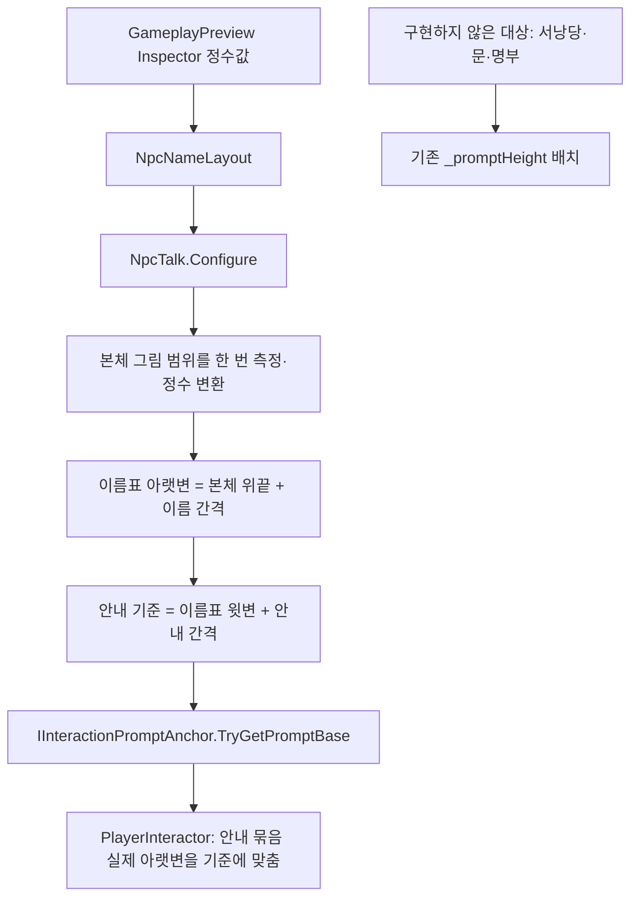

# NPC 이름표와 말걸기 안내 배치 설계

기준일: 2026-11-17 · 구현 커밋 `4f175859` · 코드 반영과 기존 컴파일 기록 확인, 실제 Play는 별도 확인.
이번 문서 정리에서 코드·시트·프리팹을 변경하지 않았습니다.

## 목차

1. [목표와 연결 경계](#1-목표와-연결-경계)
2. [현재 구현과 승인 결정](#2-현재-구현과-승인-결정)
3. [설계원칙 점검과 과거안](#3-설계원칙-점검과-과거안)

## 1. 목표와 연결 경계

NPC 본체 → 이름표 → 말걸기 안내 순서로 표시하며 상호작용 거리·대화 실행·저장 규칙은 유지합니다. 기존 `NpcTalk : InteractableBehaviour`, `DialogueRunner`, Language 조회, 공용 `PlayerInteractor`와 `SubscriptionScope`를 재사용합니다. 새 NPC 입력·대화 재생기·전역 이벤트 버스를 만들지 않습니다.

표시 설정과 실제 사용 절차는 [기획자 안내](../기획자용%20안내문서/NPC%20데이터%20작성과%20배포%20준비%20안내.md#이름표말걸기-안내-확인--2026-11-17), 데이터·스폰·대화 구조는 [NPC 데이터 설계](NPC%20데이터%20배포%20준비%20설계.md)를 따릅니다.

## 2. 현재 구현과 승인 결정

### 2.1 사용자 결정

| 결정 | 선택 |
| --- | --- |
| 간격·배율 공급 | 조립자(`GameplayPreview`) Inspector 공용 정수값. 모든 NPC 공통 |
| 안내 위치 계약 | 새 선택 인터페이스 `IInteractionPromptAnchor` |
| 가독성 | 그림자(어두운 같은 글자 1장) |
| 수명 보강 | 생성·갱신 분리와 정리 실패 격리를 함께 수정 |

### 2.2 구조

| 위치 | 변경 |
| --- | --- |
| `Adapters/Interaction/IInteractionPromptAnchor.cs`(신규) | `TryGetPromptBase(out Vector2)`. 준비 전이면 false로 기존 배치 사용 |
| `NpcTalk.cs` | 인터페이스 구현. 이름표 생성·갱신 분리, 본체 범위 측정, 정수 배치, 그림자, 부모 Scale 보정, 정리 실패 격리(`SubscriptionScope.Cleanup`) |
| 같은 파일 `NpcNameLayout`(신규 구조체) | 이름 간격·글자 배율·안내 간격·타일당 화면 거리 검증 묶음 |
| `PlayerInteractor.cs` | NPC 전용 `+0.6` 분기 제거. 인터페이스 대상은 배경·테두리까지 배치한 뒤 실제 아랫변을 맞춤(프리팹 높이 보정은 더하지 않음) |
| `GameplayPreview.Dialogues.cs` | Inspector `NPC 이름표 머리 위 간격`(30)·`글자 배율`(20000)·`말걸기 안내 간격`(10) 공급 |

기본값은 원본 요청 제안값(0.3칸·2배)이며 확정 공급값이 아닙니다. 안내 간격 0.1칸은 이번에 정한 시작값입니다.

### 2.3 설계 점검에서 보완한 점

| 문서의 빈 부분 | 구현 |
| --- | --- |
| 본체가 여러 렌더러면 오류로 본다고 했으나 리깅 NPC는 정상적으로 여러 장 | 이름표·그림자를 뺀 본체 SpriteRenderer 전체를 묶은 범위 사용. 0개면 이름표를 숨기고 안내는 기존 배치 |
| 안정적인 본체 범위 기준 없음 | 연결 시점에 한 번 측정(애니메이터 실행 전 기본 그림). 프레임마다 다시 재지 않음 |
| 글자 크기 부모 Scale 보정 방법 없음 | `characterSize`를 NPC의 월드 Scale로 나눠 월드 크기 유지 |
| `tile_x100`→월드 변환 배율 공급자 없음 | 조립자가 기존 `타일당 화면 거리`를 함께 전달, `SpatialRuntime` 변환 재사용 |
| 언어 변경 시 이름표→안내 순서 | 이름표는 언어 이벤트 안에서 즉시 재배치 후 `NotifyChanged`, 공용 안내는 기존 갱신 예약으로 다음 `LateUpdate`에서 반영 |
| 비활성 TextMesh의 범위가 비어 있음 | 측정하는 동안만 켜고 같은 프레임에서 최종 표시 여부로 되돌림(렌더링 전) |

### 2.4 원칙 적용과 예외

| 원칙 | 적용 | 예외와 이유 |
| --- | --- | --- |
| 정수화 | 간격·배율은 tile_x100·분모 10000 정수, 본체 위끝·이름표 범위·안내 기준·이동량은 정수 계산 | 그림·글자 범위 읽기와 Transform 대입, `characterSize`는 Unity 표시 API가 float만 지원 |
| 상속·재사용 | `InteractableBehaviour` 상속 유지, 기존 대화 실행·언어 조회·갱신 예약·`SubscriptionScope` 재사용 | 안내 계약은 사용자 선택으로 새 인터페이스(기반 클래스 변경 없이 선택적 구현) |
| 데이터 관리 | 이름·대화는 기존 데이터 | 간격·배율은 사용자 선택으로 조립자 Inspector(시트 열 없음). 그림자 어긋남(0.03칸)은 장식이라 고정값 |
| 독립성 | 서낭당·문·명부 배치 불변, 상호작용 거리(`Position`) 불변 | — |
| 수명·이벤트 | 재연결 시 이전 구독·대화 정리 후 적용. 구독 해제·대화 취소·등록 해제가 하나 실패해도 나머지 수행. 표시 오류는 `ErrorPopupHost.WriteError`로 기록 | **2026-11-18 수정(개선 검토 S01):** `ConnectDialogueEvents`에서 try/catch는 `RefreshNameText()`만 감쌉니다. 이름표 표시 실패는 `ErrorPopupHost.WriteError`로 기록하고, `NotifyChanged()`는 표시 성공 여부와 무관하게 그 밖에서 실행합니다. 소비자(`InteractionRegistry` → `PlayerInteractor`) 예외는 삼키지 않고 언어 변경·사용 가능 통지의 호출 흐름으로 전달합니다. 컴파일·코어 검사 통과, Play 미확인. 장부 상호작용의 같은 구조(S10)도 함께 수정 |

### 2.5 검증 상태

| 검증 | 결과 |
| --- | --- |
| 정식·개발 조건 컴파일 | 경고·오류 0 |
| 에디터 조건 컴파일 | 이 작업 관련 오류 0. 다른 담당 `PreviewBossSprite.cs`(`9561b795`)의 미할당 필드 경고가 로컬 검사에서 오류로 집계됨(Unity·CI 빌드에는 영향 없음) |
| 실제 Play | 미확인. 도화골 피난민에서 이름표 위치·크기·그림자, 말걸기 안내 겹침, 서낭당·문·명부 안내 높이 불변, 한국어·영어 전환을 확인 |

## 3. 설계원칙 점검과 과거안

정의는 읽기 전용이며 측정 결과·안내 기준은 개체별 표시 상태입니다. 원본 행을 수정해 배치하지 않습니다. 공용 표시 간격은 사용자 선택의 Inspector 정수 공급이고, 이를 다시 신규 테이블로 옮기는 것은 확정 작업이 아닙니다.

표시 이벤트의 소비자 예외 경계는 [분리된 개선 검토 S01](개선%20검토/코드%20구조와%20반복·재귀%20개선%20검토.md#2-설계원칙과-구조-개선)에 남겼습니다. 현재 계약의 미흡함을 문서만으로 수정 완료 처리하지 않습니다.

[이전 설계·제안·점검 보존본](구버전/2026-11-17/NPC%20이름표와%20말걸기%20안내%20배치%20설계.md)에는 당시 로컬 높이 2.5·NPC 보정 0.6과 설정 공급 미정 기록이 있습니다. 현재 코드의 설명으로 사용하지 않습니다.

기존 크기·폰트 조정은 `8a967f99` LEEGEONHO, 이번 자동 배치·정리 연결은 `4f175859` hollowinday의 Git 이력으로 구분합니다. 기획 요청은 김현호이며 아트 담당자는 Git 외부 원본 제작·공급에 함께 참여했습니다. 기여 이력을 개인 완성률로 환산하지 않습니다.
