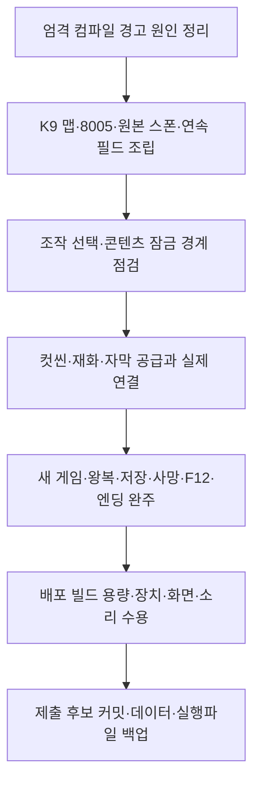

# 간트와 프로젝트 통합 진행 현황

기준: 2026-11-06 17:23 KST 조회. 클라이언트 `2ed7bcf`, DataSheet `3b171dc`. [간트 원본](https://docs.google.com/spreadsheets/d/16waFKHuXaZGdi2fz76nRUWFxiuQquhZGy6doAVHqBUI/edit)의 `간트!A4:F251`과 오늘 반영 커밋·배포 데이터·최신 기능 기획을 대조했습니다. 원본 간트·기획서는 수정하지 않았습니다. 이 문서는 오늘 기준 고정 보고서이며 자동 동기화하지 않습니다.

## 1. 완료율을 읽는 방법

[전체·작업자 진행 현황표](https://docs.google.com/spreadsheets/d/1JB9HPMFroLn46WlRJf68NegR9_mliZodJrYKRbJNPwI/edit)에서 작업자 비교 도식·원본 행 링크·123개 상세 작업을 확인합니다. 오늘 기준 고정 보고서이며 원본 변경을 자동 반영하지 않습니다.

전체 작업 완료율은 **86/123 = 69.9%**, 작업자별 완료율을 같은 비중으로 평균하면 **50.9%**입니다. 개발 두 담당의 합산은 **9/26 = 34.6%**입니다. 이는 간트 완료 상태를 집계한 값이며 임의로 진행 작업을 50% 처리하지 않았습니다. 작업 크기·공수가 서로 다르고 기획 작업 72개가 전체에 큰 비중을 차지하므로 게임 플레이 완성률로 읽으면 안 됩니다. 실제 게임 완성률은 최종 범위·수용 항목별 증거가 없어 미산정입니다.

개인별 담당 구역 5개만 집계했습니다. 관문 10개, 요약 탭, 백업 탭, 표 제목은 제외해 중복 계산을 막았습니다. 기한 경과는 11/6 이전 종료 예정인데 미완료인 행입니다. 간트의 지연 집계와 더하지 않습니다. 완료 보고는 담당자 보고이며 게임 적용·실행파일 검증 완료 증거와 별개입니다.

| 담당 | 전체 | 완료 | 진행 | 예정 | 기한 경과 미완료 | 완료율 |
| --- | ---: | ---: | ---: | ---: | ---: | ---: |
| 황영근 | 12 | 2 | 9 | 1 | 5 | 16.7% |
| 나영민 | 14 | 7 | 6 | 1 | 1 | 50.0% |
| 김현민 | 12 | 8 | 2 | 2 | 2 | 66.7% |
| 김현호 | 72 | 65 | 0 | 7 | 0 | 90.3% |
| 이건호 | 13 | 4 | 5 | 4 | 4 | 30.8% |
| 합계 | 123 | 86 | 22 | 15 | 12 | 69.9% |

## 2. 오늘 올라온 작업과 실제 적용 범위

| 변경 근거 | 확인한 내용 | 아직 완료로 볼 수 없는 부분 |
| --- | --- | --- |
| 6b76522 | 일반 맵 전멸 출구 조건 제거, 목적지 콘텐츠 접근 판정 | 연속 필드·장부방 공간 이동·별도 보스 씬 |
| 8345fa1 | 서낭당 접촉/휴식·개별 처치·저장 성공 사본 기반 사망 복원 | 실제 왕복·사망·파일 실패·재실행 수용 |
| 9aa639e·682d7a7 | 컷씬 공용 실행·역할 Key 자동 조회·잠금·결과별 진행 | 두 컷씬 CSV 0행, 실제 화면·주소·미디어 연결 |
| 2d5bf4e·354bc8e | K9 맵 1~3·장부방·보스 및 멀티엔딩 초안 리소스 공급 | StageContentSet은 8001~8004만 참조. 8005 에셋 존재와 실제 실행 연결은 다름 |
| 47bb4ee | 쇄문아비 2페이즈 리그·애니·시험 자료·설계/안내 추가 | 시험용 리그의 검증 결과를 운영 보스 연결·전투 완성으로 합산하지 않음 |
| 2ed7bcf | A/B 키 매핑·설정 저장, 아래 점프 허용 정책, NPC 대사 에셋·연결 시험 변경 | KeyboardLayoutScreen 생성 호출이 없고 TitleGameEntry는 바로 인트로/맵 진입. NPC 에셋은 현재 임시 NpcTalk 연결과 별도 확인 |

K9 참조는 `Map_1_Dohwagol_K9`, `Map_2_Sangil_K9`, `Map_3_Hyeopgok_K9`, `Map_BossRoom_K9`입니다. `Map_Jangbubang_K9`와 클라이언트 spawn/8005.json은 추가됐으나 목록에는 8005가 없습니다. DataSheet spawn 원본에는 8001~8003만 있어 8005 원본 공급도 맞춰야 합니다. Build Settings 활성 씬은 Title·MapDohwagolTest 두 개이며 현재 GoToStage는 같은 테스트 씬을 다시 읽습니다.

## 3. 기획과 구현의 차이 및 다음 담당 연결

| 항목 | 최신 요구와 현재 차이 | 다음 행동 |
| --- | --- | --- |
| 한 씬 필드 | K06_1 R4는 맵 1~3 도보 왕복·장부방 암전·보스 별도 씬. 현재 맵마다 재로딩 | 황영근 공간 조립·나영민 이동/카메라 협업. 새 프리팹 공급 후 연결 확인 |
| 저장 범위 | K05 R12·K16 R7의 엽전/혼·해금 목록·사망 50%는 SaveSnapshot에 없음 | 재화 가격·소유자·저장 스키마를 담당자와 확정 후 추가 |
| 조작 선택 | O03_1 R4·O01_4 R3는 새 게임→A/B 선택→인트로. 옵션 A/B와 저장은 코드에 있음 | 나영민 입력 담당과 TitleGameEntry 조립 연결·취소·설정 복원 확인 |
| 컷씬 | Intro/Ledger/Ending 키는 자동 조회. 실제 행·미디어 없음 | 기획 확정 ID·자막·주소 공급 후 공용 화면 1회 조립 |
| F12 | 사용자 확정/현재 코드: 1회·확인·최신 슬롯. O13 R6: 5초·현재 플레이 슬롯 | 사용자 지시 유지. 기획자와 차이를 조율하고 승인 없이 코드 변경하지 않음 |
| 엔딩 범위 | L11 R4는 정식 멀티엔딩을 스테이지 4 끝으로 설명. 현재 테스트 보스 사망→Ending 경로 준비 | 지스타 종료 연출과 정식 멀티엔딩 트리거를 분리해 확정 |
| 콘텐츠 잠금 | 기본 코어·목적지·일반몹 필터 있음 | Skill·Item·상호작용·우회 경로와 출시 입력/객체 제외 수용 |
| 원본 메모 | 간트의 전멸 저장·F12 무확인·30마리 등 옛 설명 잔존 | 원본 상태를 임의 변경하지 않고 기획 담당에게 갱신 대상 전달 |

## 4. 확인한 검사와 검증 한계

- 오늘 최신 커밋에서 데이터 **937개**, 코어 **689개** 검사 통과.
- `Tools/Verify-Project.ps1 -CompileUnity`는 `DropThroughPlatform.cs:8`의 `_allowed` CS0649(미할당 직렬화 필드)가 경고를 오류로 다루는 설정에서 실패했습니다. 문서 작업 범위이므로 코드는 수정하지 않았습니다.
- GitHub의 project-checks는 기본 통합 검사이며 이 선택 참조 컴파일을 실행하지 않습니다. 따라서 이 결과만으로 GitHub 게임 빌드 실패나 실제 Unity 오류를 단정하지 않습니다.
- Unity 실제 Play·패드·저장 파일 손상·영상 재생·최종 Windows 실행파일·FPS·용량·완주 검증은 이번 점검에서 실행하지 않았습니다. 기존 리그 문서의 개별 시험 결과는 해당 범위만 유지합니다.

## 5. 완성까지의 연결 순서

간트 관문은 11/7 2차, 11/10 3차, 11/14 4차·통시연, 11/16 제출입니다. 11/15 완성과 일요일 휴무 표기가 충돌하고 11/17 백업은 제출 뒤입니다. 일정은 임의 수정하지 않았으며 제출 후보 확정·백업을 제출 전 절차로 조율해야 합니다.

## 6. 원격 기획 대조 근거

- [K05_1_수동저장_자동저장_R10.docx](https://docs.google.com/document/d/1-ZRxD9MI48sqyC0tSjmz2fKpXeItNRBk/edit?usp=drivesdk&ouid=109588538100017025422&rtpof=true&sd=true): 조회된 현재 파일 기준.
- [K16add_사망_리스폰_R7.docx](https://docs.google.com/document/d/1R6t7EmEdq17D_iJWSc0JjyknEJkIilMN/edit?usp=drivesdk&ouid=109588538100017025422&rtpof=true&sd=true): 조회된 현재 파일 기준.
- [K05_저장_R12.docx](https://docs.google.com/document/d/1kwDmW2RJwY0UcZ1B6XwoHxBop6fl0wh1/edit?usp=drivesdk&ouid=109588538100017025422&rtpof=true&sd=true): 조회된 현재 파일 기준.
- [K06_2_방이동_재방문_변경_R2.docx](https://docs.google.com/document/d/1el_FbMSx-RsmUp1XMkmIz18JIMDhkP-x/edit?usp=drivesdk&ouid=109588538100017025422&rtpof=true&sd=true): 조회된 현재 파일 기준.
- [K14add_콘텐츠잠금_해금조건_R4.docx](https://docs.google.com/document/d/1Y-jTudWvNZuTG0ZN2kCB5ucR5jvHU7qK/edit?usp=drivesdk&ouid=109588538100017025422&rtpof=true&sd=true): 조회된 현재 파일 기준.
- [K06_1_씬구성_한씬연결_R4.docx](https://docs.google.com/document/d/1Vb4qUPpFT2MgozG4gAfnzTC05ZDnu987/edit?usp=drivesdk&ouid=109588538100017025422&rtpof=true&sd=true): 조회된 현재 파일 기준.
- [K05_2_처치기록_저장_R4.docx](https://docs.google.com/document/d/1sLzRkGZ4R0qOfMcOwSvZF6bkziHTPcym/edit?usp=drivesdk&ouid=109588538100017025422&rtpof=true&sd=true): 조회된 현재 파일 기준.
- [K01_데모플레이흐름_R6.docx](https://docs.google.com/document/d/1mCRGVUatX8hHiwUzQ0RxynXW-F8L1pxM/edit?usp=drivesdk&ouid=109588538100017025422&rtpof=true&sd=true): 조회된 현재 파일 기준.
- [O13_부스운영기능_R6.docx](https://docs.google.com/document/d/1YnIrvF6Phf5JNtn224ysqn200v_vVskb/edit?usp=drivesdk&ouid=109588538100017025422&rtpof=true&sd=true): 조회된 현재 파일 기준.
- [O05_1_옵션_추가규칙_R4.docx](https://docs.google.com/document/d/1eu1fWfjp_Ggq-scCXmPsP3VcSQf00WcP/edit?usp=drivesdk&ouid=109588538100017025422&rtpof=true&sd=true): 조회된 현재 파일 기준.
- [O03_1_타이틀_추가규칙_R4.docx](https://docs.google.com/document/d/1N5X44g9dNiXmPjZ2oMBgcWslkGJNDb6l/edit?usp=drivesdk&ouid=109588538100017025422&rtpof=true&sd=true): 조회된 현재 파일 기준.
- [O01_4_UI진행FLOW_예외전체_R3.docx](https://docs.google.com/document/d/1_eSkYYRD3JItFksvsRlG0-qxhJL80iBb/edit?usp=drivesdk&ouid=109588538100017025422&rtpof=true&sd=true): 조회된 현재 파일 기준.
- [L11add_갈림길_확장방향_R4.docx](https://docs.google.com/document/d/10PwjHONnyVePpXPWv2G_TijgkSdL87jt/edit?usp=drivesdk&ouid=109588538100017025422&rtpof=true&sd=true): 조회된 현재 파일 기준.
- [L10add_LDtk_레벨디자인_좌표변환_R3.docx](https://docs.google.com/document/d/10223M3KCsgtl5K71X692Q5R4AsJgPP7d/edit?usp=drivesdk&ouid=109588538100017025422&rtpof=true&sd=true): 조회된 현재 파일 기준.
- [L09_3_맵조각분리_몬스터배치_R7.docx](https://docs.google.com/document/d/1wfFbjFTnyGuCNtrfBEKTiBUEgKmMDvgC/edit?usp=drivesdk&ouid=109588538100017025422&rtpof=true&sd=true): 조회된 현재 파일 기준.
- [L01_레벨공통규칙_R9.docx](https://docs.google.com/document/d/1Ngdp_BsUjSSAtsiP8D3lkyheCbRCKkgB/edit?usp=drivesdk&ouid=109588538100017025422&rtpof=true&sd=true): 조회된 현재 파일 기준.

## 7. 문서 전체 점검 범위

두 프로젝트의 README·설계·기획자 안내를 읽고 상태 문구와 상대 링크를 점검했습니다. 아래 유지 문서는 기능별 계약·과거 검증을 보존하며 일괄적으로 현재 완주 검증으로 바꾸지 않았습니다. 새 표의 고정 수치와 상세 작업은 별도 Google Sheets 보고서에 보관합니다.

| 문서 | 처리 |
| --- | --- |
| [문서 안내.md](../%EB%AC%B8%EC%84%9C%20%EC%95%88%EB%82%B4.md) | 현재 표현 수정 |
| [CSV 리더기.md](../%EA%B0%9C%EB%B0%9C%EC%9E%90%EC%9A%A9%20%EC%84%A4%EA%B3%84%EB%AC%B8%EC%84%9C/CSV%20%EB%A6%AC%EB%8D%94%EA%B8%B0.md) | 계약·사용 절차 유지·링크 점검 |
| [검사 자동화와 데이터 오류 경계.md](../%EA%B0%9C%EB%B0%9C%EC%9E%90%EC%9A%A9%20%EC%84%A4%EA%B3%84%EB%AC%B8%EC%84%9C/%EA%B2%80%EC%82%AC%20%EC%9E%90%EB%8F%99%ED%99%94%EC%99%80%20%EB%8D%B0%EC%9D%B4%ED%84%B0%20%EC%98%A4%EB%A5%98%20%EA%B2%BD%EA%B3%84.md) | 계약·사용 절차 유지·링크 점검 |
| [게임플레이 모듈 구조.md](../%EA%B0%9C%EB%B0%9C%EC%9E%90%EC%9A%A9%20%EC%84%A4%EA%B3%84%EB%AC%B8%EC%84%9C/%EA%B2%8C%EC%9E%84%ED%94%8C%EB%A0%88%EC%9D%B4%20%EB%AA%A8%EB%93%88%20%EA%B5%AC%EC%A1%B0.md) | 현재 표현 수정 |
| [게임플레이 코어와 프리팹 연결.md](../%EA%B0%9C%EB%B0%9C%EC%9E%90%EC%9A%A9%20%EC%84%A4%EA%B3%84%EB%AC%B8%EC%84%9C/%EA%B2%8C%EC%9E%84%ED%94%8C%EB%A0%88%EC%9D%B4%20%EC%BD%94%EC%96%B4%EC%99%80%20%ED%94%84%EB%A6%AC%ED%8C%B9%20%EC%97%B0%EA%B2%B0.md) | 계약·사용 절차 유지·링크 점검 |
| [공용 에러 팝업 설계.md](../%EA%B0%9C%EB%B0%9C%EC%9E%90%EC%9A%A9%20%EC%84%A4%EA%B3%84%EB%AC%B8%EC%84%9C/%EA%B3%B5%EC%9A%A9%20%EC%97%90%EB%9F%AC%20%ED%8C%9D%EC%97%85%20%EC%84%A4%EA%B3%84.md) | 계약·사용 절차 유지·링크 점검 |
| [공통 모듈과 객체 수명 설계.md](../%EA%B0%9C%EB%B0%9C%EC%9E%90%EC%9A%A9%20%EC%84%A4%EA%B3%84%EB%AC%B8%EC%84%9C/%EA%B3%B5%ED%86%B5%20%EB%AA%A8%EB%93%88%EA%B3%BC%20%EA%B0%9D%EC%B2%B4%20%EC%88%98%EB%AA%85%20%EC%84%A4%EA%B3%84.md) | 현재 표현 수정 |
| [기획 완료 기준 점검표.md](../%EA%B0%9C%EB%B0%9C%EC%9E%90%EC%9A%A9%20%EC%84%A4%EA%B3%84%EB%AC%B8%EC%84%9C/%EA%B8%B0%ED%9A%8D%20%EC%99%84%EB%A3%8C%20%EA%B8%B0%EC%A4%80%20%EC%A0%90%EA%B2%80%ED%91%9C.md) | 현재 표현 수정 |
| [기획 확정 반영 기준.md](../%EA%B0%9C%EB%B0%9C%EC%9E%90%EC%9A%A9%20%EC%84%A4%EA%B3%84%EB%AC%B8%EC%84%9C/%EA%B8%B0%ED%9A%8D%20%ED%99%95%EC%A0%95%20%EB%B0%98%EC%98%81%20%EA%B8%B0%EC%A4%80.md) | 현재 표현 수정 |
| [남은 구현과 검증 작업.md](../%EA%B0%9C%EB%B0%9C%EC%9E%90%EC%9A%A9%20%EC%84%A4%EA%B3%84%EB%AC%B8%EC%84%9C/%EB%82%A8%EC%9D%80%20%EA%B5%AC%ED%98%84%EA%B3%BC%20%EA%B2%80%EC%A6%9D%20%EC%9E%91%EC%97%85.md) | 현재 표현 수정 |
| [데이터 계층 인수인계 가이드.md](../%EA%B0%9C%EB%B0%9C%EC%9E%90%EC%9A%A9%20%EC%84%A4%EA%B3%84%EB%AC%B8%EC%84%9C/%EB%8D%B0%EC%9D%B4%ED%84%B0%20%EA%B3%84%EC%B8%B5%20%EC%9D%B8%EC%88%98%EC%9D%B8%EA%B3%84%20%EA%B0%80%EC%9D%B4%EB%93%9C.md) | 계약·사용 절차 유지·링크 점검 |
| [데이터 기반 모듈과 화면 표현 설계안.md](../%EA%B0%9C%EB%B0%9C%EC%9E%90%EC%9A%A9%20%EC%84%A4%EA%B3%84%EB%AC%B8%EC%84%9C/%EB%8D%B0%EC%9D%B4%ED%84%B0%20%EA%B8%B0%EB%B0%98%20%EB%AA%A8%EB%93%88%EA%B3%BC%20%ED%99%94%EB%A9%B4%20%ED%91%9C%ED%98%84%20%EC%84%A4%EA%B3%84%EC%95%88.md) | 계약·사용 절차 유지·링크 점검 |
| [반복 갱신과 임시 표시 최적화 설계.md](../%EA%B0%9C%EB%B0%9C%EC%9E%90%EC%9A%A9%20%EC%84%A4%EA%B3%84%EB%AC%B8%EC%84%9C/%EB%B0%98%EB%B3%B5%20%EA%B0%B1%EC%8B%A0%EA%B3%BC%20%EC%9E%84%EC%8B%9C%20%ED%91%9C%EC%8B%9C%20%EC%B5%9C%EC%A0%81%ED%99%94%20%EC%84%A4%EA%B3%84.md) | 계약·사용 절차 유지·링크 점검 |
| [사운드 설정 설계.md](../%EA%B0%9C%EB%B0%9C%EC%9E%90%EC%9A%A9%20%EC%84%A4%EA%B3%84%EB%AC%B8%EC%84%9C/%EC%82%AC%EC%9A%B4%EB%93%9C%20%EC%84%A4%EC%A0%95%20%EC%84%A4%EA%B3%84.md) | 계약·사용 절차 유지·링크 점검 |
| [설계 기준 점검과 개선 방향.md](../%EA%B0%9C%EB%B0%9C%EC%9E%90%EC%9A%A9%20%EC%84%A4%EA%B3%84%EB%AC%B8%EC%84%9C/%EC%84%A4%EA%B3%84%20%EA%B8%B0%EC%A4%80%20%EC%A0%90%EA%B2%80%EA%B3%BC%20%EA%B0%9C%EC%84%A0%20%EB%B0%A9%ED%96%A5.md) | 현재 표현 수정 |
| [쇄문아비 2페이즈 Attack1 대응 시험과 한계.md](../%EA%B0%9C%EB%B0%9C%EC%9E%90%EC%9A%A9%20%EC%84%A4%EA%B3%84%EB%AC%B8%EC%84%9C/%EC%87%84%EB%AC%B8%EC%95%84%EB%B9%84%202%ED%8E%98%EC%9D%B4%EC%A6%88%20Attack1%20%EB%8C%80%EC%9D%91%20%EC%8B%9C%ED%97%98%EA%B3%BC%20%ED%95%9C%EA%B3%84.md) | 기존 시험 결과 보존·링크 점검 |
| [쇄문아비 2페이즈 Attack2 설계와 검증.md](../%EA%B0%9C%EB%B0%9C%EC%9E%90%EC%9A%A9%20%EC%84%A4%EA%B3%84%EB%AC%B8%EC%84%9C/%EC%87%84%EB%AC%B8%EC%95%84%EB%B9%84%202%ED%8E%98%EC%9D%B4%EC%A6%88%20Attack2%20%EC%84%A4%EA%B3%84%EC%99%80%20%EA%B2%80%EC%A6%9D.md) | 기존 시험 결과 보존·링크 점검 |
| [쇄문아비 2페이즈 Idle 리그 설계와 검증.md](../%EA%B0%9C%EB%B0%9C%EC%9E%90%EC%9A%A9%20%EC%84%A4%EA%B3%84%EB%AC%B8%EC%84%9C/%EC%87%84%EB%AC%B8%EC%95%84%EB%B9%84%202%ED%8E%98%EC%9D%B4%EC%A6%88%20Idle%20%EB%A6%AC%EA%B7%B8%20%EC%84%A4%EA%B3%84%EC%99%80%20%EA%B2%80%EC%A6%9D.md) | 기존 시험 결과 보존·링크 점검 |
| [쇄문아비 2페이즈 Walk 초안 설계와 검증.md](../%EA%B0%9C%EB%B0%9C%EC%9E%90%EC%9A%A9%20%EC%84%A4%EA%B3%84%EB%AC%B8%EC%84%9C/%EC%87%84%EB%AC%B8%EC%95%84%EB%B9%84%202%ED%8E%98%EC%9D%B4%EC%A6%88%20Walk%20%EC%B4%88%EC%95%88%20%EC%84%A4%EA%B3%84%EC%99%80%20%EA%B2%80%EC%A6%9D.md) | 기존 시험 결과 보존·링크 점검 |
| [쇄문아비 2페이즈 공격 전용 리그 개선과 검증.md](../%EA%B0%9C%EB%B0%9C%EC%9E%90%EC%9A%A9%20%EC%84%A4%EA%B3%84%EB%AC%B8%EC%84%9C/%EC%87%84%EB%AC%B8%EC%95%84%EB%B9%84%202%ED%8E%98%EC%9D%B4%EC%A6%88%20%EA%B3%B5%EA%B2%A9%20%EC%A0%84%EC%9A%A9%20%EB%A6%AC%EA%B7%B8%20%EA%B0%9C%EC%84%A0%EA%B3%BC%20%EA%B2%80%EC%A6%9D.md) | 기존 시험 결과 보존·링크 점검 |
| [이동과 스태미나 코어.md](../%EA%B0%9C%EB%B0%9C%EC%9E%90%EC%9A%A9%20%EC%84%A4%EA%B3%84%EB%AC%B8%EC%84%9C/%EC%9D%B4%EB%8F%99%EA%B3%BC%20%EC%8A%A4%ED%83%9C%EB%AF%B8%EB%82%98%20%EC%BD%94%EC%96%B4.md) | 계약·사용 절차 유지·링크 점검 |
| [일반 몬스터 인공지능.md](../%EA%B0%9C%EB%B0%9C%EC%9E%90%EC%9A%A9%20%EC%84%A4%EA%B3%84%EB%AC%B8%EC%84%9C/%EC%9D%BC%EB%B0%98%20%EB%AA%AC%EC%8A%A4%ED%84%B0%20%EC%9D%B8%EA%B3%B5%EC%A7%80%EB%8A%A5.md) | 계약·사용 절차 유지·링크 점검 |
| [저장 기능 설계.md](../%EA%B0%9C%EB%B0%9C%EC%9E%90%EC%9A%A9%20%EC%84%A4%EA%B3%84%EB%AC%B8%EC%84%9C/%EC%A0%80%EC%9E%A5%20%EA%B8%B0%EB%8A%A5%20%EC%84%A4%EA%B3%84.md) | 계약·사용 절차 유지·링크 점검 |
| [전투와 탐색 아이디어 검토안.md](../%EA%B0%9C%EB%B0%9C%EC%9E%90%EC%9A%A9%20%EC%84%A4%EA%B3%84%EB%AC%B8%EC%84%9C/%EC%A0%84%ED%88%AC%EC%99%80%20%ED%83%90%EC%83%89%20%EC%95%84%EC%9D%B4%EB%94%94%EC%96%B4%20%EA%B2%80%ED%86%A0%EC%95%88.md) | 계약·사용 절차 유지·링크 점검 |
| [체력 표시 모듈 사용과 설계 안내.md](../%EA%B0%9C%EB%B0%9C%EC%9E%90%EC%9A%A9%20%EC%84%A4%EA%B3%84%EB%AC%B8%EC%84%9C/%EC%B2%B4%EB%A0%A5%20%ED%91%9C%EC%8B%9C%20%EB%AA%A8%EB%93%88%20%EC%82%AC%EC%9A%A9%EA%B3%BC%20%EC%84%A4%EA%B3%84%20%EC%95%88%EB%82%B4.md) | 계약·사용 절차 유지·링크 점검 |
| [컷씬 재생 설계.md](../%EA%B0%9C%EB%B0%9C%EC%9E%90%EC%9A%A9%20%EC%84%A4%EA%B3%84%EB%AC%B8%EC%84%9C/%EC%BB%B7%EC%94%AC%20%EC%9E%AC%EC%83%9D%20%EC%84%A4%EA%B3%84.md) | 계약·사용 절차 유지·링크 점검 |
| [타이틀과 콘텐츠 잠금 설계.md](../%EA%B0%9C%EB%B0%9C%EC%9E%90%EC%9A%A9%20%EC%84%A4%EA%B3%84%EB%AC%B8%EC%84%9C/%ED%83%80%EC%9D%B4%ED%8B%80%EA%B3%BC%20%EC%BD%98%ED%85%90%EC%B8%A0%20%EC%9E%A0%EA%B8%88%20%EC%84%A4%EA%B3%84.md) | 계약·사용 절차 유지·링크 점검 |
| [테스트 초기화와 공용 확인 팝업 설계.md](../%EA%B0%9C%EB%B0%9C%EC%9E%90%EC%9A%A9%20%EC%84%A4%EA%B3%84%EB%AC%B8%EC%84%9C/%ED%85%8C%EC%8A%A4%ED%8A%B8%20%EC%B4%88%EA%B8%B0%ED%99%94%EC%99%80%20%EA%B3%B5%EC%9A%A9%20%ED%99%95%EC%9D%B8%20%ED%8C%9D%EC%97%85%20%EC%84%A4%EA%B3%84.md) | 계약·사용 절차 유지·링크 점검 |
| [현재 구현과 검증 현황.md](../%EA%B0%9C%EB%B0%9C%EC%9E%90%EC%9A%A9%20%EC%84%A4%EA%B3%84%EB%AC%B8%EC%84%9C/%ED%98%84%EC%9E%AC%20%EA%B5%AC%ED%98%84%EA%B3%BC%20%EA%B2%80%EC%A6%9D%20%ED%98%84%ED%99%A9.md) | 현재 표현 수정 |
| [GitHub 빌드와 디스코드 공지 사용 안내.md](../%EA%B8%B0%ED%9A%8D%EC%9E%90%EC%9A%A9%20%EC%95%88%EB%82%B4%EB%AC%B8%EC%84%9C/GitHub%20%EB%B9%8C%EB%93%9C%EC%99%80%20%EB%94%94%EC%8A%A4%EC%BD%94%EB%93%9C%20%EA%B3%B5%EC%A7%80%20%EC%82%AC%EC%9A%A9%20%EC%95%88%EB%82%B4.md) | 계약·사용 절차 유지·링크 점검 |
| [기획자용 F12 초기화 사용 안내.md](../%EA%B8%B0%ED%9A%8D%EC%9E%90%EC%9A%A9%20%EC%95%88%EB%82%B4%EB%AC%B8%EC%84%9C/%EA%B8%B0%ED%9A%8D%EC%9E%90%EC%9A%A9%20F12%20%EC%B4%88%EA%B8%B0%ED%99%94%20%EC%82%AC%EC%9A%A9%20%EC%95%88%EB%82%B4.md) | 계약·사용 절차 유지·링크 점검 |
| [기획자용 공통 모듈 연결과 확인 안내.md](../%EA%B8%B0%ED%9A%8D%EC%9E%90%EC%9A%A9%20%EC%95%88%EB%82%B4%EB%AC%B8%EC%84%9C/%EA%B8%B0%ED%9A%8D%EC%9E%90%EC%9A%A9%20%EA%B3%B5%ED%86%B5%20%EB%AA%A8%EB%93%88%20%EC%97%B0%EA%B2%B0%EA%B3%BC%20%ED%99%95%EC%9D%B8%20%EC%95%88%EB%82%B4.md) | 계약·사용 절차 유지·링크 점검 |
| [기획자용 관문 데이터 작성과 확인 안내.md](../%EA%B8%B0%ED%9A%8D%EC%9E%90%EC%9A%A9%20%EC%95%88%EB%82%B4%EB%AC%B8%EC%84%9C/%EA%B8%B0%ED%9A%8D%EC%9E%90%EC%9A%A9%20%EA%B4%80%EB%AC%B8%20%EB%8D%B0%EC%9D%B4%ED%84%B0%20%EC%9E%91%EC%84%B1%EA%B3%BC%20%ED%99%95%EC%9D%B8%20%EC%95%88%EB%82%B4.md) | 계약·사용 절차 유지·링크 점검 |
| [기획자용 사운드 상황별 재생 조건 요청서.md](../%EA%B8%B0%ED%9A%8D%EC%9E%90%EC%9A%A9%20%EC%95%88%EB%82%B4%EB%AC%B8%EC%84%9C/%EA%B8%B0%ED%9A%8D%EC%9E%90%EC%9A%A9%20%EC%82%AC%EC%9A%B4%EB%93%9C%20%EC%83%81%ED%99%A9%EB%B3%84%20%EC%9E%AC%EC%83%9D%20%EC%A1%B0%EA%B1%B4%20%EC%9A%94%EC%B2%AD%EC%84%9C.md) | 계약·사용 절차 유지·링크 점검 |
| [기획자용 사운드 설정 사용 안내.md](../%EA%B8%B0%ED%9A%8D%EC%9E%90%EC%9A%A9%20%EC%95%88%EB%82%B4%EB%AC%B8%EC%84%9C/%EA%B8%B0%ED%9A%8D%EC%9E%90%EC%9A%A9%20%EC%82%AC%EC%9A%B4%EB%93%9C%20%EC%84%A4%EC%A0%95%20%EC%82%AC%EC%9A%A9%20%EC%95%88%EB%82%B4.md) | 현재 표현 수정 |
| [기획자용 사운드 테이블 작성과 배포 안내.md](../%EA%B8%B0%ED%9A%8D%EC%9E%90%EC%9A%A9%20%EC%95%88%EB%82%B4%EB%AC%B8%EC%84%9C/%EA%B8%B0%ED%9A%8D%EC%9E%90%EC%9A%A9%20%EC%82%AC%EC%9A%B4%EB%93%9C%20%ED%85%8C%EC%9D%B4%EB%B8%94%20%EC%9E%91%EC%84%B1%EA%B3%BC%20%EB%B0%B0%ED%8F%AC%20%EC%95%88%EB%82%B4.md) | 계약·사용 절차 유지·링크 점검 |
| [기획자용 수동 저장 사용 안내.md](../%EA%B8%B0%ED%9A%8D%EC%9E%90%EC%9A%A9%20%EC%95%88%EB%82%B4%EB%AC%B8%EC%84%9C/%EA%B8%B0%ED%9A%8D%EC%9E%90%EC%9A%A9%20%EC%88%98%EB%8F%99%20%EC%A0%80%EC%9E%A5%20%EC%82%AC%EC%9A%A9%20%EC%95%88%EB%82%B4.md) | 계약·사용 절차 유지·링크 점검 |
| [기획자용 에러 팝업 사용 안내.md](../%EA%B8%B0%ED%9A%8D%EC%9E%90%EC%9A%A9%20%EC%95%88%EB%82%B4%EB%AC%B8%EC%84%9C/%EA%B8%B0%ED%9A%8D%EC%9E%90%EC%9A%A9%20%EC%97%90%EB%9F%AC%20%ED%8C%9D%EC%97%85%20%EC%82%AC%EC%9A%A9%20%EC%95%88%EB%82%B4.md) | 계약·사용 절차 유지·링크 점검 |
| [기획자용 컷씬 표시와 씬 이동 안내.md](../%EA%B8%B0%ED%9A%8D%EC%9E%90%EC%9A%A9%20%EC%95%88%EB%82%B4%EB%AC%B8%EC%84%9C/%EA%B8%B0%ED%9A%8D%EC%9E%90%EC%9A%A9%20%EC%BB%B7%EC%94%AC%20%ED%91%9C%EC%8B%9C%EC%99%80%20%EC%94%AC%20%EC%9D%B4%EB%8F%99%20%EC%95%88%EB%82%B4.md) | 현재 표현 수정 |
| [기획자용 타이틀과 콘텐츠 잠금 사용 안내.md](../%EA%B8%B0%ED%9A%8D%EC%9E%90%EC%9A%A9%20%EC%95%88%EB%82%B4%EB%AC%B8%EC%84%9C/%EA%B8%B0%ED%9A%8D%EC%9E%90%EC%9A%A9%20%ED%83%80%EC%9D%B4%ED%8B%80%EA%B3%BC%20%EC%BD%98%ED%85%90%EC%B8%A0%20%EC%9E%A0%EA%B8%88%20%EC%82%AC%EC%9A%A9%20%EC%95%88%EB%82%B4.md) | 계약·사용 절차 유지·링크 점검 |
| [기획자용 프로젝트 검사 사용 안내.md](../%EA%B8%B0%ED%9A%8D%EC%9E%90%EC%9A%A9%20%EC%95%88%EB%82%B4%EB%AC%B8%EC%84%9C/%EA%B8%B0%ED%9A%8D%EC%9E%90%EC%9A%A9%20%ED%94%84%EB%A1%9C%EC%A0%9D%ED%8A%B8%20%EA%B2%80%EC%82%AC%20%EC%82%AC%EC%9A%A9%20%EC%95%88%EB%82%B4.md) | 계약·사용 절차 유지·링크 점검 |
| [디스코드 알림 설정 안내.md](../%EA%B8%B0%ED%9A%8D%EC%9E%90%EC%9A%A9%20%EC%95%88%EB%82%B4%EB%AC%B8%EC%84%9C/%EB%94%94%EC%8A%A4%EC%BD%94%EB%93%9C%20%EC%95%8C%EB%A6%BC%20%EC%84%A4%EC%A0%95%20%EC%95%88%EB%82%B4.md) | 계약·사용 절차 유지·링크 점검 |
| [서낭당 저장과 몬스터 처치 기록 확인 안내.md](../%EA%B8%B0%ED%9A%8D%EC%9E%90%EC%9A%A9%20%EC%95%88%EB%82%B4%EB%AC%B8%EC%84%9C/%EC%84%9C%EB%82%AD%EB%8B%B9%20%EC%A0%80%EC%9E%A5%EA%B3%BC%20%EB%AA%AC%EC%8A%A4%ED%84%B0%20%EC%B2%98%EC%B9%98%20%EA%B8%B0%EB%A1%9D%20%ED%99%95%EC%9D%B8%20%EC%95%88%EB%82%B4.md) | 계약·사용 절차 유지·링크 점검 |
| [쇄문아비 2페이즈 Attack1 개선본 확인 안내.md](../%EA%B8%B0%ED%9A%8D%EC%9E%90%EC%9A%A9%20%EC%95%88%EB%82%B4%EB%AC%B8%EC%84%9C/%EC%87%84%EB%AC%B8%EC%95%84%EB%B9%84%202%ED%8E%98%EC%9D%B4%EC%A6%88%20Attack1%20%EA%B0%9C%EC%84%A0%EB%B3%B8%20%ED%99%95%EC%9D%B8%20%EC%95%88%EB%82%B4.md) | 기존 시험 결과 보존·링크 점검 |
| [쇄문아비 2페이즈 Attack1 대응 시험 안내.md](../%EA%B8%B0%ED%9A%8D%EC%9E%90%EC%9A%A9%20%EC%95%88%EB%82%B4%EB%AC%B8%EC%84%9C/%EC%87%84%EB%AC%B8%EC%95%84%EB%B9%84%202%ED%8E%98%EC%9D%B4%EC%A6%88%20Attack1%20%EB%8C%80%EC%9D%91%20%EC%8B%9C%ED%97%98%20%EC%95%88%EB%82%B4.md) | 기존 시험 결과 보존·링크 점검 |
| [쇄문아비 2페이즈 Attack2 확인 안내.md](../%EA%B8%B0%ED%9A%8D%EC%9E%90%EC%9A%A9%20%EC%95%88%EB%82%B4%EB%AC%B8%EC%84%9C/%EC%87%84%EB%AC%B8%EC%95%84%EB%B9%84%202%ED%8E%98%EC%9D%B4%EC%A6%88%20Attack2%20%ED%99%95%EC%9D%B8%20%EC%95%88%EB%82%B4.md) | 기존 시험 결과 보존·링크 점검 |
| [쇄문아비 2페이즈 Idle 확인 안내.md](../%EA%B8%B0%ED%9A%8D%EC%9E%90%EC%9A%A9%20%EC%95%88%EB%82%B4%EB%AC%B8%EC%84%9C/%EC%87%84%EB%AC%B8%EC%95%84%EB%B9%84%202%ED%8E%98%EC%9D%B4%EC%A6%88%20Idle%20%ED%99%95%EC%9D%B8%20%EC%95%88%EB%82%B4.md) | 기존 시험 결과 보존·링크 점검 |
| [쇄문아비 2페이즈 Walk 초안 확인 안내.md](../%EA%B8%B0%ED%9A%8D%EC%9E%90%EC%9A%A9%20%EC%95%88%EB%82%B4%EB%AC%B8%EC%84%9C/%EC%87%84%EB%AC%B8%EC%95%84%EB%B9%84%202%ED%8E%98%EC%9D%B4%EC%A6%88%20Walk%20%EC%B4%88%EC%95%88%20%ED%99%95%EC%9D%B8%20%EC%95%88%EB%82%B4.md) | 기존 시험 결과 보존·링크 점검 |
| [앵커 기반 프리팹 배치 안내.md](../%EA%B8%B0%ED%9A%8D%EC%9E%90%EC%9A%A9%20%EC%95%88%EB%82%B4%EB%AC%B8%EC%84%9C/%EC%95%B5%EC%BB%A4%20%EA%B8%B0%EB%B0%98%20%ED%94%84%EB%A6%AC%ED%8C%B9%20%EB%B0%B0%EC%B9%98%20%EC%95%88%EB%82%B4.md) | 계약·사용 절차 유지·링크 점검 |
| [앵커 체력 표시 테스트 안내.md](../%EA%B8%B0%ED%9A%8D%EC%9E%90%EC%9A%A9%20%EC%95%88%EB%82%B4%EB%AC%B8%EC%84%9C/%EC%95%B5%EC%BB%A4%20%EC%B2%B4%EB%A0%A5%20%ED%91%9C%EC%8B%9C%20%ED%85%8C%EC%8A%A4%ED%8A%B8%20%EC%95%88%EB%82%B4.md) | 계약·사용 절차 유지·링크 점검 |
| [임시 게임플레이 확인 안내.md](../%EA%B8%B0%ED%9A%8D%EC%9E%90%EC%9A%A9%20%EC%95%88%EB%82%B4%EB%AC%B8%EC%84%9C/%EC%9E%84%EC%8B%9C%20%EA%B2%8C%EC%9E%84%ED%94%8C%EB%A0%88%EC%9D%B4%20%ED%99%95%EC%9D%B8%20%EC%95%88%EB%82%B4.md) | 계약·사용 절차 유지·링크 점검 |
| [표시 갱신 최적화 확인 안내.md](../%EA%B8%B0%ED%9A%8D%EC%9E%90%EC%9A%A9%20%EC%95%88%EB%82%B4%EB%AC%B8%EC%84%9C/%ED%91%9C%EC%8B%9C%20%EA%B0%B1%EC%8B%A0%20%EC%B5%9C%EC%A0%81%ED%99%94%20%ED%99%95%EC%9D%B8%20%EC%95%88%EB%82%B4.md) | 계약·사용 절차 유지·링크 점검 |
| [기획자 데이터 작성과 배포 가이드.md](../../../DataSheet/Docs/%EA%B8%B0%ED%9A%8D%EC%9E%90%20%EB%8D%B0%EC%9D%B4%ED%84%B0%20%EC%9E%91%EC%84%B1%EA%B3%BC%20%EB%B0%B0%ED%8F%AC%20%EA%B0%80%EC%9D%B4%EB%93%9C.md) | 계약·사용 절차 유지·링크 점검 |
| [기획자용 컷씬 데이터 작성과 사용 안내.md](../../../DataSheet/Docs/%EA%B8%B0%ED%9A%8D%EC%9E%90%EC%9A%A9%20%EC%BB%B7%EC%94%AC%20%EB%8D%B0%EC%9D%B4%ED%84%B0%20%EC%9E%91%EC%84%B1%EA%B3%BC%20%EC%82%AC%EC%9A%A9%20%EC%95%88%EB%82%B4.md) | 현재 표현 수정 |
| [디스코드 알림 설정 안내.md](../../../DataSheet/Docs/%EB%94%94%EC%8A%A4%EC%BD%94%EB%93%9C%20%EC%95%8C%EB%A6%BC%20%EC%84%A4%EC%A0%95%20%EC%95%88%EB%82%B4.md) | 계약·사용 절차 유지·링크 점검 |
| [맵 구성과 몬스터 배치 데이터 제안서.md](../../../DataSheet/Docs/%EB%A7%B5%20%EA%B5%AC%EC%84%B1%EA%B3%BC%20%EB%AA%AC%EC%8A%A4%ED%84%B0%20%EB%B0%B0%EC%B9%98%20%EB%8D%B0%EC%9D%B4%ED%84%B0%20%EC%A0%9C%EC%95%88%EC%84%9C.md) | 계약·사용 절차 유지·링크 점검 |
| [체력 표시 설정 작성과 배포 안내.md](../../../DataSheet/Docs/%EC%B2%B4%EB%A0%A5%20%ED%91%9C%EC%8B%9C%20%EC%84%A4%EC%A0%95%20%EC%9E%91%EC%84%B1%EA%B3%BC%20%EB%B0%B0%ED%8F%AC%20%EC%95%88%EB%82%B4.md) | 계약·사용 절차 유지·링크 점검 |
| [콘텐츠 잠금과 해금 컬럼 작성안.md](../../../DataSheet/Docs/%EC%BD%98%ED%85%90%EC%B8%A0%20%EC%9E%A0%EA%B8%88%EA%B3%BC%20%ED%95%B4%EA%B8%88%20%EC%BB%AC%EB%9F%BC%20%EC%9E%91%EC%84%B1%EC%95%88.md) | 계약·사용 절차 유지·링크 점검 |
| [README.md](../../README.md) | 현재 표현 수정 |
| [README.md](../../../DataSheet/README.md) | 현재 표현 수정 |
| [프로젝트 기본설계.md](../../%ED%94%84%EB%A1%9C%EC%A0%9D%ED%8A%B8%20%EA%B8%B0%EB%B3%B8%EC%84%A4%EA%B3%84.md) | 계약·사용 절차 유지·링크 점검 |
