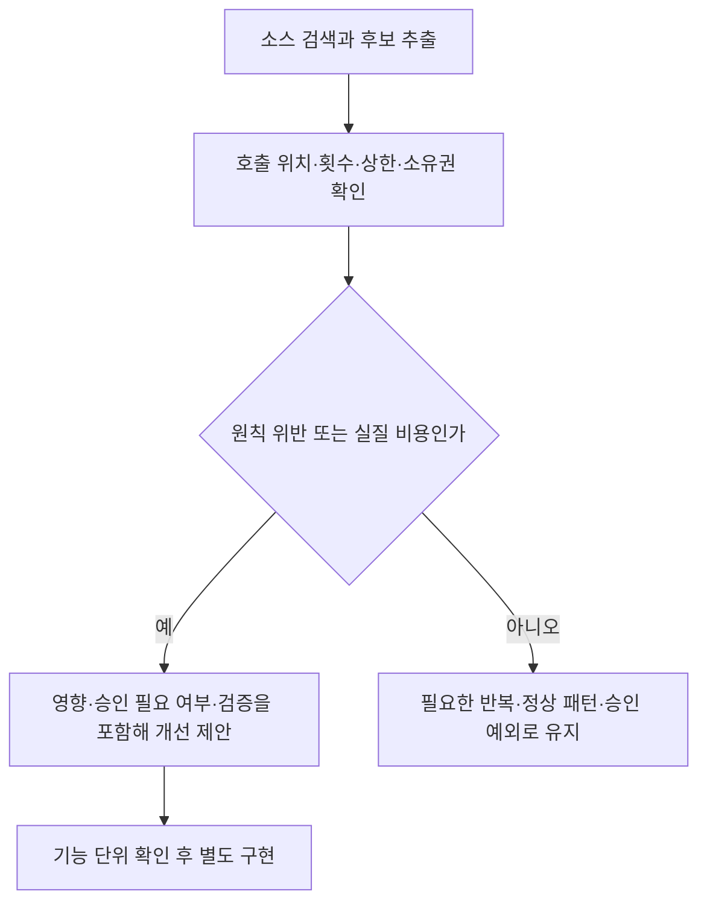
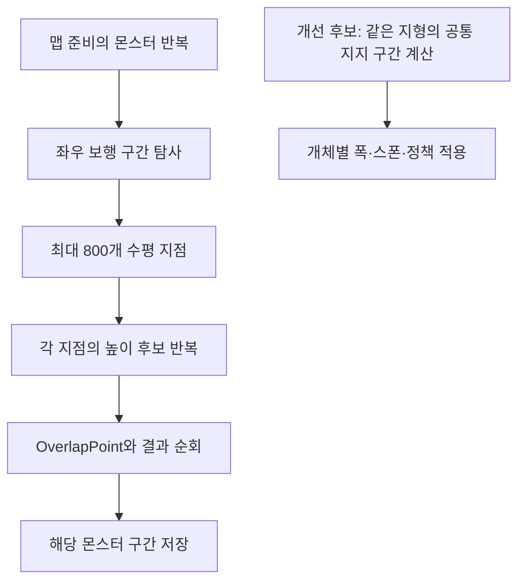
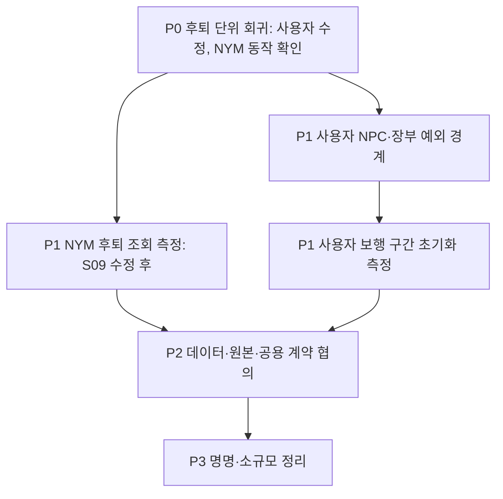

# 코드 구조와 반복·재귀 개선 검토

기준일: 2026-11-17 · 클라이언트 `ab6277fc` · **정적 점검·개선 제안이며 코드 수정이나 성능 측정을 수행하지 않았습니다.**

2026-11-17 재점검: 근거 위치를 코드와 다시 대조했습니다. S09는 실제 좌표 배율로 확인해 **확정 결함**으로 올렸고, S06은 경계 변환으로 판단해 낮췄습니다. S07은 실제 범위를 추가했고, 보행 구간 탐색과 후퇴 판정에 빠진 비용 근거를 보탰습니다. 이번에도 Play·컴파일·측정은 하지 않았습니다. 이미 적용된 표시 갱신 최적화는 [반복 갱신과 임시 표시 최적화 설계](../반복%20갱신과%20임시%20표시%20최적화%20설계.md)에 있으며 이 문서에 다시 적지 않습니다.

2026-11-18 S09 코드 수정(사용자 지시, 정수화 범위는 S09만): `CanRetreatFrom`의 후퇴 목표·구간·벽 판정을 정수로 통일했습니다. 엔진 참조 컴파일 오류 0·데이터 검사 10,856개·코어 검사 2,316개 통과. **Play 재현·확인과 NYM의 후퇴 동작 확인은 아직입니다.** 이어서 사용자 지시로 S13 효과음 병합 시간을 정수 ms로 바꿨습니다(같은 검사 통과). S11·사다리 진행도·Inspector float 값은 정수화 범위에서 제외했습니다.

2026-11-18 Play 확인(사용자): S09 옹귀 후퇴, S13 효과음 병합, S01·S10 NPC·장부 갱신, 턱 오르기·몹 이동 한계 정수화를 사용자가 Play로 확인했습니다. NYM의 S09·S13 동작 확인은 별도입니다.

2026-11-18 남은 정수화 일괄 적용: Inspector 이동 한계(`_stageHalfWidth`·`_combatMinX/MaxX` → tile_x100 int, 씬 값 변환), 일반몹 `Step`의 long 한계, 턱 오르기 위치 보간·`ClimbProgress` 정수화를 적용했습니다. 플레이어 비탈(보류)·보스(S11 이관)는 넘기는 순간만 변환합니다. 상세는 [정수 단위 감사](../정수%20단위%20감사와%20시간·좌표%20경계%20설계.md). 컴파일·코어 검사 통과, Play 미확인.

2026-11-18 담당 이관: S11 보스 좌표 정수화는 사용자 작업 범위에서 빼고 보스 담당 작업자(NYM)에게 넘겼습니다.

2026-11-18 정수화 제외 결정: `StageContentSet.BackgroundPosition.LocalX/LocalY`는 배경 표시 Transform 값이라 정수화하지 않기로 했습니다(승인 예외 표에 기록).

2026-11-18 S01·S10 코드 수정(사용자 지시): NPC 이름표 갱신만 표시 경계 try/catch에 두고 `NotifyChanged()`는 밖에서 실행하도록 바꿨습니다. 장부 상호작용은 표시 작업이 없어 try/catch를 제거했습니다. 엔진 참조 컴파일 오류 0·데이터 검사 10,856개·코어 검사 2,316개 통과, Play 미확인.

2026-11-18 재점검(클라이언트 `57d99f84`): Git 이력으로 S09의 발생 커밋을 추적해 **수정 담당을 NYM에서 사용자로 바꿨습니다**(NYM은 후퇴 동작 확인). S01과 같은 구조의 장부 상호작용, 보스 런타임 float 좌표, 중복 `BossStage` 상수, 효과음 병합 float 시간과 콜백 예외 처리 검토 후보를 S10~S14로 추가했고 S08 범위를 실제 11곳으로 보완했습니다. 코드 수정·Play·측정은 하지 않았습니다.

## 목차

1. [범위와 판단 기준](#1-범위와-판단-기준)
2. [설계원칙과 구조 개선](#2-설계원칙과-구조-개선)
3. [반복문과 호출 비용](#3-반복문과-호출-비용)
4. [재귀와 오탐 구분](#4-재귀와-오탐-구분)
5. [단순화 순서와 검증](#5-단순화-순서와-검증)
6. [우선순위와 담당별 분류](#6-우선순위와-담당별-분류)

## 1. 범위와 판단 기준

소유 스크립트 `Assets/3.Script`를 검색하고 주요 조립·NPC·상호작용·저장·오류·스폰·이동 코드를 읽었습니다. 외부 패키지·생성 정의를 일반 리팩터링 대상으로 포함하지 않았습니다. 문자열 검색과 간단한 구문 후보 추출은 의미 분석 컴파일러가 아니므로 런타임 전체 호출 그래프·모든 간접 재귀의 부재를 보장하지 않습니다.

규칙 위반, 승인 예외, 성능 후보, 검증 대기를 구분합니다. 반복 단계 수나 파일 크기만으로 오남용이라고 판단하지 않습니다. 개선 제안의 우선순위는 오류 계약 → 데이터·원본 경계 → 초기화 비용 → 표시·가독성입니다.

## 2. 설계원칙과 구조 개선

| 번호·우선순위 | 근거 | 판단과 원인 | 권장 개선·영향 |
| --- | --- | --- | --- |
| S01·**수정·사용자 Play 확인 완료(11/18)** | [NpcTalk.ConnectDialogueEvents](../../../Assets/3.Script/Adapters/Interaction/NpcTalk.cs:151) | 표시 갱신과 `NotifyChanged()` 전체가 같은 catch 안에 있음. Changed 소비자 예외까지 표시 오류로 삼켜 동기 게임플레이 이벤트 계약과 충돌할 수 있음 | 자기 표시 처리만 경계에서 기록하고 완료 통지는 그 밖에서 수행. 표시 실패 시 통지할 상태도 명확화. Registry·선택 갱신의 실패 전달·정리 검증 필요. 같은 구조의 S10(장부)과 함께 수정. **11/18 적용:** try/catch는 `RefreshNameText()`만 감싸 `ErrorPopupHost.WriteError`로 기록하고, `NotifyChanged()`는 표시 성공 여부와 무관하게 밖에서 실행해 소비자 예외를 호출 흐름(언어 변경·사용 가능 통지)으로 전달. 소비자 체인(`InteractionRegistry` → `PlayerInteractor`)은 갱신 예약만 함 |
| S02·중간 | [GameplayPreview](../../../Assets/3.Script/Preview/GameplayPreview.cs:145) | 스테이지 ID→환경음 키 switch, `BossStage=8004`, [ShowGateHint](../../../Assets/3.Script/Preview/GameplayPreview.cs:998)의 직접 문구·Z 입력 표현이 콘텐츠와 조립 코드에 남음 | 기존 Stage·사운드·Language/UI_Lang·키 공급을 먼저 재사용. 보스/장부 특례의 기존 승인 여부를 개별 확인하고 승인 예외를 일괄 제거하지 않음 |
| S03·중간 | [PlayerInteractor](../../../Assets/3.Script/Adapters/Interaction/PlayerInteractor.cs:162) | Language ID→UI ID 숫자 매핑과 `F ` 접두어가 로컬 분기에 결합. 문구 추가 시 코드 수정 필요 | 기존 UI_Lang 연결과 입력 키 표현을 공통 조회. 신규 테이블을 무조건 추가하지 않음. 서낭당·문·명부·NPC 회귀 필요 |
| S04·중간 | [StageContentSet.Stages](../../../Assets/3.Script/Adapters/StageContentSet.cs:70), StageEntry의 공개 필드 | 내부 배열과 가변 행을 외부에 그대로 노출. 실제 오염 발생을 확인한 것은 아니지만 원본 불변성이 계약으로 보장되지 않음 | 기존 직렬화는 보존하고 소비에는 읽기 전용 조회·필요한 실행 사본 공급. 단순 IReadOnlyList 래핑만으로 행 자체 불변이 되지는 않음 |
| S05·중간 | [GameplayPreview](../../../Assets/3.Script/Preview/GameplayPreview.cs)·PreviewMonsterDriver | 조립자가 콘텐츠 선택·공간 스캔·전투 연결·표시·입력/이동 정책을 많이 함께 소유. partial 분리는 파일 정리일 뿐 의존 분리는 아님 | 먼저 보행 구간 계산처럼 입력·출력이 명확한 책임부터 기존 모듈에 모음. 전체 조립자를 새 서비스/이벤트 버스로 대체하지 않음. 프리팹 직렬화·명시적 의존성 보존 |
| S06·낮음 (재점검에서 중간→낮음) | [ErrorPopupHost.ShowCopied](../../../Assets/3.Script/Adapters/ErrorPopupHost.cs:217) | `WaitForSecondsRealtime(1500 / 1000f)`. 지속시간은 정수 ms 1500으로 정하고 Unity API를 호출하는 순간에만 초로 바꾸며, 프로젝트 코드에서 누적하지 않음. AGENTS가 허용하는 경계 변환이므로 정수화 위반으로 보지 않음. 남는 문제는 이름 없는 숫자 | `CopiedNoticeMilliseconds` 같은 이름 있는 정수 상수로 분리. MillisecondClock 전환은 필요하지 않음. 소유 코드의 유일한 `WaitForSeconds` 사용 |
| S07·낮음·규칙 확인 필요 | [NpcTalk](../../../Assets/3.Script/Adapters/Interaction/NpcTalk.cs:28), [GroundSlopeRule](../../../Assets/3.Script/Core/Locomotion/GroundSlopeRule.cs:12) 외 | 재점검 범위: `Assets/3.Script`(Data 제외)에 private PascalCase 상수 14개(6개 파일, GameplayPreview 7개)와 public PascalCase 상수 20개(15개 파일)가 있음. `_camelCase` 상수는 71개. public 상수(`IntegerPosition.UnitsPerTile`, `GameSpeedState.RateScale` 등)는 여러 파일이 쓰는 공개 계약 | **이름을 바꾸기 전에 public 상수를 `_camelCase` 규칙의 예외로 둘지 사용자 확인이 먼저.** private 상수만 정리하면 영향이 파일 안에 그침. enum·자동 생성·외부 API 명칭은 제외. 내용 상수 자체의 정당성과 명명 문제는 분리 |
| S08·검토 | async void 진입점 11곳(2026-11-18 전수): CutsceneHost.Prepare, DemoResetHost.Confirm, ManualSaveHost.Save, TitleGameEntry.RefreshSave, TitleSaveSelection.Open, TitleSceneHost.Prepare, GameDataInitializer.Start, TelemetryHost.FinishQuitAsync, GameplayPreview의 PersistFirstNotices·ConnectSaves·SaveAtPoint | 이벤트/엔진 진입점에서는 필요할 수 있으나 호출자가 완료·실패를 기다릴 수 없음. 존재 자체를 오류로 판단하지 않음 | 실제 파일·리소스 I/O 비동기 유지. 내부 Task·취소·세대/수명 확인을 개별 검토하고 진입점만 얇게 유지. 일괄 동기화 금지 |
| S09·**수정·사용자 Play 확인 완료(11/18)** | [PreviewMonsterDriver.CanRetreatFrom](../../../Assets/3.Script/Preview/PreviewMonsterDriver.cs:259) | `x`는 Transform 월드 실수(예: 12.3), `_spanMin/_spanMax`는 `IntegerPosition` 정수(`UnitsPerTile = 1000000`, 예: 12,300,000)인데 직접 비교. [GameplayPreview.cs:639](../../../Assets/3.Script/Preview/GameplayPreview.cs:639)가 모든 일반 몬스터에 보행 구간을 넣으므로, 구간이 원점 주변이 아니면 조건이 항상 참이 되어 `CanRetreat`가 항상 거짓. 옹귀 "뒤로 깡총"이 실제 맵에서 거의 발동하지 않는 것으로 판단됨. **발생 경위(2026-11-18 Git 추적):** NYM의 `1f7e2f9e`(11/17 11:05) 작성 당시 `_spanMin/_spanMax`·`UseWalkableSpan`은 float였고 비교는 정상. 사용자의 `2ee0a130`(11/17 11:37, 몬스터 비탈길 이동)이 구간을 `long`으로 정수화하면서 이 호출부를 함께 바꾸지 않음. C#의 long→float 암시 변환 때문에 컴파일 오류 없이 남은 **정수화 변경 회귀** | 후퇴 목표를 `_runtime.Position.X`와 정수 이동량으로 계산해 같은 정수 구간과 비교하고, 물리 조회 순간만 월드로 변환. **정수화 변경의 호출부 누락이므로 사용자가 수정하고, 후퇴 거리·거부 조건의 의도는 NYM이 확인.** 후퇴 패턴 내용은 바꾸지 않음. **11/18 적용:** 목표 `Position.X + FromData(RetreatDistance)`를 정수 구간과 비교하고 벽은 정수 `PreviewFootCollision.MoveHorizontal(x, y, run)`로 판정. 기존 오차 0.01·바닥 탐색 여유 0.3은 `_retreatBlockTolerance`(1/100칸)·`_retreatFloorProbe`(0.3칸) 정수 상수로 옮김(타일당 화면 거리 1 기준 동일, 다른 배율에서는 타일 기준으로 일관). `FindFloor`만 Physics2D 경계에서 월드로 변환. 경사 위 후퇴는 기존처럼 평지 벽 판정을 그대로 사용하며 경사 조회 연결은 하지 않음. 남은 일: 도화골·산길 Play로 좌우 후퇴·벽·구간 끝 거부 확인, NYM 동작 확인 |
| S10·**수정·사용자 Play 확인 완료(11/18)** | [LedgerInteract.ConnectDialogueEvents](../../../Assets/3.Script/Adapters/Interaction/LedgerInteract.cs:88) | S01과 같은 구조. `NotifyChanged()`가 catch 안에 있어 Changed 소비자 예외가 `Debug.LogException`으로만 남고 호출 흐름에 전달되지 않음(사용자 `9d983415`) | **11/18 적용:** 자기 표시 작업 없이 통지만 전달하므로 try/catch를 제거하고 `NotifyChanged()`를 그대로 호출. 남은 일: 장부 표시·선택 갱신·비활성/재연결 Play 회귀 |
| S11·중간·**보스 담당 작업자 이관(11/18)** | [PreviewBossDriver](../../../Assets/3.Script/Preview/PreviewBossDriver.cs:24) | `_minX`, `_maxX`, `_landingX`, `_leapStartX`를 float 월드 좌표로 저장하고 착지점 계산·조준 기준(187행)·위치 보간에 그대로 사용. 정수화 원칙의 런타임 상태 위반(NYM `20ecfcb6`) | 착지·도약 시작·이동 범위를 정수 좌표로 보관하고 Transform 대입 순간만 변환. **2026-11-18 사용자 결정: 사용자 작업 범위에서 빼고 보스 담당 작업자(NYM)에게 넘김.** 보스 패턴·판정 재설계가 아니라 단위 정리만 다룸 |
| S12·낮음 (2026-11-18 추가) | [GameplayPreview.cs:613](../../../Assets/3.Script/Preview/GameplayPreview.cs:613) | `private const int BossStage = 8004`가 공용 [StageExitRules.BossStage](../../../Assets/3.Script/Core/Stages/StageLayout.cs:94)와 중복 정의됨 | 기존 공용 상수 재사용. 사용처 GameplayPreview의 BossTests·Cutscenes·EditorTravel·본문 확인. S02의 데이터 공급 정리와 함께 진행 |
| S13·**수정·사용자 Play 확인 완료(11/18)** | [GameAudio.ShouldMergeEffect](../../../Assets/3.Script/Adapters/GameAudio.cs:253) | 효과음 중복 재생 방지 판정이 `Time.unscaledTime` float 초와 `.06f` 간격으로 저장·비교됨. 표시 보조라도 판정 시간은 정수 ms 원칙 대상(NYM) | **11/18 적용:** `Time.unscaledTimeAsDouble`을 읽는 순간 `Math.Floor`로 long ms로 바꾸고 `_effectMergeMilliseconds = 60`과 비교. 묶음별 마지막 시각도 long ms로 저장. 누적하지 않고 두 시각의 차이만 보므로 MillisecondClock 누적은 쓰지 않았고, 페이드 중이 아니면 바로 반환하는 Update에 매 프레임 작업을 추가하지 않음. 기존 float 초(`unscaledTime`)보다 정밀도가 높아 장시간 실행 시 오차가 줄어듦. 남은 일: 같은 프레임 다중 피격음 병합을 Play로 확인, NYM 확인 |
| S14·검토 (2026-11-18 추가) | [ShrineScreen.Execute](../../../Assets/3.Script/Presentation/ShrineScreen.cs:231), [PreviewScreenFade.Play](../../../Assets/3.Script/Preview/PreviewScreenFade.cs:42), [TelemetryRecords](../../../Assets/3.Script/FireBase/TelemetryRecords.cs:101) | 닫힘 콜백·암전 중 콜백·배치 준비 이벤트를 try 안에서 호출해 소비자 예외를 실패 처리·로그로 흡수. Telemetry는 큐에 넣은 뒤 `false`를 반환해 결과가 실제와 다를 수 있음. 의도된 경계일 수 있어 결함으로 확정하지 않음 | S01 정리 때 각 콜백이 게임플레이 명령인지 표시 경계인지 담당별로 확인. 일괄 변경 금지 |

### 승인 예외와 정상 패턴

| 항목 | 현재 근거와 처리 |
| --- | --- |
| NPC 배치의 Inspector 공용 정수값 | [NPC 설계 2.1](../NPC%20이름표와%20말걸기%20안내%20배치%20설계.md#21-사용자-결정)의 사용자 선택. 데이터 기반 위반으로 재작업하지 않음 |
| 최대 경사 45도 공통 상수·상태 없는 GroundSlopeRule | 경사 설계의 11/17 사용자 확정. 정적 순수 계산에 Strategy·Factory를 추가할 이유 없음 |
| PreviewFootCollision의 상속·재정의 | 기존 충돌 버퍼·형상 관측 재사용과 플레이어 동작 보존을 위한 책임. 패턴 오남용으로 판단하지 않음 |
| Effect 상태 팩토리 | 효과 종류별 생성과 실행을 분리하는 확장 요구가 있음. 이 점검에서 제거 근거 없음 |
| LoadingScreen의 Task.Result | IsCompleted와 취소·실패를 먼저 확인. 검색 결과만으로 동기 대기·교착이라고 판단하지 않음 |
| StageContentSet.BackgroundPosition의 float LocalX/LocalY | 배경 레이어(하늘·먼산·안개) Transform localPosition 표시값. 부모 기준 로컬 단위이며 규칙·판정·상태에 쓰지 않아 표현 경계 float로 유지(2026-11-18 사용자 결정, 코드에 `[정수화 미적용 이유]` 주석). tile_x100 변환은 부모 스케일에 따라 위치를 틀어지게 할 수 있음 |
| JsonSaveStore의 이전 재화 ID 변환 | 저장 호환 마이그레이션에 과거 ID가 필요한 경우. 일반 콘텐츠 하드코딩과 구분 |

모든 패턴의 적합성을 전수 증명한 점검은 아닙니다. 현재 확인 범위에서는 패턴 이름이 많다는 이유로 제거할 근거보다 경계 혼재·원본 노출·숫자 연결을 우선 개선할 근거가 명확합니다.

## 3. 반복문과 호출 비용

### 3.1 3중 이상과 메서드 경계 너머 반복

| 위치 | 실제 구조·빈도 | 판단 | 개선 후보 |
| --- | --- | --- | --- |
| [StageLayoutRules.ResolveMonsters](../../../Assets/3.Script/Core/Stages/StageLayout.cs:69) | Placements → Monsters → Points, 명시적 3중 foreach. 맵 준비 시 실행 | 데이터 트리의 각 항목을 순회. 독립 집합의 전체 조합을 만드는 O(P×G×N)으로 단정하면 틀림. 총 입력 행·점 수에 비례하는 필요한 중첩 | 검증·생성 순서와 개체 sequence 보존. 전체 몬스터 상한 검증 위치 확인. 평탄화 복제본을 무조건 추가하지 않음 |
| [OnggwiThrowRigBuilder](../../../Assets/3.Script/Editor/OnggwiThrowRigBuilder.cs:226) | y→x→sy→sx, **4중 반복**. 내부 두 루프는 각 4회, 고해상도 팔 영역에만 사용. 편집기 생성 도구 | 런타임 프레임 부하와 구분. 중첩은 있으나 전체 세부 셀 처리를 위한 구조 | 생성 시간 측정 후 희소 영역·격자 정점 재사용 검토. 불필요한 미세 분할 제거 우선. 리깅은 다른 담당이므로 임의 수정 금지 |
| [GameplayPreview 보행 구간 준비](../../../Assets/3.Script/Preview/GameplayPreview.cs:623) | 몬스터 반복 → 좌우 FindSpanEnd 최대 800단계 → TryFindSurface 높이 스캔 → SolidAt 결과 순회. **호출을 따라가면 3~4단계 반복** | 가장 우선적인 비용 측정 후보. 맵 준비 시이고 매 프레임은 아님. 실제 지형 길이·겹친 Collider 수·중단 시점에 따라 비용 변동. **정적 상한(재점검):** 한 단계 0.25칸(`SpanStep`), 높이 탐색 ±0.25칸(`MaxRise`)을 1/96칸(`SurfaceScanStep`) 간격 → 단계당 `OverlapPoint` 최대 약 49회. 800단계×좌우 2방향이면 몬스터 하나당 최대 약 78,000회이며, 결과마다 `GetComponentInParent` 2회가 더해짐. **[GameplayPreview.cs:669](../../../Assets/3.Script/Preview/GameplayPreview.cs:669)의 조건이 경사 여부보다 `TryFindSurface`를 먼저 실행해 평지에서도 매 단계 높이 탐색 비용을 냄.** 800단계 상한은 200칸이라 더 넓은 지형에서는 구간이 오류 없이 잘림 | **1순위:** 현재 바닥이 경사가 아니면 평지 판정(앞 막힘·발밑)을 먼저 하고, 경사이거나 평지 판정이 실패할 때만 `TryFindSurface`를 호출하도록 순서 변경. 결과가 같은지 경사 시작·끝·V자에서 비교. 지역 변경이라 캐시 무효화 문제가 없음. **2순위:** 같은 지형을 공유하는 보행 구간 캐시(지형 변경 시 무효화 필수). 200칸 상한 도달 시 경고 기록 검토 |

세 번째 경로는 대략 개체 수×방향 수×수평 단계×높이 후보×조회 결과 비용입니다. 각 상한을 무조건 전부 실행한 실제 비용으로 보고하지 않습니다. 800단계 같은 상한이 종료를 보장한다는 점과, 콘텐츠 크기에 따라 탐사가 잘려 결과가 달라질 수 있다는 점도 함께 확인해야 합니다.

### 3.2 그 외 반복의 분류

| 위치 | 판단과 조건 |
| --- | --- |
| PreviewMonsterDriver.ShadowSprite의 y/x 반복 | 작은 그림 최초 생성용 2중 픽셀 처리. 정적 리소스 재사용 여부 유지. 매 프레임 처리로 오인하지 않음 |
| PlayerInteractor.Select의 대상 반복 | 변경 예약을 소비할 때 실행. 무조건 Update마다 전체 검색한다고 기록하지 않음. 이동 중 빈도가 높다면 범위 후보 수를 측정 |
| ShrineScreen의 3개 메뉴·5개 능력치 반복 | 고정 소수의 UI 표시. 중복 코드보다 간결할 수 있어 제거 대상 아님 |
| GameplayPreview.LateUpdate의 몬스터 Step | 움직이는 개체의 시뮬레이션 진행에 필요. 모든 틱을 이벤트로 바꾸지 않음. 같은 프레임 중복 전수 조회부터 측정 |
| StageContentSet의 선형 ID 조회 | 초기화/희소 호출이면 충분할 수 있음. 사용 빈도·테이블 크기 확인 없이 모든 배열을 사전으로 바꾸지 않음 |

### 3.3 프레임 경로의 낭비 후보와 이미 적용된 방어

| 경로 | 확인 결과 | 조치 판단 |
| --- | --- | --- |
| ObserveTarget → CanRetreatFrom | 움직이는 일반몹의 관측마다 Patterns를 순회해 최대 후퇴 거리 재계산. **재점검:** `ObserveTarget`은 한 프레임에 두 번 호출되고([이동 전](../../../Assets/3.Script/Preview/PreviewMonsterDriver.cs:167)·[이동 후](../../../Assets/3.Script/Preview/PreviewMonsterDriver.cs:223)), 후퇴 패턴이 있는 몬스터는 그때마다 `MoveHorizontal` 물리 조회를 함. 실제 비용은 패턴 순회보다 이 물리 조회 | 후퇴 거리 최대값은 초기화 때 한 번 계산(패턴 교체 시 무효화). 물리 조회는 후퇴 패턴의 쿨다운이 끝나 선택 가능할 때만 하거나 프레임당 한 번으로 줄이는 방안 검토. 두 번 관측하는 순서 의도는 담당자 확인. **현재는 S09 결함 때문에 259행의 구간 비교가 먼저 `false`를 반환해 260행 물리 조회가 거의 실행되지 않음.** 지금 측정하면 비용이 과소 측정되므로 S09 수정 후 측정. **11/18 S09 수정으로 물리 조회가 실제로 실행되므로 이제 측정 가능** |
| StepGameLayer | 매번 일반몹의 IsEngaged를 OR로 합침. 결과 true 뒤에도 `\|=`로 끝까지 순회 | 부작용 없는 조회이므로 true에서 종료 가능. 개체 수가 작을 수 있어 우선순위는 낮음. 다른 기능의 상태 갱신 루프를 같은 방식으로 자르면 안 됨 |
| StepGameLayer → PlayMusic | 매 프레임 호출되지만 동일 키면 즉시 반환 | 실제 음악을 매번 다시 로드·재생한다고 보고하지 않음. 필요하면 호출 경계의 상태 변경 통지로 줄이되 측정 후 결정 |
| RefreshLabels → PreviewPresentation | 이름과 상태 문자열은 구독 갱신을 소비할 때만 생성, 색상은 매번 대입 | 문자열의 매 프레임 생성 낭비는 이미 줄어 있음. 색상 변경 시만 대입하는 후보는 있으나 측정 없이 핵심 병목으로 단정하지 않음 |
| ShrineScreen·HudScreen | 갱신 예약을 소비할 때 데이터 표시. 알파·잔상 애니메이션은 진행 중 틱 필요 | 모든 Update 삭제 또는 전역 이벤트 전환은 불필요. 표시 중 `new[]`와 경로 문자열 생성은 희소 갱신 비용으로 분류 |
| GameplayPreview.LateUpdate 앞뒤의 FlushMonsterRewards·ApplyPendingProgress | 서로 다른 처리 단계 전후에 호출 | 같은 이름 두 번이라는 이유만으로 삭제 금지. 한 틱 안의 새 보상·사망/진행 반영 순서 의도가 있어 호출 사이 상태를 검증해야 함 |

`new Vector2/Vector3/Color`는 값 형식이므로 표기만으로 관리 힙 할당이라고 판단하지 않습니다. 현재 검토에는 CPU 시간·GC Alloc·Physics2D 조회 횟수의 실측이 없습니다. 최대 몬스터 배치, 다수 투사체/필드, 경사 왕복, UI 열림/닫힘, 정지·전환 상태를 나눠 프로파일링해야 합니다. 초기화 피크와 지속 프레임 비용도 별도로 기록합니다.

## 4. 재귀와 오탐 구분

| 위치 | 확인 결과 | 판단·후속 |
| --- | --- | --- |
| [JsonSaveStore.CheckIntegerValues](../../../Assets/3.Script/Adapters/JsonSaveStore.cs:120) | 자식 JToken마다 자기 메서드 호출하는 **직접 재귀**, 읽기 파서 MaxDepth=16 확인 | 저장 JSON 트리의 필요 순회. 노드 수에는 선형이며 깊이 제한 존재. 현재 근거로 과도한 재귀로 판단하지 않음. 다른 진입점이 생기면 같은 파서 제한 유지 |
| ContentAccess.Evaluate 오버로드 | 정의 종류별 메서드가 bool 등 공통 인자의 다른 오버로드에 위임 | 무한 재귀 아님. 공통화의 정상 사례 |
| GroundSlopeRule.CanTraverse/MaxRise 오버로드 | 기본 인자를 보강해 다른 인자 수의 메서드 호출 | 재귀 아님 |
| ErrorLogDispatcher.Post | SynchronizationContext.Post 호출 | 자기 호출 아님 |
| base.OnEnable·Release/Dispose 이름 일치 | 기반 메서드 또는 다른 객체 호출 | 동일 이름 검색만으로 재귀로 분류하지 않음 |

이번 확인에서 **과도한 직접 재귀로 확정한 실행 경로는 없습니다.** 저장 트리 검사는 깊이 제한을 확인했습니다. 이벤트가 서로 다시 명령을 호출하는 간접 순환은 별도 호출 그래프·실행 시험이 필요하고, 이번 단순 검색으로 없다고 단정하지 않습니다.

## 5. 단순화 순서와 검증

| 순서 | 개선 단위 | 보존·검증 |
| --- | --- | --- |
| 1 | S09 후퇴 좌표 단위 회귀(사용자 수정, NYM 동작 확인)·S01/S10 이벤트 예외 경계 | S09는 수정 전 Play로 결함 재현 → 정수 비교로 수정 → 옹귀 후퇴 발동·벽/구간 끝 거부 확인. S01/S10은 소비자 예외 전파·표시 오류 보고·등록 해제·언어 갱신 순서 |
| 2 | 후퇴 조회 측정(S09 수정 후)·보행 구간 탐색의 조건 순서 변경 → 필요 시 캐시 | 순서 변경 전후 구간 결과 일치(평지·경사 시작/끝·V자·벽), 조회 수·시간 비교 |
| 3 | S02~04·S12 콘텐츠 조회와 원본 경계, S11 보스 좌표 정수화(보스 담당 NYM 이관) | 기존 데이터·직렬화·저장 ID·담당자 승인 예외 보존. 보스 도약·착지 결과 동일 |
| 4 | S06 상수 이름·S07 명명(public 상수 규칙 확인 후) | 복사 알림 지속시간 동일, 모든 참조 검사. S13은 11/18 적용 완료 |
| 5 | 책임 분리·비동기 진입점·S14 콜백 예외 경계 검토 | 기존 조립 순서·오류 전달·취소·세대 교체 유지 |

코드를 짧게 보이게 하려고 루프를 LINQ로 감추거나 재귀를 다른 함수로 옮기는 것은 최적화 완료가 아닙니다. 정적 수치·측정값·기능 회귀가 있어야 개선으로 판정합니다. 네트워크·리플레이에는 ID·시간·상태 소유권·명령 순서를 보존하며 새 구현을 임의 추가하지 않습니다.

이번 작업은 개선사항 분류 문서만 작성했습니다. 구현은 기능 단위 설명과 확인 후 별도 진행합니다. [전체 개발 문서 통합 안내](../전체%20개발%20문서%20통합%20안내.md)에서 현황·사용 안내·이력으로 돌아갈 수 있습니다.

## 6. 우선순위와 담당별 분류

2026-11-18 재확인 · 클라이언트 `57d99f84`. S01의 예외 경계, S09의 좌표 단위 혼합과 이동 전후 관측 호출은 현재 코드에도 남아 있습니다. 같은 날 Git 이력 추적으로 S09 수정 담당을 사용자로 바꾸고 S10~S14를 분류에 넣었습니다. 이번에는 코드·기획 데이터·담당 배정·공유 간트를 바꾸지 않았으며 실행 시험과 성능 측정도 수행하지 않았습니다.

### 6.1 우선순위 기준

| 등급 | 의미 | 진행 기준 |
| --- | --- | --- |
| P0 | 정상 기능을 막을 수 있는 확인된 코드 결함 | 기능 담당과 먼저 재현·수정. 실제 Play 재현 여부는 별도 표시 |
| P1 | 이벤트·수명 계약 위험 또는 반복 물리 조회의 우선 측정 후보 | 결함 수정 직후 작은 단위로 진행. 성능 후보는 측정부터 |
| P2 | 데이터·원본 경계·책임 분리 개선 | 공급 구조·공통 계약·직렬화 영향 확인 후 진행 |
| P3 | 낮은 비용·가독성·규칙 정리 | 기능 안정화 뒤 진행. 미미한 절감 때문에 구조를 복잡하게 하지 않음 |
| 유지·관찰 | 정상 반복·승인 예외·근거 부족 후보 | 일괄 제거·재작업하지 않음 |

### 6.2 작업 단위별 우선순위

| 순서·등급 | 항목 | 현재 상태·할 일 | 권장 실행 담당 | 협업·완료 조건 |
| --- | --- | --- | --- | --- |
| 1·P0 | S09 후퇴 좌표 단위 | **11/18 코드 수정·사용자 Play 확인 완료.** 사용자 `2ee0a130` 정수화에서 호출부가 누락된 회귀. 목표 X와 구간 비교를 정수 계약으로 통일 | **사용자 수정**, NYM은 후퇴 동작 의도 확인 | 원점이 아닌 구간에서 좌우 후퇴·벽·낭떠러지 거부 재현. 후퇴 패턴 내용은 임의 변경하지 않음 |
| 2·P1 | S01 NPC·S10 장부 이벤트 예외 경계 | **11/18 코드 수정·사용자 Play 확인 완료.** 자기 표시 오류와 Changed 소비자 예외 분리. 두 파일이 같은 구조 | **사용자**: 기존 NPC·장부 상호작용 작성 범위 | 언어 변경·표시 실패·소비자 실패·비활성/재연결에서 오류 전달과 정리 확인 |
| 3·P1 측정 | 후퇴 조회의 프레임 중복 | 이동 전후 ObserveTarget → 패턴 순회·물리 조회 반복. **S09 수정 후** 실제 비용 측정, 그 뒤 불변 최대거리 캐시·조회 시점 조정 | **NYM 기능 담당** | 현재는 S09 때문에 물리 조회가 거의 실행되지 않아 수정 전 측정은 무의미. 사용자와 경사 조회 계약 확인. 두 관측의 위치·공격 순서 의도 보존 |
| 4·P1 측정 | 보행 구간 준비의 다단계 탐사 | 평지에서도 높이 스캔이 먼저 실행. 조건 순서 변경 후보를 측정·결과 대조한 뒤 적용 | **사용자**: 경사·구간 연결 담당 | 평지·경사 시작/끝·V자·벽에서 구간 결과 일치. 조회 횟수·초기화 시간 비교. 캐시는 그 다음 후보 |
| 5·P2 | S02 환경음·관문 문구·콘텐츠 ID, S12 중복 BossStage | 직접 연결값을 기존 Stage·Sound·Language·입력 공급으로 옮길 범위 협의. 중복 상수는 공용 `StageExitRules.BossStage` 재사용 | **사용자 권장** + **NYM**(환경음 switch `704fde84`·BossStage 상수 작성) | 문구/열은 기획 김현호와 협의. 기존 보스·장부 승인 특례 유지 |
| 5-1·P2 | S11 보스 런타임 float 좌표 | 착지·도약 시작·이동 범위를 정수 좌표로 보관. **11/18 보스 담당 작업자에게 이관** | **NYM**(보스 담당, 이관) | 보스 패턴·판정 재설계 없이 단위만 정리. 도약·착지·플랫폼 판정 결과 동일 |
| 6·P2 | S03 상호작용 문구·입력 키 매핑 | 숫자 매핑과 F 접두어를 기존 언어·입력 공급으로 공통화 | **사용자 권장** | 기획 김현호가 문구·기능별 연결 데이터 확인. NPC·서낭당·문·명부 회귀 |
| 7·P2 | S04 리소스 목록의 가변 원본 노출 | 읽기 전용 소비와 필요한 실행 사본 경계 설계 | **공용 코드 담당 협의**, 사용자 주도 권장. StageContentSet 해당 부분 작성은 NYM(Git 기준)이므로 NYM 확인 필수 | StageContentSet 모든 소비자·Inspector 직렬화·행 가변성 확인. 단순 배열 포장만으로 완료하지 않음 |
| 8·P2 후속 | S05 조립자 책임 집중 | 우선 구간 탐사 등 경계가 명확한 책임부터 분리 | **공용 조립 담당 협의** | 사용자·NYM이 변경 파일을 분담. partial 이동만으로 모듈화 완료 처리 금지 |
| 9·P2 검토 | S08 비동기 진입점 | async void의 완료·취소·수명 계약을 기능별 확인 | **사용자**: 11곳 모두 사용자 작성(Git 기준 hollowinday 10곳, 같은 사용자의 다른 계정 needFreeMan 1곳 `PersistFirstNotices`) | 실제 I/O 비동기 유지. 현재 결함이 확정된 항목은 아니므로 일괄 변경하지 않음 |
| 10·P3 | S06 알림 상수 이름 | 허용된 경계 변환. 정수 상수에 의미 있는 이름을 붙이는 선택적 정리 | **사용자**: ErrorPopupHost 해당 부분 작성자 | 지속시간·팝업 닫기·비활성 정리 유지. MillisecondClock 전환을 필수로 만들지 않음 |
| 11·P3 | S07 상수 명명 | private 상수 정리와 public 계약 예외 여부를 분리 | **사용자가 기준 확정**, 각 파일 담당이 적용 | public 상수 정책 확인 후 전체 참조 검사. 생성 코드·외부 API·enum 제외 |
| 12·P3 측정 | IsEngaged 합산·반복 표시 대입 | 조기 종료·동일값 대입 생략 후보 | **사용자 권장** | 실측 후 작은 변경만. 몬스터 시뮬레이션 루프 자체를 중간 종료하지 않음 |
| 13·P3 | S13 효과음 병합 float 시간 | **11/18 코드 수정·사용자 Play 확인 완료.** 60ms 판정을 정수 ms로 전환 | **NYM**(사운드 담당) | 같은 프레임 다중 피격음 병합 결과 동일 |
| 14·검토 | S14 콜백 예외 흡수 3곳 | 게임플레이 명령인지 표시 경계인지 확인 | **사용자**: ShrineScreen·TelemetryRecords 해당 부분과 PreviewScreenFade 대부분이 사용자 작성(Git 기준, hollowinday·needFreeMan). ScreenFade의 일부 줄은 NYM 작성이므로 함께 확인 | 결함 확정 전 일괄 변경 금지. S01 정리 기준을 적용할지 담당별 확인 |

P1의 성능 항목은 프레임 손실이 측정된 결함이라는 뜻이 아닙니다. 후퇴 조회는 지속 프레임, 보행 구간 탐사는 초기화 피크라는 서로 다른 비용입니다. 두 항목을 같은 FPS 개선 수치로 합산하지 않습니다.

### 6.3 작업자별 묶음과 배정 근거

| 작업자 | 확정된 기존 책임·Git 근거 | 이번 개선의 분류 |
| --- | --- | --- |
| 사용자 (Git 표기 hollowinday·needFreeMan, 2026-11-18 사용자 확인) | NPC 자동 배치 `4f175859`, 장부 상호작용 `9d983415`, 첫 안내 저장 `43b506f9`, 일반몹 경사 `98afeba2`·`2ee0a130`, 사용자 명시 담당 | S09 수정(자기 정수화 변경의 호출부 누락), S01·S10, 경사/보행 구간 비용 검토. 공용 언어·입력·저장·표시 개선은 권장 배정이며 새 일괄 승인 아님 |
| NYM | 옹귀 패턴 `1f7e2f9e`, 사운드·스폰 방향 `704fde84`, PreviewBossDriver 좌표 필드 작성 `20ecfcb6`(처형·VFX 작업 커밋); 전투·보스 패턴은 다른 담당 유지 | S09 후퇴 동작 의도 확인, 후퇴 조회 최적화, S02 환경음 연결·S12 확인, S11 보스 좌표 정수화(11/18 이관)·S13 효과음 시간 확인 |
| 기획 김현호 | 원본 NPC·비탈 요청, 데이터 공급 담당 | S02/S03의 문구·환경음 키·연결 데이터 및 신규 스키마가 필요한지 검토. 코드 수정 담당으로 배정하지 않음 |
| 기존 리소스/프리팹 작업자·아트 담당 | Git의 연결 기여와 Git 외부 원본 제작·공급 기여를 구분 | S04 직렬화·리소스 경계 변경 시 영향 확인. 아트 재제작이 자동으로 필요한 것은 아님 |
| 공용 기능 담당 협의 | 공용 계약에는 여러 기능 소비자가 있음 | S04/S05는 소유자·변경 범위를 합의하고 진행. 최근 Git 작성자만으로 책임을 확정하지 않음 |

NYM·hollowinday 등 Git 표기와 실제 작업 책임은 별개입니다. 다른 계정의 실명을 임의로 추정하지 않았으며, DataSheet Claude 작성 커밋의 사용자 지정 귀속은 Kim Hyun Ho로 유지합니다. 이 표는 기존 책임을 바탕으로 한 권장 실행 분류이지 다른 개발자의 작업을 대신 수정하라는 승인이나 외부 전달 메시지가 아닙니다.

### 6.4 지금 수정 대상에서 제외하는 항목

- StageLayout의 3중 순회는 입력 트리 순회이므로 단순 중첩 수만으로 제거하지 않습니다.
- 옹귀 리그 생성기의 4중 반복은 편집기 생성 비용입니다. 프레임 문제와 분리하고 해당 담당의 생성 시간 측정 전에는 수정하지 않습니다.
- 저장 JSON 직접 재귀는 깊이 16 제한이 있습니다. 무한 재귀로 간주하지 않습니다.
- NPC Inspector 정수값·45도 경사 공통 상수는 승인 예외로 유지합니다.
- 같은 음악 키의 재호출에는 조기 반환이 있고, 이름 문자열은 변경 예약을 소비할 때 갱신합니다. 이미 적용된 방어를 다시 구현하지 않습니다.
- 플레이어 경사 적용·보스 판정·패턴 재설계는 이 개선 분류만으로 새 작업에 포함하지 않습니다.

권장 착수는 **사용자가 S09 재현·수정하고 NYM이 후퇴 동작 확인 → 사용자는 S01·S10 → S09 수정 후 후퇴 프레임 측정과 보행 구간 초기화 측정**입니다. 실제 작업 배정 변경과 코드 수정은 별도 기능 단위 확인 후 진행합니다.

### 6.5 NYM 담당 항목 처리 결과 (2026-11-18)

기준: Develop `8cdee7e` 이후 NYM/Work 작업. 엔진 컴파일 오류 0, 에디터 Play로 확인했습니다. 코어 검사(Tools/Locomotion.Checks)는 이 환경에 .NET SDK가 없어 실행하지 못했습니다.

| 항목 | 처리 | 확인 |
| --- | --- | --- |
| S09 옹귀 후퇴 | 코드 변경 없음(사용자 수정 유지) | 옹기 가마터: 구간 안 후퇴 200(6950→7150) 발동, 구간 끝을 넘는 후퇴(7300→7500, 끝 7481)는 거부되고 다른 패턴 선택, 플레이어와 같은 X는 후퇴 안 함 |
| S13 효과음 병합 | 코드 변경 없음 | 같은 순간 몹 피격음 둘째부터 병합, 플레이어 소리는 별도 묶음, 60ms 뒤 다시 재생 |
| 후퇴 판정 반복 물리 조회 | 최대 후퇴 거리는 드라이버 생성 시 한 번 계산. 공간 조회는 `MonsterActor.UseRetreatSpace` 콜백으로 바꿔 코어가 물러서기를 고르는 순간(쿨타임·층·거리 조건 통과 뒤)에만 호출. 공개 설정자 `CanRetreat` 제거 | 위 S09 동작과 동일 |
| S11 보스 좌표 | `PreviewBossDriver`의 이동 한계·도약 시작·착지 X를 long으로 보관, `Step(seconds, long, long)`. 높이 비교·판정 범위·사슬 정지점·도약 보간을 정수로 계산하고 Transform·예고 그림으로 넘길 때만 변환. 사용처 없는 `BossRuntime.LandingX`·`PreviewBossDriver.LandingX` 제거. `SpatialRuntime.MoveHorizontal(long, long, long)` 추가 | 보스방: 돌진 벽 정지(-892), 도약 착지가 플레이어 X(537)와 일치, 한계 밖 플레이어는 한계로 착지 |
| S02 환경음 | 스테이지 번호 switch 제거. `StageContentSet` 행의 `환경음 키`(Inspector)로 이동해 각 스테이지에 연결 | 갈림길 AB3·협곡 AB4 등 기존과 같은 소리 |
| S12 BossStage | GameplayPreview의 중복 상수 제거, `StageExitRules.BossStage` 사용 | 컴파일·보스방 진입 |
| S04 StageContentSet | 행 클래스(StageEntry·WorldTextBinding·BackgroundPosition·MonsterEntry·NpcEntry)의 공개 필드를 private 직렬화 필드 + 읽기 전용 속성으로 변경(`FormerlySerializedAs`로 기존 값 보존, 에셋 재직렬화). 배열은 `IReadOnlyList`(읽기 전용 래퍼)로만 내보냄. 사용처 없는 `Stages` 제거. 편집 도구·`ResourceConnectionChecks`의 직렬화 이름(`_stageId`·`_map`·`_spawn`·`_code`·`_key`·`_prefab`)을 함께 갱신 | 모든 스테이지 맵·스폰·카메라·배경 위치·이정표 문구 로드 |
| 기타 원본 노출 | `PreviewStateSprite.StateAnimation.HitFrames`도 직렬화 배열 대신 읽기 전용 목록 | 컴파일 |

남은 공개 설정자(`PreviewBossDriver.AutomaticPatterns`·`MonsterRuntime.FreezeForEditorTest` 등 시험 기능, `PreviewFollowCamera`의 설정 토글, `StageLayout` JSON 역직렬화 DTO)는 용도상 유지합니다. 저장 진행값(`GameProgressState`)은 이미 복사본을 돌려줍니다. `ShrineMenu.Stats/HerbTargets` 배열 노출과 public 상수 명명(S07)은 해당 담당 확인 뒤 정리합니다. 보스 패턴→효과음 키도 아직 코드 switch입니다(데이터 이전 후보).

보스 위치 정수화 후속(2026-11-18): 보스 출현 위치를 앵커·몸 절반 높이를 정수로 바꿔 `IntegerPosition`으로 정하고, 보스 피격 넉백 방향은 정수 X 차이로, 2페이즈 걷기/대기 그림 선택(`BossPhaseTwoView` 이동 여부)은 보스 정수 X 변화로 판단합니다. 바닥 예고의 기준 X 대체값도 정수 위치에서 변환합니다. 플레이어 공격 창과 보스 피격 상자의 겹침(`BossHurtBounds`)은 플레이어 공격 판정 공용 경로라 이번 범위에서 제외했고, 사슬·흙먼지·예고·리그 위치와 `PreviewBossSprite` 표시 보정값은 표현 경계로 유지합니다. Play: 출현 발 높이 = 앵커(4.70), 걷기 손 짚는 소리가 이동 중에만 발생, 오류 0.