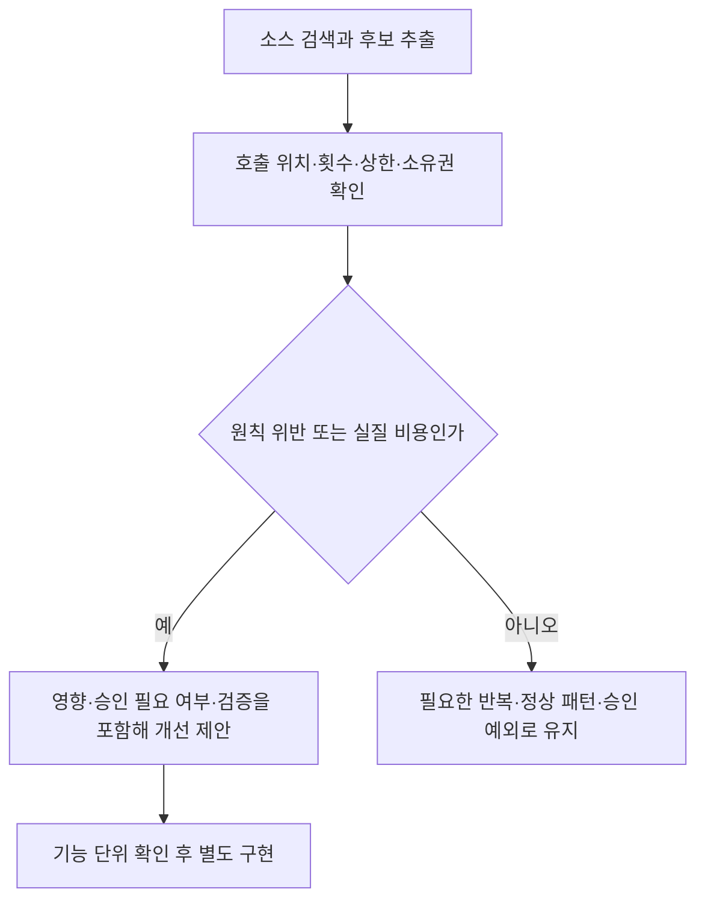
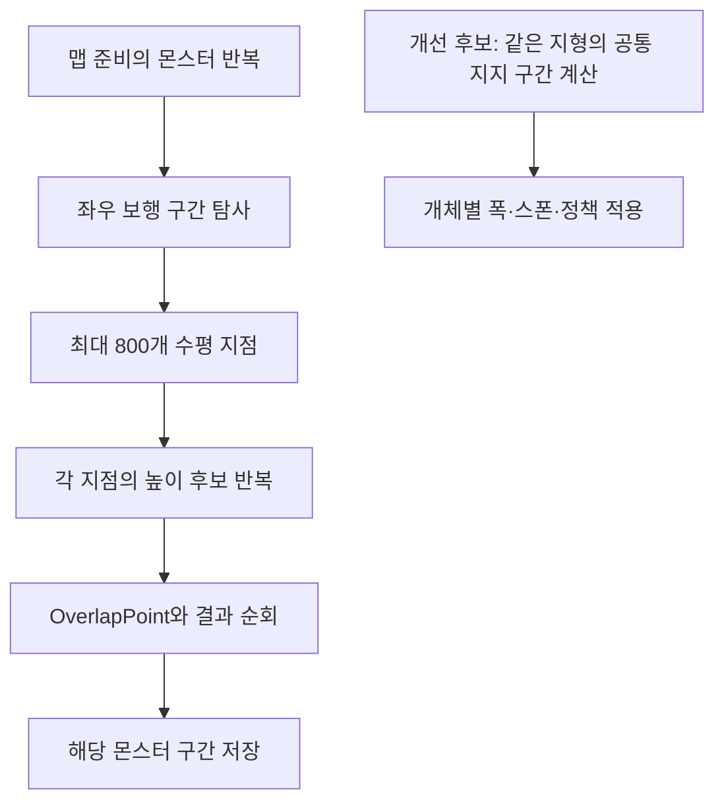

# 코드 구조와 반복·재귀 개선 검토

기준일: 2026-11-17 · 클라이언트 `ab6277fc` · **정적 점검·개선 제안이며 코드 수정이나 성능 측정을 수행하지 않았습니다.**

2026-11-17 재점검: 근거 위치를 코드와 다시 대조했습니다. S09는 실제 좌표 배율로 확인해 **확정 결함**으로 올렸고, S06은 경계 변환으로 판단해 낮췄습니다. S07은 실제 범위를 추가했고, 보행 구간 탐색과 후퇴 판정에 빠진 비용 근거를 보탰습니다. 이번에도 Play·컴파일·측정은 하지 않았습니다. 이미 적용된 표시 갱신 최적화는 [반복 갱신과 임시 표시 최적화 설계](../반복%20갱신과%20임시%20표시%20최적화%20설계.md)에 있으며 이 문서에 다시 적지 않습니다.

## 목차

1. [범위와 판단 기준](#1-범위와-판단-기준)
2. [설계원칙과 구조 개선](#2-설계원칙과-구조-개선)
3. [반복문과 호출 비용](#3-반복문과-호출-비용)
4. [재귀와 오탐 구분](#4-재귀와-오탐-구분)
5. [단순화 순서와 검증](#5-단순화-순서와-검증)

## 1. 범위와 판단 기준

소유 스크립트 `Assets/3.Script`를 검색하고 주요 조립·NPC·상호작용·저장·오류·스폰·이동 코드를 읽었습니다. 외부 패키지·생성 정의를 일반 리팩터링 대상으로 포함하지 않았습니다. 문자열 검색과 간단한 구문 후보 추출은 의미 분석 컴파일러가 아니므로 런타임 전체 호출 그래프·모든 간접 재귀의 부재를 보장하지 않습니다.

규칙 위반, 승인 예외, 성능 후보, 검증 대기를 구분합니다. 반복 단계 수나 파일 크기만으로 오남용이라고 판단하지 않습니다. 개선 제안의 우선순위는 오류 계약 → 데이터·원본 경계 → 초기화 비용 → 표시·가독성입니다.

## 2. 설계원칙과 구조 개선

| 번호·우선순위 | 근거 | 판단과 원인 | 권장 개선·영향 |
| --- | --- | --- | --- |
| S01·높음 | [NpcTalk.ConnectDialogueEvents](../../../Assets/3.Script/Adapters/Interaction/NpcTalk.cs:151) | 표시 갱신과 `NotifyChanged()` 전체가 같은 catch 안에 있음. Changed 소비자 예외까지 표시 오류로 삼켜 동기 게임플레이 이벤트 계약과 충돌할 수 있음 | 자기 표시 처리만 경계에서 기록하고 완료 통지는 그 밖에서 수행. 표시 실패 시 통지할 상태도 명확화. Registry·선택 갱신의 실패 전달·정리 검증 필요 |
| S02·중간 | [GameplayPreview](../../../Assets/3.Script/Preview/GameplayPreview.cs:145) | 스테이지 ID→환경음 키 switch, `BossStage=8004`, [ShowGateHint](../../../Assets/3.Script/Preview/GameplayPreview.cs:998)의 직접 문구·Z 입력 표현이 콘텐츠와 조립 코드에 남음 | 기존 Stage·사운드·Language/UI_Lang·키 공급을 먼저 재사용. 보스/장부 특례의 기존 승인 여부를 개별 확인하고 승인 예외를 일괄 제거하지 않음 |
| S03·중간 | [PlayerInteractor](../../../Assets/3.Script/Adapters/Interaction/PlayerInteractor.cs:162) | Language ID→UI ID 숫자 매핑과 `F ` 접두어가 로컬 분기에 결합. 문구 추가 시 코드 수정 필요 | 기존 UI_Lang 연결과 입력 키 표현을 공통 조회. 신규 테이블을 무조건 추가하지 않음. 서낭당·문·명부·NPC 회귀 필요 |
| S04·중간 | [StageContentSet.Stages](../../../Assets/3.Script/Adapters/StageContentSet.cs:70), StageEntry의 공개 필드 | 내부 배열과 가변 행을 외부에 그대로 노출. 실제 오염 발생을 확인한 것은 아니지만 원본 불변성이 계약으로 보장되지 않음 | 기존 직렬화는 보존하고 소비에는 읽기 전용 조회·필요한 실행 사본 공급. 단순 IReadOnlyList 래핑만으로 행 자체 불변이 되지는 않음 |
| S05·중간 | [GameplayPreview](../../../Assets/3.Script/Preview/GameplayPreview.cs)·PreviewMonsterDriver | 조립자가 콘텐츠 선택·공간 스캔·전투 연결·표시·입력/이동 정책을 많이 함께 소유. partial 분리는 파일 정리일 뿐 의존 분리는 아님 | 먼저 보행 구간 계산처럼 입력·출력이 명확한 책임부터 기존 모듈에 모음. 전체 조립자를 새 서비스/이벤트 버스로 대체하지 않음. 프리팹 직렬화·명시적 의존성 보존 |
| S06·낮음 (재점검에서 중간→낮음) | [ErrorPopupHost.ShowCopied](../../../Assets/3.Script/Adapters/ErrorPopupHost.cs:217) | `WaitForSecondsRealtime(1500 / 1000f)`. 지속시간은 정수 ms 1500으로 정하고 Unity API를 호출하는 순간에만 초로 바꾸며, 프로젝트 코드에서 누적하지 않음. AGENTS가 허용하는 경계 변환이므로 정수화 위반으로 보지 않음. 남는 문제는 이름 없는 숫자 | `CopiedNoticeMilliseconds` 같은 이름 있는 정수 상수로 분리. MillisecondClock 전환은 필요하지 않음. 소유 코드의 유일한 `WaitForSeconds` 사용 |
| S07·낮음·규칙 확인 필요 | [NpcTalk](../../../Assets/3.Script/Adapters/Interaction/NpcTalk.cs:28), [GroundSlopeRule](../../../Assets/3.Script/Core/Locomotion/GroundSlopeRule.cs:12) 외 | 재점검 범위: `Assets/3.Script`(Data 제외)에 private PascalCase 상수 14개(6개 파일, GameplayPreview 7개)와 public PascalCase 상수 20개(15개 파일)가 있음. `_camelCase` 상수는 71개. public 상수(`IntegerPosition.UnitsPerTile`, `GameSpeedState.RateScale` 등)는 여러 파일이 쓰는 공개 계약 | **이름을 바꾸기 전에 public 상수를 `_camelCase` 규칙의 예외로 둘지 사용자 확인이 먼저.** private 상수만 정리하면 영향이 파일 안에 그침. enum·자동 생성·외부 API 명칭은 제외. 내용 상수 자체의 정당성과 명명 문제는 분리 |
| S08·검토 | 저장·컷씬·타이틀의 async void 진입점 | 이벤트/엔진 진입점에서는 필요할 수 있으나 호출자가 완료·실패를 기다릴 수 없음. 존재 자체를 오류로 판단하지 않음 | 실제 파일·리소스 I/O 비동기 유지. 내부 Task·취소·세대/수명 확인을 개별 검토하고 진입점만 얇게 유지. 일괄 동기화 금지 |
| S09·**확정 결함·최우선** | [PreviewMonsterDriver.CanRetreatFrom](../../../Assets/3.Script/Preview/PreviewMonsterDriver.cs:259) | `x`는 Transform 월드 실수(예: 12.3), `_spanMin/_spanMax`는 `IntegerPosition` 정수(`UnitsPerTile = 1000000`, 예: 12,300,000)인데 직접 비교. [GameplayPreview.cs:639](../../../Assets/3.Script/Preview/GameplayPreview.cs:639)가 모든 일반 몬스터에 보행 구간을 넣으므로, 구간이 원점 주변이 아니면 조건이 항상 참이 되어 `CanRetreat`가 항상 거짓. 옹귀 "뒤로 깡총"(`1f7e2f9e`, NYM)이 실제 맵에서 거의 발동하지 않는 것으로 판단됨 | 후퇴 목표를 `_runtime.Position.X`와 정수 이동량으로 계산해 같은 정수 구간과 비교하고, 물리 조회 순간만 월드로 변환. **NYM 담당 기능이므로 확인 후 수정.** 수정 전후 도화골·산길에서 Play로 재현·확인. 정적 판단이며 Play 재현은 아직 하지 않음 |

### 승인 예외와 정상 패턴

| 항목 | 현재 근거와 처리 |
| --- | --- |
| NPC 배치의 Inspector 공용 정수값 | [NPC 설계 2.1](../NPC%20이름표와%20말걸기%20안내%20배치%20설계.md#21-사용자-결정)의 사용자 선택. 데이터 기반 위반으로 재작업하지 않음 |
| 최대 경사 45도 공통 상수·상태 없는 GroundSlopeRule | 경사 설계의 11/17 사용자 확정. 정적 순수 계산에 Strategy·Factory를 추가할 이유 없음 |
| PreviewFootCollision의 상속·재정의 | 기존 충돌 버퍼·형상 관측 재사용과 플레이어 동작 보존을 위한 책임. 패턴 오남용으로 판단하지 않음 |
| Effect 상태 팩토리 | 효과 종류별 생성과 실행을 분리하는 확장 요구가 있음. 이 점검에서 제거 근거 없음 |
| LoadingScreen의 Task.Result | IsCompleted와 취소·실패를 먼저 확인. 검색 결과만으로 동기 대기·교착이라고 판단하지 않음 |
| JsonSaveStore의 이전 재화 ID 변환 | 저장 호환 마이그레이션에 과거 ID가 필요한 경우. 일반 콘텐츠 하드코딩과 구분 |

모든 패턴의 적합성을 전수 증명한 점검은 아닙니다. 현재 확인 범위에서는 패턴 이름이 많다는 이유로 제거할 근거보다 경계 혼재·원본 노출·숫자 연결을 우선 개선할 근거가 명확합니다.

## 3. 반복문과 호출 비용

### 3.1 3중 이상과 메서드 경계 너머 반복

| 위치 | 실제 구조·빈도 | 판단 | 개선 후보 |
| --- | --- | --- | --- |
| [StageLayoutRules.ResolveMonsters](../../../Assets/3.Script/Core/Stages/StageLayout.cs:69) | Placements → Monsters → Points, 명시적 3중 foreach. 맵 준비 시 실행 | 데이터 트리의 각 항목을 순회. 독립 집합의 전체 조합을 만드는 O(P×G×N)으로 단정하면 틀림. 총 입력 행·점 수에 비례하는 필요한 중첩 | 검증·생성 순서와 개체 sequence 보존. 전체 몬스터 상한 검증 위치 확인. 평탄화 복제본을 무조건 추가하지 않음 |
| [OnggwiThrowRigBuilder](../../../Assets/3.Script/Editor/OnggwiThrowRigBuilder.cs:226) | y→x→sy→sx, **4중 반복**. 내부 두 루프는 각 4회, 고해상도 팔 영역에만 사용. 편집기 생성 도구 | 런타임 프레임 부하와 구분. 중첩은 있으나 전체 세부 셀 처리를 위한 구조 | 생성 시간 측정 후 희소 영역·격자 정점 재사용 검토. 불필요한 미세 분할 제거 우선. 리깅은 다른 담당이므로 임의 수정 금지 |
| [GameplayPreview 보행 구간 준비](../../../Assets/3.Script/Preview/GameplayPreview.cs:623) | 몬스터 반복 → 좌우 FindSpanEnd 최대 800단계 → TryFindSurface 높이 스캔 → SolidAt 결과 순회. **호출을 따라가면 3~4단계 반복** | 가장 우선적인 비용 측정 후보. 맵 준비 시이고 매 프레임은 아님. 실제 지형 길이·겹친 Collider 수·중단 시점에 따라 비용 변동. **정적 상한(재점검):** 한 단계 0.25칸(`SpanStep`), 높이 탐색 ±0.25칸(`MaxRise`)을 1/96칸(`SurfaceScanStep`) 간격 → 단계당 `OverlapPoint` 최대 약 49회. 800단계×좌우 2방향이면 몬스터 하나당 최대 약 78,000회이며, 결과마다 `GetComponentInParent` 2회가 더해짐. **[GameplayPreview.cs:669](../../../Assets/3.Script/Preview/GameplayPreview.cs:669)의 조건이 경사 여부보다 `TryFindSurface`를 먼저 실행해 평지에서도 매 단계 높이 탐색 비용을 냄.** 800단계 상한은 200칸이라 더 넓은 지형에서는 구간이 오류 없이 잘림 | **1순위:** 현재 바닥이 경사가 아니면 평지 판정(앞 막힘·발밑)을 먼저 하고, 경사이거나 평지 판정이 실패할 때만 `TryFindSurface`를 호출하도록 순서 변경. 결과가 같은지 경사 시작·끝·V자에서 비교. 지역 변경이라 캐시 무효화 문제가 없음. **2순위:** 같은 지형을 공유하는 보행 구간 캐시(지형 변경 시 무효화 필수). 200칸 상한 도달 시 경고 기록 검토 |

세 번째 경로는 대략 개체 수×방향 수×수평 단계×높이 후보×조회 결과 비용입니다. 각 상한을 무조건 전부 실행한 실제 비용으로 보고하지 않습니다. 800단계 같은 상한이 종료를 보장한다는 점과, 콘텐츠 크기에 따라 탐사가 잘려 결과가 달라질 수 있다는 점도 함께 확인해야 합니다.

### 3.2 그 외 반복의 분류

| 위치 | 판단과 조건 |
| --- | --- |
| PreviewMonsterDriver.ShadowSprite의 y/x 반복 | 작은 그림 최초 생성용 2중 픽셀 처리. 정적 리소스 재사용 여부 유지. 매 프레임 처리로 오인하지 않음 |
| PlayerInteractor.Select의 대상 반복 | 변경 예약을 소비할 때 실행. 무조건 Update마다 전체 검색한다고 기록하지 않음. 이동 중 빈도가 높다면 범위 후보 수를 측정 |
| ShrineScreen의 3개 메뉴·5개 능력치 반복 | 고정 소수의 UI 표시. 중복 코드보다 간결할 수 있어 제거 대상 아님 |
| GameplayPreview.LateUpdate의 몬스터 Step | 움직이는 개체의 시뮬레이션 진행에 필요. 모든 틱을 이벤트로 바꾸지 않음. 같은 프레임 중복 전수 조회부터 측정 |
| StageContentSet의 선형 ID 조회 | 초기화/희소 호출이면 충분할 수 있음. 사용 빈도·테이블 크기 확인 없이 모든 배열을 사전으로 바꾸지 않음 |

### 3.3 프레임 경로의 낭비 후보와 이미 적용된 방어

| 경로 | 확인 결과 | 조치 판단 |
| --- | --- | --- |
| ObserveTarget → CanRetreatFrom | 움직이는 일반몹의 관측마다 Patterns를 순회해 최대 후퇴 거리 재계산. **재점검:** `ObserveTarget`은 한 프레임에 두 번 호출되고([이동 전](../../../Assets/3.Script/Preview/PreviewMonsterDriver.cs:167)·[이동 후](../../../Assets/3.Script/Preview/PreviewMonsterDriver.cs:223)), 후퇴 패턴이 있는 몬스터는 그때마다 `MoveHorizontal` 물리 조회를 함. 실제 비용은 패턴 순회보다 이 물리 조회 | 후퇴 거리 최대값은 초기화 때 한 번 계산(패턴 교체 시 무효화). 물리 조회는 후퇴 패턴의 쿨다운이 끝나 선택 가능할 때만 하거나 프레임당 한 번으로 줄이는 방안 검토. 두 번 관측하는 순서 의도는 담당자 확인. S09 수정과 함께 검토 |
| StepGameLayer | 매번 일반몹의 IsEngaged를 OR로 합침. 결과 true 뒤에도 `\|=`로 끝까지 순회 | 부작용 없는 조회이므로 true에서 종료 가능. 개체 수가 작을 수 있어 우선순위는 낮음. 다른 기능의 상태 갱신 루프를 같은 방식으로 자르면 안 됨 |
| StepGameLayer → PlayMusic | 매 프레임 호출되지만 동일 키면 즉시 반환 | 실제 음악을 매번 다시 로드·재생한다고 보고하지 않음. 필요하면 호출 경계의 상태 변경 통지로 줄이되 측정 후 결정 |
| RefreshLabels → PreviewPresentation | 이름과 상태 문자열은 구독 갱신을 소비할 때만 생성, 색상은 매번 대입 | 문자열의 매 프레임 생성 낭비는 이미 줄어 있음. 색상 변경 시만 대입하는 후보는 있으나 측정 없이 핵심 병목으로 단정하지 않음 |
| ShrineScreen·HudScreen | 갱신 예약을 소비할 때 데이터 표시. 알파·잔상 애니메이션은 진행 중 틱 필요 | 모든 Update 삭제 또는 전역 이벤트 전환은 불필요. 표시 중 `new[]`와 경로 문자열 생성은 희소 갱신 비용으로 분류 |
| GameplayPreview.LateUpdate 앞뒤의 FlushMonsterRewards·ApplyPendingProgress | 서로 다른 처리 단계 전후에 호출 | 같은 이름 두 번이라는 이유만으로 삭제 금지. 한 틱 안의 새 보상·사망/진행 반영 순서 의도가 있어 호출 사이 상태를 검증해야 함 |

`new Vector2/Vector3/Color`는 값 형식이므로 표기만으로 관리 힙 할당이라고 판단하지 않습니다. 현재 검토에는 CPU 시간·GC Alloc·Physics2D 조회 횟수의 실측이 없습니다. 최대 몬스터 배치, 다수 투사체/필드, 경사 왕복, UI 열림/닫힘, 정지·전환 상태를 나눠 프로파일링해야 합니다. 초기화 피크와 지속 프레임 비용도 별도로 기록합니다.

## 4. 재귀와 오탐 구분

| 위치 | 확인 결과 | 판단·후속 |
| --- | --- | --- |
| [JsonSaveStore.CheckIntegerValues](../../../Assets/3.Script/Adapters/JsonSaveStore.cs:120) | 자식 JToken마다 자기 메서드 호출하는 **직접 재귀**, 읽기 파서 MaxDepth=16 확인 | 저장 JSON 트리의 필요 순회. 노드 수에는 선형이며 깊이 제한 존재. 현재 근거로 과도한 재귀로 판단하지 않음. 다른 진입점이 생기면 같은 파서 제한 유지 |
| ContentAccess.Evaluate 오버로드 | 정의 종류별 메서드가 bool 등 공통 인자의 다른 오버로드에 위임 | 무한 재귀 아님. 공통화의 정상 사례 |
| GroundSlopeRule.CanTraverse/MaxRise 오버로드 | 기본 인자를 보강해 다른 인자 수의 메서드 호출 | 재귀 아님 |
| ErrorLogDispatcher.Post | SynchronizationContext.Post 호출 | 자기 호출 아님 |
| base.OnEnable·Release/Dispose 이름 일치 | 기반 메서드 또는 다른 객체 호출 | 동일 이름 검색만으로 재귀로 분류하지 않음 |

이번 확인에서 **과도한 직접 재귀로 확정한 실행 경로는 없습니다.** 저장 트리 검사는 깊이 제한을 확인했습니다. 이벤트가 서로 다시 명령을 호출하는 간접 순환은 별도 호출 그래프·실행 시험이 필요하고, 이번 단순 검색으로 없다고 단정하지 않습니다.

## 5. 단순화 순서와 검증

| 순서 | 개선 단위 | 보존·검증 |
| --- | --- | --- |
| 1 | S09 후퇴 좌표 단위 결함(NYM 확인 후)·S01 이벤트 예외 경계 | S09는 수정 전 Play로 결함 재현 → 정수 비교로 수정 → 옹귀 후퇴 발동·벽/구간 끝 거부 확인. S01은 소비자 예외 전파·표시 오류 보고·등록 해제·언어 갱신 순서 |
| 2 | S02~04 콘텐츠 조회와 원본 경계 | 기존 데이터·직렬화·저장 ID·담당자 승인 예외 보존 |
| 3 | 보행 구간 탐색의 조건 순서 변경 → 필요 시 캐시 | 순서 변경 전후 구간 결과 일치(평지·경사 시작/끝·V자·벽), 조회 수·시간 비교 |
| 4 | S06 상수 이름·S07 명명(public 상수 규칙 확인 후) | 복사 알림 지속시간 동일, 모든 참조 검사 |
| 5 | 책임 분리·비동기 진입점 검토 | 기존 조립 순서·오류 전달·취소·세대 교체 유지 |

코드를 짧게 보이게 하려고 루프를 LINQ로 감추거나 재귀를 다른 함수로 옮기는 것은 최적화 완료가 아닙니다. 정적 수치·측정값·기능 회귀가 있어야 개선으로 판정합니다. 네트워크·리플레이에는 ID·시간·상태 소유권·명령 순서를 보존하며 새 구현을 임의 추가하지 않습니다.

이번 작업은 개선사항 분류 문서만 작성했습니다. 구현은 기능 단위 설명과 확인 후 별도 진행합니다. [전체 개발 문서 통합 안내](../전체%20개발%20문서%20통합%20안내.md)에서 현황·사용 안내·이력으로 돌아갈 수 있습니다.

