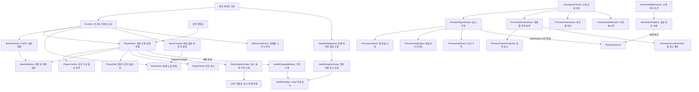

# 게임플레이 모듈 구조

> 2026-11-06 문서 대조(로컬 `3204b4a`): StageLayout·PreviewStage·PreviewSession·HUD/메뉴/소리 연결이 추가됐습니다. PreviewSession은 임시 정적 상태이며 영구 저장 소유자가 아닙니다. 해체900ms·이동 자원 유지·매복은 Preview 연결 범위입니다. 전체 상태는 [현재 구현과 검증 현황](%ED%98%84%EC%9E%AC%20%EA%B5%AC%ED%98%84%EA%B3%BC%20%EA%B2%80%EC%A6%9D%20%ED%98%84%ED%99%A9.md), 우선순위는 [남은 작업](%EB%82%A8%EC%9D%80%20%EA%B5%AC%ED%98%84%EA%B3%BC%20%EA%B2%80%EC%A6%9D%20%EC%9E%91%EC%97%85.md)을 따릅니다.

플레이어·일반몹·보스의 공개 진입점과 기존 프리팹 참조를 유지하면서, 자주 함께 바뀌는 책임을 내부 모듈로 나눕니다.

화살표는 호출·주입·통지 관계입니다. 공격 실행 객체의 AttackWindow와 각 Runtime의 시계는 개체별 인스턴스입니다. HealthDisplayHost의 실제 씬 부착은 보류 상태입니다.

| 모듈 | 소유하는 값·책임 | 호출 경계 |
| --- | --- | --- |
| Core/Characters/PlayerActor | HP·행동 시간·무적·구속·해체, 상태 전환·소모 순서 | 기존 TryAttack/TryRoll/ReceiveHit/Tick 및 결과 이벤트 유지 |
| Core/Characters/PlayerSkill·PlayerHerbs | 결박 가르기 실행 인수·쿨타임, 약초 개수·회복 값 | 상태 전환·판정·회복 적용은 PlayerActor |
| Core/Interaction/InteractionSelector·TextboxPlayback·StageProgress | 대상 선택, 텍스트 진행, 클리어 기록 | 표시·입력·저장 연결은 호출자 |
| Adapters/Interaction | IInteractable과 Talk·Door·Ledger·Shrine, PlayerInteractor 순서 판정·표시 | 서비스는 InteractionContext로 주입, 대상은 전달받은 묶음에서만 수집 |
| Core/Combat/GroundFire | 불 지속·피해 주기 | 위치·접촉·피해 적용은 호출자 |
| Preview/PreviewCollision·HangEdges·FallZones·DeathRestart·ThrownProjectile·GroundFireView | 임시 이동의 충돌 조회, 표식 해석, 사망 재시작, 변종 표시 | 전달받은 표식 묶음만 사용. 운영 물리·스폰이 아님 |
| Core/Combat/PlayerCombo | 읽기 전용 공격 배열 스냅샷·현재 타수·예약 입력 | Actor가 검증된 시간/버퍼로 요청. 다음 타 진입 때 Actor가 비용 지불 |
| Core/Combat/AttackWindow | 활성 여부·창마다 맞은 양수 개체 ID·창 변경 이벤트 | 피해 계산·거리·상태 전환은 소유하지 않음. 회피한 대상도 기존처럼 그 창의 등록은 소비 |
| Core/Characters/MonsterActor | 목표·패턴·대기·경직·잡고 있는 플레이어·AI 상태 전환 | Observe/ClearTarget/NotifyWallHit/TryHitPlayer/Release 유지 |
| Core/Characters/BossPoise | 보스 HP·체세·노출·해체·HP 기준 페이즈 수치 전환 | AI·범위·전환 연출·연출 종료 정책은 호출자 책임 |
| Core/Characters/BossCombat | 내려찍기·2연타·문 돌진 실행·타격별 판정 창·대기·벽 충돌 처리 | BossPoise 상태 머신 공유, BossPoise.Tick 미호출. 이동과 접촉 관측은 외부 공급 |
| Core/Combat/BossPattern | 패턴 상태 키와 타격별 AttackSpec 스냅샷 | 설정 에셋 BossPatternSettings에서 생성 |
| Core/Combat/HitRoll | 창 등록→상대 Dodge→공격자 Crit 순서·난수 범위 검증·HitOutcome | 피해 계산·적용은 각 Actor. 난수는 공격자 런타임 소유 |
| Core/Timing/MillisecondClock | 한 Runtime의 소수 ms 나머지 | 초→정수 ms 변환. 음수·비유한 입력 거부, int 상한 뒤 나머지 보존 |
| Adapters/*Runtime | 제공 데이터로 코어 조립·Update 시간 전달·활성 수명 | 기존 초기화 계약/직렬화 필드 유지. 전역 시계·추가 Bootstrapper 없음 |
| Preview/GameplayPreview | Inspector 참조·초기화·구독/해제·프레임 실행 순서·검사 전용 키 | 일반 C# 내부 모듈을 직접 조립. 새 MonoBehaviour를 프리팹에 추가할 필요 없음 |
| Preview/PreviewPlayerMotion | 임시 점프/구르기 진행·Transform 표시 | 코어 요청 수신, 완료 시 기존 SetGrounded 전달. 운영 물리 정책 아님 |
| Preview/PreviewMonsterDriver | 일반몹 한 개체의 임시 이동·거리/벽 관측·타격·확인 색상 | 개체별 참조·판정 ID를 초기화 때 공급. 운영 스폰/풀링 아님 |
| Preview/PreviewPresentation | 플레이어/보스 표시 변경 구독·예약·색상·공통 상태 이름 | 게임 규칙은 변경하지 않고 Reset에서 구독/예약 정리 |
| Core/SubscriptionScope | 구독 해제·표시 예약 병합·이전 콜백 Guard | 게임 규칙·Unity 자원 수명 자체는 소유하지 않음 |
| Adapters/Interaction/InteractableBehaviour·InteractionRegistry | 동일 묶음의 대상 등록/해제·변경 통지 | 기존 네 대상의 공통 수명, 새 대상의 변경 통지 계약 |
| Presentation/HealthDisplayHost·HealthDisplayGroup | 전달된 의존성과 소유 표시의 활성·생성·정리 | 데이터·플레이어·부모 생성은 호출자 책임. 실제 씬 연결 보류 |
| Presentation/HealthDisplayBinding·HealthDisplay | 체력 이벤트·최초/재활성 동기화·이전 연결 거부·Unity 막대 | 게임 규칙·현재 HP를 별도로 소유하지 않음 |
| Adapters/SpawnAnchors | 부모 인스턴스 내부의 이름별 Transform 참조 | 한 번 수집, 선택 이름 누락·중복·제거 거부. 풀링·회수 정책과 분리 |

## 변경할 위치

- 콤보 입력 창/타수 구성은 PlayerCombo, 공격 수치·비용은 기존 PlayerCombatSettings와 제공 정의에서 관리합니다.
- 행동 우선순위·피격/구속/해체 전이는 Actor에서 조정합니다. 다른 모듈이 별도 상태 머신을 만들지 않습니다.
- 판정 창의 대상 중복 규칙은 AttackWindow, 회피/치명 판정 순서는 HitRoll이 맡습니다. 실제 접촉과 공격자 난수는 판정 어댑터가 공급합니다.
- 임시 이동·몬스터 관측 방식·표시를 바꿀 때는 각각 해당 Preview 모듈을 수정합니다. GameplayPreview의 조립 순서와 구독 수명을 함께 확인합니다.
- Core는 Unity API를 참조하지 않습니다. 이번 분리는 클래스 책임 단위이며 새 asmdef·범용 DI·전역 이벤트 버스·상태 팩토리를 도입하지 않습니다.
- 보스 페이즈 수치 전환과 문 돌진 코어는 구현했습니다. 데이터 공급/생성 정책·운영 물리·미공급 기획 수치는 임의로 확정하지 않습니다.

이벤트 표시와 매 프레임 진행을 구분합니다. Runtime의 시간 공급과 이동·센서 관측은 필요하지만 운영 UI의 변하지 않은 문자열을 매 프레임 만들 필요는 없습니다. Preview의 현재 표시 방식은 후속 운영 표현에서 교체할 범위입니다.
설계 적합성·예외 경계·구독 수명 개선은 [설계 점검](%EC%84%A4%EA%B3%84%20%EA%B8%B0%EC%A4%80%20%EC%A0%90%EA%B2%80%EA%B3%BC%20%EA%B0%9C%EC%84%A0%20%EB%B0%A9%ED%96%A5.md)을 참고합니다.

검사는 기존 이동·전투·몬스터 경계와 모듈 간 독립성/이벤트 정리·프레임 나머지 보존을 함께 확인합니다. 실행 방법은 [검사 자동화](%EA%B2%80%EC%82%AC%20%EC%9E%90%EB%8F%99%ED%99%94%EC%99%80%20%EB%8D%B0%EC%9D%B4%ED%84%B0%20%EC%98%A4%EB%A5%98%20%EA%B2%BD%EA%B3%84.md), 기능 계약은 [게임플레이 코어](%EA%B2%8C%EC%9E%84%ED%94%8C%EB%A0%88%EC%9D%B4%20%EC%BD%94%EC%96%B4%EC%99%80%20%ED%94%84%EB%A6%AC%ED%8C%B9%20%EC%97%B0%EA%B2%B0.md)를 따릅니다.
