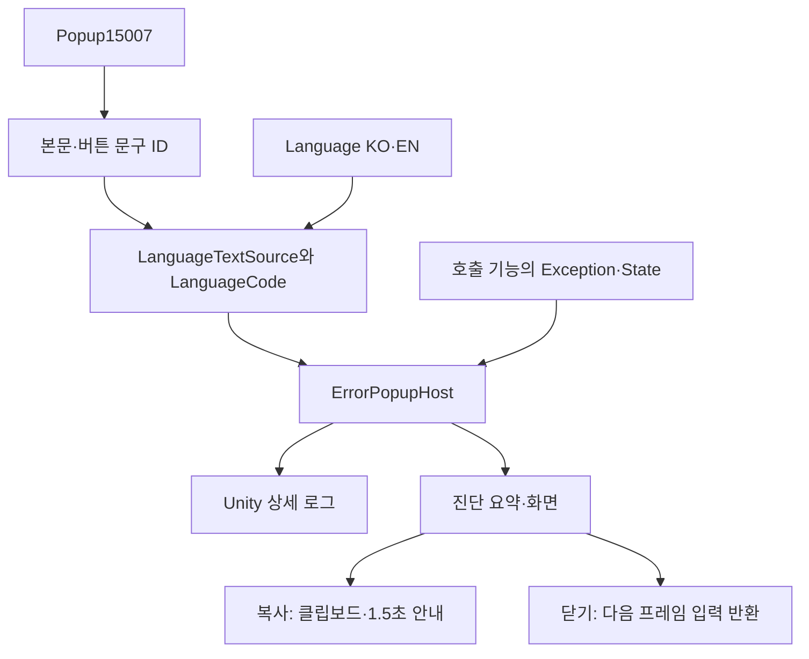
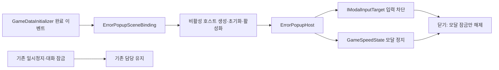

# 공용 에러 팝업 설계

2026-11-05 소비 측 후속: TitleGameEntry도 기존 IModalInputTarget에 연결해 옵션의 별도 MenuInput·포인터 진입점을 차단합니다. GameplayPreview는 초기화 전 모달 상태를 보존하고 준비되는 입력에 적용합니다. UI 종료의 입력·버퍼 폐기는 게임 조립자가 담당하며 독립 GameSpeedState 모달 정지와 기존 정지 소유권은 그대로 유지합니다. 데이터·수집/표시 모듈·씬은 수정하지 않았습니다. 격리 프리팹71검사 통과, 실제 Play·장치·클립보드·F9/부스 검증은 후속입니다.

2026-11-05. 사용자가 Popup15007의 새 기획을 승인해 기존 X·확인/일반 문구 전용안에서 **복사·닫기·상세 오류 표시**로 변경했습니다. Popup·Language를 검사·배포하고 데이터 조회를 연결했습니다. 초기화된 테스트 호스트의 Unity 오류 자동 수집을 추가했습니다. 현재 타이틀·MapDohwagolTest에는 오류 호스트와 모달 입력·시간 차단이 연결되어 있습니다. 실제 Play·장치·클립보드 수용과 F9·부스 표시·출시 전체 정책, Firebase·메일은 별도 범위입니다.

## 1. 목적과 구조

오류 화면을 저장·맵·컷씬마다 다시 만들지 않으면서 오류 문구는 기획 데이터로 관리합니다. 상세 원본은 Unity 로그에 유지하고 화면에는 진단 요약을 표시해 복사할 수 있게 합니다.



## 2. 상속과 책임

| 위치 | 책임 |
| --- | --- |
| Presentation/PopupScreen | 공통 표시·선택·이전 선택 복귀·닫기 요청을 제공하는 추상 부모 |
| Presentation/ErrorPopupScreen | PopupScreen 상속. 오류 문구·상세·복사/닫기 라벨·복사 요청 추가 |
| Adapters/ErrorPopupHost | 데이터 연결·로그·생성·메뉴 입력·복사·소유권 정리 |
| Adapters/LanguageTextSource | 문구ID·언어코드를 KO/EN으로 해석하는 공용 조회. Read는 확장 가능 |
| Core/Feedback/ErrorPopupDetails | 예외·횟수·씬·상태·시각·기록 경로를 표시용 문자열로 구성 |
| Core/Settings/LanguageCode | Korean=0·English=1. 추가 언어·언어 선택 UI는 후속 |
| UI/PopupButton.prefab | 기본 Button·Image·Label. 오류 전용 동작 없이 두 버튼이 중첩 재사용 |
| UI/ErrorPopupScreen.prefab·ErrorPopupHost.prefab | 처음 비활성 화면과 명시적 초기화가 필요한 호스트 |

같은 표시 수명은 부모에 두고 오류 전용 동작만 자식에 둡니다. 버튼 자체를 감싸는 새 클래스를 늘리지 않습니다. 기존 다른 메뉴를 일괄 상속 전환하지 않습니다.

## 3. 실제 데이터 연결

| 항목 | 실제 참조 |
| --- | --- |
| Popup | 15007 |
| 본문 | BodyTextID→30209: 오류가 발생했습니다 / An error occurred |
| 첫 버튼 | Button1TextID→30210: 복사 / Copy |
| 둘째 버튼 | Button2TextID→30211: 닫기 / Close |
| 초기 선택·취소 | DefaultButton=1, CancelButton=2 |
| 기록 경로 라벨 | 30212: 기록 파일 / Log file |
| 복사 안내 | 30214: 복사했습니다 / Copied, 1500ms 실제 경과시간 |

30213은 F9 안내용이므로 이번 팝업에는 사용하지 않습니다. 버튼 의미는15007의 첫 버튼=복사·둘째=닫기라는 계약이며 시트 순서를 임의 교환하면 안 됩니다. 예외 메시지·스택 원문은 번역하지 않습니다. 진단 항목명은 현재 한국어이며 별도 번역ID는 아직 공급되지 않았습니다.

```csharp
// 세 참조는 호출 조립자가 명시적으로 소유합니다.
popup.Initialize(sceneEvents, SetErrorModalState, catalog, LanguageCode.Korean, ReadCurrentState);
// 실제 오류 경계에서 호출합니다. state는 오류 순간의 호출 기능 상태를 전달합니다.
popup.Report(error, OnErrorDismissed, this, state);
```

초기화가 Popup·Language 연결을 함께 수행합니다. 언어를 바꿀 때는 팝업을 닫은 상태에서 Configure(catalog, LanguageCode.English)를 호출합니다. Initialize는 한 번, Configure는 언어 변경 시 재호출할 수 있습니다. 전역 언어 선택·저장은 아직 없습니다. 생성 데이터 정의를 임의 수정하지 않습니다.

## 4. 표시·복사·수명 계약

- Report는 상세 예외를 Debug.LogException으로 기록하고 종류·호스트 누적 보고 횟수·메시지·스택3줄·씬·State·현지시각·Application.consoleLogPath를 요약합니다. State는 호출자가 전달하고 미전달 시 빈 값입니다. 로그 경로는 플랫폼에 따라 비어 있을 수 있습니다.
- 표시 중 새 오류가 오면 중첩 화면 없이 최신 요약·횟수로 갱신합니다. 원본 예외는 각각 로그에 남고 처음 호출의 닫힘 콜백은 유지합니다. true는 새 표시 인수, false는 기존 화면이 있어 새 팝업을 만들지 않았다는 뜻입니다.
- 복사는 현재 표시 문구와 진단 요약을 GUIUtility.systemCopyBuffer에 넣고 창을 유지합니다. 복사 안내는 멈추지 않는1500ms로 지웁니다.
- 화면의 닫기·취소는 같은 닫기 요청을 씁니다. 여는 프레임의 입력은 무시하며 닫는 입력이 뒤쪽으로 새지 않도록 다음 프레임에 소유권을 돌려줍니다.
- Initialize의 콜백은 팝업 동안 뒤쪽 UI·게임 입력과 게임 일시정지를 조립자가 연결하는 지점입니다. 다른 일시정지/로딩 소유권을 무조건 해제하면 안 됩니다. 모듈은 Time.timeScale을 직접 덮어쓰지 않습니다.
- 비활성화/씬 종료 때 표시·입력·코루틴·소유 잠금을 정리하고 닫힘 콜백을 호출하지 않습니다. 외부 EventSystem·원본 InputAction을 파괴하지 않습니다.
- 테스트 환경에서 초기화가 끝난 호스트는 UnityErrorLogCollector로 Application.logMessageReceivedThreaded를 구독합니다. Error·Exception·Assert만 받고 일반 Log·Warning은 무시합니다. 원본을 Unity가 기록했으므로 수집 결과를 다시 로그로 쓰지 않습니다.
- 직접 Report가 기록한 로그는 스레드별 보고 범위 표시로 자동 수집에서 제외해 같은 오류를 두 번 세지 않습니다. 자동 표시 중 발생한 로그도 재진입하지 않습니다. 표시 처리 자체가 실패하면 해당 수집기를 중지하고 오류를 한 번 기록합니다.
- 작업 스레드는 문자열·시각만 보관합니다. ErrorLogDispatcher가 Unity 메인 SynchronizationContext로 한 번 전달을 예약하고 예약 중에는 최신 내용과 누적 수로 합칩니다. UI·씬·State·로그 경로 조회는 메인 스레드에서만 합니다. 매 프레임 로그를 조회하지 않습니다.
- 호스트 비활성화/파괴 시 구독·대기 전달을 폐기합니다. 재활성화하면 새 수집 수명으로 연결합니다. 같은 오류를 중복 표시하지 않도록 씬의 활성 수집 호스트는 한 개로 조립해야 합니다.
- 자동 수집은 에디터/Development Build에서만 시작하고 Inspector에서 끌 수 있습니다. 부스는 해당 플래그를 끄는 준비가 필요하며 구석 표시·정식 출시 객체 제거 전체 정책은 아직 별도입니다. 자동 수집이 꺼져 있어도 명시적 Report API의 정책은 호출자가 책임집니다.
- 데이터와 호스트 초기화 이전의 오류는 현재 수집 범위 밖입니다. 수집기가 있다는 사실을 부트 준비 실패까지 표시한다는 뜻으로 사용하지 않습니다.

## 5. 검증과 후속

실제 배포 CSV에서15007의 참조·KO/EN·기본/취소 버튼, 지원하지 않는 언어 거부, 요약 스택3줄·시각·경로를 검사했습니다. 데이터903·코어600 통과, 기존 CS0414를 제외한 분리 엔진 참조 컴파일 통과했습니다. 최종 초기화 API 변경 뒤 데이터903·참조 컴파일도 다시 통과했습니다. 기본 엄격 검사 문제는 변경하지 않았습니다.

실제 Unity 임포트·상세 글자 넘침·복사·키보드/마우스·일시정지·입력 반환은 별도 확인이 필요합니다. [기획자 안내](../%EA%B8%B0%ED%9A%8D%EC%9E%90%EC%9A%A9%20%EC%95%88%EB%82%B4%EB%AC%B8%EC%84%9C/%EA%B8%B0%ED%9A%8D%EC%9E%90%EC%9A%A9%20%EC%97%90%EB%9F%AC%20%ED%8C%9D%EC%97%85%20%EC%82%AC%EC%9A%A9%20%EC%95%88%EB%82%B4.md)를 참고합니다. 시트의 K17add 빌드 정책·F9·자동 로그 수집은 별도 기능 단위로 구현하며 이번 연결로 완료 처리하지 않습니다.

## 6. 자동 수집 검증과 현재 경계

백그라운드100개 합산·병렬100개 합산·메인 스레드 전달·종료 전 예약 폐기·종료 뒤 무시·새 수명 재연결을 검사했습니다. 데이터911·코어600과 기존 CS0414 제외 엔진 참조 컴파일 통과 기록이며 실제 Unity 로그 이벤트·UI·씬 수명 검사는 별도입니다.

IsCapturing으로 활성 수집 여부를 확인할 수 있습니다. Initialize의 마지막 ReadCurrentState 콜백은 메인 스레드에서 현재 상태를 제공하며 생략하면 State는 빈 값입니다. 이 팝업을 일시정지 상태로 만드는 것은 전달된 SetErrorModalState의 책임입니다. 이번 자동 수집 단계는 실제 씬 조립 코드를 자동 생성하지 않았습니다.


## 7. 씬 조립과 독립 잠금

2026-11-05 후속 연결: ErrorPopupSceneBinding을 TitleScreen 프리팹과 MapDohwagolTest에 연결했습니다. 이전 절의 실제 씬 조립 대기는 이 두 대상에서는 코드·참조 연결 완료로 바뀌며, 실제 Unity 조작 검증은 남았습니다.



씬 참조를 가진 조립자는 Adapters에 둡니다. 입력 대상은 IModalInputTarget으로 연결해 타이틀/맵의 구체적 게임 규칙을 알 필요가 없습니다. MenuInput은 요청된 활성 상태와 모달 차단 상태를 나눠 보관하므로 다른 기능이 비활성화한 입력을 잘못 다시 켜지 않습니다. 플레이어의 모달 차단은 기존 대화 잠금과 분리하며, 팝업 확인 키가 대화 넘김으로 전달되지 않게 합니다. GameSpeedState는 기존 정지와 모달 정지를 OR로 결합하고 정지 동안 연출 시간도 보존합니다. 타이틀은 게임 시간이 없어 속도 참조를 요구하지 않습니다.

DefaultExecutionOrder로 연결 이벤트 구독을 먼저 준비하고, 이미 데이터가 준비된 경우도 처리합니다. 비활성 생성 후 설정을 마치고 활성화하며 종료 시 호스트를 먼저 비활성화해 구독·소유 잠금을 반환합니다. 재활성화는 새 호스트로 시작합니다. Additive 다중 씬은 자동 단일화하지 않으며 조립자가 활성 수집기를 하나로 관리해야 합니다. 신규 화면은 자신의 입력 진입점을 계약 안에서 차단해야 하고, 임의 MonoBehaviour를 꺼서 수명을 깨뜨리는 방법은 사용하지 않습니다.

이 변경은 로컬 표시·입력 경계이며 네트워크 전송·권한 처리를 추가하지 않습니다. 게임 명령이나 저장 상태를 오류 로그에서 재실행하지 않습니다. 출시 분기에서는 이 씬 연결이 호스트를 생성하지 않지만, 명시적 Report 호출자 전체의 출시 정책이나 부스 표시까지 완성한 것은 아닙니다.
