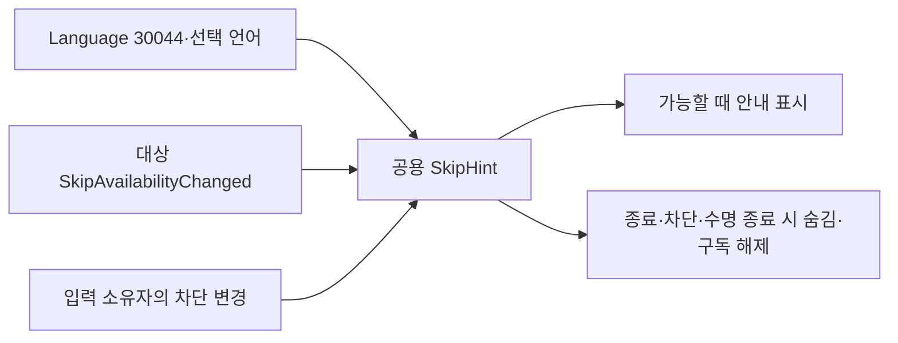
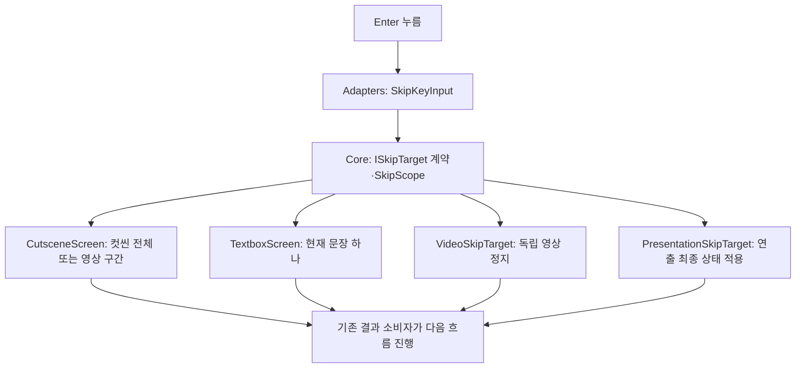
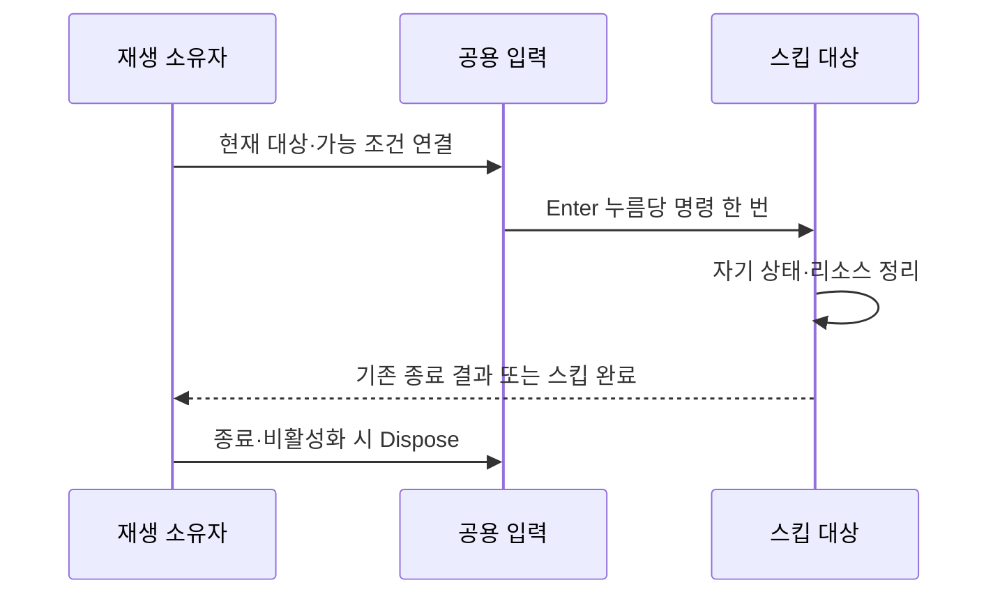

# 공용 즉시 스킵 설계

## 목차

1. [공용 안내 표시 추가 — 2026-11-11](#공용-안내-표시-추가--2026-11-11)
2. [필요한 이유와 확정 규칙](#1-필요한-이유와-확정-규칙)
3. [책임과 배치](#2-책임과-배치)
4. [범위별 결과](#3-범위별-결과)
5. [객체 수명과 실패](#4-객체-수명과-실패)
6. [데이터 호환과 현재 한계](#5-데이터-호환과-현재-한계)
7. [확인 범위](#6-확인-범위)

## 공용 안내 표시 추가 — 2026-11-11

Language 30044를 기존 유지 입력 안내에서 Enter 즉시 스킵 안내로 갱신했습니다. 원본 엑셀의 B50:E50만 수정하고 다른 패키지 항목·서식은 보존했습니다. 기존 ID를 재사용해 프리팹마다 문장을 복제하지 않습니다.

ISkipTarget은 가능 여부 변경을 명시적으로 통지합니다. CutsceneScreen은 기존 코어 변경·일시정지, TextboxScreen은 열기·닫기·활성화, 일반 연출은 Begin·Complete·스킵, 독립 영상은 started·종료·오류에서 통지합니다. 독립 영상의 외부 Pause·Stop은 소유자가 NotifyPlaybackChanged를 호출해야 합니다. 입력 차단과 안내 차단은 같은 소유자가 함께 전달하며 표시 쪽에서 전역 시간이나 입력 상태를 추측하지 않습니다.

SkipHint는 Text 표시·Language ID·대상 구독만 소유합니다. 게임 명령을 재호출하지 않고 자기 표시 오류만 자기 경계에서 기록합니다. 대상이 Unity 객체이면 파괴 여부를 확인하고, 종료·재연결에는 이전 구독을 정리합니다. 안내의 label은 자식 오브젝트로 두어 숨김이 연결 담당 자체를 비활성화하지 않도록 합니다.

공용 CutsceneScreen·TextboxScreen 프리팹에 표시를 연결했고 독립 화면용 SkipHint 프리팹을 추가했습니다. 공용 입력 어댑터는 ConnectText로 기존 언어 공급자를 받습니다. GameplayPreview의 대사 안내도 기존 상호작용 수명 범위에서 연결·해제하고 모달·저장·로딩·사망·일시정지 조건을 반영합니다. 언어 코드가 있는 새 대사는 동일 언어로 안내를 갱신합니다.

안내 반영 검사: 데이터 1,119개·코어 879개, Unity 참조 컴파일 경고·오류 0개. 안내 프리팹·Language ID·컷씬/대사 표시 참조를 검사했습니다. 실제 Unity 화면의 배치·입력·영상 자연 종료·모달 복귀는 별도입니다. 데이터 배포 과정에서 함께 갱신된 비관련 JSON은 이 작업의 변경 범위에 포함하지 않았습니다.

## 1. 필요한 이유와 확정 규칙

2026-11-11 확정: Enter를 누르면 즉시 한 번 스킵합니다. 길게 누르기·누적 시간·진행률은 제거했습니다. 컷씬 전체, 영상 하나, 대사 하나, 연출 하나는 종료 범위가 달라 입력 코드만 공통화하고 실제 정리는 대상 소유자에게 남깁니다.

## 2. 책임과 배치

| 위치 | 책임·이유 |
| --- | --- |
| Core/Interaction/ISkipTarget | Unity 입력·영상 타입을 모르는 범위와 명령 계약 |
| Adapters/SkipKeyInput | Enter·숫자패드 Enter의 누름 이벤트, 연결 프레임·동일 프레임 중복 차단, 해제 |
| Adapters/SkipInput | 독립 대상 컴포넌트와 범위를 연결하는 재사용 입력. 차단은 SetBlocked로 주입 |
| 기존 CutsceneInput | 같은 키 입력을 재사용. 다음 장 입력은 유지하고 기본 Enter 범위는 컷씬 전체 |
| 기존 GameplayPreview | 기존 상호작용 수명 범위에서 대사 Enter 연결·정리. 오류 모달·저장·일시정지·로딩 중 차단 |
| VideoSkipTarget·PresentationSkipTarget | 독립 영상·연출의 소유권 경계. 콘텐츠마다 새 키 입력을 복제하지 않음 |

새 기능마다 전역 버스·대상 탐색·비동기 작업을 추가하지 않았습니다. SkipInput은 명시적으로 연결된 ISkipTarget만 호출합니다. 같은 화면에 기존 입력과 SkipInput을 중복 설치하지 않으며, 서로 겹치는 재생 대상은 조립자가 하나만 입력 가능하게 해야 합니다. 같은 프레임의 중복 실행 방지는 대상 우선순위 결정 기능이 아닙니다.

## 3. 범위별 결과

| 범위 | 명령 결과 |
| --- | --- |
| Cutscene | CutscenePlayback.Skip으로 전체 종료. 기존 Skipped 결과와 잠금·리소스 정리 경로 재사용 |
| Video | 컷씬 안에서는 현재 영상만 다음 구간으로 이동. 남은 컷씬 유지. 독립 영상은 VideoPlayer.Stop 후 소유자에게 알림 |
| Dialogue | 현재 출력의 남은 글자를 완료하고 즉시 다음 항목 로드. 마지막이면 대화 종료. 일반 Advance의 글자 완성 동작과 구분 |
| Presentation | Begin한 연출 하나만 스킵 가능. 중복을 막은 뒤 최종 상태 적용 연결 실행, 완료 이벤트 발행 |

컷씬 영상 하나를 넘겨 마지막 구간이 끝난 경우 전체 결과는 Completed입니다. 컷씬 전체를 건너뛴 결과는 Skipped입니다. 기존 자연 종료·실패·취소 의미를 합치지 않습니다. 영상 구간을 넘길 때 이전 VideoPlayer와 출력 리소스를 즉시 정리하고 다음 표시는 기존 화면 갱신이 담당합니다. 이전 토큰의 완료 콜백은 다음 구간에 적용되지 않습니다.

## 4. 객체 수명과 실패

입력은 키 반복과 길게 누르기 타이머를 사용하지 않습니다. 연결한 프레임과 이미 처리한 프레임을 거부하여 같은 입력이 새 대상에 전파되지 않게 합니다. 비활성화·상호작용 해제 시 입력 구독을 정리합니다. 별도 화면의 모달·일시정지 정책은 소유자가 SetBlocked로 전달합니다. 단순히 timeScale이 0인지로 스킵 가능 여부를 추측하지 않습니다.

연출은 물체를 끄는 것만으로 완료 처리하지 않습니다. 최종 위치·문 상태·카메라·시간/입력 잠금은 연출 소유자가 먼저 확정해야 합니다. 최종 상태 적용 실패는 성공 완료로 간주하지 않고 오류로 기록합니다. 스킵 자체는 저장을 추가 실행하지 않습니다.

## 5. 데이터 호환과 현재 한계

기존 Cutscene 데이터의 SkipHoldMs는 원본 표·정의 클래스 호환을 위해 남아 있지만 런타임 재생 정의와 입력에서 읽지 않습니다. 재생 시간 DurationMs와 로딩 최소 대기는 별도 규칙이며 제거하지 않습니다. 컬럼 삭제는 데이터 공급 담당과 별도 스키마 변경으로 맞춥니다.

새 대사는 TextboxScreen.Open의 Language ID 목록·LanguageTextSource·LanguageCode 연결을 사용합니다. TextboxPlayback은 ID와 번역의 사본을 소유하며 CurrentTextId로 현재 항목을 알립니다. ID 하나에 줄바꿈이 여러 개 있어도 한 번에 넘깁니다. 사용자의 결정에 따라 새 Language ID는 추가하지 않았고 기존 피난민·명부 임시 문자열 경로는 ID 공급 대기 상태로 유지합니다. 신규 ID 연결에서 임시 문자열로 대체하지 않습니다.

일반 연출·독립 영상의 완료 이후 이동과 저장은 해당 소유자가 연결합니다. 현재 기능을 보상·스폰·카메라 전역 스킵으로 확대하지 않습니다. 향후 리플레이에는 범위·콘텐츠 ID·명령 순서를 기록해야 하며 키 입력만으로 결정성을 보장하지 않습니다.

## 6. 확인 범위

2026-11-11 최종 확인: 데이터 1,023개·코어 873개와 일반 Unity 참조 컴파일을 통과했습니다(경고·오류 0개). 실제 Unity Play·키 입력·실행파일 검증은 별도입니다.

코어 검사는 출력 중 문장 넘기기·마지막 문장 종료, 컷씬 즉시 종료·중복 거부, 영상 하나만 넘기기·이전 영상 콜백 거부를 포함합니다. 실제 Enter 유지·재입력·오류 모달·재활성·독립 VideoPlayer·연출 최종 상태는 Unity Play로 추가 확인합니다. [기획자 사용 안내](../기획자용%20안내문서/기획자용%20즉시%20스킵%20사용%20안내.md)를 따릅니다.
