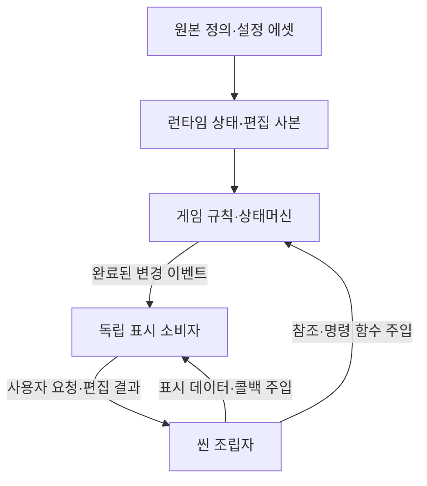
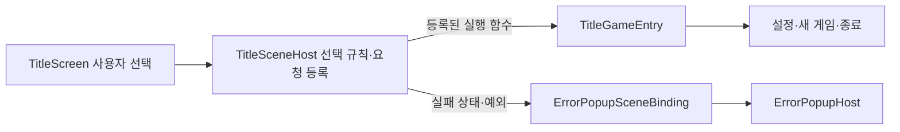
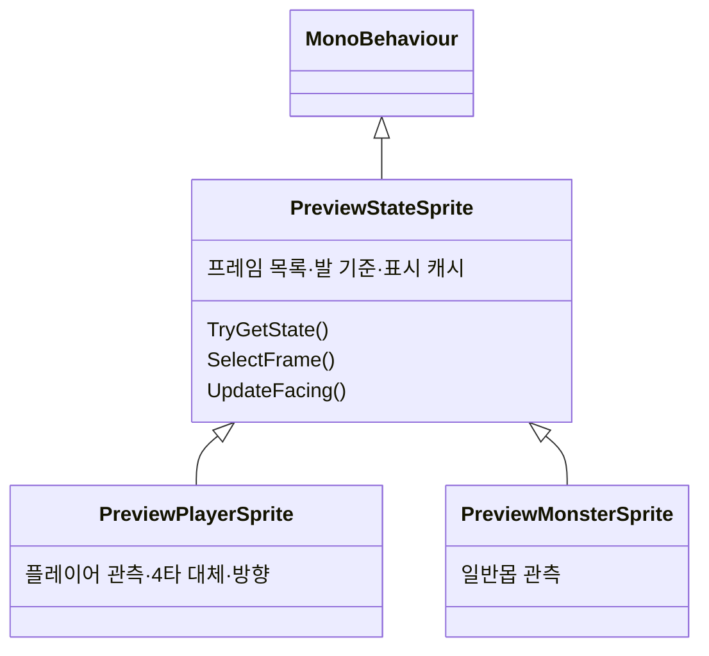
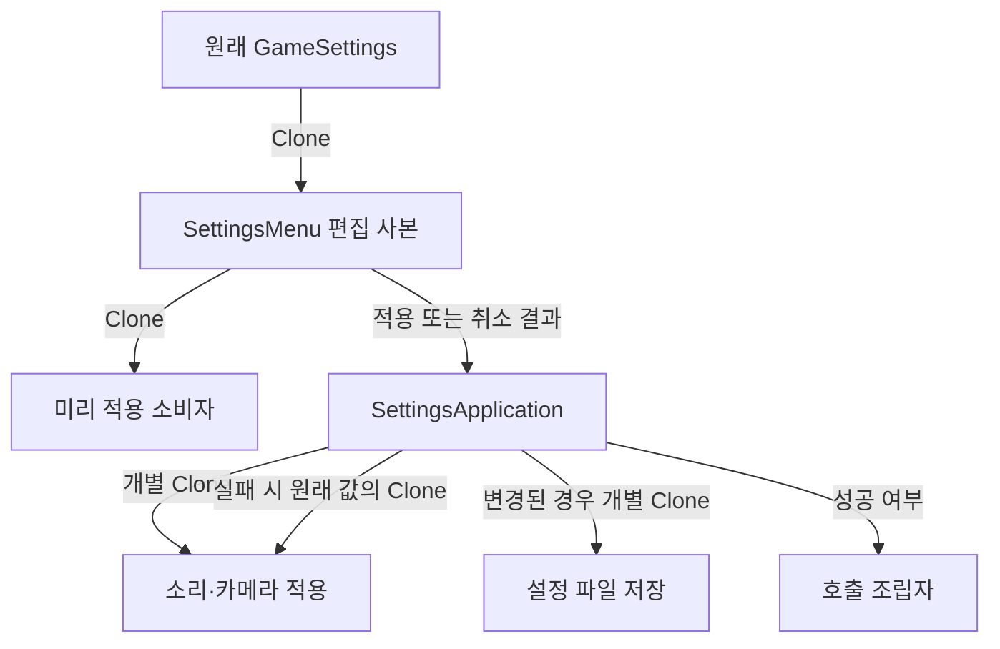
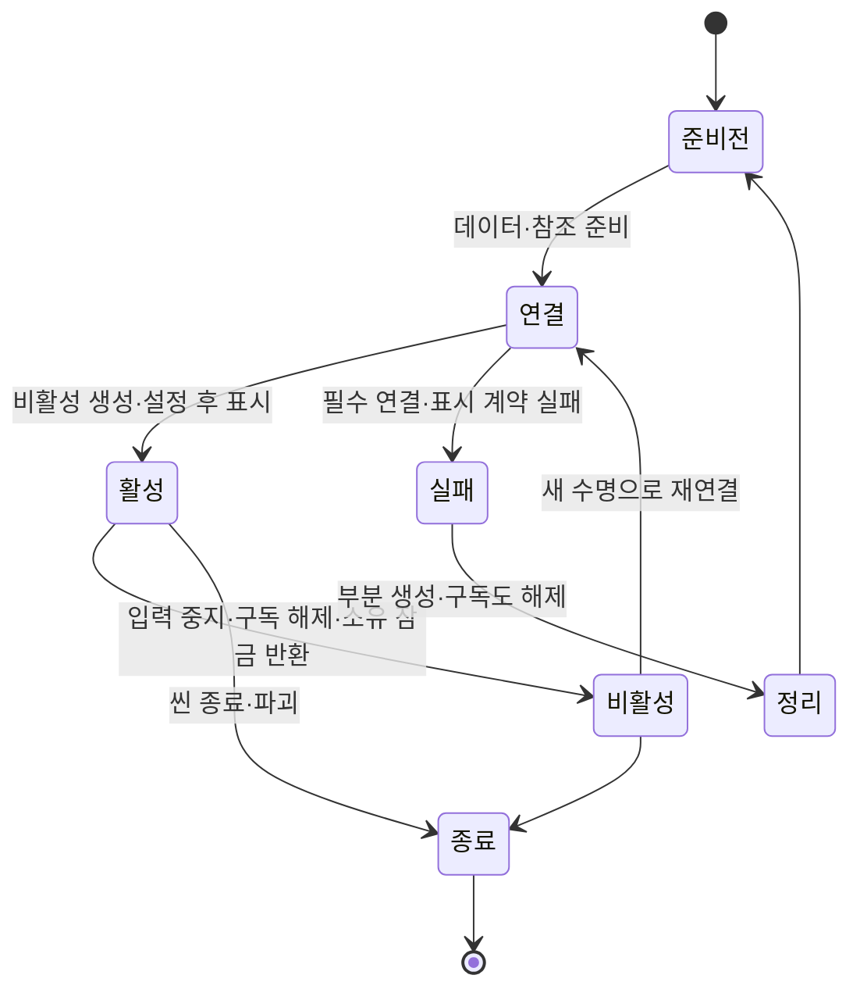
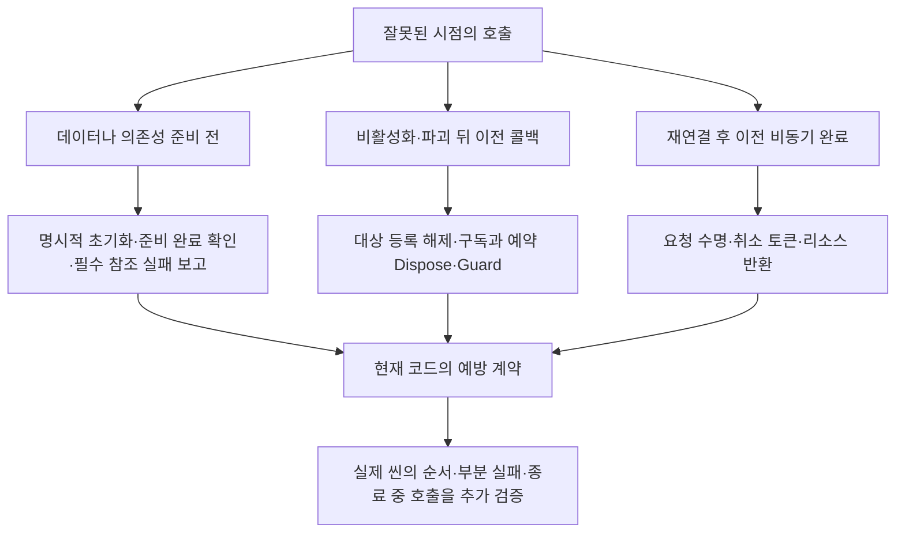

# 공통 모듈과 객체 수명 설계

기준일: 2026-11-07. 기존 변경 통지·등록/해제·구독/예약 계약을 유지하며 PreviewStage의 생성 범위 정리와 GameProgressState 주입을 추가했습니다. 실제 모든 씬의 실행 검증이나 모든 수명 오류 해결을 뜻하지 않습니다. 상세 전후 비교와 정수·리깅 경계는 [설계 기준 점검](설계%20기준%20점검과%20개선%20방향.md)에 모읍니다.

## 1. 문제에서 설계로

타이틀 옵션이 입력을 인수한 뒤 보이지 않는 문제가 출발점이었습니다. SettingsScreen 프리팹의 루트 배율이0으로 저장돼 있었고 타이틀 씬에도 루트 배율0 덮어쓰기가 있었습니다. 오브젝트 참조가 존재하고 예외도 발생하지 않으므로 로그 기반 오류 수집만으로는 표시 실패를 알 수 없었습니다. 보이지 않는 화면을 열린 것으로 취급하지 않도록 표시 계약과 입력 소유권을 함께 정리했습니다.

| 확인한 문제 | 현재 변경 | 필요한 이유 |
| --- | --- | --- |
| 화면 배율0·표시 영역0을 성공으로 취급 | 프리팹 배율·앵커 수정, ScreenVisibility 공용 계약 | 화면 표시 확인 후에만 입력을 넘김 |
| 중간 타이틀 요청 전달 컴포넌트 | TitleSceneActions 제거, TitleSceneHost에 등록 통합 | 같은 요청이 어댑터를 반복 통과하는 단계 제거 |
| 타이틀·일시정지의 설정 적용·저장 중복 | SettingsApplication으로 통합 | 적용·저장·실패 복구 순서를 일원화 |
| 타이틀과 다른 메뉴의 마우스 이벤트 연결 중복 | MenuText.Connect 재사용 | 왼쪽 클릭 정책과 연결 방식을 한곳에서 관리 |
| 플레이어·일반몹의 고정 상태 프레임 중복 | PreviewStateSprite 추상 부모와 자식 재정의 | 상태 프레임 선택·발 정렬을 재사용 |
| 종료된 타이틀에 이전 비동기 결과 전달 가능 | 타이틀 준비·저장 조회의 수명 번호 확인 | 비활성화 전 요청이 새 수명을 덮어쓰지 않음 |
| 일시정지 비활성화 뒤 입력과 정지 유지 가능 | 메뉴 입력·화면·소유 잠금 정리 | 꺼진 기능의 콜백 실행·입력 잠금 잔류 방지 |
| 맵 준비 도중 실패 시 일부 이벤트 해제 누락 | 완료 여부와 무관하게 연결한 대상별 해제 | 부분 초기화 실패에서도 정리 가능 |
| 파괴된 상호작용 대상이 인터페이스로 남음 | 공통 기반에서 등록·해제하고 등록 묶음 변경을 통지 | 제거·재활성·묶음 교체를 명시적으로 관리. 외부 직접 구현은 같은 계약 준수 |
| 같은 시간 변환·같은 표시값 반복 적용 | 공용 밀리세컨드 시계·변경 캐시·기존 이벤트 사용 | 불필요한 문자열·UI 갱신·목록 탐색 감소 |

## 2. 기능은 독립적으로 두고 조립자가 연결

도메인 규칙은 Unity 화면이나 파일 저장을 알지 않습니다. 화면은 타이틀 이동·맵 생성·게임 시간·파일 저장을 직접 실행하지 않습니다. 어댑터는 입력·리소스·Unity 수명을 담당하고 조립자는 필요한 기능만 연결합니다. 모든 호출을 전역 이벤트로 바꾸지 않습니다. 명령은 호출자가 실행 결과를 받고 독립 소비자에게 필요한 완료 상태만 이벤트로 전달합니다.

### 타이틀의 전달 단계 통합

TitleSceneActions 컴포넌트와 파일을 제거하고 프리팹의 해당 참조도 정리했습니다. 호출자는 TitleSceneHost.Connect(action, execute)와 Disconnect(action, execute)를 사용합니다. 해제는 등록한 함수와 같은 소유자만 가능합니다. 등록된 명령이 없거나 요청을 처리하지 못하면 타이틀의 대기 상태부터 복구하고 오류를 직접 보고합니다. 초기화 이전 또는 오류 연결 자체가 없는 경우에는 상세 로그가 남으며 팝업을 보장할 수 없습니다.

## 3. 공통화·상속·재정의의 경계

공통 부모가 고정 상태 프레임의 표시 수명을 소유하고 자식은 런타임 관측과 실제 차이만 재정의합니다. 기존 자식 스크립트의 GUID와 직렬화 필드명을 유지했습니다. 공통 필드는 부모에서 한 번 선언하며 자식에서 재선언하지 않습니다. 보스는 시간 기반 다중 프레임 재생이므로 이 고정 프레임 부모에 억지로 맞추지 않았습니다.

설정·팝업에서는 ScreenVisibility를 공유합니다. 기능이 서로의 자식이 되는 관계가 아니므로 설정 화면을 오류 팝업의 하위 클래스로 만들지 않습니다. 기존 PopupScreen→ErrorPopupScreen 상속은 계속 사용합니다. 메뉴 입력은 기존 MenuInput, 마우스 연결은 MenuText를 재사용합니다.

## 4. 설정 원본과 실행 사본

원본 데이터는 읽기 전용으로 사용합니다. GameSettings는 변경 가능한 런타임 값이므로 편집·소비자 전달·저장 전달에 각각 사본을 사용합니다. 외부 적용 함수가 받은 값을 바꾸더라도 원래 설정과 확정 결과에 영향을 주지 않는지 검사했습니다. 적용·저장 실패는 원래 값 복구를 시도하고 구체적인 예외를 전달하며 성공으로 처리하지 않습니다. 복구까지 실패하면 두 예외를 함께 보고합니다.

데이터 정의의 읽기 전용 속성, Boss 상태 목록의 복사·읽기 전용 래퍼, 전투 설정 에셋에서 새 실행 인수를 만드는 기존 경계는 유지했습니다. 읽기만 하는 불변 정의와 리소스는 참조할 수 있습니다. 변경할 상태가 생기면 원본을 수정하지 말고 런타임 사본을 만듭니다. Sprite·AudioClip 원본 자체를 수정하는 코드는 추가하지 않았습니다. 저장 스냅샷과 새 사운드 테이블 구조는 이번 정비에서 변경하지 않았습니다.

## 5. 생성·활성·해제 순서

| 소유자 | 생성·연결 | 비활성화·실패·종료 |
| --- | --- | --- |
| TitleSceneHost | 데이터와 저장 조회 후 메뉴·입력 연결 | 수명 번호 무효화, 메뉴 입력 중지. 새 수명에서 준비 재시도 |
| TitleGameEntry | 설정 화면·입력 생성, 저장 조회 | 저장 조회 수명 무효화, 설정 취소, 반환 코루틴 중지, 입력 정리 |
| SettingsScreen | 편집 사본·자기 변경 이벤트 연결 | 정상 닫기·외부 비활성화·열기 실패 모두 편집과 콜백 정리 |
| PauseMenuHost | 명시적 연결·메뉴 열 때 입력 소유 | 중복 연결 거부, 부분 실패 원복, 비활성화 시 화면·입력·정지 정리 |
| ErrorPopupSceneBinding | 데이터 완료 후 비활성 호스트 생성·초기화 | 호스트 비활성화 후 제거, 로그 구독·대기 보고·자기 잠금 반환 |
| GameplayPreview | 런타임·입력·표시를 단계별 연결 | 최종 완료 플래그와 관계없이 이미 연결한 대상별 이벤트 해제 |
| PlayerInteractor | 호출자 문맥·대상 묶음 수신, 변경 통지 구독과 최초 갱신 예약 | 비활성화 때 구독·예약·선택 정리. Disconnect와 플레이어 파괴 때 문맥·콜백도 비움 |
| InteractableBehaviour·InteractionRegistry | 전달된 묶음에서 최초 연결, 이후 활성 대상 등록·변경 통지 | 대상 비활성화/파괴/부모 변경 시 등록 해제·이전 묶음 분리 |
| SubscriptionScope | 연결마다 해제 함수·변경 예약·Guard 소유 | Dispose로 구독·예약 정리, 이전 호출 목록의 콜백 무효화 |
| HudScreen | 기력·보스 변경 구독과 최초 표시 | 재연결 전 이전 구독 해제, 비활성화 시 중지·재활성 시 재구독 |
| TitleSaveSelection | 저장 목록 비동기 조회 | 기존 수명 번호 유지·표시 대상 생존도 확인, 종료 시 구독 안전 해제 |
| LoadingScreen | 참조·씬 검증 후 로드 시작, 한 번만 Begin | 준비 실패 생성 객체 제거. 화면 중단 시 취소 불가능한 씬 작업의 활성화 대기를 해제 |
| PreviewScreenFade | 자기 암전 객체를 활성 소유자로 등록 | 콜백 실패·비활성화 시 정리, 이전 객체가 새 소유자의 활성 상태를 지우지 않음 |
| HealthDisplayHost·Group | 앵커별 비활성 생성 후 연결·활성 | 기존 명시적 Disconnect와 소유 표시만 해제하는 계약 유지 |

부모 앵커·공유 EventSystem·원본 입력 에셋은 기능이 제거하지 않습니다. 오류 팝업을 닫을 때 다른 메뉴의 정지를 풀지 않습니다. UI 표시 검사는 배포 데이터 검사기를 클라이언트에 추가하는 것이 아니라 실제 Unity 연결 계약을 확인하는 것입니다.

## 6. 불필요한 반복과 유지한 갱신

| 대상 | 현재 처리 | 이유 |
| --- | --- | --- |
| 고정 상태 스프라이트 | 상태 변경 시 프레임 선택, 바뀐 Sprite만 적용 | 상태가 같은 동안 프레임 목록 재탐색 제거 |
| TextboxScreen | 글자 출력 시간은 진행하되 보이는 글자 수·문장이 바뀔 때만 문자열 생성 | 타자 효과는 유지하고 같은 부분 문자열 반복 제거 |
| GameSpeedController | 기존 MillisecondClock 사용, 실제 배율이 바뀔 때만 Time.timeScale 쓰기 | 같은 변환 코드와 같은 값 재설정 제거 |
| HUD 기력·보스 체력·체세 | 기존 변경 이벤트로 갱신 | 값이 바뀌지 않은 프레임의 상태 조회·막대 재설정 제거 |
| HUD 약초·기술 문구 | PlayerActor.DisplayChanged로 예약하고 LateUpdate에서 반영 | 매 프레임 값 비교 대신 명시적 통지. 쿨타임은 올림 초 변경만 통지 |
| HUD 잔상·페이드·피격 점멸 | 표시 시간 진행은 유지 | 연속 연출 자체에 필요한 갱신 |
| 캐릭터 Tick·물리·카메라·이동 | 기존 진행 순서 유지 | 시간 진행과 위치 관측은 상태가 정지했다고 가정할 수 없음 |
| 보스 다중 프레임·배경음 페이드 | 기존 연속 표시 유지 | 고정 프레임 모듈과 다른 책임 |

현재 HUD·이름표·상호작용 선택은 명시적 변경 통지로 갱신을 예약합니다. HUD·몬스터 이름표·상호작용 안내는 LateUpdate 순서1100에서 예약을 소비합니다. 이동·충돌·시간 연출과 일부 표현 관측은 유지하며, 프로젝트 전체가 이벤트 전용인 것은 아닙니다. 캐릭터별 난수 공급·난수열 분리·게임 명령 순서도 유지했습니다. 정수 사용만으로 결정적 실행이 보장된다고 주장하지 않습니다.

## 7. 검증과 실제 확인 경계

자동 검사에는 기존 동작 회귀, 미변경 설정 미저장, 적용·저장 실패 복구, 외부 소비자에 의한 원본 변경 방지, 실제 UI 프리팹의 배율·앵커·정렬·타이틀 오류 연결을 포함합니다. 최신 검사 수치·경고 제외 조건·실제 실행 여부는 [현재 구현과 검증 현황](현재%20구현과%20검증%20현황.md)에 모아 관리합니다. 과거 검사 기록을 최신 결과로 사용하지 않습니다.

정적 검사와 엔진 참조 컴파일은 실제 화면 표시를 보장하지 않습니다. 타이틀 옵션 열기·닫기·강제 연결 실패·오류 팝업, 재활성화·씬 이동·프레임 상속의 Inspector 연결·HUD 표시를 Unity에서 확인해야 합니다. 안내는 [기획자용 공통 모듈 연결과 확인 안내](../기획자용%20안내문서/기획자용%20공통%20모듈%20연결과%20확인%20안내.md)를 따릅니다. 아직 모든 수명 조합을 실행 검증하거나 성능 개선량을 측정한 상태는 아닙니다.

## 8. 다음 기능을 붙일 때 지킬 경계

기존 공통 책임을 먼저 찾고 실제 같은 역할이면 부모·공용 모듈을 재사용합니다. 공개 데이터 정의를 런타임 상태처럼 수정하지 않습니다. 새 소비자의 구독 시작·해제·부분 실패와 재진입을 같이 설계합니다. 비동기 함수에는 취소나 수명 확인을 두고 완료 시 대상 생존을 다시 확인합니다. 코드와 Inspector 문구·설명·로그는 기존 한글 정책을 지킵니다. 원본 시트·생성 정의의 스키마 변경은 데이터 담당과 합의하고 자동 생성 로딩 계획을 수동 수정하지 않습니다.

## 9. 데이터 우선과 Inspector의 최소 역할

콘텐츠의 값·선택·재생 규칙은 데이터 테이블을 우선합니다. Inspector에는 현재 Unity 객체 참조와 화면/리소스 조립에 필요한 연결만 남기는 방향입니다. 데이터 기반이 완료된 부분과 아직 Inspector·코드 설정인 부분을 구분해야 합니다.

| 항목 | 원본·담당 | 현재 경계 |
| --- | --- | --- |
| 문구 | Language | 기존 문구 ID 사용, 마스터 임시 문구는 ID 공급 대기 |
| 팝업 구성 | Popup | 오류15007·설정 확인15006 연결 |
| 배경음·효과음 정의 | Sound | 빈 표·검사·배포·조회·주소 준비/재생 기반 완료. 실제 행·상황별 소비는 보류 |
| 맵 배치 | Stage와 기존 스폰 JSON | 현재 공급 구조 유지, 이번 정비에서 스키마 변경 없음 |
| 플레이어 음량 | 별도 settings.json | 런타임 편집 사본을 사용자 확정 후 저장 |
| 타이틀 이미지·배치 | 씬·프리팹 | 사용자가 지정한 씬 직접 편집 예외 유지 |
| 필수 Unity 참조 | 조립자 Inspector | 데이터 초기화·입력·화면·렌더러·오류 보고 연결. 임의 전역 탐색으로 대체하지 않음 |

기존 캐릭터 전투·패턴 설정 에셋과 일부 임시 표시 문구는 아직 Inspector/코드에 남아 있습니다. 테이블 전환에 필요한 기획 스키마·번호·리소스 계약을 이번 코드 정비에서 임의 추가하지 않았습니다. 이 정비를 프로젝트 전체의 데이터 전환 완료로 보지 않습니다.

## 10. 로딩·암전의 중단 계약

로딩은 표시 참조·이동할 씬을 먼저 확인한 다음 엔진 작업을 시작합니다. 새 게임의 임시 진행 초기화와 맵 이동의 상태/입력 변경은 로딩 준비가 성공한 뒤 수행합니다. LoadingScreen은 활성 작업의 Update에서 진행하고, 화면 중단 시 자기 객체를 정리합니다. 별도 PreviewScreenFade의 로컬 암전 코루틴은 남아 있습니다. Unity의 씬 로드는 취소할 수 없으므로 이미 시작된 작업은 활성화 대기를 풀어 완료하도록 합니다. 즉 화면 종료는 씬 이동 취소가 아닙니다. 이동 취소 UX가 필요하면 씬 준비·확정 정책을 별도 기획해야 합니다.

암전은 실제 활성 객체를 소유자로 보관해 이전 객체의 파괴가 새 암전의 활성 상태를 해제하지 않게 합니다. 암전 중 실행 콜백이 실패하면 오류를 기록하고 자기 화면을 정리합니다. 기존 애니메이션 시간·로딩 기획의 표현 자체는 바꾸지 않았습니다. 저장과 컷씬 공용 호출 기반은 연결됐습니다. 실제 미디어·연속 필드·별도 보스 씬의 수용은 별도입니다.

## 9. 빈 객체와 조기 호출의 발생 경로·현재 대응

| 상태 | 현재 소유권·호출 계약 | 확인할 내용 |
| --- | --- | --- |
| 준비 전 | GameDataInitializer의 Awake가 취소 수명을 준비하고 Start가 초기화를 요청. 소비자는 데이터 완료 알림과 이미 준비된 Data를 확인 | 다른 객체의 Awake가 먼저일 것이라고 가정하지 않음. InitializeAsync의 준비 전 호출은 실패로 전달 |
| 연결 | 조립자가 준비된 데이터·런타임·필수 화면을 전달. 비활성 생성 뒤 설정·연결하고 활성화 | 부분 생성·일부 구독 후 실패해도 소유자가 정리해야 함 |
| 활성 | 이벤트는 표시 예약만 기록하고 표시 단계에서 최종 값 반영 | 콜백에서 코어 명령을 재진입시키지 않음. 현재 연결의 호출 순서를 유지 |
| 비활성 | 표시 구독·예약·선택을 정리. 같은 대상 재활성화를 위한 문맥은 기능에 따라 유지 | 비활성화가 모든 저장 데이터나 공유 자원 삭제를 의미하지 않음 |
| 재연결·풀 반환 | 기존 수명 해제 후 새 연결. 전체 Disconnect/Unbind는 소스·콜백 참조도 정리 | 변경한 대상·최신 값 최초 반영. 풀 대여 초기화는 각 기능 계약을 따라야 함 |
| 파괴 | 상호작용 대상은 등록 해제. PlayerRuntime.Destroyed가 상호작용 문맥과 안내 해제 | Unity의 파괴된 객체와 인터페이스/CLR null 차이를 고려 |
| 비동기 완료 | 각 작업 소유자가 취소·요청 유효성·현재 객체 확인 후 적용, 사용하지 않는 리소스 반환 | SubscriptionScope가 파일 작업이나 Unity 씬 로드를 취소하는 것은 아님 |

SubscriptionScope는 구독과 예약을 정리하는 공통 도구입니다. 소비자가 가진 Unity 참조를 전부 지우거나 소유권을 대신 결정하지 않습니다. 필수 연결 누락은 조립자에게 보고하고 단순 null 검사로 정상 처리하지 않습니다. 실제로 제거된 표시 대상의 정리는 해당 표시 경계에서 수행합니다.

F12의 실행 담당에는 화면과 Popup ID만 남겼고 기존 ErrorPopupSceneBinding이 준비된 공통 연결을 전달합니다. 기획자가 저장 초기화 객체를 별도로 할당할 필요는 없습니다. [F12 설계](테스트%20초기화와%20공용%20확인%20팝업%20설계.md)와 [반복 갱신 설계](반복%20갱신과%20임시%20표시%20최적화%20설계.md)를 재사용합니다.

검증 결과는 [현재 구현과 검증 현황](현재%20구현과%20검증%20현황.md)에 모읍니다. 실행 전 호출·중복 연결·비활성화/재활성화·부분 실패·씬 종료·이전 완료 통지를 실제 게임 흐름에서 재현하는 검증은 남아 있습니다.
