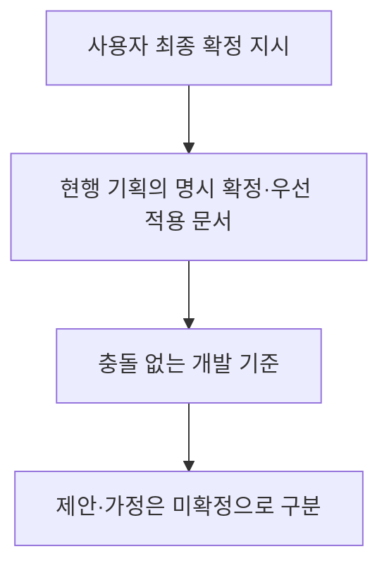

# 기획 확정 반영 기준

기준일: 2026-11-04. 최신 코드 기준은 클라이언트 `c7100e3`입니다. 구현·연결·검증 현황은 [현재 구현과 검증 현황](%ED%98%84%EC%9E%AC%20%EA%B5%AC%ED%98%84%EA%B3%BC%20%EA%B2%80%EC%A6%9D%20%ED%98%84%ED%99%A9.md)에서 관리합니다.

## 적용 우선순위

이 문서의 과거 시각별 대조 기록은 출처와 당시 판단을 보존한 자료입니다. 현행 규칙과 다르면 상단 규칙과 사용자 최종 지시를 적용합니다. 11/4에는 공유 간트·현행 개별 기획을 다시 조회했습니다. 과거 날짜별 기록은 당시 판단이며 현재 상태를 설명하는 기준은 상단 최신 절입니다.

## 11월4일 최신 대조와 회의

- 저장 상세 K05_1 R6는 슬롯 직접 선택·날짜 내림차순·번호 비표시, 빈 칸15001·덮어쓰기15002입니다. K05 R8의 ‘선택 없음’은 상세 문서와 충돌합니다. 기존 사용자 직접 선택 기준을 유지합니다. 현재 UI 코드는 삭제30203·팝업 불일치가 있습니다.
- 스폰 실제 공급은 FormatVersion2의 플랫폼 앵커 기준 Points입니다. 최신 클라이언트는 SpawnTemp30마리·Trigger매복을 임시 사용하고 공식 배포는4마리입니다. 자동 배치 산출물·풀·Stage경로 자동참조를 완료로 보지 않습니다.
- K16 재진입 잡몹 재생성과 사용자 이전 처치 유지 방향은 확인 대기입니다. 현재 구현을 기획 확정으로 바꾸지 않습니다.
- 회의 버그 수정9668a97은 코드 반영 상태이며 빌드 재검증 대기입니다. 허수귀 사망 불0과 해체900ms는 임시 조치입니다.
- O01_3/O01_4는 마지막 장치별 커서, 포커스상실·패드분리 자동정지, 단일팝업·F5차단·닫는프레임 버퍼폐기 등을 요구합니다. 기본 클릭 구현과 구분합니다.
- 캐릭터 애니80% 이상·컷씬 후보정 필요는 회의 공급 상태입니다. 결박된 요괴는11/9확인, 타이틀은 새 시안 후, 전투 카메라는 종합 기획 후 진행합니다. 신규 아이디어 전체 구현 승인은 아닙니다.

현행 근거: [작업 간트](https://docs.google.com/spreadsheets/d/16waFKHuXaZGdi2fz76nRUWFxiuQquhZGy6doAVHqBUI/edit), [저장 상세R6](https://docs.google.com/document/d/1qe7fhtw2zvakRZoSVzXtrnaX2ZUs6KZM/edit), [사망R2](https://docs.google.com/document/d/1bmttFuwhPczzTL2Vd1GHqOL30WrErqbZ/edit), [자동배치L09_1](https://docs.google.com/document/d/16DYjRzN3bQluCKL81PPB9zG8hdGFm5me/edit), [UI예외](https://docs.google.com/document/d/1ZY6iCgqD-RIjlQSOyLA_4ZIbF3mc2H1a/edit). 구체적인 작업은 [잔여 작업](%EB%82%A8%EC%9D%80%20%EA%B5%AC%ED%98%84%EA%B3%BC%20%EA%B2%80%EC%A6%9D%20%EC%9E%91%EC%97%85.md)에 모읍니다.

## 저장·타이틀의 사용자 최종 확정

| 항목 | 적용 규칙 |
| --- | --- |
| 수동 저장 대상 | 사용자가 기록 또는 빈 칸을 직접 선택. 가장 오래된 슬롯 자동 선택·삭제는 수동 저장에 적용하지 않음 |
| 목록 | 날짜·시각 내림차순, 슬롯 번호 비표시. 내부 슬롯 ID는 선택 대상 연결에만 사용 |
| 빌드 | 테스트·시연은 수동/자동 공용10슬롯. 출시는 수동 저장·F5·슬롯 화면 없이 자동 저장1슬롯 |
| 현재 플레이 슬롯 | 새 게임·이어하기·성공한 수동 저장 대상. 자동 저장은 이 슬롯을 갱신 |
| 새 게임 | 시작 위치·초기 상태가 정해지면 즉시 이어하기 가능한 초기 기록 생성. 기존 기록 보존, 가득 차면 가장 오래된 기록 교체 |
| 이어하기 | 저장 당시 맵·정수 위치·자원·진행 상태 복원. 사망 체크포인트 복원과 분리 |
| 자동 저장 지점 | 맵3 잡몹30 처치 뒤 지정 앵커 통과 시 지점별 최초 성공1회. 새 게임 외에는 해당 진행의 사용 이력 유지 |
| 서낭당 | 지스타 빌드에서 HP·약초 회복 없음. E 사용이나 마지막 몹 처치 순간에 저장하지 않음 |
| 연결 보류 | 스테이지 완성 전 실제 맵 구성·복원은 연결하지 않음. 독립 계약·검사·프리팹만 준비 |
| 테스트 타이틀 | 실제 기록 조회·선택 버튼은 테스트 전용. 출시는 전용 객체 제거와 코드 제외 |

[K05_1 R4](https://docs.google.com/document/d/12dY7kpbWsmRn7C6J24JRT1PS6iO9JYvN/edit)의 자동 슬롯 선택·번호순 표시·번호 노출·지스타 이후 개발 빌드 비활성 문구보다 이후 사용자 확정이 우선합니다. 수동 기록 선택·날짜 정렬을 원문의 옛 규칙으로 되돌리지 않습니다. 동작·연결 계약은 [저장 기능 설계](%EC%A0%80%EC%9E%A5%20%EA%B8%B0%EB%8A%A5%20%EC%84%A4%EA%B3%84.md)를 따릅니다.

## 연결 전 해결할 정합성

- 기획 관문 키는 `StageID_PlacementID`이며 연습 관문은 `8005_101`입니다. 현재 `SaveSnapshot.OpenedGates`는 정수 목록이므로 같은 대상을 표현하는 정책이 필요합니다. 정수 쌍 등은 검토안이며 이번 문서 갱신으로 확정·구현하지 않았습니다.
- 모든 메뉴의 마우스 조작은 확정 규칙입니다. 타이틀·일시정지·설정 클릭은 임시 연결됐으며 실제 장치와 마지막 입력 장치 커서·포커스 예외 검증이 남았습니다.
- 컷씬·로딩·사망·보스 처치 연출 등 F5 금지 조건은 실제 게임 담당자가 전달하는 판단에 연결합니다. 연결 API만 있는 상태를 운영 동작 완료로 보지 않습니다.

아래 기획 대조의 최초 범위는 2026-11-03 클라이언트 d5467fa 이후입니다. 이후 사용자 변경은 위 최종 확정 표로 갱신합니다.

2026-11-03 12:28 KST 재점검 기준: 현행 DOCX 62개(통합1·코어15·전투12·레벨10·아웃게임21·구조3), `_이전판`123개. 현행62개 전체 본문·표를 직전61개와 대조해 변경27·신규1·동일34개를 확인했습니다. 보관본은 목록 점검이며 루트10/29 PDF는 재독하지 않았습니다. 개정 번호·명시 확정 날짜·추가 규칙을 우선하며 업로드 시각만으로 우선순위를 정하지 않습니다. 아래 날짜별 과거 점검은 당시 기록입니다.

아래의 **기획 확정**은 원문에 확정으로 적힌 결정입니다. **개발 기준**은 이번 보류 해소 요청에 따라 채택한 구현·튜닝 기준이며 기획자의 별도 승인을 받았다는 뜻은 아닙니다. 확정된 규칙과 코드 구현 완료를 구분합니다.

## 공통 기획 기준: 이후 저장 변경 반영

| 항목 | 적용 기준 | 현재 반영 |
| --- | --- | --- |
| 캐릭터 크기 | 플레이어 키 1.5타일. `스케일 = 목표 키 × PPU / 투명 여백을 뺀 몸 높이` | MapDohwagolTest 플레이어에 적용. 판정용 사각형 크기는 보존 |
| 맵 구성 | 도화골 80타일·잡몹 0, 산길·협곡 각각 120타일·잡몹 30 | 테스트씬은 R3c 도화골 맵 사용. 테스트용 몹·보스는 검사용으로 유지. 운영 스폰은 별도 구현 |
| 변종 구성 | 맵 2: 3003×18 + 3002×12. 맵 3: 3003×18(매복 4 포함) + 3004×12 | 배치 기준 확정. 불 남김·투척 고유 동작은 미구현 |
| 출구·재방문 | 생존 0 AND 스폰 예정 0. 클리어 기록이 있으면 재잠금 없음. 도화골은 명부 조사 완료 조건. 보스방 입장 뒤 역주행 금지 | 운영 진행 구현 기준 |
| 서낭당 | 맵3 잡몹 처치 조건 이후 지정 저장 앵커 통과1회. 지스타에서 HP·약초 회복 없음 | K05_1 R4와 사용자 최종 지시 적용. 이전 E 저장·회복 규칙 폐기 |
| 사망·낙하 | 활성화 전 사망은 도화골 시작, 이후 서낭당. 낙하 HP −10·앞 지점 복귀, HP≤10이면 사망 | 운영 물리·전환 구현 기준 |
| 저장 | 테스트/시연 공용10슬롯·수동 직접 선택·날짜 내림차순·번호 숨김. 자동은 현재 슬롯. 출시는 자동1슬롯 | 새 게임 즉시 초기 기록, 저장 당시 위치 복원. 상세는 상단 최종 확정 표 |
| 새 게임 | 기존 기록 보존·즉시 초기 기록. 부스 확인 생략, 학원은 저장 있을 때 확인. 30037은 ‘새로 시작할까요?’ | O03_1·O06_1과 사용자 초기 기록 시점 확정 적용 |
| 메뉴 입력 | 결정은 자식, Esc/B·X는 부모. 이전 커서 보존. 타이틀 뒤로 무시. 저장이 없으면 이어하기 숨김·빈칸 제거, 보이는 버튼만 탐색. 팝업 외부 클릭 무시 | 11/3 O01_1·O01_2 기준 |
| 일시정지 | Esc는 한 단계 복귀, Start는 전체 닫기. HP0부터 사망 암전 끝까지 금지. 해체·스킬 연출·로딩 중 금지 | 운영 UI 구현 기준 |
| 설정 | 변경 즉시 미리 적용, 나갈 때 확인. 예는 별도 설정 파일 저장, 아니오는 원래 값. 한국어 고정·언어 행 없음 | 11/3 O05_1 R2 기준. 확인창 처음 커서는 예. Language 30046 수신 완료 |
| 입력·시간 수명 | 창 닫는 프레임 입력·공격/구르기 버퍼 폐기. UI는 unscaled, 글자 출력은 Pause 때 정지. 게임 속도는 단일 소유자가 Pause·히트스톱·슬로 우선순위로 관리 | 운영 UI·피드백 구현 기준 |
| F12 | 한 번 입력 후 확인·취소·X 팝업. 확인 시 최신 슬롯 하나 삭제·타이틀. 로딩 중 요청은 전환 후 표시. 설정 유지 | 방치 자동 초기화·90초 경고·120초 리셋은 제외(O13 R3) |
| 로딩·컷씬 | 원문 기준은 맵 진입 최소2000ms·타이틀 암전, E2000ms 스킵·X 다음 그림. 장부방3장·엔딩2장 | 로딩 수정 기획으로 구현 보류. 컷씬은 데이터/코어만 준비, 실제 재생 연결 미완료 |
| 보스 체세·해체 | 체세 80, HP420, HP210 이하 Phase1, 해체 최대HP 18% 내림=75. 노출 중 E, 일반몹 해체 없음 | 기존 코어·프리팹 재확인. 스킬 해금 여부를 해체 조건에 추가하지 않음 |

## 이번에 고정한 개발 기준과 적용

| 항목 | 기준값·정책 | 코드·에셋 |
| --- | --- | --- |
| 몹 임시 외형 | 허수귀 1.5타일·지게귀 1.8타일. 상태별 대표 프레임 한 장, 방향 반전·공격/사망 색 변경 | HusugwiGameplay·JigegwiGameplay·PreviewMonsterSprite. Animator·프레임 재생 없음 |
| 몹 판정 | 기존 사각형 렌더링만 끄고 활성 객체·SpriteRenderer bounds 유지 | PreviewMonsterDriver의 판정 제공자는 기존 사각형 |
| 허수귀 잡기 | 추가 피해 −5, 구속 상한 1000ms, X 3회면 조기 해제. 회피만 추첨, 치명 없음. 피해 무적 적용·HP0이면 구속하지 않음 | HusugwiPatterns·MonsterActor·PlayerActor. ATK20·DEF0이면 피해15 |
| 일반몹 튜닝 | 기존 타이밍·지게귀 돌진 속도900·벽 허점800ms·Hit300/CritHit500ms 채택 | 기존 설정 에셋 재사용. 기획서의 개발 조정 영역 |
| 보스 내려찍기 | 선딜700 / 판정120 / 후딜600ms, 추가 피해+6 | Config/BossPatterns.asset |
| 보스 2연타 | 1타500/100/0, 2타250/100/600ms, 추가 피해0. 둘째 Windup250ms가 두 타 사이 간격 | 같은 에셋. 타격마다 독립 판정 창 |
| 문 돌진 | 선딜1000 / 상한2500 / 후딜800ms, 속도1200(tile_x100/초), 추가 피해+14, 벽 체세 피해30, 최소 Phase1 | BossGameplay에 설정 연결. PreviewBossDriver로 이동·벽·접촉 확인 |
| 테스트 보스 선택·범위 | 사용 가능한 패턴 순환. 근접2.5타일·둘째 타3.5타일, 추적은 제공 MoveSpeed, 돌진 방향 고정 | 테스트씬 전용. 운영 자동AI·정식 히트박스 완료를 뜻하지 않음 |
| 사슬 당기기 | 선딜900 / 판정150 / 후딜900ms, 추가 피해−6, 구속 상한900ms·연타3회, 거리800·끄는 속도900(tile_x100). 시간·거리는 개발 값 | Config/BossPatterns.asset. 결박 가르기로 끊기는 스킬 구현 후 연결 |
| 짐 투척 | 선딜500 / 비행700 / 후딜500ms, 추가 피해−4, 거리300~600, 포물선 높이1.5타일 | JigegwiThrowerGameplay·JigegwiThrowerPatterns |
| 불붙은 짚 | 죽은 자리에 3000ms, 초당 고정5, 절반 폭100(tile_x100) | HusugwiFireGameplay·HusugwiFirePatterns |
| 결박 가르기 | 시트 피해+6·체세30·쿨타임8000, 개발 값 선딜150·판정120·후딜350·앞2타일. 회피 안 굴림, 스태미나 없음, 사슬 중 사용 시 끊음, 매달리기 중 불가 | Skill 7001·PlayerCombatSettings. 해금 연출·HUD 아이콘·결박 관문은 후속 |
| 약초 | Buff 14001 회복40·사용800ms·3개. 사용 중 이동 절반은 개발 값, 맞으면 취소·개수 유지 감소, 체력 가득이면 사용 안 함은 개발 판단 | PlayerHerbs. 정식 HUD는 후속 |
| 상호작용 | K15 순서·범위 앞뒤1·위아래2타일. 서낭당은 K05_1 R6 우선으로 HP·약초·저장 변경 없음. 대사·재조사 문구는 임시, 장부방 맵·명부 컷씬 공급 전 | PlayerInteractor·NpcTalk·StageDoor·LedgerInteract·ShrineInteract·TextboxScreen |
| 페이즈·해체 종료 | HP 행 전환은 진행 중 패턴·노출 유지. 새 무적/정지 없음. 해체 완료는 명시적 완료 신호, 완료 뒤 체세 최대 복구 | 기존 코어 유지, 테스트씬 `restorePoise=true`. 포효·사슬 연출은 별도 구현 |
| HP 표시 | 기존 Host.Connect에 준비된 catalog·prefabs·PlayerActor·anchorRoot 전달. Disable/재활성·대상 해제는 기존 Host 수명 사용 | GameplayPreview·MapDohwagolTest에 연결. HP 막대는 흰 배경/검은 채움으로 적용. 정식 UI 이미지는 제작 완료 후 반영. 전체 운영 HUD와 구분 |

판정 시간·후딜·속도를 정하지 못해 보스 설정을 연결하지 않던 보류는 해제했습니다. 위 값은 에셋에서 조정하며 0인 필수 타이밍의 초기화 거부는 유지합니다. Inspector 직렬화 필드는 언어 초기값 0을 명시해 CS0649를 제거했으며 검증을 끄지 않았습니다.

## 설계 보류를 닫은 후속 구현 기준

- 코요테·점프 선입력은 100ms, 공격·구르기 선입력은 제공 Player.InputBuffer(현재150ms). 메뉴 종료 시 모두 비우는 계약을 사용합니다. 입력 보정·Hang·약초·스킬은 현재 코어에 새로 구현됐다는 뜻이 아닙니다.
- 피드백 시작값: 일반50ms, 치명80ms 뒤 200ms·50% 슬로, 해체150ms, 보스 피격100ms. 해체 중 치명 슬로 중첩 없음. HUD 탐색25%·전환300ms·전투 종료3000ms·잔상500ms, 데미지 숫자는 표시하지 않는 개발 기준을 채택합니다. 정식 피드백은 후속 구현입니다.
- 저장은 상단 사용자 최종 확정 표를 적용합니다. 맵3 잡몹30 처치 뒤 저장 앵커 통과 최초1회이며 자동은 현재 슬롯을 갱신합니다. 영구 JSON에는 맵·정수 위치·자원·본 컷씬·진행·사용한 저장 지점을 보관합니다. 보스 처치 여부는 별도 저장하지 않습니다. 명부·7001 해금은8005 클리어에서 계산하며 같은 사실을 중복 기록하지 않습니다. 사망 복원은 별도 규칙입니다. 관문 키 형식 불일치는 연결 전 수정이 필요합니다.
- 런타임 잠금은 `ContentEnabled`만 판단합니다. 11/3 공식 공급 340087a에서 폐기한 Item.InGstar는 원본·정의·JSON·검사에서도 제거했습니다. K14 R3의 InGstar 병기 문구보다 실제 최신 공급 스키마를 우선합니다. 기존 Skill.UnlockType은 설명용입니다. Stage·Skill 조건0=없음,1=스테이지 클리어, 명부 완료=8005 클리어이며7001/8002가 이를 사용합니다. 원본/정의/배포 정합과 N01 당시 Unity 검수는 완료했고 ContentAccess 판단 코어도 구현했습니다. 진행 상태 소유·실제 실행 경계 적용은 미연결입니다. 비활성 Stage 건너뛰기·Skill 비활성 관문 열기·Monster 수 제외는 개발 기준입니다. Active=N 내보내기 제외라는 원문과 Exporter 무필터 동작은 문서 정합 대상으로 남기며 임의 행 삭제/필터를 추가하지 않습니다.
- 좌표 초안은 씬/프리팹 앵커 작성 자료로 사용합니다. 스폰할 때 전달받은 앵커 범위만 사용하고 전역 검색·원점 대체는 하지 않습니다. 매복 트리거66타일·서낭당116타일은 개발 배치 기준으로 채택합니다. 운영 스폰 JSON과 앵커 조립은 후속 구현입니다.
- 보스 HP0은 일반 타격·해체 모두 사망으로 끝냅니다. 운영 종료 조립자는 각각 Dead/해체 완료 신호를 한 번 수신하고 2000ms 뒤 엔딩을 요청하는 개발 기준입니다. 사슬 Attack3·변종 불/투척·운영 센서/맵 진행·타이틀/저장/UI 전체가 이번 변경으로 완성된 것은 아닙니다.
- QR은 O08 R2·O13 R4에 따라 기능 자체를 보류하며 엔딩/엔딩 스킵 뒤 타이틀로 갑니다. 시나리오 대사·정식 UI/애니 원본은 수신 뒤 연결합니다. 사용자 요청으로 제작 중인 UI 이미지 반영은 나중에 진행합니다. 임의 URL·대사·아트를 만들지 않습니다. 로딩 태평소의 실제 프레임 재생속도는 새 4~6프레임 원본에 맞춰 연결합니다.

## 과거 대조 기록: 2026-11-03 12:28 KST

- 11:55 KST에 교체된6개 분류 폴더의 현행62개를 전부 읽고 대조했습니다. 신규는 O11_1, 변경27개에는 통합 R14·코어 개요 R10·전투 개요 R3·레벨 개요 R7·아웃게임 개요 R9가 포함됩니다. 구조3개 본문은 동일하여 아래 구조 예시 보완 사항은 계속 유효합니다. 마감 재조회에서6폴더의 추가 변경은 없었습니다.
- 실제 반영: DataSheet의 기존 캐시 원격 커밋3cb99c4(Language42행 추가)·340087a(Item.InGstar 제거)의 해당3파일을 현재 작업 트리에 수신했습니다. 기존 HealthDisplayConfig 변경과 브랜치/HEAD는 보존했습니다. 클라이언트 Item 정의·bool 매핑 검사와 공식 배포 Language.csv·Item.json을 맞췄습니다. 다른 기존 스탯·ID·자동 로딩 계획 내용은 보존했습니다.
- 기존 PlayerHealthBar는 흰 배경·검은 채움만 적용했습니다. 기존 Image 교체 구조·GUID·fileID는 유지하며 새 PNG/Figma 원본을 적용하지 않았습니다. **UI 이미지 반영은 제작 완료 후 진행**합니다. HP·기력·보스HP 전체 HUD가 완성됐다는 뜻이 아닙니다.

| 최신 출처 | 확정·변경 기준 | 반영 범위 |
| --- | --- | --- |
| [O03 R6](https://drive.google.com/file/d/1iOxrjUxpSvG8JMKpW3Y9G1kECLYL4p8X/view)·[O03_1 R2](https://drive.google.com/file/d/1RRTFdRBAeOFNzEflwCSLgQ7km8Yqviml/view) | 저장 없음→이어하기 숨김·빈칸 제거. 일반 메뉴 저장 있음4/없음3, 부스는 종료도 숨겨3/2. 보이는 버튼만 탐색. 타이틀 개발 나영민 | 운영 타이틀 후속 계약 |
| [O05_1 R2](https://drive.google.com/file/d/13YKPFj6oezL3Jnzulf3fAwsEckP7lzQv/view) | 설정 적용 확인창 처음 커서는 예 | 운영 설정 후속 계약 |
| [K05 R6](https://drive.google.com/file/d/1qZ6Ydg9R1XpkIazEaeVF7FoR9dmV6BwH/view)·[O06 R3](https://drive.google.com/file/d/10Zj0aVWsf5HOTbiZ3vJS6Tmgkn2w0h8m/view) | 저장 황영근, 사망·리스폰 나영민. 저장 시점2개만 허용. 보스 처치 비저장, 엔딩 뒤 Continue는 마지막 서낭당. 새 게임은 기존10기록 보존 | 저장·전환 후속 계약. 보스 처치 필드 삭제 기준 갱신 |
| [K15 R4](https://drive.google.com/file/d/1p0li6M9IJNCRm7s_GpotAupDTpenS75k/view) | E+동작 글자: Shrine30063·Talk30064·Ledger30065·Door30066. 해체/매달리기는 아이콘만. CanInteract=false는 숨김. 컷씬 E2초 스킵은 입력 잠금 예외. 장부방·보스방 문도 로딩 최소2초 | Language 수신 완료. Interactor/표시·전환은 후속 |
| [L04 R2](https://drive.google.com/file/d/1nk2qmd3jykzseSogwpIxQBMnGViPg9mI/view)·[L08 R4](https://drive.google.com/file/d/1zRrMiMpb0LxcXku5SrRJiJKa79LbeO0G/view) | 연습 결박 확정, openedGates 키8005_101. shrineActive는 맵3 클리어와 별도 저장. 명부3장 약12초·엔딩 약11초 | 운영 맵·저장·컷씬 후속 계약 |
| [O08 R2](https://drive.google.com/file/d/1CzMkzgpNZbCYHivCCJL__dgwY7WL7wgd/view)·[O13 R4](https://drive.google.com/file/d/1PhlS9n74NaNq1ZTCjiDGEXEjSzWk1-Ee/view) | QR 기능 보류. 엔딩 자연 종료/스킵→타이틀 직접 복귀 | 기존 QR 공급 대기 항목을 기능 보류로 변경 |
| [O11_1 신규](https://drive.google.com/file/d/1nFnBJlcwFoYxoqnKwMD9OROsPmaesRqD/view) | HP·기력·보스HP는 같은 검은 붓 획·흑백. 최종 PNG577×40, Figma B안v2(node10:26/10:81) | 기존 HP 색상만 적용. 사용자 요청으로 UI 이미지 교체 연기 |
| [통합 R14](https://drive.google.com/file/d/1fs-MkeHj5muNL7T1oY5dJhu_5zQMIEVn/view)·[C10 R2](https://drive.google.com/file/d/1f_9akVxle4AAFLrt8xwY0QpYZFeiKHIx/view) | 도화골/장부방 운영 몹0. 목표5~10분, 현 기획 약14분은 플레이 검증 대상. Hang은11/4 빌드 전 일정 | 테스트용 몹 유지. 전투 수치 변경 근거 없음 |

Language는30001~30069 총69행입니다. 새42행(30028~30069)을 수신해 설정30046·상호작용30063~30066을 확인했습니다. 30043(언어)·30045(방치 경고)·30068/30069(QR 보류 관련)는 예약값을 보존하되 사용 기능을 재개하지 않습니다. NPC 첫 목표는 새30070이후를 공급받아야 하며30067은 맵2 허수귀 목표입니다. 대사 본문이 완성됐다는 뜻이 아닙니다.

검증: 공식 check/deploy14탭·데이터14·정의18·계획1 통과, 데이터796·코어360·C#93 참조 컴파일 통과. 실제 Unity 도메인 재로딩 뒤 두 테스트씬 각23개(데이터·새 문구·잠금 컬럼·영문 앵커·HP·몹1프레임)와 기존 앵커24개 통과. N01은 완료했으며 진행/해금·타이틀/설정·저장/씬/상호작용은 다음 구현입니다.

## 과거 대조 기록: 2026-11-03 10:49 KST

### 범위·변경

- 루트의 현재 6개 분류·각 `_이전판` 목록을 재조회했습니다. 현행 DOCX 61개(통합1·코어15·전투12·레벨10·아웃게임20·구조3), 보관본91개입니다. 앞선 44개 집계는 폴더 교체 중의 일시 목록이며 현재 기준이 아닙니다.
- 현행61개 본문·표를 기존57개 수신본과 대조했습니다. 실질 변경6개, 신규4개, 기준판 표기만 변경5개, 본문 동일46개입니다. 보관본은 목록 점검이며 91개 전체 본문 재독을 뜻하지 않습니다. 루트의 10/29 PDF는 이번 개정 대상이 아니며 재독하지 않았습니다.
- 실질 변경: 통합 R11, 코어 개요 R9, K14 R3, K05 R4, K01 R4, O03 R4. 신규: K15 R2, 구조설계 예시 R2(본문 v0.7), 관문B 빌드 기획틀 R2, 씬전환·컷씬 기획정리.
- K12·C02·C04·L04·L07은 기준판 표기만 변경. L04·L07의 변경된 PNG 압축 데이터도 디코딩한 픽셀이 같았습니다. O03 R4의 새 타이틀 도식(1600×900)은 별도로 확인했습니다. Figma 원본을 열어 검수한 것은 아닙니다.
- 점검 중 10:41 KST에 O03 R3가 R4로 교체됐습니다. 마지막 재조회 결과와 R4 본문·포함 도식을 반영했습니다. R4는 인귀 로고, 붉은 노리개 커서, 부스 메뉴3줄, ↑↓ 선택·Enter/C 결정, 뒤로 안내 없음, 새 게임 기록 보존을 명시합니다. 기존 O03의 삭제 충돌은 R4에서 해소됐습니다.
- 마감 10:53 KST에 현재6폴더를 다시 조회했습니다. 추가 개정·추가/제거 없음. O03 R4의 최종 파일 시각(10:41:11 KST)·크기987902는 수신 본문/원본과 일치합니다.
- 이번 추가 점검은 문서 기준 갱신입니다. 제품 코드·CSV·시트·씬·프리팹·Drive 원본은 수정하지 않았고 컴파일·Play·빌드 검사를 재실행하지 않았습니다. 아래 구조 예시의 문제는 현재 게임에서 발생한 결함과 구분합니다.

### 새 기준과 구현 영향

| 출처 | 새로 확인한 기준 | 구현 영향 |
| --- | --- | --- |
| [K14 R3](https://docs.google.com/document/d/1b_8G3Me0qPT03jDVitCA9ozQ76H2oFcb/edit) | [확정 11/3] `8001.NextStage=8002`. 장부방8005는 마을 문으로 왕복 | 출구 체인과 Door 목적지를 분리 |
| K14 R3 | [확정 11/3] 잠금 저장은 `clearedStages`·`shrineActive`·`openedGates`. 명부 조사와7001 해금은8005 클리어에서 계산 | `ledgerChecked`·해금목록에 같은 사실을 중복 저장하지 않음. 관문 키는 `StageID_PlacementID` |
| K14 R3·공급 작성안 | Stage·Skill의 새4열, Item·Monster의 `ContentEnabled`. 런타임은 `ContentEnabled`만 읽고 Item.InGstar는 시연용 동일 값 | 기존 Active와 AND하던 이전 개발 기준을 갱신. 단, K14 전체는 아직 [제안]·개발 확인 문구가 섞여 있음 |
| [K15 R2](https://docs.google.com/document/d/1uPR2Mo6MgZISt5sXETC3oCzeSi-DUqBk/edit) | [확정 11/3] 새 시트 없음. 씬 배치 Inspector + 대사 JSON/Language. Door는 목적 StageID·도착 앵커 소유 | Talk·Door·Ledger·Shrine 4종. Execute는 전투, Hang은 이동 책임 |
| K15 R2 | [제안] 공중 턱 잡기 → 지상·앞쪽 Exposed 보스 해체 → 지상 최근접 CanInteract → 무동작. 키1회 동작1개, 아이콘1개 | 현재 Preview의 거리 검사만으로 K15 완료 처리하지 않음. 매달린 중 위=올라가기, 대화·컷씬·로딩·Pause 입력 차단 |
| [K05 R4](https://docs.google.com/document/d/1tl_Dq-A2dNy0iUCjw5xy4aBv13h54xlO/edit)·[O03 R4](https://docs.google.com/document/d/1ob8QpemXHgvdILdD9kQvc7sUqkFjkAnK/edit) | 이어하기는 저장된 HP·약초, 사망은 HP 최대·약초3. 새 게임은 기존 기록 보존, 초과 시 가장 오래된1개 교체 | 이어하기·사망·새 게임 경로를 구분. K05의 낡은 삭제 [제안]보다 O03 R4·O06_1의 11/3 확정 우선 |
| [K01 R4](https://docs.google.com/document/d/1RqFdx1i8lmAyuvZV-fWFEZ5J_5457cLs/edit)·O13 R3 | 방치 자동 초기화 제외. F12는 사용자 최신 확정으로 한 번 입력·확인 팝업·최신 슬롯 하나 삭제로 변경 | 타이틀 대기 영상 반복과 저장 초기화를 혼동하지 않음 |
| [관문B R2](https://docs.google.com/document/d/1IVafMy37byWRy5hdHNRwtx7lxyPirEol/edit) | 11/7 관문B는 타이틀→TO BE CONTINUED 한 판 완주. 임시 아트 허용 | 기능별 체크와 실제 완주 증거가 필요. 빈 체크박스를 완료로 표시하지 않음 |

K15 범위(가로1·세로2타일, 해체 앞1.5타일, 아이콘 머리 위0.5타일)는 [가정] 또는 개발 조정 영역입니다. 보스·잡기 수치(C08·C09)는 본문 변경이 없어 앞선 적용값을 다시 튜닝할 근거가 없습니다.

### 보완 항목

| 우선 | 위치 | 확인한 문제·완료 조건 |
| --- | --- | --- |
| 공급·소비 정합 | [현재 Stage CSV](../../Assets/Data/Csv/Stage.csv)·[Stage 정의](../../Assets/3.Script/Data/Stage.cs) 및 Skill·Item·Monster | 현재8001의 NextStage는 여전히8005, 새 잠금 컬럼도 클라이언트 CSV·정의에 없음. 공급 문서는 11/3 시트 적용을 기록했으나 실제 XLSX 내부를 이번에 직접 검사하지 않았음. 원본 컬럼·정의 생성자·파서·배포·기존 검사 정합 후 반영. 배포만으로 기존 정의 클래스가 갱신되지 않음 |
| 계약 확인 | K14 R3·DataSheet 공급 작성안·Exporter | K14는 Active=N이면 내보내지 않는다고 쓰지만 현재 SheetRuleReader→ProjectData→CSV/JSON은 Active 필터 없이 행을 내보냄. K14 하단에는 관계 ‘미결정’, 공급 작성안 하단에는 ‘엑셀 미변경’도 남음. 현재 동작·합의 범위를 문서와 맞추고 임의 행 삭제/필터 추가로 해결하지 않음 |
| 예시 수정 | [구조 v0.7](https://docs.google.com/document/d/16hRk99oBMgHN7px4YO-GE99quqfhycOw/edit) §2-4 JsonSaveStore.Write | 기존 파일을 Delete한 뒤 tmp를 Move함. 두 연산 사이 실패하면 이전 저장 소실. 기존 파일을 보존한 원자 교체 및 성공 뒤 저장 완료 통지 필요 |
| 예시 수정 | 구조 §2-4 SaveSlots | `DateTime.Now.ToString("s")`는 초 단위. 같은 초 슬롯0(HP64)→슬롯1(HP100) 저장 시 LatestSlot은 먼저 만난0을 골라 최신 기록 대신 이전 슬롯을 선택. 동일 시각·시계 변경에도 결정되는 저장 순서 필요 |
| 예시 수정 | 구조 §2-3·§3·§5-3 명부 완료 | 완료 예시는7001·ledgerChecked만 설정하고8005를 클리어 목록에 넣지 않음. 새 K14 조건에서는7001/8002가 해금되지 않음. 자연 종료·스킵 모두8005 클리어를 한 번 기록하고 같은 기록에서 해금/재조사/출구를 계산 |
| 예시 수정 | 구조 §2-2·§2-7 사망 | ‘저장 전 사망이면 그 사이 기록 소멸’ 규칙과 달리 예시는 메모리 진행을 그대로 둔 채 Respawn만 호출. 마지막 체크포인트 스냅샷 복구 필요. 첫 저장 전에는 현재 새 게임 초기값을 사용하며 이전 판의 보존 슬롯을 잘못 불러오지 않음 |
| 예시 수정 | 구조 §4-3 Dialogue | 글자 출력이 unscaledDeltaTime으로 계속 진행하며 Pause 검사 없음. O04_1대로 Pause 때 글자·넘김 입력을 멈추되 UI 시계와 분리 |
| 예시 수정 | 구조 §5-3 Cutscene | 입력/음소거만 잠가 몬스터·판정 시계 정지가 보장되지 않음. RunSlides는 X 다음 그림 입력도 없음. 단일 시간 소유자 연결·X 넘김 및 중단/영상 실패 시 입력·음소거·시간 잠금 해제 필요 |
| 예시 수정 | 구조 §1-3 SceneFlow.GoTitle | Busy면 요청을 버려 로딩 중 끝난 F12 예약 실행과 불일치. 예약 요청 보존 및 전환 실패/취소 때 Busy·입력·로딩 UI 정리 필요 |
| 공급 ID 확인 | 구조 §4-2·O05_1 | NPC 예시30046과 설정 확인창 제안30046이 겹침. 둘 다 제안/자리 표시라 현재 CSV 중복 결함은 아님. 실제 Language 배정 후 연결 |
| 원문 정합 | 통합 R11·K05·K14·L02/L04·씬전환 정리 | 새 게임 삭제·마우스 숨김·장부방 로딩 없음·태평소2장 등 옛 문구 잔존. 최신 O03 R4·O01_1/O01_2·O06_1·K10/O07 우선. K15 명부 약30초와 컷씬 예시12초도 개발 타이밍/원본 길이 기준으로 맞춰야 함 |

구조 예시는 실제 `GameDataInitializer.Initialized/Data`·`IReadOnlyDataCatalog`·현재 PlayerActor API에 맞춰 연결합니다. 문서의 가상 클래스/메서드 이름 차이 자체를 현재 제품 결함으로 등록하지 않습니다. 이번 점검으로 운영 SceneFlow·저장·상호작용·컷씬 구현이 완료된 것은 아닙니다.

## 2026-11-03 11:20 KST 다음 단계 준비

- Stage·Skill·Item·Monster XLSX의 B1/6행/데이터행을 직접 확인했습니다. 새 잠금 컬럼과8001.NextStage=8002는 원본에 반영되어 있습니다. 위 10:49 점검의 원본 내부 미확인은 이번에 해소됐고, 클라이언트 정의·배포 형식 정합은 여전히 다음 작업입니다.
- 실제 소비 형식은 Stage·Skill·Monster CSV, Item JSON입니다. 원본을 기다리거나 컬럼을 중복 추가하지 않고 [다음 작업 N01](%EB%82%A8%EC%9D%80%20%EA%B5%AC%ED%98%84%EA%B3%BC%20%EA%B2%80%EC%A6%9D%20%EC%9E%91%EC%97%85.md)에서 기존 정의/생성자·fixture·공식 배포를 맞춥니다.
- 현재61개 목록 재조회. K13 R2·O03 R4는 수정시각 변경 후 본문 동일 확인. 이번 준비는 데이터/계약 점검이며 제품 구현·배포·기존 테스트 재실행은 없습니다.

## 앞선 점검 근거와 검증 (11:20 이전)

- [코어 K04 R2](https://drive.google.com/file/d/1u9ftzE3TIXQn9ZztDWdlwaR-ugm1lvSN/view), [K05 R4](https://drive.google.com/file/d/1tl_Dq-A2dNy0iUCjw5xy4aBv13h54xlO/view), [K10 R2](https://drive.google.com/file/d/1kr5Q-OObIKWkXrowZVr6isv42b17V-1c/view)
- [전투 C08 R2](https://drive.google.com/file/d/1xLf1qhe4JjXszFAaSvLnCiJt1DHoT4bj/view), [C09 R2](https://drive.google.com/file/d/1jPKb-p3_pFFXduQvW6qNIzET8V046XUJ/view), [레벨 L01 R5](https://drive.google.com/file/d/1vFO5pVegZS-KCszQ0CwHGts49K-ePyWE/view)
- [11/3 UI 구현 확정](https://drive.google.com/file/d/1PY70NrFyY6ntRFLOCBCO_qRv2Qv_KcAX/view), [메뉴 계층](https://drive.google.com/file/d/13hGV_Ao6IufSFdm2PhUgqk_Gsbb10ped/view), [새 게임](https://drive.google.com/file/d/1KFd_8A4dJ81iIZfJtr8K8Nw-RTHJBm9s/view), [설정](https://drive.google.com/file/d/1pzDkMYG_f_QtXOyW-nK6FY4eV_NDdm5v/view)

실행 결과는 [현재 구현과 검증 현황](%ED%98%84%EC%9E%AC%20%EA%B5%AC%ED%98%84%EA%B3%BC%20%EA%B2%80%EC%A6%9D%20%ED%98%84%ED%99%A9.md), 실행 방법은 [임시 확인 안내](../%EA%B8%B0%ED%9A%8D%EC%9E%90%EC%9A%A9%20%EC%95%88%EB%82%B4%EB%AC%B8%EC%84%9C/%EC%9E%84%EC%8B%9C%20%EA%B2%8C%EC%9E%84%ED%94%8C%EB%A0%88%EC%9D%B4%20%ED%99%95%EC%9D%B8%20%EC%95%88%EB%82%B4.md)를 따릅니다.
