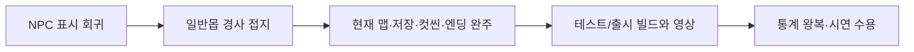
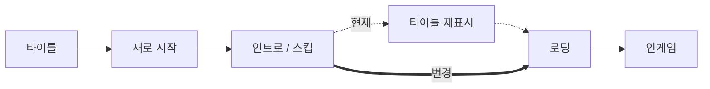

# 남은 구현과 검증 작업

기준일: 2026-11-17 · 현재 코드와 Git `ab6277fc` 기준. **새 코드 작업의 일괄 승인 목록이 아니라 구현·검증·협의 대기를 구분한 안내입니다.**

## 목차

1. [지금 확인할 순서](#1-지금-확인할-순서)
2. [사용자 예정 작업](#2-사용자-예정-작업)
3. [보류와 개선 검토](#3-보류와-개선-검토)
4. [과거 목록](#4-과거-목록)

## 1. 지금 확인할 순서

| 순서 | 구분 | 남은 조건 |
| --- | --- | --- |
| 1 | NPC 실제 확인 | 이름표·그림자·말걸기 겹침, KO/EN·재연결·비활성, 서낭당·문·명부 배치 불변. 기존 대화 상호작용의 사용자 확인과 새 표시 확인을 구분 |
| 2 | 일반 몬스터 경사 검증 | 편집기 비탈 접지 도구 재실행 여부 확인과 실제 산길 왕복·정지·V자·벽/천장·지형 끝 검사. 최대 경사 45도·수평 속도 유지의 승인 계약 보존 |
| 3 | 전체 흐름 수용 | 새 게임·인트로 Enter·저장/재시작·서낭당·처치 복원·명부 이후 복귀·엔딩/마무리. 이미 있는 기능을 다시 만들지 않고 현재 연결 확인 |
| 4 | 테스트/출시 결과물 | F5/F8/F9/F12 등 테스트 기능의 포함/노출 정책, 출시 미리보기와 실제 빌드 차이, 영상·리소스·리비전 확인 |
| 5 | 통계 운영 | 실제 게임 기록→전송→허용된 팀 계정 조회→조건별 집계/다운로드 대조. 무료 요금제 운영 조건 유지 |

검사 기준과 방법은 [전체 통합 안내](전체%20개발%20문서%20통합%20안내.md)의 기능별 원문을 따릅니다. 이번 작업에서 Play·새 빌드·원격 CI·실제 Firebase 왕복을 수행하지 않았습니다.

## 2. 사용자 예정 작업

2026-11-18 사용자 지시로 등록한 작업입니다.

| 항목 | 담당 | 현재 흐름 | 바꿀 흐름 | 상태 |
| --- | --- | --- | --- | --- |
| 새 게임 진입 흐름 정리 | 사용자 | 타이틀 → 새로 시작 → 인트로(스킵 가능) → **타이틀이 한 번 더 나옴** → 로딩 → 인게임 | 타이틀 → 새로 시작 → 인트로(스킵 가능) → 로딩 → 인게임. 인트로 뒤 두 번째 타이틀 없이 로딩 화면이 인게임 진입 직전까지 이어짐 | **11/18 구현·컴파일·코어 검사 완료, Play 미확인.** `LoadingScreen.Begin`의 `covered` 선택 인자와 `TitleGameEntry` 실행 순서로 인트로 종료 프레임에 로딩이 바로 덮음. 상세는 [타이틀 설계](타이틀%20설계.md#인트로-뒤-로딩-직결--2026-11-18) |

## 3. 보류와 개선 검토

- 플레이어 경사 이동 적용은 최신 경사 설계에서 보류입니다. 일반몹 코드가 공통 기반을 사용한다고 자동 적용된 것으로 간주하지 않습니다.
- 리소스·기획 공급이 필요한 신규 콘텐츠와 미래 기능은 기존 기능 문서에서 현재 공급 여부를 확인한 뒤 진행합니다. 과거 미공급 목록을 그대로 현재 일정으로 사용하지 않습니다.
- 패링·보스 판정·패턴은 다른 담당과 경계를 확인합니다. 옵션 등 과거 배정도 최신 사용자 지시가 우선입니다.
- 규칙 위반·중첩 반복·재귀·원본 노출·단순화 후보는 [개선 검토 문서](개선%20검토/코드%20구조와%20반복·재귀%20개선%20검토.md)로 분리했습니다. 수정은 기능 단위로 확인 후 진행합니다.

## 4. 과거 목록

[11/17 정리 전 남은 작업 보존본](구버전/2026-11-17/남은%20구현과%20검증%20작업.md)은 당시 계획과 검증 한계를 보존합니다. 현재 미구현 목록·현재 담당·현재 검사 결과로 인용하지 않습니다. 이전 날짜별 미디어·리소스 보고서도 당시 측정 기준이며 [구버전 안내](구버전/구버전%20문서%20안내.md)에서 구분합니다.
