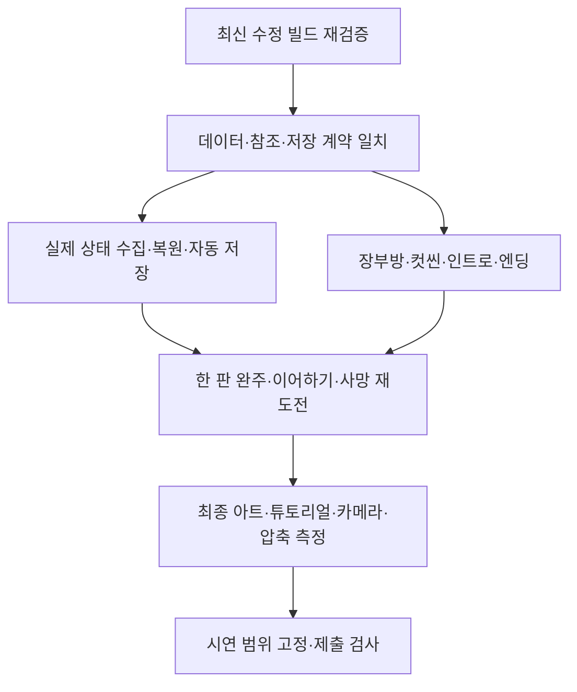

# 남은 구현과 검증 작업

2026-11-05 전체 스크립트 정비: 타이틀 설정 루트 배율·앵커·직접 오류 보고를 수정하고, TitleSceneActions를 제거했습니다. 설정 적용/저장·UI 표시 계약·고정 상태 프레임 부모·시간 변환을 공통화했고 비동기 완료·구독·부분 초기화·파괴된 상호작용 대상 경계를 정리했습니다. 데이터913·코어635 및 기존 CS0414 제외 일반 참조 컴파일 통과입니다. 실제 Play·씬 수명·프리팹 상속 연결 검증은 별도이며 상세 설계와 확인 절차는 공통 모듈과 객체 수명 문서를 따릅니다.

2026-11-05 공용 설정 후속: 현재 타이틀과 일시정지는 같은 SettingsScreen을 사용합니다. 마스터·배경음·효과음·카메라 흔들림, 저장/취소와 모달 입력 차단을 연결했고 마스터 조작부를 추가했습니다. 이전의 임시 빈 타이틀 옵션 설명은 과거 상태입니다. 실제 Unity 표시·입력·소리 확인은 기획자용 사운드 설정 사용 안내를 따릅니다.

2026-11-05 `b8779f7` 후속: 삭제30203/저장확인 계약·미사용_exitAnchor·타이틀 공용 옵션·자동정지·입력 버퍼 폐기와 신규 오류 모달 결합은 완료했습니다. 데이터911·코어610·엄격C#176·Unity 프리팹71검사 통과. 아래 과거 순서표에서 이 완료 항목을 다시 착수하지 않습니다.

1. 실제 저장/진행 연결: 기존 ISaveGameRuntime·SaveGameFlow의 상태 소유자와 관문/배치 식별·버전을 데이터/진행 담당과 맞춘 뒤 소비 코드를 연결합니다. 새 저장/진행 Manager를 중복 생성하지 않습니다.
2. 실제 장치 수용 검사: 옵션/대화 중 오류→닫기, 일시정지 닫는 프레임의 대화 넘김 방지, Alt+Tab·패드 분리, F5/컷씬 통합 예외와 마지막 장치별 커서를 확인합니다.
3. 장부방·컷씬·인트로/엔딩의 공급/조립 계약 이후 사용자 담당 런타임·입력·프리팹 연결을 진행합니다. 데이터 행·문구·스폰·키·배포 수정은 담당자에게 전달하고 직접 바꾸지 않습니다.

원격 간트는 수정하지 않았으며 실제 게임 빌드·commit/push는 사용자 담당입니다. 아래는 이전 단계 기록입니다.

2026-11-05 씬 연결 후속: TitleScreen 프리팹과 MapDohwagolTest에 ErrorPopupSceneBinding을 연결했습니다. 데이터 준비 후 호스트를 만들고 메뉴·플레이어 입력과 게임 시간을 모달 소유권으로 차단합니다. 다른 정지·대화 잠금은 유지합니다. 새 씬 설정과 Unity 확인 순서는 기획자용 에러 팝업 사용 안내에 추가했습니다. 실제 Unity 표시·복사·입력·씬 수명 검증은 남아 있습니다.

2026-11-05 자동 오류 수집 모듈 추가: 초기화된 에디터/개발 빌드 호스트가 Error·Exception·Assert를 수집하고 메인 스레드에서 합산 표시합니다. 직접 Report 중복·표시 재귀·종료 후 전달을 차단합니다. 데이터911·코어600·기존 CS0414 제외 일반/개발분기 참조 컴파일이 통과했습니다. 실제 씬 초기화·입력/일시정지 연결과 Unity 표시 검사는 별도이며 F9·부스표시·출시 전체 정책은 후속입니다.

2026-11-05 에러 알림 갱신: 사용자 승인으로 Popup15007의 복사·닫기·상세 요약을 연결했습니다. Language30209~30212·30214의 KO/EN을 공용 조회로 읽고 PopupScreen 상속으로 표시 수명을 재사용합니다. 기존 X·확인/로그 전용 설명은 이 변경 이전 기록입니다. 데이터903·코어600, 기존 CS0414 제외 엔진 참조 컴파일이 통과했습니다. 실제 씬 오류 자동 수집·F9·부스/출시 정책은 후속입니다.

2026-11-05 작업 순서 변경: 전체 씬 흐름 연결 전에 공용 에러 팝업을 먼저 준비합니다. 모듈·공용 버튼·한국어/영어 enum·언어 조회 계약을 추가했고 실제 UI·중복 오류·입력 반환을 확인한 뒤 씬별 실패 경계를 연결합니다. 언어 선택 화면·추가 언어·Firebase/메일 전송은 이번 범위가 아닙니다.

2026-11-04 최신 풀 c7100e3 기준입니다. [공유 간트](https://docs.google.com/spreadsheets/d/16waFKHuXaZGdi2fz76nRUWFxiuQquhZGy6doAVHqBUI/edit?gid=0#gid=0), 개별 기획과 사용자 제공11/4 회의를 대조했습니다. 원격 시트는 수정하지 않았습니다. 담당은 원문 작업 창구이며 새 배정이 아닙니다.

## 1. 회의 버그와 최신 수정의 관계

| 회의 보고 | 최신 코드에서 확인한 조치 | 다음 수용 검사 |
| --- | --- | --- |
| 보스 해체 때 양쪽·입력 정지 | 900ms 뒤 CompleteExecution 자동 호출 | 해체 반복·사망·중단·타이틀 복귀, 최종 애니 완료로 대체 |
| 보스방 사망 후 재입장 불가 | 클리어 기록 출구 개방·보스 처치 기억 | 서낭당 복귀 후 여러 번 재도전 |
| 결박 관문을 점프로 우회 | 충돌 높이 확대·근접Z 안내 | 점프·매달림 우회 차단과 스킬 후 통과 |
| 맵2에서 맵1 복귀 시 시작 위치 | Spawn_FromSangil 등 복귀 앵커 추가 | 모든 왕복 방향·도착 발 위치 확인 |
| 사냥 후 계속 피해 | 사망 불 설정0, 피해 시간 누적·표시 정리 | 기본형/변종을 나눠 재현. 최종 불 피해 복구 여부 결정 |
| 죽은 몬스터도 피격됨 | 현재 드라이버는 사망 타격 거부 | 실제 사용 판정 경로·사망 보상·반응 중복 확인. 해결 확정 전 |
| 캐릭터·오브젝트 떠 보임 | 캐릭터 프레임별 정점 하단 정렬 | 실제 알파 여백·충돌·오브젝트·각 높이에서 시각 검사 |
| 공격 카메라 부족 | 일반/치명 명중 진동 추가 | 설정OFF·과도한 진동·회의의 종합 카메라 기획 대조 |
| 잠긴 출구로 맵 밖 추락 | 맵 경계 이동 제한 추가 | 좌우 끝·출구 잠금·낙하 구역 회귀 |

위 항목은 ‘수정 반영·실제 빌드 재검증 대기’입니다. 커밋 메시지만으로 버그 해결을 확정하지 않습니다.

## 2. 먼저 정리할 연결·검사 문제

| 순서 | 항목 | 완료 조건 |
| --- | --- | --- |
| 1 | 엄격한 엔진 참조 컴파일 실패 | `_exitAnchor` 역할 정리 후 전체 검사 통과 |
| 2 | 스폰 원본 이중화 | SpawnTemp30마리·배포4마리 중 빌드 기준을 명시하고 원본/배포/참조 일치 |
| 3 | 저장 팝업 계약 | 삭제30203 참조 해소, 빈 칸15001·덮어쓰기15002·기본아니오·목록복귀 |
| 4 | 저장 관문·진행 식별 | 정수목록/문자키/배치ID 합의·버전·왕복복원 |
| 5 | 재방문 정책 충돌 | 사용자 처치 유지와 K16 재생성 중 빌드 범위별 확인 |
| 6 | 최신 UI 예외 | 포커스상실·패드분리 자동정지, F5금지, 단일팝업, 입력버퍼폐기 |

## 3. 다음 작업의 의존 순서

## 4. 간트와 현재 범위

| 담당 창구·간트 | 현재와 앞으로 할 일 |
| --- | --- |
| 황영근: 1차11/4완료·2차11/7완주·3차11/9기능점검 | 1차 완료는 실행파일 확보 단계. 회의 버그 회귀 후 완주·저장·컷씬 검증 |
| 나영민: 이동/공격/자원/AI/변종 완료, 보스강화 진행 | 코드·Preview 존재. 최종 애니·실제 장치·보스 재도전·해체 종료 검사 |
| 나영민: NPC11/5~6진행·피드백11/6예정·UI11/7예정 | 이미 임시 화면·피드백 구현. 정식 시안·문구·최신 예외·장치 검증으로 범위 구분 |
| 황영근: 씬/로딩/타이틀 완료 | 새 게임·설정·임시 로딩 연결. 인트로·이어하기·장부방·엔딩 완료는 아님 |
| 황영근: 저장11/3~4진행 | 독립 모듈 준비. 실제 ISaveGameRuntime·진행 소유·팝업·관문·지점저장·엽전 후속 |
| 황영근: 용량11/4진행 | 맵19개PC BC7 설정. 실제 빌드 크기·메모리·화질 측정 필요. 500MB 달성 미확인 |
| 황영근: 컷씬11/5진행 | 빈 표·재생 코어. 실제 행·후보정 그림·주소·표시·스킵·소리 연결 |
| 황영근: 맵통합/잠금11/5진행 | JSON2·30마리/매복 임시. 풀·원본통합·전 실행 경계 잠금·정식 장부방 후속 |
| 간트 황영근 / O13 나영민 | 부스 작업 창구 확인. F12 5000ms·로딩 후 예약·설정보존·저장삭제·대기영상 후속 |
| 김현민: 아트·애니 | 회의의 캐릭터80% 이상은 팀 보고. 실제 전체 연결/수용완료는 별도. 컷씬 후보정 필요 |
| 김현호·이건호: 기획·시안·문구 | 새 타이틀·전투 카메라·튜토리얼 키·스폰 개연성·정책 충돌 협의 |

간트의11/14 최종작업·11/16제출과11/17완성빌드확정/백업은 일정 확인이 필요합니다.11/9 이후 새 기능 없음과 신규 아이디어 도입도 별도 합의해야 합니다. 기한을 임의 변경하지 않습니다.

## 5. 11월4일 회의의 개선·미확정 작업

- 타이틀: 아이콘 확대·버튼 하단 배치, 배경 애니/파티클 검토. 새 시안 공유 후 진행합니다.
- 안내: 튜토리얼 동선·키 조작 기준·맵2 스킬 관문 안내·도착 위치의 개연성을 확정합니다. 코드의Z안내 추가와 전체 튜토리얼 완성을 구분합니다.
- 표현: 텍스트박스·HUD·반복 타일·프리팹 다양화·그림자/음영·배경 무드·산 흰 테두리·불 애니·캐릭터 애니 보강이 필요합니다.
- 카메라: 이번 명중 진동 외에 전투 상황별 연출·저스트 회피를 종합 기획합니다. 기존 설정OFF와 일치해야 합니다.
- 결박된 요괴: 스킬이 추가 피해처럼 느껴진다는 의견. 애니 반영 후11/9(월) 상태를 확인하고 판단합니다.
- 일부 적의 범위 피해를 다른 적에게도 적용하는 사례는 제안 상태입니다. 대상·피해원·중첩·연쇄 범위를 먼저 정합니다.

열한 아이디어 전체는 [검토안](%EC%A0%84%ED%88%AC%EC%99%80%20%ED%83%90%EC%83%89%20%EC%95%84%EC%9D%B4%EB%94%94%EC%96%B4%20%EA%B2%80%ED%86%A0%EC%95%88.md)에 남기며 회의가 구현 승인이나 오늘 빌드 포함을 뜻하지 않습니다.

## 6. 최종 수용 검사

타이틀→장부방 왕복→맵2·3→보스→엔딩→타이틀, 사망 재도전·이어하기·설정·입력 예외를 실제 빌드에서 확인합니다. 테스트30마리 매복과 공식 배포4마리의 차이를 기록합니다. 저장은 체크포인트와 분리하고 새게임 초기기록·현재슬롯·지점 최초성공1회·정수 위치 복원을 검증합니다. 출시에서는F5/테스트 화면 자체가 없는지 검사합니다.

## 타이틀 옵션의 추가 보고

옵션 선택 후 멈춤 현상은 사용자 보고이며 원인은 미확정입니다. 요청에 따라 빈 캔버스를 열고 새 버튼 입력으로 닫는 임시 우회를 로컬에 적용했습니다. 실제 Play에서 재진입·키보드/패드/클릭 복귀를 확인하고 정식 SettingsScreen 연결 문제는 별도 조사합니다. 임시 우회를 정식 설정 완료로 간주하지 않습니다.
