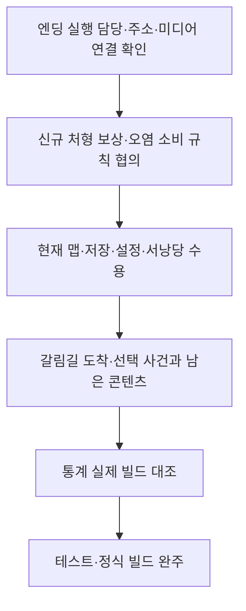

# 남은 구현과 검증 작업

> 2026-11-14 사용자 확정 보완: NPC 대화·상호작용과 장부방 완료 후 사망 복귀는 사용자 실제 확인을 완료했습니다. 옵션 후속도 사용자 담당으로 변경했습니다. 다음 작업의 설계·재사용 경계·미확정 사항은 [담당 예정 기능 설계와 연결 기준](담당%20예정%20기능%20설계와%20연결%20기준.md)을 우선합니다. 아래 11월 13일 표의 과거 공급·진행 상태를 현재 전체 완료 상태로 해석하지 않습니다. 이번 갱신은 문서만 변경했습니다.

2026-11-13 필드 효과 후속: 상태 팩토리·주기 피해·얼음 거리 보정·공통 면역·enum 배포 기반과 현재 테스트 맵 연결을 구현했습니다. 다음 확인은 [기획자 필드 확인 순서](../기획자용%20안내문서/필드%20효과와%20enum%20시트%20사용%20안내.md#6-실제-확인-순서)입니다. 실제 지형 5개 영역 정렬, 로딩 전 피해 차단, 얼음 위/밖 넉백, 사망·재진입·비활성 재사용, 실행파일 검증이 필요합니다. 보류 종류·복합 효과 입력 컬럼·전용 미디어는 추가 구현 대기입니다.

기준일: 2026-11-13. 클라이언트 4f2855d3와 DataSheet 00f4f7e 및 이번 미커밋 기능 변경 기준입니다.  일정·담당 배정·공유 간트는 변경하지 않았습니다. 검사 결과와 기능별 연결 상태는 [현재 현황](현재%20구현과%20검증%20현황.md)에 모읍니다.

## 목차

1. [우선 진행 순서](#1-우선-진행-순서)
2. [이미 처리된 일을 반복하지 않기](#2-이미-처리된-일을-반복하지-않기)
3. [보류와 담당 협의](#3-보류와-담당-협의)
4. [공용 기능의 재사용 경계](#4-공용-기능의-재사용-경계)
5. [실제 수용 검사 기록](#5-실제-수용-검사-기록)

## 1. 우선 진행 순서

| 우선 작업 | 현재 준비된 것 | 완료 조건 |
| --- | --- | --- |
| 엔딩 실제 확인 | Ending 22003·영상 22101·Ending.mp4·공용 프리팹 연결, 마지막 이미지 제외 | 보스 처치·해체 후 재생 → 완주/Enter 스킵 → 맵 탐색 → 오른쪽 끝 이동 시 감사·마무리 안내 → 타이틀 암전. 관문 모양·충돌과 실제 빌드 확인 |
| 신규 데이터 소비 | ExecuteReward·CorruptionStep 4행씩 로딩 | 처형 추가 보상·회복·오염 누적·단계 표시와 저장 계약을 담당자와 확인 후 기존 재화·이벤트 경계에 연결. 로딩만으로 완료 처리 금지 |
| 현재 UI와 입력 | 타이틀 옵션·서낭당·오류창·모달 | 열기·구매·취소·중첩·재진입·입력 복구를 실제 Play에서 확인 |
| 저장 수용 | 새 게임 즉시 기록·F5 직접 선택·서낭당·개별 처치 기록 | 재실행·왕복·사망 후 위치·잔액·레벨·강화·처치 복원. 저장 전 임시 상태와 영구 파일 구분 |
| 일반몹 처형 수용 | 상태·애니메이션 길이·무적·취소·기존 사망 처리 연결 | 반복 처형·동시 사망·대상 비활성·키 해제·기존 보상 중복 방지 Play. 신규 ExecuteReward 소비와 구분 |
| 갈림길 공간 | 산길 9마리·HIGH 8/MID 5 배포, 첫 도착 1회 기반 | 실제 도착 영역·대상 오브젝트 연결과 저장 검증. 경로 선택의 실제 사건을 통계 RecordRouteChoice에 연결 |
| 컷씬 콘텐츠 | Ending 행 공급, Intro·Ledger는 없음 | Intro·Ledger 데이터와 미디어 공급 후 신규 시작·이어하기·장부·스킵 확인 |
| NPC와 공간 | 고정·플랫폼 NPC, Language 대화·반복·정지·목표·보스 사건 연결 | 실제 NPC 배치·대화·중단·재진입 확인. 8004 스폰 파일/참조와 별도 씬 필요 여부 협의. 전체 공간 왕복·사망·재진입 |
| 사운드·표현 | 공급 음원·클립·피격 이펙트·배경 | 최종 청취·반복 전투·카메라·신규 로딩 그림의 실제 적용 확인 |
| 통계 실제 수용 | Firebase 활성·조회 사이트·관리자 권한·xlsx | 새 게임 빌드에서 사망·재화·레벨·처치·오류를 실제 표·파일과 대조. dataVersion은 현재 unversioned이며 운영 식별 기준 필요 |
| 빌드 제출 | GitHub development/release 선택·공지 | 두 빌드 다운로드·실행·출시 시험 기능 비노출·영상 포함·저장·완주. 원격 작업 성공은 별도 확인 |

## 2. 이미 처리된 일을 반복하지 않기

- 산길 8002는 현재 원본·배포 모두 상한 9·실제 9마리입니다. 30마리 미배포를 다시 해결할 항목으로 적지 않습니다.
- 현재 별도 JSON은 대사 4개를 포함해 15개이며, 배포 도구의 검사 전용 실행을 통과했습니다. 이번 문서 갱신에서는 재배포하지 않았습니다.
- Firebase Hosting·규칙 배포와 관리자 한 명의 조회 권한은 앞선 작업에서 완료했습니다. 새 실전 기록·추가 팀원 권한은 별도입니다.
- 일반몹 처형과 NPC1 프리팹은 다른 작업자의 반영분입니다. 새로 구현하지 않고 실제 사용 경계와 후속 연결을 확인합니다.
- GateConfig는 현재 빈 표입니다. 폐기 ID를 임의 복구하지 않으며 새 관문 사용 시에만 정식 ID와 배치를 연결합니다.

## 3. 보류와 담당 협의

몬스터 구간별 리스폰 ON/OFF, 랜덤박스와 아이템 소비, 최종 리깅 전투, 미확정 전투 아이디어·로딩 시안은 별도 공급·설계 결정 후 진행합니다. 렌더링·최소 사양·프레임 개선은 측정 전 확정하지 않습니다. 과거 PNG 무손실 압축은 완료 기록이며 전체 성능 개선 완료를 뜻하지 않습니다.

사용자 확정 F12는 테스트에서 확인 팝업 후 최신 슬롯 하나를 삭제하고 타이틀로 이동합니다. 출시에서는 입력·시험 화면을 노출하지 않습니다. 서로 다른 기획안이 들어오면 이 기준을 임의로 바꾸지 않고 확인합니다.

## 4. 공용 기능의 재사용 경계

| 필요한 책임 | 기존 재사용 대상 |
| --- | --- |
| 정의 초기화와 조회 | GeneratedDataLoadPlan·DataCatalog |
| 설정과 팝업 | SettingsScreen·ErrorPopupSceneBinding·ConfirmationPopupScreen |
| 저장과 복원 | SaveSession·JsonSaveStore·SaveGameFlow·ManualSaveHost |
| 보상과 강화 | CurrencyWallet·MonsterRewards·PlayerLevels·UpgradeSession |
| 컷씬과 사운드 | CutsceneHost·CutsceneScreen·TableSoundPlayer·PreparedAssetStore |
| 수명과 상호작용 | SubscriptionScope·InteractionRegistry·기존 조립자 |
| 통계 기록 | GameplayTelemetryBinding·TelemetryHost·기존 수집 정책 |

단순 표 추가와 새 소비자 구현을 구분합니다. 이미 있는 어댑터·상태·표시 기능을 먼저 확인하며 이번 문서 정비를 코드 구현 지시로 확대하지 않습니다.

## 5. 실제 수용 검사 기록

1. 커밋·빌드 종류·씬·Stage ID·데이터 버전·저장 날짜를 남깁니다.
2. 시작 위치와 행동 순서, 첫 오류, 재현 횟수를 기록합니다.
3. 처치·구매·개방 전후 상태와 명시적 저장 성공을 확인합니다.
4. 타이틀 복귀·이어하기·사망·재입장 후 결과를 대조합니다.
5. 실제 실행 미확인 엔딩·미배치 갈림길·현재 임시 관문 통행을 완료로 집계하지 않습니다.

11월 4일 회의의 지속 피해·보스 재진입·관문 우회·해체 정지·복귀 위치·떠 보이는 표현은 최신 빌드에서 재검증합니다. 과거 리소스 부재를 현재 문제로 반복하기보다 공급된 현재 표시와 실제 사용을 확인합니다.
