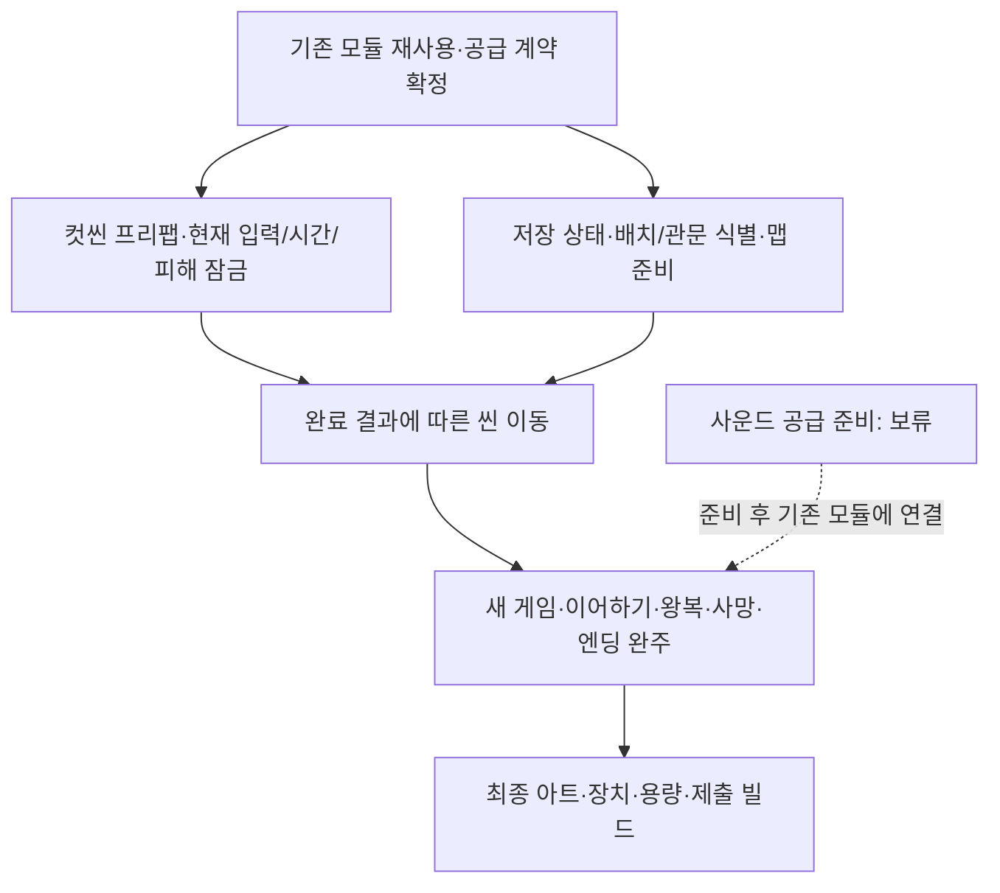

# 남은 구현과 검증 작업

기준일: 2026-11-06, 기준 커밋 `3204b4a` 이후 출구 변경 포함. 사용자 지정 순서인 맵·출구 → 서낭당·처치 저장 → 컷씬과 전체 흐름 → 잠금 빌드·완주 검증을 따릅니다. 일정·담당 배정은 변경하지 않았습니다. 구현 근거와 검사 결과는 [현재 구현과 검증 현황](현재%20구현과%20검증%20현황.md)에 모아 관리합니다.

## 이번 순서와 공간 제작 대기

| 단계 | 현재 상태 | 다음 완료 조건 |
| --- | --- | --- |
| 맵·출구 | 일반 맵 전멸 출구 조건 제거·목적지 접근 판단 구현, 자동 검사 통과 | 실제 플레이에서 미전멸 이동·장부 조건·목적지 잠금 확인 |
| 실제 공간 연결 | 연속 맵·장부방·별도 보스 씬 미준비, 사용자 요청에 따라 연결 준비까지만 | 에셋 공급 후 무로딩 필드·장부방 암전·보스 씬 이동 연결 |
| 서낭당·처치 저장 | 구현·자동 검사 완료, 실제 플레이 확인 대기 | 첫 접촉 저장과 재방문 상호작용 분리, 안정적인 개체 키, 재방문 유지·사망 시 마지막 저장 상태 복원 |
| 컷씬과 전체 흐름 | 공용 실행·역할 키 자동 연결·종료 결과 처리 기반 구현, 실제 표·미디어·화면 대기 | 정상 종료·스킵·실패·취소의 잠금 해제와 다음 진행 확인 |
| 잠금 빌드·완주 | 후속 | 빌드별 기능 노출·잠금 경계와 실제 새 게임부터 종료까지 확인 |

서낭당은 첫 접촉 저장·E키 휴식 저장으로 교체했습니다. 개별 처치 임시 기록·파일 기록·사망 복원도 연결했으며 실제 공간의 접촉·왕복·사망 검증은 남아 있습니다.

## 1. 완료된 기반을 다시 만들지 않기

| 이미 있는 것 | 다음 작업에서 재사용할 대상 |
| --- | --- |
| 테이블 탐색·검사·추출·배포·CSV 후 JSON 자동 초기화 | 기존 로딩 계획·조회 저장소 |
| 공용 설정·음량·확인/취소 | SettingsScreen·SettingsApplication·GameSettings |
| 오류 수집·복사/닫기·모달 입력/시간 소유권 | ErrorPopupSceneBinding과 기존 오류 호스트 |
| 저장 슬롯·JSON 기록·복원 순서·수동 화면 | SaveSession·JsonSaveStore·SaveGameFlow·ManualSaveHost |
| 컷씬 규칙·주소 준비·그림/영상/자막·입력 | CutscenePlayback·CutsceneSequenceSource·CutsceneScreen·CutsceneInput |
| 주소 사운드 준비·재생·정지·시험 창 | PreparedAssetStore·AddressableAssetSource·TableSoundPlayer |
| 맵 로딩·타이틀 암전 | LoadingScreen.Begin·BeginFade |
| 표시 변경 통지·갱신 예약·구독 해제 | PlayerActor.DisplayChanged·SubscriptionScope·기존 상태 이벤트 |
| 상호작용 자동 등록·해제 | InteractableBehaviour·InteractionRegistry·PlayerInteractor |
| 테스트 F12 초기화·공용 확인 화면 | DemoResetHost·ConfirmationPopupScreen·최신 슬롯 삭제 |
| 회피 글자 재사용 | PreviewCombatFeedback의 소형 표시 풀 |

타이틀의 임시 빈 옵션은 공용 설정 화면으로 교체됐습니다. 삭제30203 참조와 수동 저장15001/15002 계약도 수정됐습니다. 포커스 상실/패드 분리 자동 정지·UI 전환 입력 버퍼 폐기는 구현돼 있습니다. 이 항목들은 새 구현 목록이 아니라 실제 실행 검증 목록으로 관리합니다.

## 2. 다음 작업과 완료 조건

| 순서·상태 | 할 일 | 필요한 입력과 완료 조건 |
| --- | --- | --- |
| 우선 실행 확인: 표시·객체 수명 | 준비 전 호출·대상 비활성화/파괴·부분 초기화 실패·재연결·씬 종료 | 기존 수명 범위와 연결 계약을 재사용. 무변경 재탐색·중복 구독·이전 콜백이 새 연결에 영향을 주지 않아야 함 |
| 보류: 렌더링·리소스 | HDR·아틀라스·압축·참조 구조 변경 | 사용자 보류 유지. 해상도 낮추기는 현재 최적화 범위에서 제외 |
| 후속 측정: 성능 | 1920×1080·60FPS 목표, 최소 사양 후보 검토 | 현재 PC의 측정과 실제 후보 PC 검증을 구분. 성능 기록 기능·일반 빌드 선택 추가는 아직 미구현 |
| 제작 대기: 컷씬 실제 조립 | 표·주소·프리팹·호출자 연결 | 확정 ID·미디어·자막·입력 액션 공급. 정상/스킵/취소/실패에서 자기 잠금을 정리하고 다음 진행을 구분 |
| 우선: 씬 흐름 연결 | 인트로 뒤 새 게임·이어하기·장부방·엔딩 | 공간 준비 완료와 플레이어 배치 계약. 기존 Begin/BeginFade 재사용. 보류된 로딩 새 시안은 확정 후 |
| 실행 확인: 저장 연결 | Capture·Prepare·Apply·SetPlayable과 새 게임·선택 복원·F5·현재 지점 저장 연결 완료 | 실제 Unity의 현재 위치·자원·관문·왕복·중단을 검증. 몬스터 개별 처치 기록은 연결했고 실제 왕복·사망 확인 대기 |
| 데이터 대기: 스폰 원본 | StageContentSet과 정식 배포 원본 통합 | 임시30지점/공식4지점 중 빌드 기준 확정·참조 동기화. 실제 풀과 재사용/반환 규칙은 별도 |
| 데이터 대기: 몬스터 | 기본 리스폰 OFF, 추후 구간별 ON/OFF | 정책은 사용자 확정. 고정 개체 ID·처치 기록·생성 제외는 연결. 구간별 ON/OFF 데이터와 초기화 시점은 후속 |
| 보류: 사운드 | 실제 음원·상황별 자동 재생 | 사용자 요청으로 데이터·리소스 준비 후 재개. 기존 준비/동기 재생 기반은 유지 |
| 후속: 잠금·부스·출시 | 모든 실행 경계와 빌드별 노출 정책 | 기획 잠금 우선·유저 해금 분리. 출시 F5/시험 UI 객체·입력 제거와 F12 확인·취소·최신 슬롯 삭제·로딩 예약 흐름 실행 확인 |
| 최종: 품질·제출 | 아트·튜토리얼·용량·한 판 완주 | 실제 빌드 크기/메모리/화질 측정, 장치별 수용 검사, 최종 시연 범위 고정 |

## 3. 담당자가 확인할 실제 실행 항목

- 타이틀/일시정지 설정: 화면 표시·저장·취소·다음 프레임 입력 복귀.
- 오류 모달: 옵션/대화/일시정지 중 오류를 열고 닫아 기존 잠금이 유지되는지 확인.
- 입력: Alt+Tab·패드 분리·닫는 프레임의 재입력·F5/컷씬 중복 실행.
- 컷씬: 잘못된 주소·늦은 준비·영상 오류·준비 제한 시간·비활성화·재연결·건너뛰기.
- 씬: 맵 로딩과 타이틀 암전 구분·이중 이동 거부·이동 중 화면 중단. 중단이 원래 씬 복귀를 뜻하지 않음.
- 저장: 테스트/시연 10슬롯·날짜 내림차순·번호 숨김·직접 선택·현재 위치 복원·자동 지점 최초 성공 1회·새 게임 초기화.

## 4. 11월 4일 회의 버그의 수용 검사

| 회의 보고 | 최신 코드에서 확인한 조치 | 다음 수용 검사 |
| --- | --- | --- |
| 보스 해체 때 양쪽·입력 정지 | 900ms 뒤 CompleteExecution 자동 호출 | 해체 반복·사망·중단·타이틀 복귀, 최종 애니 완료로 대체 |
| 보스방 사망 후 재입장 불가 | 클리어 기록 출구 개방·보스 처치 기억 | 서낭당 복귀 후 여러 번 재도전 |
| 결박 관문을 점프로 우회 | 충돌 높이 확대·근접Z 안내 | 점프·매달림 우회 차단과 스킬 후 통과 |
| 맵2에서 맵1 복귀 시 시작 위치 | Spawn_FromSangil 등 복귀 앵커 추가 | 모든 왕복 방향·도착 발 위치 확인 |
| 사냥 후 계속 피해 | 사망 불 설정0, 피해 시간 누적·표시 정리 | 기본형/변종을 나눠 재현. 최종 불 피해 복구 여부 결정 |
| 죽은 몬스터도 피격됨 | 현재 드라이버는 사망 타격 거부 | 실제 사용 판정 경로·사망 보상·반응 중복 확인. 해결 확정 전 |
| 캐릭터·오브젝트 떠 보임 | 캐릭터 프레임별 정점 하단 정렬 | 실제 알파 여백·충돌·오브젝트·각 높이에서 시각 검사 |
| 공격 카메라 부족 | 일반/치명 명중 진동 추가 | 설정OFF·과도한 진동·회의의 종합 카메라 기획 대조 |
| 잠긴 출구로 맵 밖 추락 | 맵 경계 이동 제한 추가 | 좌우 끝·출구 잠금·낙하 구역 회귀 |

위 항목은 ‘수정 반영·실제 빌드 재검증 대기’입니다. 커밋 메시지만으로 버그 해결을 확정하지 않습니다.

## 5. 기존 회의의 개선·미확정 작업

- 타이틀: 아이콘 확대·버튼 하단 배치, 배경 애니/파티클 검토. 새 시안 공유 후 진행합니다.
- 안내: 튜토리얼 동선·키 조작 기준·맵2 스킬 관문 안내·도착 위치의 개연성을 확정합니다. 코드의Z안내 추가와 전체 튜토리얼 완성을 구분합니다.
- 표현: 텍스트박스·HUD·반복 타일·프리팹 다양화·그림자/음영·배경 무드·산 흰 테두리·불 애니·캐릭터 애니 보강이 필요합니다.
- 카메라: 이번 명중 진동 외에 전투 상황별 연출·저스트 회피를 종합 기획합니다. 기존 설정OFF와 일치해야 합니다.
- 결박된 요괴: 스킬이 추가 피해처럼 느껴진다는 의견. 애니 반영 후11/9(월) 상태를 확인하고 판단합니다.
- 일부 적의 범위 피해를 다른 적에게도 적용하는 사례는 제안 상태입니다. 대상·피해원·중첩·연쇄 범위를 먼저 정합니다.

열한 아이디어 전체는 [검토안](%EC%A0%84%ED%88%AC%EC%99%80%20%ED%83%90%EC%83%89%20%EC%95%84%EC%9D%B4%EB%94%94%EC%96%B4%20%EA%B2%80%ED%86%A0%EC%95%88.md)에 남기며 회의가 구현 승인이나 오늘 빌드 포함을 뜻하지 않습니다.

## 6. 최종 수용 경로

타이틀→새 게임/인트로→정식 공간·맵 왕복→보스→엔딩→타이틀을 실제 빌드에서 확인합니다. 이어하기·사망 재도전·저장·설정·입력 예외를 함께 검사합니다. 현재 이 전체 경로가 연결·검증 완료된 상태는 아닙니다. 시연 작업의 순서와 출시 정책을 섞지 않습니다.

현재 관문 ID는 데이터로 연결했고 저장 스키마 변경은 하지 않았습니다. 타이틀 진입의 초기 기록/복원과 일반 맵 이동을 분리했으므로 새 맵마다 과거 저장 위치를 적용하지 않습니다. 정식 장부방·엔딩 공간 공급과 미제작 컷씬은 이 코드 연결 완료와 구분합니다.

F12 초기화의 구현은 준비됐습니다. 기존 무확인 5초 초기화로 다시 구현하지 않습니다. 테스트 한 번 입력→공용 확인/취소/X→최신 슬롯 하나 삭제→타이틀이라는 사용자 최종 지시를 적용했고 실제 시연 빌드 검증이 남았습니다.
