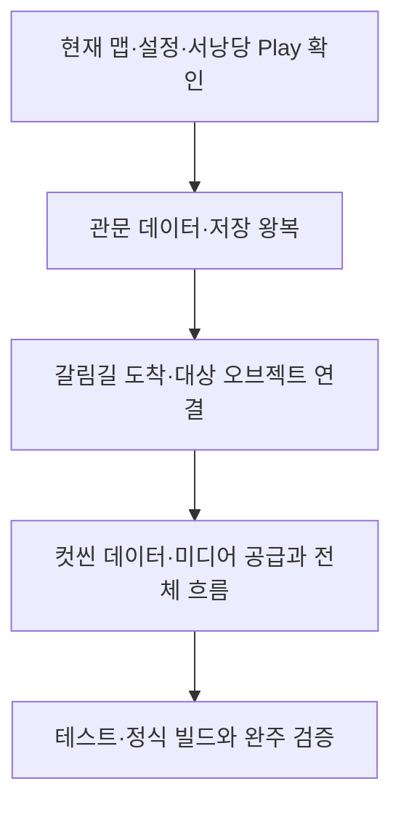

# 남은 구현과 검증 작업

2026-11-11 스킵: Enter 즉시 스킵 기반과 컷씬·영상·대사·연출 연결 계약을 구현했습니다. 다음은 실제 Enter 유지/재입력·모달 차단·재활성·영상 정지·연출 최종 상태 확인입니다. 기존 임시 대사를 Language ID로 전환하려면 기획자의 ID 공급이 필요합니다. [기획자 안내](../기획자용%20안내문서/기획자용%20즉시%20스킵%20사용%20안내.md)를 따릅니다.

기준일: 2026-11-10. 현재 로컬 코드·데이터 기준입니다. 원격 일정과 담당 배정은 변경하지 않습니다. 구현 근거·검사 수치는 [현재 현황](현재%20구현과%20검증%20현황.md)에 모으고 여기서는 다음 완료 조건을 관리합니다.

## 1. 다음 진행 순서

| 우선순위 | 할 일 | 준비된 기반·완료 조건 |
| --- | --- | --- |
| 먼저 확인 | 타이틀 옵션·서낭당·오류창·입력 복구 | 기존 공용 화면 유지. 열기·구매·취소·중첩 모달·재진입·닫은 입력이 게임에 새지 않는지 Play |
| 관문 정식 연결 | GateConfig 행과 실제 BindGate 표식 정리 | 현재 빈 표의 미연결 관문은 생성 생략. 정식 ID를 배정하고 배포한 뒤 스킬 개방·저장·이어하기 확인 |
| 저장 수용 | 새 게임 즉시 기록·F5 직접 선택·서낭당·처치 기록·폐기 관문 호환 | 현재 위치·잔액·레벨·강화·처치 복원. 저장 전 임시 진행과 파일 기록을 구분 |
| 갈림길 연결 | 도착 영역 배치·유효 오브젝트 ID와 성공 처리 | 지도 등록과 도착 감지를 구분. 첫 도착 1회·중복 방지·명시적 저장·이어하기 확인 |
| 콘텐츠 공급 | 컷씬 ID·재생 행·미디어·자막·역할 키 | 기존 재생기와 호출 경로 사용. 종료·스킵·취소·실패 뒤 잠금 정리와 다음 진행 확인 |
| 전체 공간 | 맵·장부방·보스·타이틀의 도착·복귀·사망 | 등록된 8001~8005와 실제 콘텐츠를 구분. 8004 Spawn은 비어 있음. 전체 왕복·사망·재진입 확인 |
| 성장·보상 | 최종 UI·획득 연출·보스 보상 행·랜덤박스 | 지갑·레벨·강화 코어는 재사용. 랜덤박스 데이터·지급 규칙은 확정 후 |
| 사운드 | 추가 음원·상황 조건·실제 청취 | 기존 표·준비 저장소·재생기 사용. 새 재생기를 복제하지 않음 |
| 제출 | 테스트·정식 빌드·기능 잠금·실제 완주 | 출시 F5·시험 슬롯·F12 비노출, 테스트 F12 확인/취소/최신 슬롯 삭제, 빌드 공지·다운로드·실행 |

## 2. 다른 작업과 보류 범위

일반몹 패링의 공격 취소·경직 후 Parried 이벤트와 표시 연결은 다른 작업자가 반영했습니다. 이를 미구현으로 되돌려 적거나 새로 재구현하지 않습니다. 담당자는 실제 입력·연속 패링·사망·표시·소리 수용을 확인합니다. [패링 확인 안내](../기획자용%20안내문서/캐릭터%20스프라이트%20애니메이션%20확인%20안내.md)를 참고합니다.

몬스터 구간별 리스폰 ON/OFF, 최종 리깅 전투 연결, 미확정 전투 아이디어와 새 로딩 시안은 후속입니다. 렌더링·리소스 변경과 최소 사양 확정은 별도 결정·측정 대상이며 해상도 축소는 현재 범위에서 제외합니다. 문서 정비를 해당 기능의 구현 지시로 해석하지 않습니다.

## 3. 이미 있는 기능을 다시 만들지 않기

| 필요한 책임 | 재사용 대상 |
| --- | --- |
| 초기화·조회 | 자동 GeneratedDataLoadPlan·DataCatalog |
| 설정·오류·확인 팝업 | SettingsScreen·ErrorPopupSceneBinding·ConfirmationPopupScreen |
| 저장·복원·슬롯 | SaveSession·JsonSaveStore·GameSaveFlow·ManualSaveHost |
| 재화·레벨·강화 | CurrencyWallet·MonsterRewards·PlayerLevels·UpgradeSession |
| 갈림길 | GalimgilRewards·GalimgilArrival·기존 GameplayPreview 연결 |
| 컷씬·사운드 | CutscenePlayback·CutsceneScreen·TableSoundPlayer·PreparedAssetStore |
| 씬 이동 | LoadingScreen.Begin·BeginFade |
| 구독·상호작용 | SubscriptionScope·InteractionRegistry·기존 조립자 |

## 4. 실제 수용 검사에서 남길 기록

1. 사용한 커밋·빌드 종류·씬·저장 슬롯의 날짜를 기록합니다.
2. 시작 위치·입력·행동 순서와 첫 오류를 기록합니다.
3. 구매·처치·개방 전후 값과 저장 성공 여부를 확인합니다.
4. 타이틀 복귀·이어하기·사망·재입장 후 같은 결과인지 확인합니다.
5. 임시 관문 통행·없는 컷씬·미배치 갈림길을 완료로 집계하지 않습니다.

11월 4일 회의에서 제기한 사냥 후 지속 피해, 보스방 재진입, 관문 점프 우회, 해체 중 정지, 맵 복귀 위치, 떠 보이는 표현은 실제 빌드 재검증 대상으로 유지합니다. 타이틀·배경·애니메이션은 이후 공급이 반영됐으므로 예전의 ‘리소스가 전혀 없음’ 대신 현재 표시 결과를 확인합니다.
