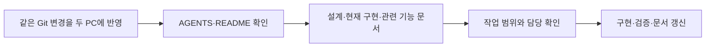
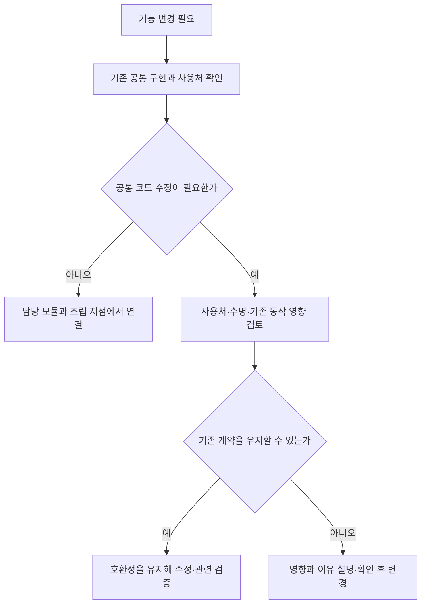

# 다른 PC 작업 시작과 설계원칙 인수인계

기준일: 2026-11-13 · 대상: 다른 PC에서 작업을 이어가는 개발자와 AI 작업 도구

## 목차

1. [왜 저장소에서 관리하는가](#1-왜-저장소에서-관리하는가)
2. [먼저 읽는 순서](#2-먼저-읽는-순서)
3. [반드시 유지할 설계 기준](#3-반드시-유지할-설계-기준)
4. [다른 개발자의 작업과 공통 코드](#4-다른-개발자의-작업과-공통-코드)
5. [다른 PC에서 작업을 재개하는 순서](#5-다른-pc에서-작업을-재개하는-순서)
6. [인수인계 요청 예시와 완료 기준](#6-인수인계-요청-예시와-완료-기준)

## 1. 왜 저장소에서 관리하는가

PC의 대화 기록이나 개인 설정에만 원칙을 남기면 다른 환경에서 누락됩니다. 이 프로젝트는 Git으로 전달되는 문서를 기준으로 작업 맥락을 복원합니다. 프로젝트 루트의 AGENTS.md는 작업 지침의 진입점, README는 사용·구조 안내의 진입점입니다. 이 문서는 두 문서를 읽고 현재 상태를 확인하는 절차를 설명합니다.



문서가 다른 PC에 전달되려면 관련 변경을 커밋·푸시하고 그 PC에서도 받아야 합니다. 이 문서를 작성한 것만으로 원격 저장소에 반영되지는 않습니다. AI 도구마다 지침을 읽는 방식이 다르므로 자동 인식을 가정하지 말고 시작 요청에서 명시적으로 읽도록 안내합니다.

## 2. 먼저 읽는 순서

| 순서 | 읽을 문서 | 확인할 내용 |
| --- | --- | --- |
| 1 | [루트 AGENTS.md](../../AGENTS.md) | 명명·책임·수명·문서 관리 규칙 |
| 2 | [README](../../README.md) | 실행·데이터 배포·프로젝트 구획 |
| 3 | [프로젝트 전체 아키텍처](프로젝트%20전체%20아키텍처.md) | 왜 나눴는지, 의존 방향과 예외 |
| 4 | [현재 구현과 검증 현황](현재%20구현과%20검증%20현황.md) | 구현·연결·실제 검증의 차이와 기준 커밋 |
| 5 | [남은 구현과 검증 작업](남은%20구현과%20검증%20작업.md) | 남은 조건과 보류 사항 |
| 6 | [문서 안내](../문서%20안내.md)에서 해당 기능 | 기능별 설계·기획자 사용법 |

현재 파일·커밋과 문서의 기준이 다르면 차이를 확인합니다. 과거 검증 통과 기록을 현재 코드의 통과로 간주하지 않습니다. 최신 사용자 지시가 기존 문서와 다르면 적용 범위를 확인하고 해당 문서를 함께 갱신합니다.

## 3. 반드시 유지할 설계 기준

아래는 작업 시작용 요약입니다. 상세 계약은 AGENTS와 아키텍처 문서를 기준으로 하며 같은 내용을 여러 문서에 따로 확장하지 않습니다.

| 기준 | 실제 작업에서 지킬 것 | 이유 |
| --- | --- | --- |
| 자동화·데이터 기반 | 기존 시트 규칙과 발견·검사·배포 재사용. 새 소비 기능의 최초 연결은 별도 구현 | 반복 등록과 콘텐츠 하드코딩 감소 |
| 독립 모듈·명시적 조립 | 정의·실행 상태·규칙·표시·인프라 구분 | 기능 교체와 담당 분리 |
| 객체 지향·공통화 | 기존 클래스·메서드·어댑터부터 확인. 의미 있는 상속·재정의와 조합 사용 | 중복 감소, 과도한 세분화 방지 |
| 목적에 맞는 패턴 | 상태·복합 상태·팩토리·옵저버·퍼사드 등을 실제 책임에 맞게 적용 | 패턴 적용 자체가 목적이 되지 않음 |
| 명령과 이벤트 | 명령은 상태 소유자에게, 완료 결과는 독립 소비자에게. 매 프레임 표시 조회 대신 변경 통지 | 순서·책임·갱신 비용 명확화 |
| 원본 보존 | 공유 정의는 읽기 전용. 변경 상태는 별도 객체·필요한 복사본에 보관 | 개체 사이 데이터 오염 방지 |
| 정수 단위 | 기본 값·이동 단위는 정수, 시간은 ms, 확률 분모는 10000. Unity 경계 변환은 분리 | 데이터 의미 통일 |
| 수명 관리 | 비활성 생성·연결 후 활성화. 구독·예약·비동기 결과·잠금의 소유자와 해제 지점 명시 | 빈 객체·늦은 호출·입력 잠금 누수 방지 |
| 필요한 비동기만 | 실제 외부 작업을 기다리는 구간에 사용. 해제 후 결과 적용 방지 | 불필요한 실행 흐름과 수명 복잡도 축소 |
| 오류 경계 | 필수 실패는 조립자에게 전달, 표시 오류는 표시 담당이 정리·보고. 기존 Firebase 오류 보고 사용 | 실패 원인 전달과 정리 보장 |
| 한글·파일 용도 | 설명·주석·로그는 한글, 객체 이름·호출 키는 영문 ASCII. 보고서는 Markdown, JSON은 게임 데이터 용도 | 팀의 이해와 데이터/보고서 구분 |
| 문구 관리 | 화면 문구는 Language ID, 공통 언어 조회 재사용. 기능별 연결 시트는 필요할 때 도입 | 번역 중복·연결 실수 방지 |

현재 프로젝트는 싱글플레이이며 이번 원칙으로 네트워크 기능을 추가하라는 뜻은 아닙니다. 정수 사용만으로 결정성이 보장되지 않으며, 향후 확장 시 시간·난수·순서·상태 소유권을 별도 검토합니다.

일반 정의 C#는 최초 생성 후 보존하고, 생성 enum·로딩 계획은 배포 소유 정책을 따릅니다. DataSheet 내부 최신 C#와 Unity 배포 코드의 호환 경계를 유지합니다. 클라이언트에 데이터 검사기를 중복 추가하지 않습니다. 테스트 전용 기능은 기존 빌드 조건을 재사용합니다.

## 4. 다른 개발자의 작업과 공통 코드



- 담당 기능을 구현한다는 이유로 다른 개발자의 기능 내부를 임의로 다시 작성하지 않습니다.
- 공통 코드는 재사용하고 필요한 수정도 합니다. 독립성은 공통 코드 수정 금지를 뜻하지 않습니다.
- 기존 공개 계약을 바꿔야 하거나 설계원칙의 예외가 필요하면 이유·영향·대안을 먼저 설명하고 사용자 확인을 받습니다.
- 작업 전에 왜 필요한지, 기존 무엇을 재사용하는지, 왜 해당 위치에 코드를 두는지 설명합니다. 기능 단위로 결과를 확인받습니다.
- 담당 배정은 현재 사용자 지시를 확인합니다. 이 문서에 변경이 잦은 개인별 목록을 복제해 고정하지 않습니다.

## 5. 다른 PC에서 작업을 재개하는 순서

### 환경과 작업물 확인

1. 두 저장소를 같은 상위 폴더 아래 `Human_Ghost-`와 `DataSheet`로 배치합니다. 개인 PC의 절대 경로를 코드에 넣지 않습니다.
2. 두 저장소의 브랜치·커밋·미커밋 변경·충돌 유무를 확인합니다. 기존 변경을 버리거나 자동 덮어쓰지 않습니다. 최신화·병합은 작업 범위와 사용자 승인에 맞춰 진행합니다.
3. 앞의 문서 읽기 순서와 담당 작업을 확인합니다. 문서만 요청받았으면 코드를 수정하지 않습니다.
4. Unity 버전은 ProjectSettings/ProjectVersion.txt, 패키지는 저장소의 선언을 따릅니다. Unity 반영과 패키지 복원이 끝난 뒤 작업합니다.
5. 도구 개발·검사는 해당 도구의 런타임이 필요합니다. 기획자용 배포 EXE 실행과 도구 소스 개발 환경은 구분합니다. DataSheet README의 현재 요구사항을 확인합니다.
6. Unity 에셋은 원본과 .meta를 함께 전달합니다. 별도 공급 아트·미디어가 누락되면 기존 연결을 임의의 다른 자산으로 덮어쓰지 않습니다.
7. Firebase 로그인·GitHub 비밀값 등 PC/서비스별 인증은 Git 문서와 별개입니다. 비밀번호·토큰·개인 경로를 문서에 기록하지 않습니다.

### 검증과 인계

게임 코드 변경 시 기존 검사 진입점은 프로젝트 루트의 다음 명령입니다. 필요한 .NET·Unity 참조·패키지 준비 여부는 기존 검사 안내를 따릅니다.

```powershell
./Tools/Verify-Project.ps1 -CompileUnity
```

변경에 필요한 검사만 수행하고 실제 Play·테스트/정식 빌드 확인과 구분해 보고합니다. 새 PC에서 실행하지 않은 과거 검사를 이번 통과로 적지 않습니다. 문서만 변경한 경우에는 경로·링크·내용 확인이 우선입니다.

## 6. 인수인계 요청 예시와 완료 기준

다른 PC의 작업 도구에 아래처럼 요청할 수 있습니다. 항목의 실제 내용은 현재 작업에 맞게 적습니다.

> 이 저장소의 AGENTS.md와 README를 먼저 읽고, 다른 PC 작업 시작과 설계원칙 인수인계 문서가 안내하는 현재 현황·관련 기능 문서를 확인해 주세요. 작업은 [기능명]입니다. 현재 파일과 커밋을 확인하고 구현과 계획을 구분해 주세요. 기존 공통 기능을 먼저 재사용하고 다른 개발자 담당 기능은 임의로 변경하지 마세요. 공통 계약 변경이나 설계 예외가 필요하면 이유와 영향을 설명하고 확인받으세요. 코드 수정 전에 책임·연결·수명과 검증 방법을 설명하고, 완료 후 관련 개발자 설계·기획자 안내를 갱신해 주세요.

| 전달할 내용 | 예시 형식 |
| --- | --- |
| 기준 | 두 저장소의 브랜치·커밋, 미커밋 작업 유무 |
| 범위 | 이번 기능, 다른 작업자 담당, 보류 사항 |
| 이유·방식 | 기존 문제 → 재사용/변경 → 기대 효과 |
| 검증 | 실행한 검사와 결과, 실제 실행하지 않은 항목 |
| 후속 | 데이터·리소스 공급과 실제 연결이 필요한 부분 |

기능 변경 시 설계와 기획자 사용 안내를 함께 갱신하고 [문서 안내](../문서%20안내.md)에 연결합니다. 구현 진행 일지를 별도로 늘리기보다 해당 기능 문서와 현재 현황을 최신화합니다. 내부 문서는 외부 소개 자료와 구분합니다.
