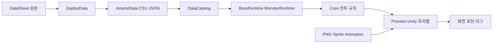
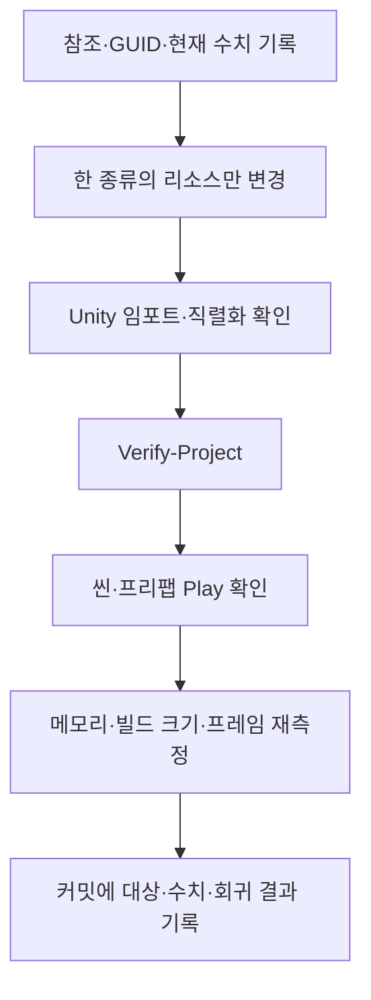

# 다른 개발자 리소스·프리팹 최적화 작업 인수인계

기준 커밋: `322454f1` (`HYT/work`, `origin/Develop`과 동일)  
작성 기준일: 2026-11-19

이 문서는 이후 담당자가 이미지와 프리팹의 용량·메모리·런타임 비용을 줄일 때, 현재 Git에 커밋된 기능 계약을 깨지 않도록 읽는 개발자용 인수인계 문서입니다. 커밋에 반영된 완료 사항과 앞으로 확인할 최적화 작업을 구분합니다.

## 목차

1. [현재 기준과 읽는 순서](#1-현재-기준과-읽는-순서)
2. [커밋 기준으로 완료된 작업](#2-커밋-기준으로-완료된-작업)
3. [현재 데이터·코드·프리팹 연결](#3-현재-데이터코드프리팹-연결)
4. [이미지 최적화 작업 범위](#4-이미지-최적화-작업-범위)
5. [프리팹 최적화 작업 범위](#5-프리팹-최적화-작업-범위)
6. [변경 전후 검증 계약](#6-변경-전후-검증-계약)
7. [후속 작업 기록 방법](#7-후속-작업-기록-방법)

## 1. 현재 기준과 읽는 순서

먼저 다음 문서를 읽습니다.

1. [프로젝트 전체 아키텍처](프로젝트%20전체%20아키텍처.md)
2. [다른 PC 작업 시작과 설계원칙 인수인계](다른%20PC%20작업%20시작과%20설계원칙%20인수인계.md)
3. [게임플레이 코어와 프리팹 연결](게임플레이%20코어와%20프리팹%20연결.md)
4. [몬스터 투척 리그 용량 최적화 가이드](몬스터%20투척%20리그%20용량%20최적화%20가이드.md)
5. [현재 구현과 검증 현황](현재%20구현과%20검증%20현황.md)

현재 HEAD에서 `git status`는 깨끗한 상태였습니다. 따라서 아래 “완료”는 작업 트리에만 남은 변경이 아니라 `322454f1`까지 커밋된 내용만 뜻합니다. 최적화 작업을 시작할 때에는 먼저 최신 브랜치와 `git status --short`를 다시 확인합니다.

## 2. 커밋 기준으로 완료된 작업

### 2.1 데이터·규칙 중복 제거

| 커밋 | 완료 내용 | 후속 담당자가 지켜야 할 점 |
| --- | --- | --- |
| `322454f1` | 보스 패턴 수치·타격 수치·패턴 효과음 키를 `BossSkill`·`BossSkillHit`·`BossState.Music`으로 이전하고 `BossPatterns.asset`, `BossPatternSettings`를 제거 | 보스 수치나 패턴을 프리팹 Inspector에 다시 추가하지 않음 |
| `54269529` | 일반 몬스터 패턴을 `MonsterSkill`로 이전하고 몬스터 패턴 설정 자산 5개와 `MonsterPatternSettings`를 제거 | 몬스터 프리팹을 최적화하면서 공격 수치의 직렬화 필드를 부활시키지 않음 |
| `1c5bdc17` | 보스 2페이즈 선택 기준을 `BossState`에서 읽도록 이전 | 선택 순서는 아직 코드 책임이며 데이터 값과 섞지 않음 |
| `16554717` | 맵 역할을 `Stage.Role` 기반으로 변경 | 프리팹 이름이나 씬 위치를 맵 역할 판정에 사용하지 않음 |
| `0fd9ea94` | 코요테 시간·점프 버퍼를 `Player` 데이터로 이전 | 조작 시간 상수를 화면·프리팹 코드에 복제하지 않음 |
| `c0cc30d5` | 맵 배경음을 `Stage.BGM_Normal`·`Stage.BGM_Battle`에서 읽도록 변경 | 프리팹에 배경음 키를 별도로 넣지 않음 |
| `bc2ef038` | 보스 상태 대사·몬스터 피격 이펙트 등의 직접 ID/경로 비교를 줄이고 데이터·프리팹 연결로 이동 | 기존 참조를 제거할 때 `StageContentSet`·몬스터 프리팹 연결을 함께 확인 |

### 2.2 상태·콜백·수명 계약 보강

| 커밋 | 완료 내용 | 최적화 작업 영향 |
| --- | --- | --- |
| `c74b182b` | 상태 변경 통지 중 재전환을 거부하고 전환 보호 구간에 통지를 포함 | 콜백 순서를 바꾸거나 표시 컴포넌트에서 코어 상태를 다시 호출하지 않음 |
| `893cb8eb` | 보스 도약 상수 별칭 제거, `ClearPattern` 통지 위치 정리 | 화면 최적화 때문에 전투 이벤트·정리 순서를 변경하지 않음 |
| `83106018` | 문구 대체 분기 제거, 상태 그림 키 중복 검사 추가 | 이미지 교체 시 Language ID와 그림 키의 단일 연결을 유지 |
| `1c8a1354` | 보스 발악 HP 판정과 체공 시간의 단일 사용처·경계 검사 | `LeapAirTime`을 프리팹이나 애니메이션 코드에 별도 상수로 두지 않음 |
| `9af5fcb5` | `ContentEnabled` 판정을 초기화 경로에서 재사용하고 중지 콘텐츠를 오류로 전달 | 프리팹을 비활성화하는 것으로 데이터 콘텐츠 중지를 대신하지 않음 |

### 2.3 이미지·리그·프리팹 관련 기존 작업

다음은 리소스 최적화의 출발점으로 삼을 기록입니다.

- `30945eec` — 이미지 수정
- `c89ec09e` — 옹귀 리깅 재작업
- `37b1bb62` — 옹귀 투척 리그·공격 예고 반영
- `e4d8f5d6` — 모듈화 작업 및 검증 테스트
- `322454f1` — 보스 패턴 설정 자산 제거와 데이터 연결 전환

PNG를 다시 저장하거나 프리팹을 재생성할 때에는 원본 PNG·`.meta`·기존 클립 GUID·프리팹 GUID를 보존하는 것을 기본으로 합니다. 기존 압축 결과 문서는 당시 측정값의 기록이므로, 최적화 결과를 현재 수치로 인용하려면 다시 측정합니다.

## 3. 현재 데이터·코드·프리팹 연결

리소스 담당자는 `H → G → I`를 주로 다루지만, 다음 계약을 건드리면 데이터·코어 검증까지 다시 해야 합니다.

| 영역 | 현재 소유자 | 최적화 시 확인할 것 |
| --- | --- | --- |
| 패턴·피해·반응 | `BossSkill.csv`, `BossSkillHit.csv`, `MonsterSkill.csv` | 프리팹에 수치 필드를 추가하지 않음 |
| 보스 페이즈 기준·음악 | `BossState.json` | `Music`, `LeapAirTime`과 코드 상수의 중복 금지 |
| 콘텐츠 등록 | `StageContentSet`, 각 맵/몬스터 프리팹 | GUID·코드 ID·등록 항목 보존 |
| 애니메이션·리그 | `Assets/5.Animation`, 관련 Preview 컴포넌트 | 표시용 변경이 판정·상태 시간에 영향을 주지 않음 |
| 이미지 | `Assets/4.Sprite`와 `.meta` | 알파, 피벗, PPU, 필터, 압축 플랫폼 설정을 전후 비교 |

프리팹 생성·연결은 호출자가 전달한 앵커 묶음 안에서만 이름을 찾고, 누락 시 원점에 임의 생성하지 않습니다. 씬·프리팹 오브젝트와 앵커 이름은 ASCII 이름 규칙을 유지합니다.

## 4. 이미지 최적화 작업 범위

### 4.1 먼저 측정할 것

파일 크기만 줄었다고 메모리와 프레임 비용이 줄었다고 판단하지 않습니다. 대상별로 다음을 따로 기록합니다.

| 측정값 | 의미 |
| --- | --- |
| 저장소 파일 크기 | Git·배포 파일 용량 |
| 빌드 포함 크기 | 실제 플랫폼 패키지 용량 |
| 런타임 텍스처 메모리 | 임포트 후 GPU/CPU 사용량 |
| 로딩 시간 | 씬·프리팹 최초 표시 비용 |
| 프레임·배치·드로우콜 | 화면에 배치된 이후 비용 |

### 4.2 안전한 우선순위

1. 중복·미참조 이미지부터 찾되, 삭제하지 말고 참조 검색과 빌드 포함 여부를 확인합니다.
2. PNG 무손실 압축은 픽셀 스트림, 알파, 비이미지 청크, `.meta`를 전후 비교합니다.
3. 플랫폼 압축·Max Size·Read/Write·MipMap·Filter·Compression 설정은 맵 배경, 픽셀 아트, UI, 리그 원본을 구분해 적용합니다.
4. 여러 작은 스프라이트를 아틀라스화할 때는 필터링 경계, 패딩, 런타임 로딩 수명, 변형별 실제 사용 여부를 확인합니다.
5. 원본 그림에 글자를 굽지 않습니다. 문구·다국어 연결은 `Language`·UI 프리팹 계약을 유지합니다.

### 4.3 금지할 변경

- 픽셀 동일성이 필요한 캐릭터·타일·UI를 임의로 손실 압축하지 않음
- Sprite pivot·PPU를 바꿔 캐릭터 발 위치, 콜라이더, 앵커가 이동하는 변경
- 원본 `.meta`를 재생성해 GUID를 바꾸는 이동·복사
- 리그용 원본 Sprite를 합치거나 이름을 바꿔 Animation Clip 참조를 끊는 변경
- 이미지 최적화 작업에 전투 수치·상태 전환·데이터 스키마 변경을 함께 섞는 것

## 5. 프리팹 최적화 작업 범위

### 5.1 우선 확인할 대상

- `Assets/2.Model/Prefabs/MOP`의 몬스터·보스 gameplay 프리팹
- `Assets/2.Model/Prefabs/Map`의 맵 프리팹과 반복 배치 오브젝트
- `Assets/2.Model/Prefabs/UI`의 공용 화면 프리팹
- `Assets/5.Animation`의 리그·클립·파생 Sprite
- `Assets/2.Model/Prefabs/Config/StageContentSet.asset`, `GameAudio.prefab`

### 5.2 최적화 방법

- 중복된 표시 컴포넌트는 공용 프리팹·변형 프리팹 상속 구조를 먼저 확인한 뒤 통합합니다.
- `MonoBehaviour`를 제거하기 전에 해당 컴포넌트가 이벤트 구독, 앵커 검색, 풀 반환, 리그 생성, 직렬화 참조를 소유하는지 확인합니다.
- 생성·설정·대상 연결은 비활성 상태에서 완료한 뒤 활성화하는 현재 수명 계약을 유지합니다.
- 런타임 생성 오브젝트의 풀 재사용을 추가할 때는 위치·활성·이벤트 구독·MaterialPropertyBlock·리그 상태를 모두 초기화합니다.
- `Update`에서 반복되는 탐색·할당을 줄이되, 코어 시간은 정수 ms이고 Unity 표현 경계에서만 실수로 변환한다는 원칙을 유지합니다.
- 컴포넌트 제거·병합은 씬과 모든 프리팹 인스턴스의 직렬화된 참조를 검색한 뒤 수행합니다.

### 5.3 변경 단위

이미지 임포터 변경, Sprite 파생 생성, 프리팹 구조 변경, 런타임 표시 코드 변경을 한 커밋에 모두 섞지 않습니다. 최소한 다음 단위로 나눕니다.

1. 측정·보고서만
2. 이미지/임포터 최적화
3. 프리팹 구조 최적화
4. 런타임 표시 비용 최적화
5. 회귀 검증과 문서 갱신

## 6. 변경 전후 검증 계약

최소 확인 항목:

- `Tools/Verify-Project.ps1`의 데이터·리소스 연결 검사
- 보스·몬스터 패턴이 CSV/JSON에서 계속 로드되는지
- `ContentEnabled`, `Stage.Role`, 앵커 이름, `StageContentSet` 등록이 유지되는지
- 캐릭터 발 접지, 콜라이더, 공격 예고, 피격·처형·사망 표시가 기존과 같은지
- 프리팹 비활성화·재활성화·씬 재진입에서 이벤트 중복 구독과 누수가 없는지
- 개발 빌드와 실제 배포 빌드의 파일 크기·로딩·메모리 차이

자동 검사는 실제 Play, 장치별 GPU 메모리, 새 실행파일 수용을 대신하지 않습니다. 결과 문서에는 “검사 통과”와 “실제 Play 확인”을 별도로 기록합니다.

## 7. 후속 작업 기록 방법

새 담당자는 작업 시작 전에 이 문서의 기준 커밋을 갱신하지 말고, 자신의 기준 SHA와 작업 브랜치를 작업 문서 또는 커밋 메시지에 기록합니다. 완료 후 다음 정보를 남깁니다.

| 기록 | 예시 |
| --- | --- |
| 대상 | `Assets/4.Sprite/...`, `BossGameplay.prefab` |
| 변경 종류 | PNG 무손실 압축, 임포터 설정, 프리팹 컴포넌트 정리 |
| 보존 확인 | 픽셀/알파, GUID, PPU, pivot, Animation Clip, 콜라이더 |
| 측정 전후 | 저장소·빌드·런타임 메모리·프레임 |
| 검증 | Verify-Project, 씬 Play, 플랫폼 빌드 |
| 미확인 | 실제 장치, 특정 해상도, 로딩 반복 등 |

리소스 원본 제작·공급의 기여와 Git에서 수행한 임포터·프리팹·연결 작업은 문서와 커밋에서 구분합니다. 기존 데이터·코어 계약을 변경해야 최적화가 가능한 경우에는 먼저 변경 이유와 영향 범위를 별도 제안하고, 리소스 최적화 커밋에 몰래 포함하지 않습니다.
