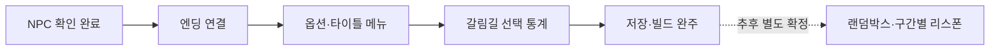
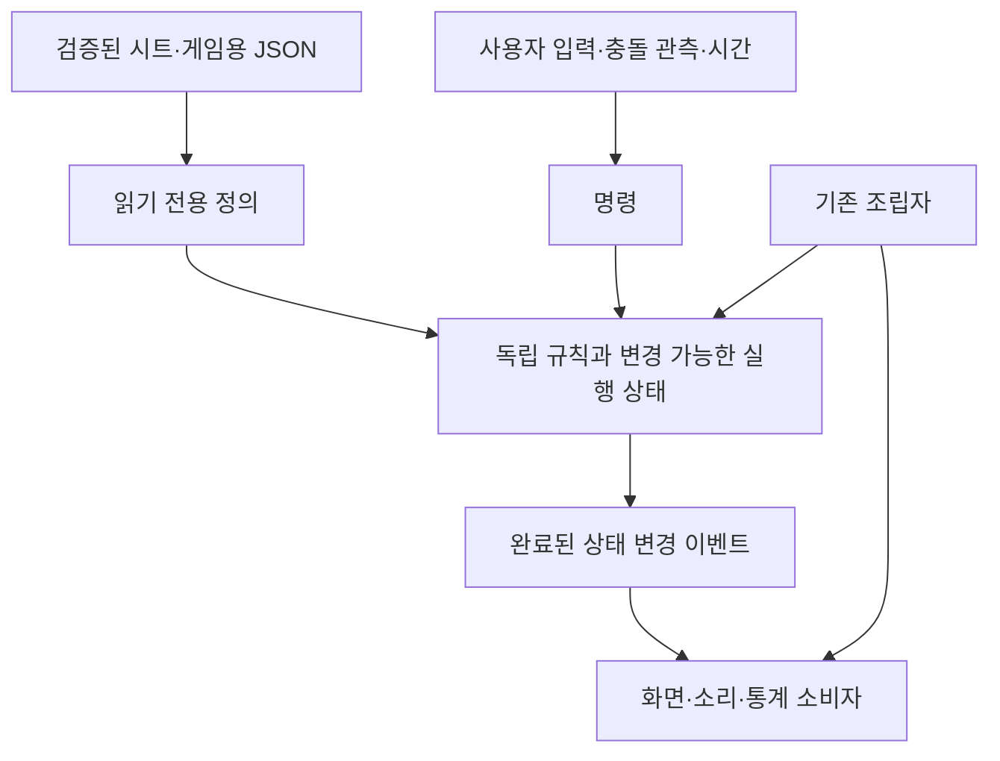
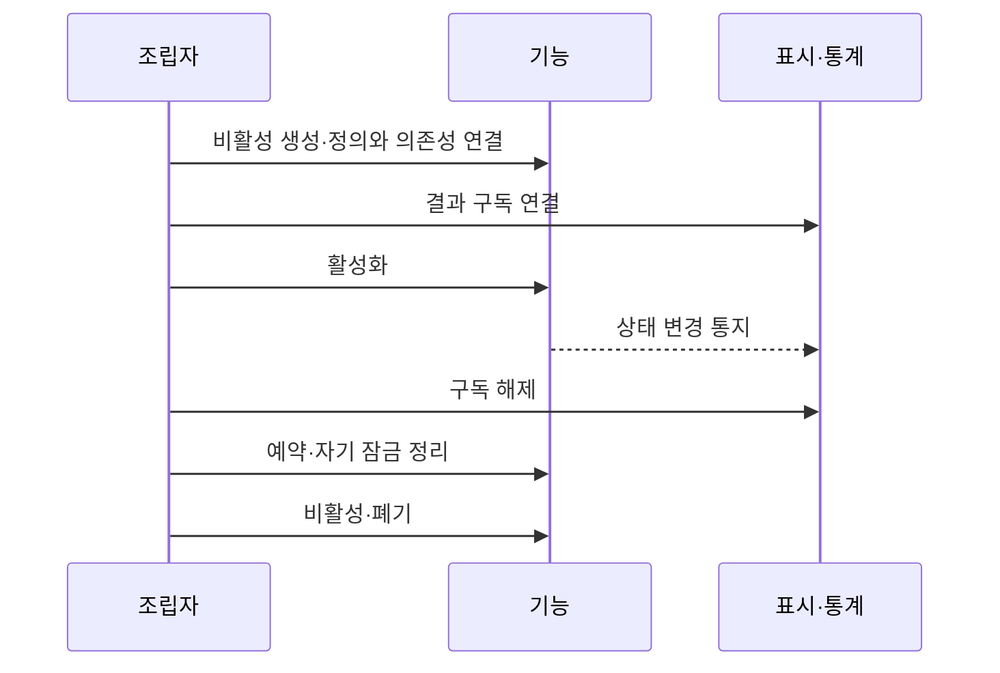
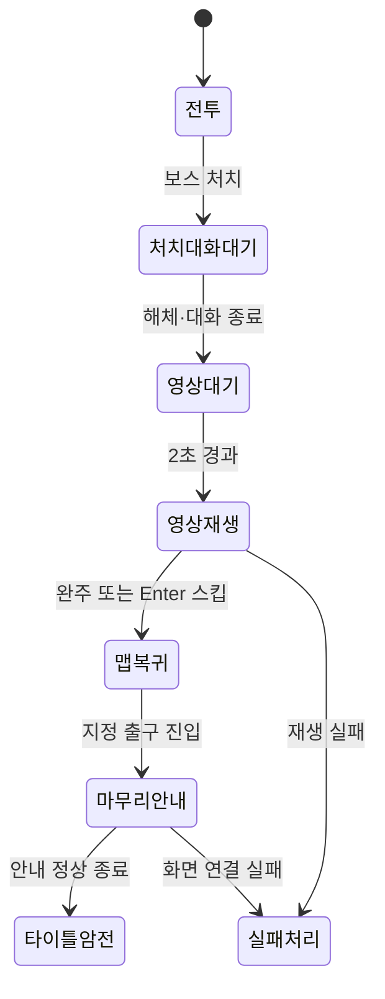
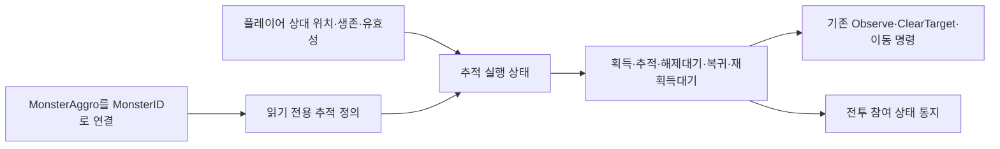
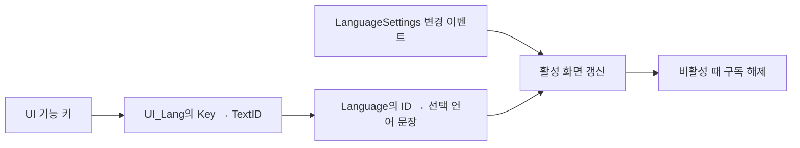
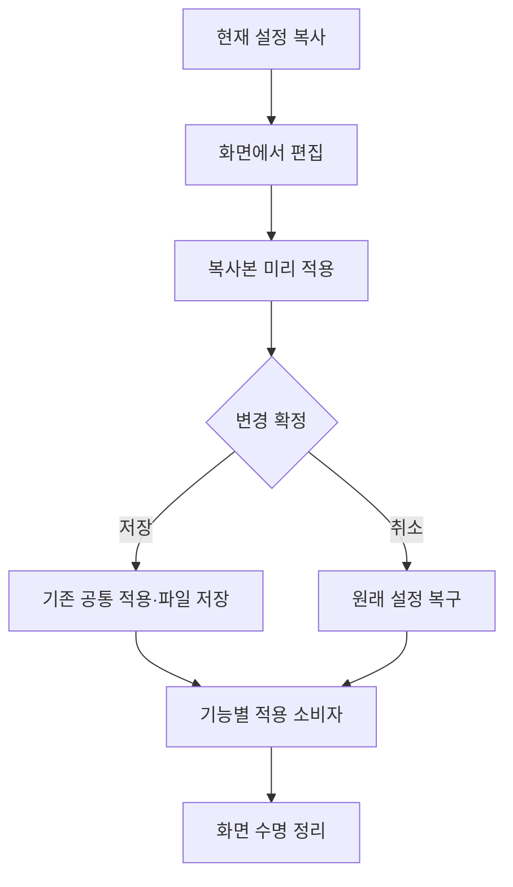
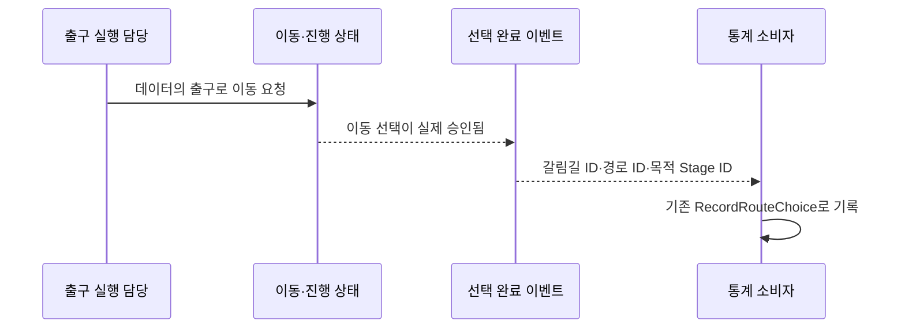
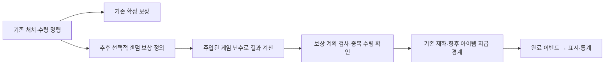
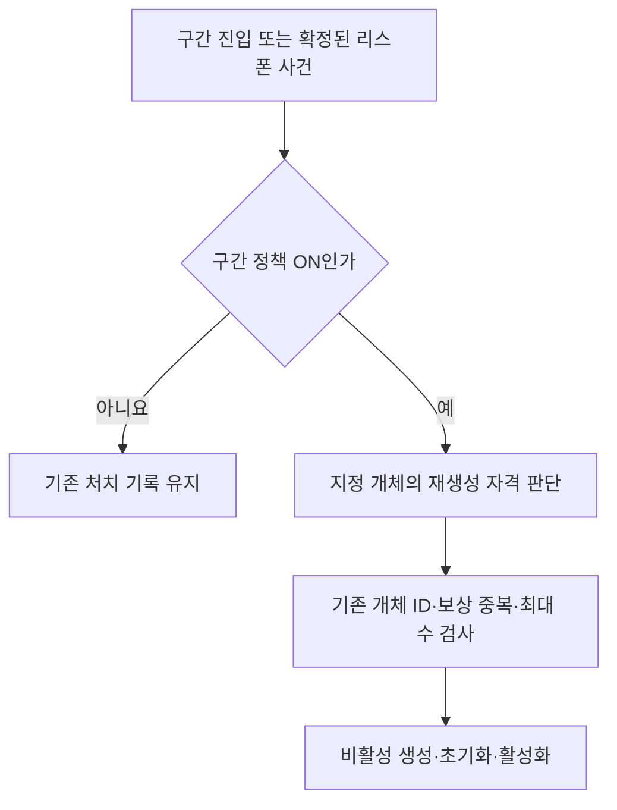

# 담당 예정 기능 설계와 연결 기준

기준일: 2026-11-14. 대상: 사용자 담당 개발 작업과 협업 연결. **이 문서는 설계안이며 기능 구현·데이터 변경·자동 배포를 수행한 기록이 아닙니다.** 상세 미확정 사항은 구현 전에 확인합니다.

**기획 기준 입력:** DataSheet [개발전달_최종통합_1114](../../../DataSheet/Docs/개발전달_최종통합_1114.md)(기획 확정, 데이터 main 7728900). 이 문서와 다르면 1114 전달이 최신 기획입니다. 항목별 대응 현황은 [1114 통합 전달 대응 현황](1114%20통합%20전달%20대응%20현황.md)에서 관리합니다.

## 목차

1. [범위와 현재 상태](#1-범위와-현재-상태)
2. [공통 설계와 선택 이유](#2-공통-설계와-선택-이유)
3. [엔딩과 마지막 출구](#3-엔딩과-마지막-출구)
4. [몬스터 추적 설정](#4-몬스터-추적-설정)
5. [UI 언어와 옵션 후속](#5-ui-언어와-옵션-후속)
6. [갈림길 선택 통계](#6-갈림길-선택-통계)
7. [저장과 빌드 검증](#7-저장과-빌드-검증)
8. [추후 기반: 랜덤박스와 구간별 리스폰](#8-추후-기반-랜덤박스와-구간별-리스폰)
9. [담당·준비물·완료 판단](#9-담당준비물완료-판단)

## 1. 범위와 현재 상태

사용자 확정에 따라 옵션 후속도 사용자 담당입니다. 다른 개발자가 맡은 패링 흐름·추가 처형 보상·리깅과 애니메이션 후속은 임의 수정하지 않습니다. 공통 계약 변경이 필요하면 사용처와 영향을 설명하고 먼저 확인받습니다.

| 작업 | 1114 항목 | 현재 확인한 상태 | 이번 문서의 설계 범위 |
| --- | --- | --- | --- |
| NPC 대화·상호작용 | — | 사용자 실제 동작 확인 완료 | 다시 구현하지 않음. 수명·등록 사례를 공통 검증 기준에 반영 |
| 맵 출구·단위 변환 | A1 | StageExit 연결·정수 단위 변환 수정 | 기존 기반 재사용 |
| 장부방 완료 후 사망 복귀 | — | 사용자 확인 완료 | 승인된 한정 예외 유지 |
| 엔딩 | A2 | 2026-11-14 구현·사용자 Play 확인(3장 구현 기록) | 2초 대기·열린 관문의 마무리 동작·30352 안내·타이틀 연결 |
| 몬스터 추적 | B1 | MonsterAggro 로딩, 실행 소비 없음. 가로 거리만 관측. **11/14 다른 작업자 담당으로 변경** | 설계 기준을 인계용으로 유지 |
| UI 언어 | B11 | Language 선택·조회 존재, UI_Lang 로딩 후 소비 없음. **11/14 다른 작업자 담당으로 변경** | 설계 기준을 인계용으로 유지 |
| 옵션 후속 | B7 | 공통 설정·화면·저장 기반 존재. 2026-11-14 창모드 1280×720 수정 | 1114 확정 순서·노출 범위 반영, 오타 수정 |
| 갈림길 통계 | C6 | 2026-11-14 StageExit.RouteID로 연결, 에디터 로컬 기록 확인(6장) | 실제 출구 이동 승인과 통계 소비 연결 |
| 저장·빌드 | — | 기존 기능 존재 | 기능 간 연결·실행파일 수용 검증 |
| 랜덤박스·구간별 리스폰 | — | 추후 계획 | 데이터·책임·연결 경계 제안, 즉시 도입 아님 |

## 2. 공통 설계와 선택 이유

### 2.1 독립 기능을 기존 조립자에서 연결

- 정의·실행 상태·규칙·표현·저장 및 통신을 분리합니다. 공유 정의를 수정하지 않습니다.
- 기존 GameplayPreview와 기능별 partial 파일에서 조립합니다. 향후 조립자를 교체해도 코어 규칙은 재사용합니다. 모든 기능마다 새 조립자·이벤트 버스를 추가하지 않습니다.
- 명령은 상태 소유자가 수행하고 이벤트는 결과를 알립니다. 표시 콜백에서 코어 상태를 다시 변경하지 않습니다.
- 상속은 실제 공통 역할에 사용하고, 정책 교체는 조합·전략으로 해결합니다. 패턴 개수를 늘리기 위한 계층은 만들지 않습니다.
- 시트·JSON은 게임 콘텐츠에 사용합니다. 설계 설명을 위한 별도 JSON 보고서는 만들지 않습니다.

### 2.2 생성·활성·정리

비활성 준비를 실제 등록 완료와 혼동하지 않습니다. NPC 사례처럼 활성화 뒤 등록을 확정하고 비활성·파괴 시 해제합니다. 매 프레임 전체 검색을 추가하지 않습니다. 오류가 발생해도 자기 소유 입력 잠금·정지·구독 정리는 끝내고 기존 오류 보고 경로로 전달합니다.

### 2.3 시간·정수·확장 기준

시트의 타일×100과 내부 IntegerPosition의 타일×1,000,000은 기존 FromData 변환으로 맞춥니다. 정수라는 이유만으로 같은 단위로 비교하지 않습니다. 시간은 ms로 정의하고 누적은 기존 시간 제공 경계를 재사용합니다. 테스트는 실제 내부 단위와 데이터 변경에 대한 연결을 확인하며 HP·보상 같은 공급 수치를 고정값과 비교하지 않습니다.

게임 난수와 표시 난수를 분리합니다. 향후 네트워크는 명령 승인과 권한 검증, 리플레이는 시간·난수·명령 순서 기록이 추가로 필요합니다. 현재 구조만으로 동기화나 결정성이 완성됐다고 보지 않습니다.

## 3. 엔딩과 마지막 출구

### 3.1 왜 필요한가

현재 엔딩 영상 흐름과 FinishDemo는 있지만 마지막 출구가 마무리 동작을 호출하지 않습니다. 엔딩을 봤다는 상태와 게임 시연이 끝났다는 상태를 구분해야 영상 뒤 맵 탐색 의도를 유지할 수 있습니다.

### 3.2 재사용과 제안 변경

- 기존 CutsceneHost·DemoEndingFlow·LanguageTextSource·씬 복귀 기능을 재사용합니다. 영상 종료 콜백이 직접 씬을 바꾸지 않고 결과를 조립자가 소비합니다.
- 마지막 출구도 StageExit의 위치·접촉을 재사용합니다. 보스 ID나 오른쪽 좌표를 코드에 더 넣지 않습니다.
- **1114 A2 확정 순서:** 보스 처치 2초 뒤 Cutscene 22003 → 완주·스킵 모두 타이틀이 아니라 보스방으로 복귀, 관문은 열림 → 열린 관문으로 넘어가려 하면 Language 30352 → 타이틀. 현재 코드에는 2초 대기가 없고, 처치 대화·처형이 끝나는 즉시 시작합니다. 2초의 기준 시점(처치 순간인지, 대화 종료 뒤인지)은 기획에 확인합니다.
- **제안:** 보스방(8004)은 NextStage가 비어 있고 StageExit 행도 없습니다. 열린 관문을 마무리 동작으로 표현하려면 출구에 일반 이동과 시연 마무리의 동작 종류가 필요합니다. 1114 전달은 데이터 형식을 지정하지 않았으므로 컬럼명·기술 값·필수 조건은 DataSheet 스키마 변경 전에 기획과 맞춥니다. 지금 열을 추가한 상태가 아닙니다.
- 이동 동작은 목적 Stage와 도착 앵커, 마무리 동작은 완료 조건과 Language 안내를 검사합니다. 가짜 목적 Stage를 만들어 마무리 동작을 숨기지 않습니다.
- 감사 문구는 Language 30352(현재 GameplayPreview의 Inspector 기본값), 위치는 앵커로 공급합니다. 표시 방식은 1114의 기획 제안(검은 화면 가운데 글자, 3초 뒤 또는 버튼 입력으로 타이틀)을 따릅니다. 기존 대사창만으로 검은 중앙 화면이 완성됐다고 보지 않습니다.

**예정 코드 위치:** 출구 접촉은 Core/Stages와 기존 PreviewStageExit, 엔딩 순서는 GameplayPreview.Cutscenes, 표현은 기존 화면 구성. 데이터 정의는 원본 스키마를 먼저 맞춘 뒤 수정합니다.

**2026-11-14 구현:** 열린 관문은 보스방 오른쪽 끝(구조물_02 x=22.4)으로 판단했습니다. StageExit에 `ExitAction`(Travel|FinishDemo) 열을 추가하고 FinishDemo 행은 TargetStageID 0·도착 앵커 빈칸으로 둡니다(가짜 목적지 없음). Travel 행의 도착 앵커 형식 검사는 시트 규칙에서 배포 도구 StageExitDataValidator로 옮겼습니다. 출구는 GameplayPreview.TravelExit에서 FinishDemo로 분기하고, 사용 가능 여부는 CanFinishDemo(영상 시청 뒤)입니다. 검은 화면은 그림 어드레서블 없이 TextboxScreen.OpenBlackout이 대사 글꼴로 만듭니다. 대기 2000ms·표시 3000ms는 GameplayPreview Inspector 값입니다.

**완료 확인:** 처치 2초 뒤 영상 시작, 완주·스킵 모두 보스방 복귀와 관문 열림, 영상 전에 마무리 출구를 써도 종료되지 않음, 중복 종료 방지, 타이틀 이동 실패 후 잠금 정리, 저장 후 재진입 시 의도대로 복원. 별도 리소스 미공급은 남은 조건으로 기록합니다.

관련: [컷씬 설계](컷씬%20재생%20설계.md), [출구 설계](맵%20출구와%20도착%20앵커%20연결%20설계.md).

## 4. 몬스터 추적 설정

> 2026-11-14 사용자 지시로 다른 작업자 담당입니다. 아래 설계 기준은 인계용으로 남깁니다.

### 4.1 왜 필요한가

MonsterAggro는 로딩되지만 PreviewMonsterDriver는 현재 가로 거리 중심으로 관측합니다. 따라서 기획자가 추적 해제 높이·시간을 바꿔도 적용되지 않습니다. 공격 패턴과 추적 정책을 분리하면 다른 개발자의 공격·패링 작업에 영향을 줄일 수 있습니다.

### 4.2 데이터와 책임

| 기존 데이터 | 사용할 책임 |
| --- | --- |
| Monster.SightRange | 가로 최초 감지 범위 |
| SightHeight | 세로 감지 범위 |
| LoseRange·LoseHeight·LoseTime | 해제 조건과 지속 시간 |
| LeashRange | 생성 기준점에서 추적을 허용하는 범위 |
| ReacquireDelay | 해제 뒤 재획득 대기 |

위 열 이름은 현재 정의입니다. 거리는 타일×100, 시간은 ms이며 현재 4종 모두 같은 시험값입니다. 1114 B1에서 아래 규칙이 확정됐습니다.

| 구분 | 1114 확정 규칙 |
| --- | --- |
| 대상 | 잡몹 4종(MonsterID 3001~3004). 보스는 제외하고 보스방에서는 항상 인식 |
| 인식 | 가로 SightRange 안이고 높이 차이 SightHeight 안. 피격되면 거리와 관계없이 즉시 인식 |
| 해제 ① | 가로 LoseRange 밖 또는 높이 LoseHeight 밖에 LoseTime 동안 머묾. 중간에 다시 들어오면 시간 초기화 |
| 해제 ② | 몬스터가 스폰 자리에서 가로 LeashRange를 넘으면 즉시 |
| 복귀 | 걸어서 스폰 자리로 돌아가 대기. 체세는 가득, HP는 유지. 복귀 시작 뒤 ReacquireDelay 동안 재인식 안 함(피격 시 예외) |
| 해제하지 않음 | 공격 패턴·돌진·잡기·그로기·처형 중 |
| 플레이어 사망 | 모두 해제하고 복귀 |

남은 확인 사항은 경계값 포함 여부(이내가 이하인지), 복귀 도착 허용 오차, 복귀 경로가 막혔을 때의 처리입니다. 복귀 시 체세 회복은 1114 B5 잡몹 체세와 맞닿으므로 체세 소유 코드를 재사용하고 담당을 확인합니다. 표에 없는 수치를 코드에 임의로 넣지 않습니다.

**예정 코드 위치:** 규칙과 상태는 기존 Core의 몬스터 규칙 영역, 상대 위치 관측·실제 이동·개체 수명은 PreviewMonsterDriver와 기존 MonsterRuntime. 새 프레임 검색 없이 기존 살아 있는 개체의 이동 갱신에 연결합니다. 추적 대상 소멸·사망·매복 비활성 때 타깃과 대기를 정리합니다.

**완료 확인:** 높이 4칸 이상 차이 미인식, 범위 경계, 잠깐 이탈 후 시간 초기화, 11칸 밖 2초 뒤 복귀와 HP 유지·체세 회복, 12칸 견인 시 즉시 복귀, 재획득 지연과 피격 예외, 공격 중 해제 안 함, 플레이어 사망 시 전체 복귀, 대상 파괴·몬스터 재활성. 패턴·공격 타격 규칙은 변경하지 않습니다.

## 5. UI 언어와 옵션 후속

### 5.1 UI 언어는 문장과 기능별 키를 분리

> 2026-11-14 사용자 지시로 UI_Lang 화면 연결(1114 B11)은 다른 작업자 담당입니다. 아래 설계 기준은 인계용으로 남깁니다.

Language는 번역 문장의 원본이고 UI_Lang은 UI가 사용할 문장 ID를 모으는 목록입니다. 현재 120행(51001~52117)이 화면별 100 단위 대역으로 공급됐고, Popup·Npc·Stage처럼 자기 표에 TextID가 있는 문구는 넣지 않았습니다(1114 B11). 같은 문장을 여러 표에 복제하지 않습니다. 현재 UI_Lang에는 ID·Key·TextID가 있습니다. 예를 들어 **실제 공급 키** Title.NewGame → TextID 30028을 조회하고, 문장 자체는 Language에서 읽습니다. 이 연결을 게임 규칙의 콘텐츠 ID 분기와 섞지 않습니다.

**예정 코드 위치:** 기존 LanguageTextSource에 기능 키 조회 경계를 조합하고, 화면은 기존 연결·정리 수명에서 변경 이벤트를 구독합니다. 화면마다 별도 번역 사전·로더를 만들지 않습니다. 다른 기능용 언어 목록이 늘어날 때 공급 로딩은 자동 발견 구조를 사용하되 새 의미의 소비 연결과 검사는 필요합니다.

Key 중복과 TextID 참조 검사는 DataSheet 배포 검사가 이미 담당하므로 클라이언트에 같은 검사기를 다시 만들지 않습니다. 지원 언어 값 누락 검사가 필요하면 DataSheet 검사에 추가합니다. 클라이언트는 실행 중 조회 실패를 기존 오류 보고 경로로 알리고, 누락을 빈 글자로 조용히 숨기지 않습니다. 한국어·영어만 확정 지원하며 다른 언어의 실제 지원을 약속하지 않습니다.

### 5.2 옵션은 기존 기능을 유지하고 후속 범위를 확정

현재 GameSettings·SettingsMenu·SettingsApplication·GameSettingsStore와 SettingsScreen이 있습니다. 마스터·배경음·효과음·카메라 흔들림·입력 방식·창 모드·언어의 정의가 있으므로 다시 구현하지 않습니다. 옵션 후속 담당 변경은 새 옵션 추가 확정과 다릅니다.

- 타이틀과 일시정지는 같은 설정 규칙과 적용 기능을 사용합니다. UI별 저장·복구 코드를 복제하지 않습니다.
- 창 모드는 1114 B7 확정을 따릅니다. WindowModeApplication의 1208×720은 기획이 확인한 오타라 2026-11-14 1280×720으로 고쳤습니다. 전체 화면은 테두리 없는 1920×1080이고, 화면 모드 줄은 타이틀 옵션에만 둡니다.
- 옵션 순서는 마스터·배경음·효과음·카메라 흔들림·키보드 조작·언어·화면 모드(타이틀만)입니다. 언어 줄은 타이틀과 일시정지 모두에 두고, 언어 설정은 저장 슬롯과 따로 저장합니다. 언어 추가는 Language 열과 옵션 목록 한 줄로 끝나야 합니다.
- 입력 방식은 기존 두 방식 선택을 재사용하며 임의 키 재배치는 확정 범위가 아닙니다.
- UI_Lang 변경은 문구 연결, GameSettings는 사용자 선택 상태입니다. 기획용 콘텐츠와 개인 설정 파일을 혼동하지 않습니다.
- 신규 항목이 필요하면 데이터·상태·적용 경계·취소 복구·저장 호환성을 먼저 정합니다. 새 옵션 항목 목록과 외형은 미확정입니다.

**개발자 가이드에 남길 것:** 항목 추가 위치, 기존 적용 소비자 연결, 상태 복사, 실패 복구, 화면 구독 해제, 타이틀·일시정지 양쪽 확인. **기획자 안내에 남길 것:** UI_Lang 문구 수정, 확정된 표시 항목과 화면 조정, 실제 확인 절차. 실행 구현 후 기존 안내를 갱신하며 미구현 설정 방법을 현재 사용법처럼 배포하지 않습니다.

관련: [언어 선택 설계](언어%20선택%20설정%20설계.md), [사운드 설정 설계](사운드%20설정%20설계.md).

## 6. 갈림길 선택 통계

### 6.1 도착 보상과 선택 확정은 다른 사건

갈림길에 첫 도착해 보상을 받았다는 사실만으로 어느 길을 골랐는지 판단할 수 없습니다. 현재 RecordRouteChoice는 준비됐지만 호출이 없습니다.

**1114 C6 확정 번호:** 갈림길 ID 8007(갈림길 StageID), 경로 ID 협곡 1·폐광 2·산사 3, 도착 Stage 협곡 8003(폐광·산사는 지스타 뒤 8008~에서 결정). 지스타 빌드에서 열린 길은 협곡뿐이며 현재 StageExit 7번 행(Exit_ToHyeopgok → 8003)이 해당합니다.

**결정(2026-11-14 사용자):** 경로 ID는 StageExit의 `RouteID` 열에 둡니다. 0은 통계 대상이 아니고, 갈림길 ID는 그 행의 StageID를 씁니다. 별도 연결 표는 출구 ID를 손으로 맞춰야 해서 쓰지 않았고, 코드에 1·2·3을 넣지 않습니다. 같은 사람이 같은 경로로 다시 나가도 실제 이동마다 1건으로 셉니다.

| 위치 | 변경 |
| --- | --- |
| DataSheet Stage.xlsx StageExit | `@column Name=RouteID;Type=Integer;Minimum=0` 추가, 7번 행(8007 → 8003 협곡) = 1, 나머지 0 |
| Data/StageExit.cs | RouteID 속성·생성자 인자 추가(일반 정의 클래스라 직접 수정) |
| GameplayPreview.TravelExit | 데이터 출구 이동이 실제로 시작된 경우(`_leaving`이 새로 켜짐)에만 기록 요청 |
| GameplayPreview.Telemetry | RouteID > 0이면 기존 RecordRouteChoice(StageID, RouteID, TargetStageID) 호출 |
| StageDoor | Configure에 선택 인자 `travel`을 추가. GameplayPreview가 `TravelExit`을 넘겨 Interact 출구(문)도 같은 기준으로 기록 |
| DataSheet StageExitDataValidator | 같은 StageID 안에서 RouteID(> 0)가 겹치면 배포 실패. 회귀 검사(DataExporter.Checks)에 중복 실패 사례 추가 |

배포 검사 변경은 `Tools/Publish-DataExport.ps1`로 DeployData.exe를 다시 만들어야 기획자 실행파일에 반영됩니다. 모든 이동을 갈림길 선택으로 기록하거나 프리팹 이름에서 번호를 추측하지 않습니다.

이벤트에는 직렬화 가능한 ID만 넘깁니다. 같은 이동 요청의 재시도는 중복 집계하지 않고, 실제로 돌아와 다시 고른 경우를 새 선택으로 셀지는 통계 기준으로 명시합니다. 처음 1회 보상 규칙을 선택 통계에 그대로 적용하지 않습니다.

**예정 코드 위치:** 기존 이동 조립자가 선택 결과를 알리고 GameplayTelemetryBinding이 소비합니다. 통계 실패가 이동 성공을 취소하지 않습니다. TelemetryHost의 기존 로컬 기록·전송·7분 간격 및 종료 흐름을 재사용합니다. 새 전송기를 만들지 않습니다.

**완료 확인:** 잠긴 출구·거절된 이동은 미기록, 승인된 선택은 1건, 재시도 중복 방지, 재방문 기준, 로컬 기록과 웹 집계·다운로드 일치. Firestore 무료 운영은 별도 기존 제한을 유지합니다.

## 7. 저장과 빌드 검증

### 7.1 기능을 새로 만드는 대신 연결을 확인

SaveSession·SaveGameFlow·JsonSaveStore를 재사용합니다. 명시적 저장 전은 임시 상태라는 원칙을 유지합니다. 새 저장 필드가 필요한 후속 기능만 스키마·이전 파일 호환을 별도 설계합니다.

| 검증 묶음 | 확인 내용 |
| --- | --- |
| 위치와 진행 | 수동 저장 당시 위치, 서낭당 복귀, 장부방 완료 한정 예외, 출구 도착 앵커 |
| 전투·재화 | 레벨·EXP·혼·엽전·강화·처치 기록의 임시/영구 구분 |
| UI 수명 | 옵션·대화·오류창 열기/닫기 뒤 입력·시간 복구 |
| 테스트 빌드 | F5 슬롯 선택·타이틀 시험 진입·F8 보스 시험·F9 데이터 확인·F12 확인 후 최신 슬롯 삭제 등 확정 기능 |
| 정식 빌드 | 시험 입력뿐 아니라 시험용 버튼·화면도 비노출 |
| 미디어·배포 | 선택 리비전 식별·영상 포함·출구 데이터 최신화·첫 실행 |
| 통계 | 게임 결과와 로컬 기록·사이트 집계·다운로드 대조 |

검사 통과·사용자 Play 확인·실행파일 확인은 따로 기록합니다. 한 기기에서 성공했다고 최소 사양이나 Windows 전체 호환 완료로 판단하지 않습니다. 현재 해상도를 낮춰 성능 목표를 맞추는 작업은 사용자 보류 범위입니다.

관련: [저장 설계](저장%20기능%20설계.md), [테스트와 정식 빌드](테스트와%20정식%20빌드%20선택%20설계.md), [통계 수집 설계](플레이%20통계와%20오류%20수집%20설계.md).

## 8. 추후 기반: 랜덤박스와 구간별 리스폰

### 8.1 랜덤박스

현재 MonsterReward의 Exp·SoulDrop·CoinDrop은 확정 자동 지급 수량입니다. 이를 랜덤 보상으로 바꾸지 않습니다. 추후 별도 주소 컬럼을 추가해 게임용 JSON의 보상 정의를 읽는 방향이며 열 이름·스키마는 아직 확정하지 않습니다.

코어는 추첨과 지급 계획, 공급 계층은 JSON 파싱, 조립자는 기존 재화·아이템 경계를 연결합니다. 아이템이 아직 없다는 이유로 가짜 지급 성공을 만들지 않습니다. 확률은 프로젝트 공통 기준인 정수 분모 10000을 사용합니다. 가중치 방식·빈 보상·재추첨·저장 시점은 기획 확인이 필요합니다. 난수 재현과 지급 중복 방지를 설계하고 다른 개발자에게 데이터 형식·성공/실패 계약을 공유합니다. 새 보상 관리자를 기존 재화 관리자와 겹치게 만들지 않습니다.

### 8.2 구간별 몬스터 리스폰 ON/OFF

기본은 처치 기록을 유지하고 자동 재생성하지 않는 기존 방식입니다. 제안 정책은 구간별 OFF/ON이지만 실제 켜지는 조건·시간은 미확정입니다. 이번 장부방 예외는 플레이어의 사망 복귀이며 이 몬스터 리스폰 설계와 다릅니다.

정책 위치는 Stage 또는 스폰 JSON 중 구간 소유 데이터에 결정하며 지금 필드를 추가하지 않습니다. MonsterSpawnId의 개체 정체성, 처치 기록, 세대별 보상 이력을 구분합니다. ON만 켰다는 이유로 보상을 무한 반복 지급하거나 영구 저장의 처치 기록을 지우지 않습니다. 맵·플랫폼을 몬스터와 함께 재생성하지 않습니다. 기존 스폰 최대 수와 수명·풀 초기화 계약을 유지합니다.

**완료 확인:** OFF 기존 동작, ON 조건 충족, 살아 있는 개체 중복 생성 방지, 최대 수, 저장·불러오기, 구간 비활성 후 예약 취소. 시간 기반이 확정되지 않은 현재 코루틴·타이머를 먼저 추가하지 않습니다.

## 9. 담당·준비물·완료 판단

| 담당 | 역할과 경계 |
| --- | --- |
| 사용자 | 1114 A1 출구·A2 엔딩·A3 인트로·B6 타이틀 메뉴·B7 옵션·B15 NPC·B17 재화 부족 안내·C6 갈림길 통계, 저장/빌드 수용, 추후 랜덤박스/리스폰 기반 |
| 다른 개발자 | 패링 흐름·추가 처형 보상·리깅 및 애니메이션 후속, 1114의 나머지 항목(몬스터 추적 B1·UI_Lang 연결 B11 포함). 인계 목록은 [1114 대응 현황 7장](1114%20통합%20전달%20대응%20현황.md#7-다른-작업자-인계-목록) |
| 기획자 | 규칙·식별자·문구·출구/경로/배치 데이터, 미확정 정책 확정 |
| 아트 담당자 | 원본 이미지·영상·애니메이션·소리 등 담당 자산 제작과 외부 파일 공급에 함께 참여. Git 통합 작업과 구분 |

이 역할 배분은 사용자 대화 확정이며 Git 작성자로부터 추정한 담당 배정이 아닙니다. 2026-11-14 사용자 지시로 1114 전달 중 A1·A2·A3·B6·B7·B15·B17·C6은 사용자, 나머지는 다른 작업자 담당입니다. 이에 따라 몬스터 추적(4장)과 UI_Lang 연결(5.1)은 담당에서 빠졌고 설계 기준만 인계용으로 남깁니다. 기준 Git 이력은 클라이언트 72f50033(hollowinday, NPC 대사연결 작업 수정), ec0a9408(hollowinday, 맵 출구와 이동·리스폰 수정)입니다. 이 커밋을 미래 기능의 구현 근거로 쓰지 않습니다. DataSheet의 Claude 작성 이력은 사용자 확정에 따라 Kim Hyun Ho 작업으로 귀속하되 원래 작성자 표기와 구분합니다.

구현할 때는 기능 하나씩 이유·재사용 경계·코드 위치를 설명하고 확인받습니다. 공통 계약·새 스키마·미확정 기획은 적용 전에 합의합니다. 구현 후 개발자 문서와 기존 기획자 사용 안내를 함께 갱신합니다.

**완료의 기준:** 데이터 검사 → 코어 동작 → 엔진 연결 → 생성/소멸 → 오류 정리 → 사용자 Play → 테스트/정식 실행파일. 문서 작성이나 커밋 수만으로 완성률을 산정하지 않습니다.
