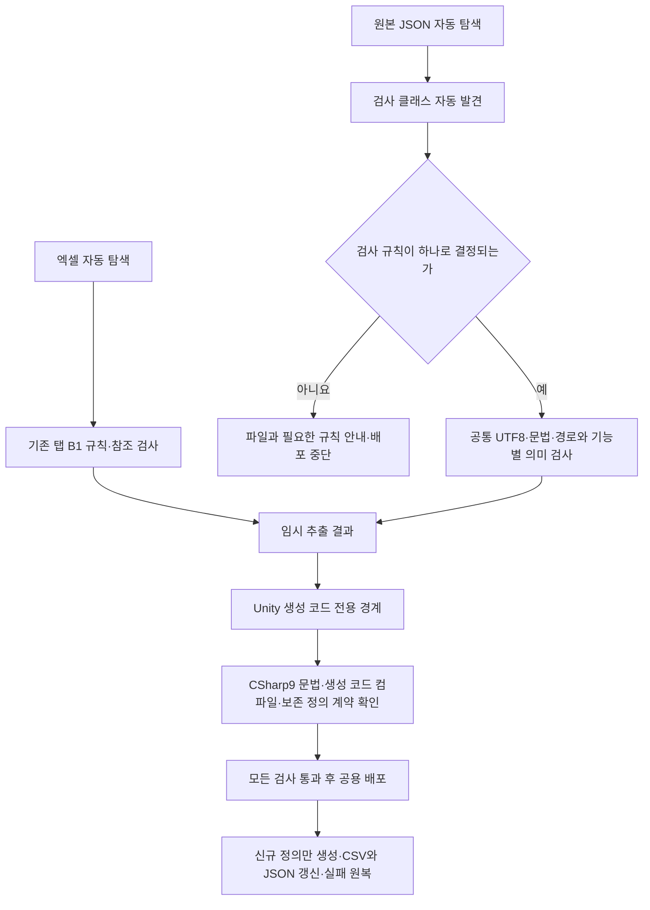

# 데이터 자동 발견과 Unity 배포 경계 설계

기준일: 2026-11-13. 적용 대상은 DataSheet 도구와 생성 코드 배포 경계입니다. [기획자 실행 안내](../기획자용%20안내문서/새%20시트와%20JSON%20자동%20배포%20사용%20안내.md), NPC 개별 계약은 [NPC 설계](NPC%20데이터%20배포%20준비%20설계.md)를 봅니다.

## 1. 왜 다시 나누었는가

기존 엑셀은 신규 파일·탭을 자동 발견했지만 별도 JSON은 Program에서 스폰·서낭당·갈림길·대사 수집기를 각각 호출하고 OutputCatalog에도 기능별 허용 경로를 추가해야 했습니다. 파일 배포가 기능 증가에 따라 반복 수정되는 문제가 있었습니다.

공통 파이프라인이 원본 발견·검사 연결·경로 결정·배포 목록을 담당하고, 기능별 클래스는 데이터 의미 검사만 제공하도록 바꿨습니다. 사용자가 승인한 기준에 따라 규칙 없는 JSON은 기본 문법만 검사해 배포하지 않고 중단합니다.



## 2. 코드 책임과 위치

| 위치 | 책임과 선택 이유 |
| --- | --- |
| DataSheet/Tools/DataExporter/Infrastructure/JsonAssetPipeline.cs | 원본 자동 발견·규칙 선택·전체 배포 목록 대조. 기능별 수집기를 직접 열거하지 않음 |
| 같은 폴더 JsonAssetRule.cs | 공통 수집 절차와 검사 계약. 도구 어셈블리의 구체 검사 클래스를 시작할 때 발견 |
| 같은 폴더 JsonAssetCollector.cs | 기존 UTF-8·문법·임시 사본 생성 재사용 |
| Validation의 SpawnJsonRule·ShrineJsonRule·GalimgilJsonRule·DialogueJsonRule | 공통 기반을 상속해 해당 데이터의 의미 검사만 제공 |
| Infrastructure/OutputCatalog.cs | 공통 상대 경로·소유 경계. 새 기능마다 배포 허용 경로 조건을 추가하지 않음 |
| Generation/UnityCodeOutput.cs | 생성 전용 폴더의 정의와 로딩 계획만 검증 후 배포 목록으로 반환 |
| Infrastructure/ClientLoadPlanCompiler.cs | 보존될 클라이언트 정의를 사용해 계획 컴파일. 생성자 컬럼 계약 차이도 배포 전에 알림 |
| Infrastructure/DeploymentService.cs | 기존 소유 목록·신규 생성·수정·삭제·실패 원복 정책 유지 |

Program은 공통 JSON 파이프라인과 Unity 코드 출력 경계를 한 번씩 호출합니다. 기존 네 종류의 FileCollector는 JsonRule로 정리했습니다. 검사 규칙마다 파일 복사·삭제·배포기를 새로 만들지 않습니다.

## 3. 자동 발견 범위와 경로

프로젝트 원본에서 JSON을 재귀 탐색합니다. Tools·Docs·tables와 점으로 시작하는 관리 항목은 제외합니다. `stats/item`은 사용자가 예시라고 지정한 기존 예외이므로 계속 제외합니다. 링크 경로는 허용하지 않습니다.

원본 상대 경로를 Assets/Data/Json 아래로 대응시킵니다. 기존 stats 폴더는 호환을 위해 그 접두어만 제거합니다. 따라서 기존 파일의 배포 위치는 바뀌지 않습니다.

| 원본 | 배포 |
| --- | --- |
| spawn/8002.json | Assets/Data/Json/spawn/8002.json |
| stats/shrine/stat/Crit.json | Assets/Data/Json/shrine/stat/Crit.json |
| dialogue/24001.json | Assets/Data/Json/dialogue/24001.json |
| 새 원본 폴더의 파일 | 같은 상대 구조로 결정하되, 검사 규칙이 없으면 중단 |

경로의 각 이름은 영문·숫자·밑줄이며 상위 이동·절대 경로·다른 확장자는 허용하지 않습니다. 서로 다른 폴더라도 클라이언트의 파일명 로딩 키가 충돌하면 중단합니다. 발견한 원본 목록과 검사를 마친 배포 목록이 다를 때도 중단합니다.

## 4. 확장할 때 필요한 작업의 경계

| 변경 | 배포 도구 수정 |
| --- | --- |
| 기존 규칙의 새 엑셀 파일·탭 | 불필요. 기존 README·상단 규칙에 따라 자동 추출 |
| 지원되는 JSON 구조의 새 파일·행 | 불필요. 기존 검사 적용 후 자동 배포 |
| 처음 등장하는 JSON 구조·새 원본 폴더 | 그 구조의 JsonAssetRule 구현 필요. Program 호출·배포 허용 목록 추가는 불필요 |
| 새 게임 동작 | 클라이언트 소비 기능·조립 필요. 파일 복사와 구분 |

새 규칙은 JsonAssetRule을 상속하는 공개 구체 클래스에서 SourceFolder와 Prepare를 제공합니다. 매개변수 없는 생성자로 만들 수 있어야 합니다. 파일별 검사와 필요 시 전체 파일 집합 검사를 반환합니다. 외부 플러그인 DLL을 자동 실행하는 구조가 아니라 도구 자체 어셈블리에서만 발견합니다. 새 규칙 코드를 넣었다면 실행파일을 다시 빌드해야 하지만, 새 데이터 파일만 추가한 경우 실행파일을 다시 만들 필요는 없습니다.

검사 규칙의 폴더가 겹쳐 같은 파일에 두 규칙이 선택되면 실패합니다. 우선순위를 임의로 정해 다른 검사로 통과시키지 않습니다. 이미 지원하는 구조의 파일 발견과 처음 등장하는 구조의 의미 검사 구현을 혼동하지 않습니다.

## 5. 도구 최신 문법과 Unity 코드 분리

도구는 .NET 10과 LangVersion=latest를 사용합니다. 기본 실행 흐름에 최신 C#의 컬렉션 식·주 생성자 등을 사용할 수 있습니다. 최신 안정 SDK 문법을 의미하며 preview를 켜지 않습니다.

Unity 배포 코드는 CodeGenerator·LoadPlanGenerator의 별도 템플릿으로 생성하고 GeneratedCodeCompiler의 명시적인 C# 9 검사와 보존 정의를 포함한 컴파일을 통과해야 합니다. 도구의 LangVersion 설정을 생성 코드 검사기가 따라가지 않습니다.

```text
도구 소스                         Unity 배포 후보
Tools/DataExporter/*.cs           임시 UnityDefinitions/*.cs
.NET 10 · 최신 안정 C#            임시 UnityLoadPlan/GeneratedDataLoadPlan.cs
          실행만 함                         │
          복사하지 않음              C# 9와 참조 계약 검사
                                           │
                              통과한 생성 결과만 배포 목록에 포함
```

기존 정의 `.cs`는 배포로 덮어쓰지 않습니다. 신규 정의만 생성하고 GeneratedDataLoadPlan은 자동 생성 전용 파일이므로 갱신합니다. 기존 정의와 시트의 생성자 컬럼이 다르면 코드 소유자가 수정하도록 알리고 중단합니다. 이번에는 실제 시트에서 제거된 SkipHoldMs에 맞춰 Cutscene.cs와 해당 검사 예제만 별도 수정했습니다.

문법 검사와 SDK 참조를 사용한 계약 컴파일을 실제 Unity 실행·API 호환성 전체 보장으로 확대하지 않습니다. 이번 실제 배포 결과는 클라이언트의 엔진 참조 컴파일도 따로 확인했습니다. 생성 템플릿을 바꿀 때도 이 두 경계를 유지해야 합니다.

## 6. 실제 데이터 반영과 검사

기획자가 공급한 Npc·Dialogue 두 탭과 dialogue JSON 4개를 포함해 현재 31개 탭·별도 JSON 15개를 검사·재추출·배포했습니다. Npc와 Dialogue는 시트가 CSV로 지정했으므로 CSV로 배포하고, 대사 줄은 원본 JSON을 검사해 복사했습니다. 원본 시트나 대사를 임의로 다시 작성하지 않았습니다.

도구 검사 185개 통과. 규칙 없는 폴더 차단, 새 검사 클래스 자동 발견, 새 종류의 파일 추가·수정·삭제·원복, 생성 전용 경로만 반환, 최신 전용 문법 차단, 보존 정의 컬럼 불일치 차단을 포함합니다. 새 DeployData.exe도 검사·배포를 통과했습니다.

실제 배포 전후 기존 정의 C# 35개의 해시가 같았습니다. 이 비교는 별도로 수행한 Cutscene.cs 스키마 수정 이후 배포 직전에 시작했습니다. 배포가 그 수정을 했다는 의미는 아닙니다.

배포 후 클라이언트 데이터 5,847개·코어 1,357개·엔진 참조 컴파일 경고와 오류 0개를 확인했습니다. 실제 NPC 생성·대화 실행·맵 배치 Play는 이번 데이터 배포 작업의 완료 항목이 아닙니다.
