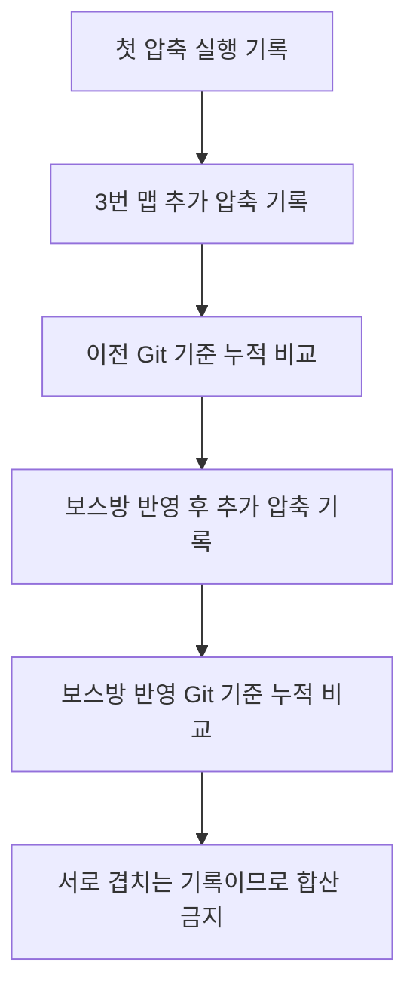

# 리소스 압축 결과 종합 비교

2026-11-12 측정 기록을 2026-11-13에 한글 문서로 정리했습니다. JSON은 게임 데이터에 사용하고, 사람이 읽는 결과 보고서는 Markdown으로 관리합니다.

## 목차

1. [보고서별 비교](#1-보고서별-비교)
2. [측정 기준과 중복 관계](#2-측정-기준과-중복-관계)
3. [결과를 읽는 방법](#3-결과를-읽는-방법)

## 1. 보고서별 비교

각 링크에는 원본의 전체 파일별 수치·적용 여부·검증값이 들어 있습니다. 용량은 바이트입니다.

| 보고서 | 기록 파일 | 적용·변경 | 비교 전 | 비교 후 | 절감 | 절감률 |
| --- | ---: | ---: | ---: | ---: | ---: | ---: |
| [2026-11-12 PNG 무손실 압축 결과](2026-11-12%20PNG%20%EB%AC%B4%EC%86%90%EC%8B%A4%20%EC%95%95%EC%B6%95%20%EA%B2%B0%EA%B3%BC.md) | 10 | 4 | 107,852,286 | 105,801,348 | 2,050,938 (1.956 MiB) | 1.902% |
| [2026-11-12 보스방 반영 후 Git 대비 리소스 절감 요약](2026-11-12%20%EB%B3%B4%EC%8A%A4%EB%B0%A9%20%EB%B0%98%EC%98%81%20%ED%9B%84%20Git%20%EB%8C%80%EB%B9%84%20%EB%A6%AC%EC%86%8C%EC%8A%A4%20%EC%A0%88%EA%B0%90%20%EC%9A%94%EC%95%BD.md) | 288 | 288 | 132,202,214 | 125,546,813 | 6,655,401 (6.347 MiB) | 5.034% |
| [2026-11-12 최신 3번맵 PNG 압축 결과](2026-11-12%20%EC%B5%9C%EC%8B%A0%203%EB%B2%88%EB%A7%B5%20PNG%20%EC%95%95%EC%B6%95%20%EA%B2%B0%EA%B3%BC.md) | 84 | 81 | 15,453,627 | 14,047,337 | 1,406,290 (1.341 MiB) | 9.100% |
| [2026-11-12 최신 Git 대비 리소스 절감 요약](2026-11-12%20%EC%B5%9C%EC%8B%A0%20Git%20%EB%8C%80%EB%B9%84%20%EB%A6%AC%EC%86%8C%EC%8A%A4%20%EC%A0%88%EA%B0%90%20%EC%9A%94%EC%95%BD.md) | 85 | 85 | 76,345,577 | 72,888,349 | 3,457,228 (3.297 MiB) | 4.528% |
| [2026-11-12 최신 보스방 PNG 압축 결과](2026-11-12%20%EC%B5%9C%EC%8B%A0%20%EB%B3%B4%EC%8A%A4%EB%B0%A9%20PNG%20%EC%95%95%EC%B6%95%20%EA%B2%B0%EA%B3%BC.md) | 467 | 203 | 105,186,164 | 101,987,991 | 3,198,173 (3.050 MiB) | 3.040% |

## 2. 측정 기준과 중복 관계

실행 결과 세 문서는 해당 작업의 전후 비교입니다. Git 대비 요약 두 문서는 서로 다른 기준 커밋을 사용한 누적 비교입니다. 최신 보스방 실행 기록에도 기존 맵 파일이 포함되므로 이름만 보고 보스방 전용 파일 수로 해석하지 않습니다.

## 3. 결과를 읽는 방법

| 궁금한 내용 | 확인할 곳 |
| --- | --- |
| 어떤 파일이 얼마나 줄었는지 | 각 보고서의 전체 파일 비교표 |
| 실행 때 실제 교체됐는지 | 적용 또는 기존 유지 열 |
| 같은 그림을 유지했는지 | Git 비교 보고서의 동일성 결과와 파일별 검증값 |
| 최종적으로 얼마가 줄었는지 | 같은 기준 커밋의 누적 보고서 하나를 선택 |
| 현재 게임 성능도 좋아졌는지 | 이 기록만으로 판단 불가. 실제 실행 측정 필요 |

원본 JSON 5개는 전체 내용의 문서 전환 후 제거했습니다. 리소스 파일과 게임 데이터 JSON은 변경하지 않았습니다. 원본 아트는 아트 담당자의 제작·공급과 개발자의 가공·게임 적용이 함께 반영된 결과입니다.
