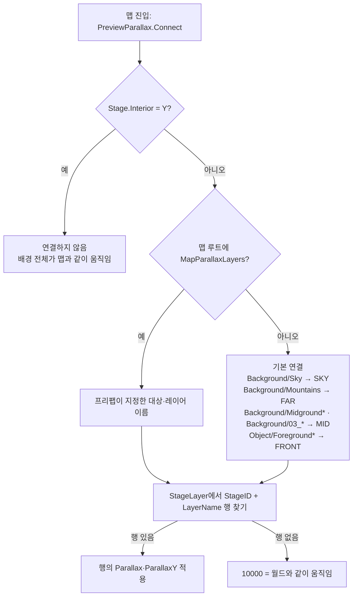

# 맵 배경 시차와 StageLayer 연결 설계

2026-11-20 · 대상: 맵 프리팹·배경 레이어를 바꾸는 개발자, StageLayer 시트를 고치는 데이터 작업자

맵 배경 레이어가 카메라 이동에 따라 얼마나 움직이는지(시차)를 데이터 `StageLayer`와 맵 프리팹이 어떻게 나눠 갖는지 정리합니다. 11/20에 실내 공간 칸(`Stage.Interior`)을 추가하고, 맵이 연결하지 않아 반영되지 않던 `StageLayer` 10행을 지웠습니다. 그 이유도 함께 기록합니다.

## 목차

1. [책임 나눔](#1-책임-나눔)
2. [연결 흐름](#2-연결-흐름)
3. [실내 공간 (Stage.Interior)](#3-실내-공간-stageinterior)
4. [쓰이지 않던 행 정리 (11/20)](#4-쓰이지-않던-행-정리-1120)
5. [검사와 확인 상태](#5-검사와-확인-상태)

## 1. 책임 나눔

| 무엇 | 소유 | 위치 |
| --- | --- | --- |
| 레이어별 이동 비율(가로 `Parallax`, 세로 `ParallaxY`, 만분율) | 데이터 | `StageLayer` (DataSheet `StageLayer.xlsx`) |
| 맵이 실내인지 | 데이터 | `Stage.Interior` (DataSheet `Stage.xlsx`, 11/20 추가) |
| 어떤 오브젝트가 어떤 레이어 이름인지 | 맵 프리팹 | 맵 루트의 `MapParallaxLayers`, 없으면 `PreviewParallax`의 기본 연결 |
| 비율 적용 | 표현 | [PreviewParallax](../../Assets/3.Script/Preview/PreviewParallax.cs) |

- 비율 수치는 프리팹에 두지 않습니다. 11/20 `f265519a`(NYM)에서 프리팹의 레이어별 배율을 `StageLayer` 행(9034~9045)으로 옮겼습니다.
- `LayerIndex`·`ImageKey`·`SortOrder`는 코드가 읽지 않습니다. 그림 배치와 정렬은 맵 프리팹이 정합니다.

## 2. 연결 흐름



**행은 연결된 레이어 이름이 있을 때만 쓰입니다.** 맵에 그 이름으로 연결된 오브젝트가 없으면 행 값을 바꿔도 화면이 달라지지 않습니다. 반대로 연결된 이름에 행이 없으면 경고 없이 10000(시차 없음)으로 움직입니다.

현재 맵별 연결(11/20, `StageContentSet`의 맵 프리팹 기준):

| Stage | 맵 프리팹 | 연결 방식 | 쓰이는 레이어 이름 |
| --- | --- | --- | --- |
| 8001 마을 | Map_1_Dohwagol_K9 | 기본 연결 | SKY·FAR·FRONT |
| 8002 사냥터1 | Map_2_Sangil_K9 | MapParallaxLayers | SKY·FAR·FAR_NEAR·MID_FAR·MID_NEAR·NEAR·PLAY·PLAY_NEAR |
| 8003 사냥터2 | Map_3_Hyeopgok_K9 | MapParallaxLayers | SKY·FAR·FAR_NEAR·MID_FAR·MID_NEAR·NEAR·PLAY |
| 8004 보스방 | Map_BossRoom_K9 | 기본 연결 | SKY·FAR |
| 8005 장부방 | Map_Jangbubang_K9 | **실내(연결 안 함)** | — |
| 8006 가마터 | Map_2b_Onggi_K9 | MapParallaxLayers | SKY·FAR·MID_FAR·MID_NEAR·NEAR·PLAY |
| 8007 갈림길 | Map_X01_Galimgil_K9 | 기본 연결 | SKY·FAR·MID |

## 3. 실내 공간 (Stage.Interior)

**왜 추가했나:** 장부방은 마을 안의 실내 맵입니다. 창밖 하늘(`Background/Sky`)이 바깥 맵처럼 카메라를 따라 미끄러지면 방 안이라는 느낌이 깨집니다.

- 11/20 이전에도 장부방에는 `StageLayer` 행이 없어 우연히 10000으로 움직였습니다. 하지만 이것은 "행이 없음"에 기댄 암묵적인 동작이었습니다.
- 그래서 누가 장부방 하늘 행을 추가하면 실내가 움직이게 됩니다. 점검에서도 이 상태가 "장부방에 맞는 행이 없음"이라는 누락처럼 보였습니다.
- 맵 역할(`Role=LEDGER`)로 판정하지 않고 별도 칸을 둔 이유는 의미가 다르기 때문입니다. 역할은 전투 자세·카메라 위아래 보기 같은 게임 규칙이고, 실내 여부는 배경 표현입니다. 다른 실내 맵이 생겨도 칸 값만 Y로 두면 됩니다.

**동작:**

- `Stage.Interior`는 `Flag`(Y/N) 칸입니다. 현재 8005만 Y입니다.
- `PreviewParallax.Connect`는 Y인 맵에서 레이어를 연결하지 않고 바로 끝냅니다. 이전 맵의 연결은 먼저 끊고 원위치합니다.
- Y인 맵에 `StageLayer` 행이 있으면 반영되지 않는 값이므로 개발자 검사(`DeploymentConnectionChecks`)가 실패시킵니다.

```text
설명용 예시(현재 공급값과 같음)
Stage   ID    … Role     Interior
        8001  … VILLAGE  N
        8005  … LEDGER   Y   ← 장부방: 배경 시차 없음
```

## 4. 쓰이지 않던 행 정리 (11/20)

**왜 정리했나:**

- 위 2장 흐름대로라면 맵이 그 이름으로 연결하지 않은 행은 게임에 반영되지 않습니다.
- 그런데 시트에는 값이 있어서 기획자가 고치면 바뀐다고 오해할 수 있습니다. 값을 보고 다른 맵의 비율을 맞추는 기준으로 삼을 위험도 있었습니다.
- 데이터가 이기는 원칙([조건 규칙 감사 7.1](조건%20규칙%20교차%20감사와%20흐름%20단절%20위험%20분석.md#71-원칙))은 시트 값이 실제로 쓰일 때만 성립합니다.

**어떻게 찾았나:**

- `StageContentSet`이 각 Stage에 연결한 맵 프리팹의 계층을 읽었습니다.
- `MapParallaxLayers`가 있으면 그 레이어 이름을, 없으면 기본 연결 경로가 실제로 있는지를 보고 각 맵이 쓰는 이름을 구했습니다.
- 그 이름과 맞지 않는 행을 골랐습니다.
- 처음 받은 점검 목록은 5행이었습니다. 계층을 끝까지 따라가 보니 10행이었습니다.

| ID | Stage | LayerName | 지운 이유 |
| --- | --- | --- | --- |
| 9003 | 8001 마을 | MID | 맵에 `Background/Midground*`·`03_*`이 없음 |
| 9004 | 8001 마을 | PLAY | 기본 연결에 PLAY가 없음. 값도 10000이라 행이 없을 때와 같음 |
| 9008 | 8002 사냥터1 | MID | `MapParallaxLayers`가 MID를 쓰지 않음(11/20 세분 레이어로 대체) |
| 9030 | 8002 사냥터1 | FRONT | 같음. 전경은 `NEAR`·`PLAY_NEAR`로 대체 |
| 9012 | 8003 사냥터2 | MID | 같음 |
| 9014 | 8004 보스방 | BACK | `BACK`에 연결되는 경로가 없음 |
| 9015 | 8004 보스방 | PLAY | 기본 연결에 PLAY가 없음. 값 10000 |
| 9033 | 8004 보스방 | MID | 보스방에 `Midground*`·`03_*`이 없음(배경은 Sky·Mountains·Backfill) |
| 9018 | 8006 가마터 | MID | `MapParallaxLayers`가 MID를 쓰지 않음 |
| 9023 | 8007 갈림길 | PLAY | 기본 연결에 PLAY가 없음. 값 10000 |

- 지운 행은 화면에 영향이 없습니다(반영되지 않던 값).
- 원본 시트(`StageLayer.xlsx`) 설명 칸에 지운 ID와 이유를 적었습니다. 시트의 행 번호는 당겨졌지만 ID는 바뀌지 않습니다.
- 다시 쓰려면 먼저 맵 프리팹에 그 이름으로 대상을 연결하고(`MapParallaxLayers` 또는 기본 연결 경로), 그다음 행을 추가합니다.

## 5. 검사와 확인 상태

| 항목 | 상태 |
| --- | --- |
| 원본 시트 변경 | `Stage.xlsx`(Interior 칸), `StageLayer.xlsx`(10행 삭제). 대상 시트 XML만 수정 |
| 원본 배포 | `DeployData.exe --check`·`--deploy` 통과. 클라 변경은 `Stage.csv`(칸 추가)·`StageLayer.csv`(10행 삭제)뿐 |
| 정의 클래스 | `Stage.cs`에 `Interior` 추가(정의 클래스는 배포가 덮어쓰지 않음) |
| 교차 검사 | 실내 맵에 `StageLayer` 행이 있으면 실패(`DeploymentConnectionChecks`) |
| 프로젝트 검사 | `Verify-Project.ps1 -CompileUnity` 통과 |
| 실제 Play | **미확인.** 장부방 배경 고정, 다른 맵의 시차가 그대로인지 확인 필요 |

**남은 일:**

- 맵에 연결된 이름에 행이 없을 때 경고 없이 10000으로 동작하는 점은 그대로입니다.
- "맵 프리팹이 연결한 레이어 이름 = `StageLayer` 행" 교차 검사는 프리팹 계층을 읽어야 해서 아직 넣지 않았습니다. `ResourceConnectionChecks`에 추가할 후보입니다.
