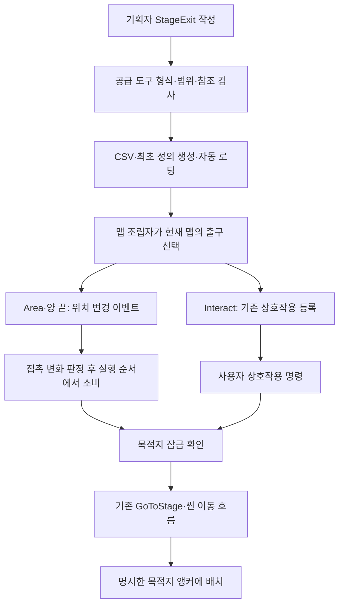
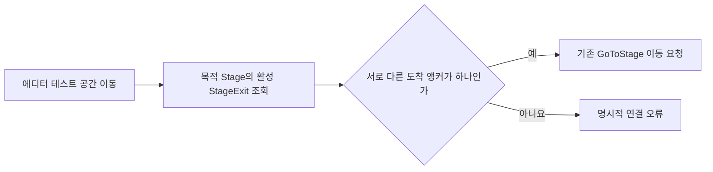
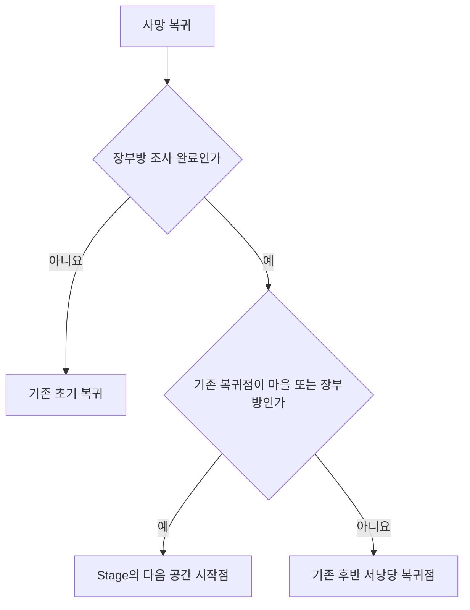

# 맵 출구와 도착 앵커 연결 설계

2026-11-14. 현재 구현은 명시적인 출구 데이터 연결입니다. Unity 실제 이동·플레이어 빌드 검증은 남아 있습니다.

## 목차

1. 변경 이유와 비교
2. 책임과 실행 순서
3. 데이터·수명 계약
4. 검증과 남은 범위
5. 담당과 협업

## 1. 변경 이유와 비교

맵 ID로 이름을 선택하고 `Spawn_From`을 붙이는 방식은 새 맵마다 코드 수정이 필요했습니다. 이전 맵을 자동 추정하는 방식도 편도와 여러 출구를 표현하기 어렵습니다. 따라서 Stage.xlsx의 StageExit 탭에서 출구 한 행을 한 방향의 연결로 관리합니다.

| 항목 | 이전 | 현재 |
| --- | --- | --- |
| 목적지·도착 위치 | 코드의 맵 이름 분기 | TargetStageID·ArrivalAnchorName |
| 역방향 | 이전 맵 추론 | 역방향 행을 명시한 경우만 이동 |
| 갈림길 | 다음 맵 하나 | 같은 StageID에 출구 여러 행 |
| 위치 | 양 끝 중심 | 양 끝·Markers의 영역·상호작용 문 |
| 검사 | 고정된 이동 사례 | 배포된 모든 출구의 참조·리소스 검사 |

기존 Stage.NextStage는 다른 기능과의 호환을 위해 유지하며 이번 출구 이동에서는 사용하지 않습니다.

## 2. 책임과 실행 순서

- 데이터 정의: StageExit. 원본 값은 변경하지 않습니다.
- 접촉 상태: StageExitContact. 엔진 참조 없이 출구별 진입 여부만 관리합니다.
- 엔진 연결: PreviewStageExit. 위치 이벤트는 갱신 예약만 하고 기존 Step에서 이동 요청을 소비합니다.
- 문: 기존 StageDoor와 PlayerInteractor를 재사용합니다. 별도 문 실행기를 만들지 않습니다.
- 조립: GameplayPreview. 데이터·앵커·기존 콘텐츠 잠금과 이동 기능을 연결합니다.

기술 실행 방식의 문자열 분기는 유지합니다. 콘텐츠 ID별 목적지를 코드에서 선택하는 분기는 제거했습니다. 네트워크 전송은 추가하지 않았으며, 향후에는 출구 ID와 이동 요청을 권한 담당이 검증해야 합니다.

## 3. 데이터·수명 계약

Area·Interact의 출발 앵커는 현재 맵 Markers 아래에서 찾습니다. 도착 앵커는 목적지 Markers 소속입니다. 전역 검색·원점 대체·자동 역방향은 없습니다. 현재는 정적으로 배치한 맵 앵커를 지원합니다. 생성된 플랫폼 내부 앵커와 움직이는 출구는 이번 지원 범위에 포함하지 않습니다.

접촉 기준은 타일×100 정수입니다. Area의 RangeX·RangeY는 각각 반폭이며, 양 끝 출구는 RangeX를 안쪽 여유로 사용합니다. Interact 거리는 기존 PlayerInteractor의 공통 설정을 사용하므로 RangeX·RangeY를 0으로 둡니다.

생성 시 최초 접촉을 관측한 뒤 구독합니다. 출구 위에 도착해도 이탈 후 재진입해야 이동합니다. 같은 갱신에 두 영역으로 진입하면 임의 우선순위를 선택하지 않고 오류를 전달합니다. 출구 Dispose가 위치 이벤트를 해제하며 정리 시 외부 소유 앵커는 삭제하지 않습니다. 사용 중 앵커 소멸은 조립 실패로 전달합니다.

## 4. 검증과 남은 범위

공급 도구에서 필수 값·중복·참조와 방식별 조건을 검사합니다. 클라이언트 검사는 배포된 출구 행과 등록된 맵 리소스의 앵커 이름을 비교합니다. 접촉 검사는 최초 겹침·반복 진입·범위 경계·독립 상태를 확인합니다. 리소스 검사는 이름의 존재를 확인하며 실제 Markers 계층과 충돌·시각 위치는 Play 확인이 필요합니다.

현재 데이터에는 11개 방향 연결을 넣었습니다. 엔딩 후 마지막 출구의 별도 동작, 기존 시작 위치·스테이지 역할 고정값, NPC 대화 연결은 후속입니다. 이 변경을 프로젝트 전체 하드코딩 제거 완료로 판단하지 않습니다.

| 남은 고정 연결 | 이유와 후속 방향 |
| --- | --- |
| 기본 PlayerStart·장부방 역할 판단 | 기존 새 게임·복귀 계약이며 시작 앵커·공간 역할 데이터로 별도 이관 필요 |
| NPC·명부·서낭당 표식별 분기 | 기존 상호작용 콘텐츠 연결이며 공통 배치 정의로 이관 필요 |
| 플레이어·스킬·팝업·표시 ID | 부팅 설정·기능별 언어 키 소비와 함께 순차 정리 필요 |
| 연출 시간·카메라·소리 기본값 | 기획 공급값과 기존 승인 예외를 대조하고 이관 필요 |

## 5. 담당과 협업

이번 미커밋 변경은 출구 데이터·코드·검사를 연결한 작업으로, Git에 확정된 담당 이력과 구분합니다. 원본 맵·배경·표식과 아트 제작·공급에는 아트 담당자가 함께 참여했습니다. 원본을 새로 제작한 작업으로 표시하지 않습니다. 기획자는 출구와 앵커를 설정하고 개발자는 새 기술 실행 방식과 공통 이동 계약을 담당합니다.

사용 순서와 예시는 [기획자 K9 안내](../기획자용%20안내문서/기획자용%20K9%20맵%20공급과%20연결%20확인%20안내.md)를 참고합니다.

### 에디터 전용 이동의 도착 연결

에디터 테스트 이동에 삭제된 LedgerArrival 참조가 남아 컴파일 오류가 발생했습니다. 장부방·보스방 테스트 이동도 기존 도착 처리와 GetUniqueArrivalAnchor를 공유해 StageExit의 도착 앵커를 읽습니다. 고정 앵커 문자열을 다시 넣지 않았습니다. 사용 중인 도착 앵커가 없거나 둘 이상이면 임의 선택 없이 연결 오류로 전달합니다.

일반 엔진 참조 컴파일에는 에디터 전용 코드가 포함되지 않습니다. 이 경로 변경은 `DefineConstants=UNITY_EDITOR` 조건으로도 검사해야 합니다. 실제 에디터 메뉴 실행은 별도 Play 확인 대상입니다.

### 장부방 복귀 후 산길 진입의 범위 단위 수정

출구 범위는 시트에서 타일×100으로 입력하지만 캐릭터 위치는 타일×1,000,000으로 보존합니다. 초기 구현은 두 단위를 변환하지 않고 비교했습니다. 따라서 RangeX 160이 1.6타일이 아닌 0.00016타일로 적용됐고, 캐릭터의 맵 경계 제한 때문에 출구에 도달할 수 없었습니다.

StageExitContact 생성 때 기존 공통 변환으로 범위를 한 번 변환합니다. 원본 시트와 캐릭터 좌표 체계는 바꾸지 않습니다. 기존 검사도 작은 정수를 같은 단위로 취급해 문제를 놓쳤으므로 입력 위치를 실제 런타임 단위로 고쳤고, 맵 끝보다 1.5타일 앞에서 범위 160에 진입하는 양방향 검사를 추가했습니다. 실제 Play 확인은 별도입니다.

### 장부방 완료 후 사망 복귀의 한정 예외

사용자 요청에 따라 장부방 조사 완료 후 초기 공간·장부방으로 되돌아가는 사망 복귀에만 기존 예외를 연결했습니다. GameProgressState.RestartAfterDeath의 예외는 이미 있었지만 GameplayPreview가 PreviewDeathRestart에 stageAfterLedger를 전달하지 않아 실행되지 않았습니다. 호출부에서 기존 Stage의 마을 NextStage를 전달합니다. 현재 공급값은 산길이며 코드에 산길 ID를 추가하지 않습니다. 새 리스폰 모듈·Inspector 필드는 만들지 않습니다.

이 예외는 사망 복귀에 한정합니다. 새 게임·수동 저장의 위치 복원·실제 저장 파일 내용은 바꾸지 않습니다. 처치 기록의 마지막 저장 상태 복원과 사망 재화 손실도 기존 처리를 재사용합니다. 장부방 완료는 기존 조사 완료 기록을 기준으로 합니다.
