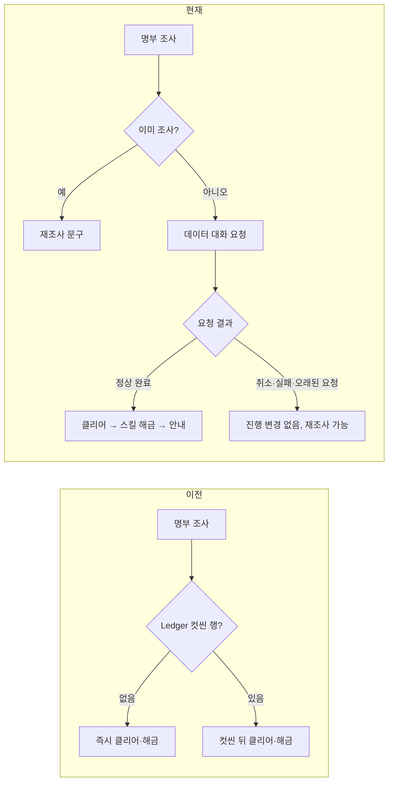
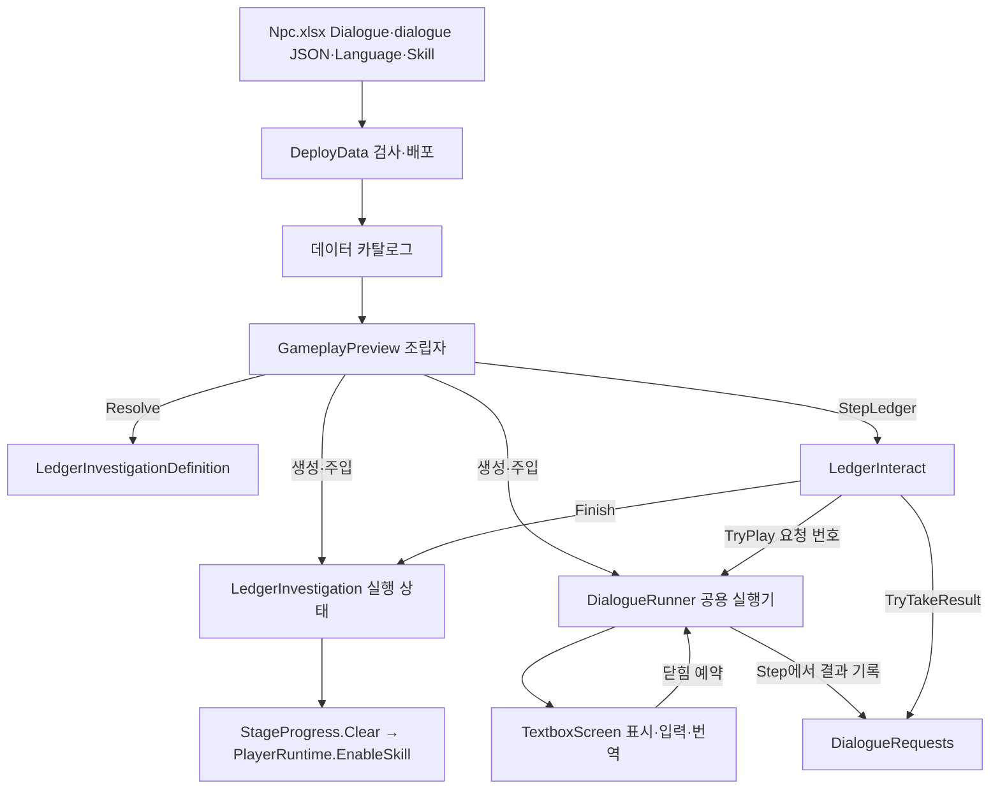
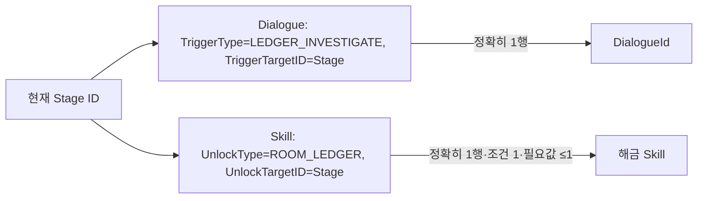
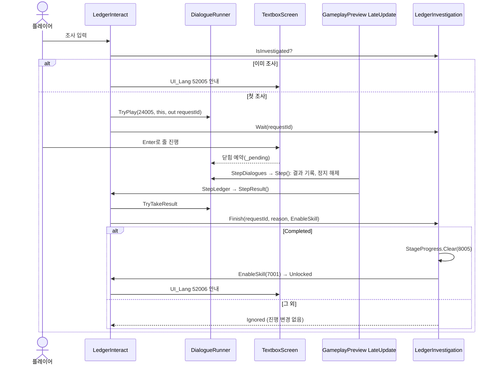
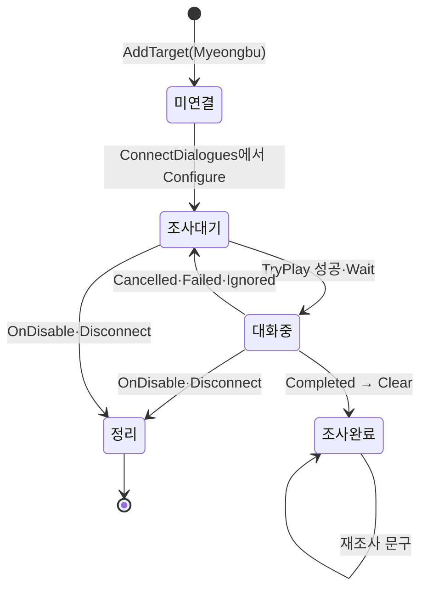

# 명부 대화와 조사 완료 연결 설계

기준일: 2026-11-16 · 클라이언트 기준 `e0090fbd` + 이번 미커밋 변경, DataSheet 기준 `322c68f` + 이번 미커밋 변경.

**구현 상태: 코드·데이터 연결과 자동 검사 통과. 실제 Unity Play 확인은 남아 있습니다.** 처음 작성한 설계안을 구현하면서 개선한 내용은 [2장](#2-설계안-대비-개선-사항)에 따로 적었습니다. 기획자 작성·확인 절차는 [명부 조사 대화 작성과 확인 안내](../기획자용%20안내문서/명부%20조사%20대화%20작성과%20확인%20안내.md)를 봅니다.

## 목차

1. [목표와 이전 동작](#1-목표와-이전-동작)
2. [설계안 대비 개선 사항](#2-설계안-대비-개선-사항)
3. [전체 구조와 책임](#3-전체-구조와-책임)
4. [데이터 연결](#4-데이터-연결)
5. [요청·결과 계약](#5-요청결과-계약)
6. [실행 순서와 완료 판정](#6-실행-순서와-완료-판정)
7. [객체 수명과 실패 처리](#7-객체-수명과-실패-처리)
8. [검증 현황과 남은 확인](#8-검증-현황과-남은-확인)
9. [담당과 근거](#9-담당과-근거)

## 1. 목표와 이전 동작

플레이어가 명부를 조사하면 데이터의 대화를 읽고, 마지막 줄까지 정상 진행한 뒤 조사 완료·스킬 해금을 실행합니다. 이미 조사했다면 재조사 문구만 표시합니다. 대화 화면은 게임 진행을 직접 수정하지 않습니다.

| 구분 | 이전 구현 | 현재 구현 |
| --- | --- | --- |
| 첫 조사 | Cutscene `Ledger` 행이 없으면 즉시 클리어·해금 | 데이터 대화 필수. 누락·중복이면 맵 준비 실패로 보고 |
| 대화 연결 | Dialogue 24005가 `TALK`/0으로 배포됐지만 명부와 연결 없음 | `LEDGER_INVESTIGATE`/Stage 8005로 조회 |
| 완료 판정 | DialogueRunner는 `AvailabilityChanged`만 통지 | 요청 번호별 `Completed`·`Cancelled`·`Failed` 결과 |
| Stage·Skill | LedgerInteract에 8005·7001 고정 기본값 | 현재 Stage와 Skill 표(`ROOM_LEDGER`)에서 결정 |
| 재조사 | UI_Lang 52005 → Language 30262 | 그대로 재사용 |
| 해금 안내 | 30023 비교 후 UI_Lang 52006 | UI_Lang 52006 상수로 정리 |



## 2. 설계안 대비 개선 사항

| 설계안 | 문제 | 개선·구현 |
| --- | --- | --- |
| 명부 설정은 기존 `ConnectStageObjects`에서 | 대화 실행기 생성(`ConnectDialogues`)보다 먼저 실행돼 주입할 실행기가 없음 | 표식에서는 대상만 만들고 `ConnectDialogues`에서 실행기 생성 직후 설정 |
| 요청·결과·판정을 어댑터에 | Unity 의존 클래스라 엔진 없이 검사할 수 없음 | `Core/Interaction`의 `DialogueRequests`·`LedgerInvestigation`으로 분리하고 코어 검사 추가 |
| Clear 후 EnableSkill 부분 실패의 롤백·재시도 정책 필요 | 롤백은 저장·이벤트 소비자까지 되돌려야 해 복잡도 증가 | **조사 완료(Stage 클리어)를 원본 진행, 스킬 해금을 파생 상태**로 정의. 맵 준비 때 기존 `EnableSkill(진행 기반)`이 다시 적용되므로 롤백 없이 복구 |
| 대화 ONCE 기록 뒤 진행 적용 실패 시 재시도 차단 우려 | 클리어는 HashSet 추가라 실패하지 않고, 해금 예외 뒤에도 진행은 남음 | 진행이 남으므로 이후 재조사 문구 경로로 감. 실행기는 맵마다 다시 만들어져 ONCE도 초기화 |
| 해금 Skill은 기존 고정값 재사용 | 고정 기본값 복제 위험 | `UnlockType=ROOM_LEDGER`·`UnlockTargetID=Stage`·조건 1인 Skill 하나를 표에서 결정 |
| 데이터 검사는 허용값만 | 클라이언트에서야 연결 오류 발견 | 배포 도구가 Stage 참조·Stage별 단일 행·해금 Skill 존재·조건을 배포 전에 검사 |
| 명부 컷씬 경로 유지 여부 미정 | 컷씬과 대화가 겹칠 위험 | 명부의 Cutscene `Ledger` 소비를 제거. 키 상수와 다른 컷씬(엔딩) 흐름은 유지 |
| 맵 세대 대조 | 별도 세대 번호를 두면 상태 추가 | 실행기가 맵마다 새로 생성되고 명부는 재설정 시 자기 요청을 폐기. 모르는 요청은 `Cancelled`로 처리해 세대 번호 없이 늦은 결과 차단 |
| 한 맵에 명부 여러 개 | Stage 단위 완료와 충돌 | `Myeongbu` 표식이 둘 이상이면 맵 준비 실패로 보고 |

## 3. 전체 구조와 책임



| 위치 | 책임 | 이유 |
| --- | --- | --- |
| `Core/Interaction/DialogueRequests.cs` | 요청 번호·소유자·결과 보관, 한 번만 가져가기 | 엔진 없는 공통 규칙. NPC·보스 대화와 공유 |
| `Core/Interaction/LedgerInvestigation.cs` | 데이터 결정(`Resolve`)·대기 요청·결과 적용 순서 | 명부 도메인 규칙을 표시·엔진에서 분리 |
| `Adapters/DialogueRunner.cs` | 공용 대화 실행, 요청별 결과 기록·취소 정리 | 명부 전용 대화 실행기를 만들지 않음 |
| `Adapters/Interaction/LedgerInteract.cs` | 조사 입력·재조사 문구·자기 요청 수명·결과 소비 | 명부 상호작용 수명을 이미 소유 |
| `Preview/GameplayPreview.Dialogues.cs` | 데이터 조회·주입·`StepLedger` 소비 순서·정리 | 맵 조립 경계 |
| `Preview/GameplayPreview.cs` | `Myeongbu` 표식에 대상 생성(하나만) | 기존 표식 연결 위치 |

전역 이벤트 버스·명부 전용 대화 관리자·새 저장 관리자는 추가하지 않았습니다.

## 4. 데이터 연결

### 4.1 현재 공급값

```csv
ID,TriggerType,TriggerTargetID,RepeatMode,PauseGame,ObjectiveTextID,LineFile
24005,LEDGER_INVESTIGATE,8005,ONCE,Y,0,24005.json
```

| 데이터 | 값 |
| --- | --- |
| Dialogue (`tables/Npc.xlsx` Dialogue 탭) | 위 행. 이전 `TALK`/0에서 변경 |
| 대사 JSON `dialogue/24005.json` | 화자 30380(명부)·30001(플레이어), 본문 30381~30388 8줄 |
| Skill | 7001, `UnlockType=ROOM_LEDGER`, `UnlockConditionType=1`, `UnlockTargetID=8005`, `UnlockRequiredValue=1` |
| 문구 | 재조사 UI_Lang 52005 → 30262, 해금 UI_Lang 52006 → 30023 |

### 4.2 조회 규칙



`LedgerInvestigationDefinition.Resolve`가 누락·중복·조건 불일치를 `InvalidOperationException`으로 조립자에게 전달합니다. 첫 행 선택이나 즉시 해금으로 대체하지 않습니다. 같은 규칙을 DataSheet `DialogueJsonRule`이 배포 전에 검사하므로 정상 배포된 데이터에서는 클라이언트 실패가 나지 않습니다.

시트 상단 지정 규칙의 `AllowedValues`에 `LEDGER_INVESTIGATE`를 추가했습니다. Stage ID는 한 Stage의 여러 명부를 구분하지 못합니다. 필요해지면 안정적인 상호작용 대상 ID를 별도로 설계합니다.

## 5. 요청·결과 계약

```csharp
// 기존 호출자(NpcTalk·보스 대사 큐)는 그대로입니다. 결과를 쌓지 않습니다.
bool TryPlay(int id, object owner);
// 결과가 필요한 호출자: 요청 번호를 받습니다.
bool TryPlay(int id, object owner, out int requestId);
// true = 결과 확정(한 번만), false = 아직 재생 중. 모르는 요청은 Cancelled.
bool TryTakeResult(object owner, int requestId, out DialogueEndReason reason);
```

| 상황 | 기록되는 결과 |
| --- | --- |
| 마지막 줄까지 Enter로 진행 | `Completed` (`TextboxScreen.LastPlaybackCompleted`) |
| 화면이 중간에 닫힘 | `Cancelled` |
| 시작 중 예외 | 기록 없음. `TryPlay`가 false, 기존 오류 보고 |
| 소유자 `Cancel(owner)` | 재생 중이면 닫고 그 소유자의 대기 결과 폐기 |
| 실행기 `Dispose` | 모든 결과 폐기. 이후 조회는 `Cancelled` |
| 다른 소유자·다른 번호로 조회 | `Cancelled` (진행 허용 안 함) |

`AvailabilityChanged`는 표시 갱신 신호로만 남겼습니다. 완료 판정에 쓰지 않습니다.

## 6. 실행 순서와 완료 판정



| 결과 | 조사·해금 | 다음 동작 |
| --- | --- | --- |
| 정상 완료 | 실행 | 이후 재조사 문구 |
| 시작 거절(다른 대화 재생 중 등) | 안 함 | `CanInteract`가 false였다가 사용 가능 통지 뒤 다시 true |
| 취소·사망·맵 이탈 | 안 함 | 요청 폐기, 재조사 가능 |
| 데이터·화면 실패 | 안 함 | 기존 오류 보고(`ReportCutsceneError` → 팝업·Firebase 수집) |
| 오래된 요청의 늦은 결과 | 안 함 | 요청 번호·소유자 불일치로 폐기 |
| 이미 클리어된 상태에서 결과 도착 | 중복 적용 안 함 | `AlreadyInvestigated` |
| 기획에서 Skill `ContentEnabled=N` | 클리어만 | 안내 문구 없음(`Investigated`) |

Enter는 기존 한 줄 진행 규칙을 유지합니다. 명부 전체를 즉시 끝내는 새 스킵은 없습니다. 조사로 바뀐 진행은 런타임 상태이며 기존 자동·수동 저장으로만 영구 파일에 확정됩니다. 재입장·불러오기의 완료 판정은 `StageProgress`를 사용합니다.

## 7. 객체 수명과 실패 처리



- 재생 요청은 명부가, 실행기·화면 수명은 조립자가 소유합니다. 명부는 실행기를 Dispose하지 않고 `Cancel(this)`로 자기 요청만 정리합니다.
- `OnDisable`·`Disconnect`는 구독 해제·자기 요청 취소·대기 요청 폐기를 `SubscriptionScope.Cleanup`으로 끝까지 수행합니다.
- 조립자의 `DisconnectDialogues`는 명부 `Disconnect` → 실행기 `Dispose` 순서로 정리합니다.
- 결과 소비는 이벤트 콜백이 아니라 `LateUpdate`의 `StepDialogues` 다음 `StepLedger`에서 합니다. 명부 적용 예외는 대화 실행기를 중단시키지 않고 별도로 보고합니다.
- 새 비동기·코루틴·매 프레임 데이터 검색은 없습니다. `Resolve`는 맵 준비 때 한 번만 실행합니다.
- 원본 정의는 읽기 전용이며 실행 상태는 대기 요청 번호뿐입니다. 네트워크 확장 시 요청 번호와 진행 명령의 권한·순서를 다시 검토해야 하며 현재 동기화를 제공하지 않습니다.

## 8. 검증 현황과 남은 확인

| 검사 | 결과 |
| --- | --- |
| `./Tools/Verify-Project.ps1 -CompileUnity` | 통과. 코어 검사 2,215 → 2,253개, 엔진 참조 컴파일 경고·오류 0 |
| 코어 검사 추가 항목 | 요청별 결과·한 번만 가져가기·결과 미요청 대화·취소·늦은 결과·동시 요청 거절, 명부 데이터 누락·중복·조건 불일치, 취소·실패·오래된 요청·정상 완료·중복 적용·해금 꺼짐·해금 예외 뒤 진행 유지 |
| DataSheet `dotnet run --project Tools/DataExporter.Checks` | 204개 통과. 명부 유효·Stage 없음·Skill 없음·조건 불일치·Stage 중복 검사 추가 |
| `DeployData.exe` 재생성·`--check`·`--deploy` | 통과. 37개 탭. 클라이언트 `Dialogue.csv` 24005 행만 내용 변경 |

**실제 Unity Play로 확인하지 않은 항목:** 첫 조사 완주·해금 안내, 중간 취소 후 재조사, 반복 입력, 이미 조사한 명부, 사망·맵 이탈·재입장, 언어 전환, 피난민·보스 대화 회귀. 확인 절차는 [기획자 안내 4장](../기획자용%20안내문서/명부%20조사%20대화%20작성과%20확인%20안내.md#4-게임에서-확인하기)을 따릅니다.

## 9. 담당과 근거

- 이전 클라이언트 LedgerInteract의 마지막 변경 근거: `2c6975d4`, Git 작성자 NYM. 이번에 사용자 요청과 승인된 설계에 따라 명부 상호작용 내부를 대화 결과 기반으로 바꿨습니다. 해당 커밋만으로 기능 전체의 단독 제작자를 판단하지 않습니다.
- 명부 원본(대사·문구) 공급 근거: DataSheet `1d6d43b`, Git 작성자 Claude. 사용자 확정에 따라 **Kim Hyun Ho** 작업으로 귀속합니다.
- 이번 연결 구현(클라이언트 코드·DataSheet 검사 도구·Dialogue 행 변경·문서)은 사용자 요청 작업이며 커밋 전입니다.
- 대사 화면·프리팹·아트는 재사용했습니다. 아트 원본 제작·외부 공급에는 아트 담당자가 함께 참여했으며 새 아트 제작은 없습니다.

관련 문서: [남은 요청 전체 설계](1116%20남은%20개발%20요청과%20연결%20설계.md#4-명부-대화와-조사-완료) · [NPC 데이터 작성 안내](../기획자용%20안내문서/NPC%20데이터%20작성과%20배포%20준비%20안내.md) · [컷씬 재생 설계](컷씬%20재생%20설계.md)
