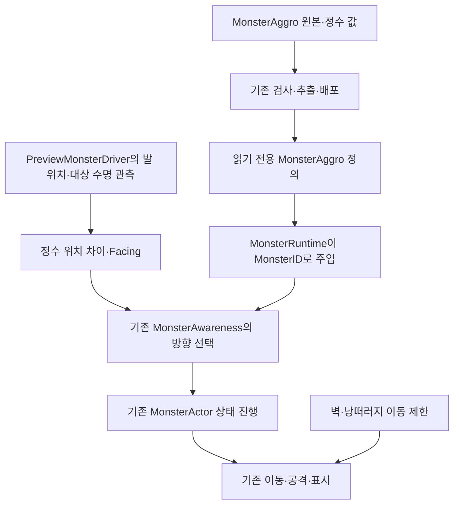
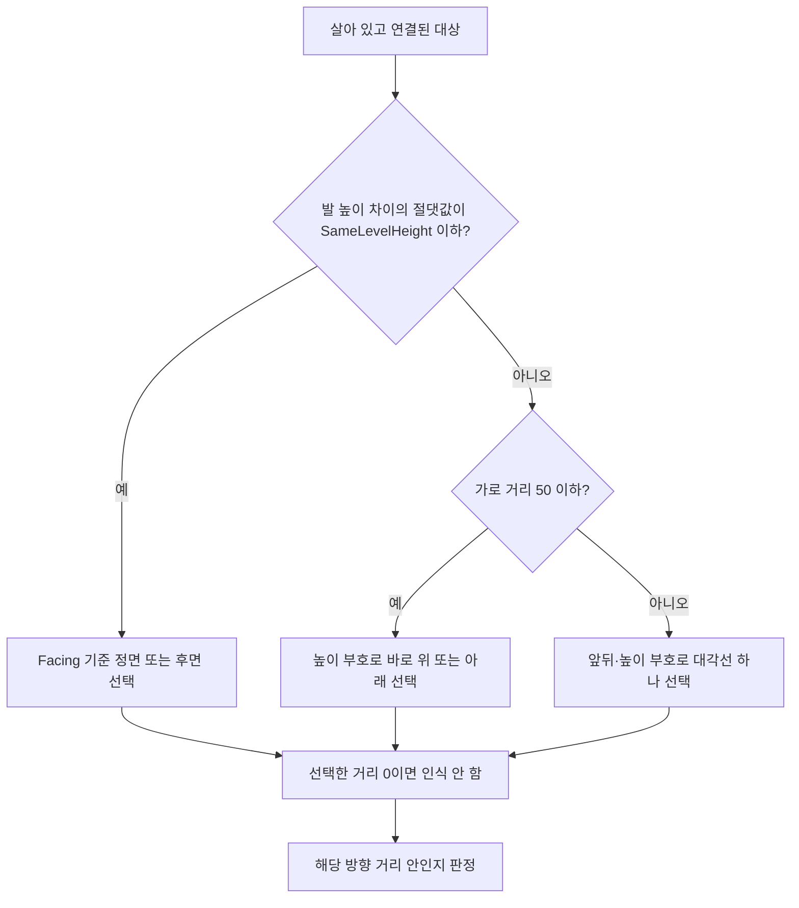
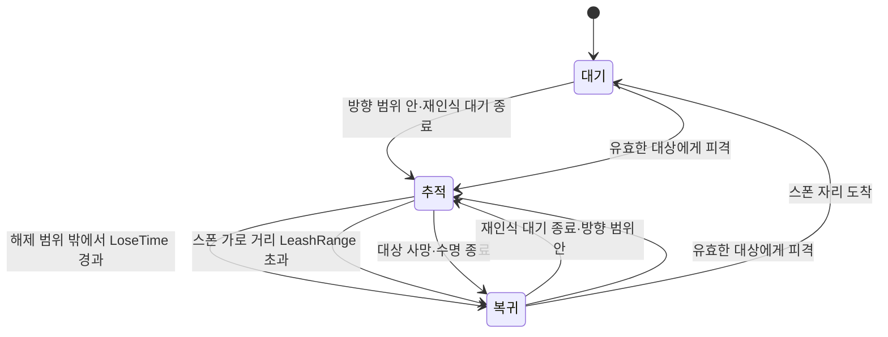
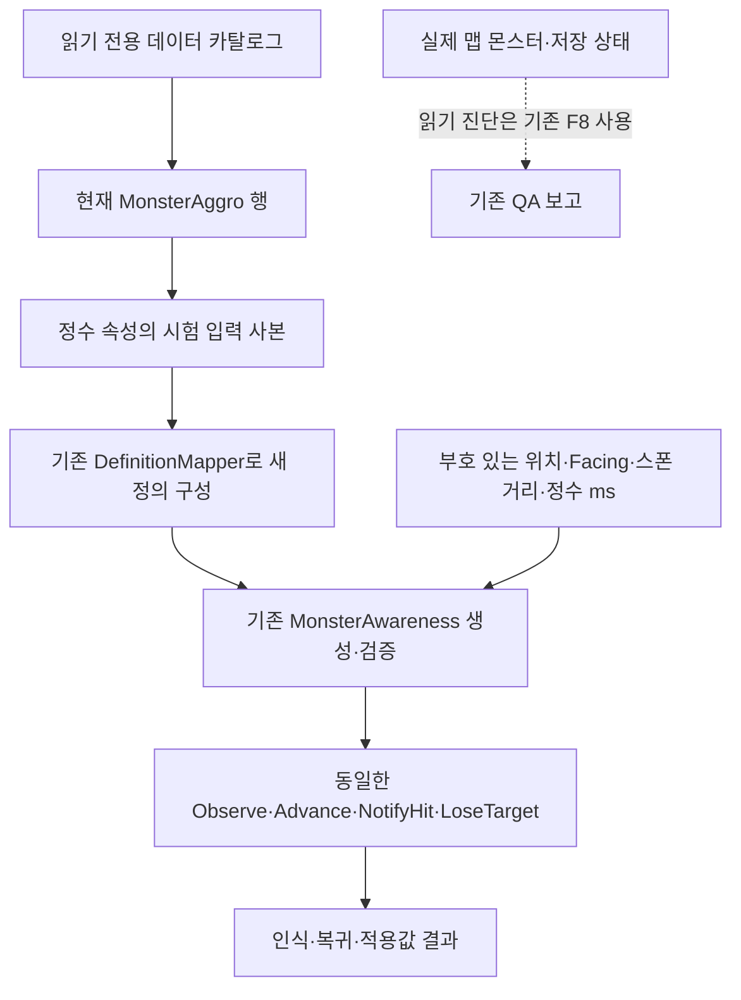

# 몬스터 8방향 인식과 추적 설계

기준일: 2026-11-16. 원본 개정은 DataSheet `5c3bef3`, 클라이언트 기반은 `4274c187`입니다. 사용자 승인으로 SameLevelHeight를 원본에 추가하고 기존 실행기에 연결했습니다. 코드·배포·자동 검사와 실제 Play 확인을 구분합니다.

## 목차

1. [왜 설계를 바꾸는가](#1-왜-설계를-바꾸는가)
2. [데이터와 책임](#2-데이터와-책임)
3. [8방향 선택과 정수 단위](#3-8방향-선택과-정수-단위)
4. [추적·해제·복귀](#4-추적해제복귀)
5. [코드·배포·수명 계약](#5-코드배포수명-계약)
6. [검사와 협업](#6-검사와-협업)
7. [데이터 주입 시험 모듈](#7-데이터-주입-시험-모듈)

## 1. 왜 설계를 바꾸는가

이전 인식은 Monster.SightRange와 MonsterAggro.SightHeight의 대칭적인 직사각형 범위였습니다. 새 기획은 몬스터 정면과 등 뒤의 인식 거리가 다르며 위·아래·대각선도 각각 조절합니다. 기존 가로 거리와 높이에 새 열을 추가만 하면 방향별 값을 실제로 사용할 수 없으므로 인식 판정기를 기존 MonsterAwareness 안에서 교체했습니다.

| 이전 | 현재 | 이유 |
| --- | --- | --- |
| Monster.SightRange·SightHeight | MonsterAggro의 8방향 거리 | 기획자가 앞·뒤·위·아래를 개별 조절 |
| 절댓값 가로·높이만 관측 | 부호를 보존한 위치 차이와 현재 Facing | 등 뒤를 정면으로 잘못 판정하지 않음 |
| 서로 다른 몸체 중심의 높이 | 판정 몸체의 발 위치 높이 차이 | 몸체 크기를 다른 층으로 오해하지 않음 |
| 같은 높이의 오차 기준 없음 | SameLevelHeight | 작은 발 위치 오차를 코드의 숨은 허용값으로 두지 않음 |
| 화면·보행 구간을 인식 조건으로 사용하던 과거 정책 | 표의 방향 범위만 사용 | 화면·표현·지형 이동과 인식 책임 분리 |

## 2. 데이터와 책임

운영 MonsterRuntime은 인식 표의 MonsterID 일치·누락·중복을 검사한 뒤 기존 코어에 주입합니다. 원본 객체를 변경하지 않고 관측값·해제 대기·재인식 대기만 실행 상태로 보관합니다. 운영 인식은 더 이상 Monster.SightRange를 조회하지 않습니다. 표를 주입하지 않는 기존 독립 코어 시험 생성자의 호환 경로와 운영 조립을 혼동하지 않습니다.

새 대화 관리자·AI 관리자·전역 이벤트 버스를 추가하지 않았습니다. 인식 상태는 매 프레임 변할 수 있는 위치와 정수 시간에 의존하므로 기존 관측·Tick 순서를 유지합니다. 매 프레임 시트를 검색하거나 새 컬렉션을 생성하지 않습니다. 생성자에서 정의를 검증할 때만 범위 목록을 준비합니다.

## 3. 8방향 선택과 정수 단위

오른쪽을 보는 몬스터의 설명용 배치입니다. 왼쪽을 보면 앞·뒤 열이 좌우로 바뀝니다. 이 그림은 원형 시야가 아니라 원본 규칙의 방향별 가로·세로 제한을 설명합니다.

| 뒤 위 | 바로 위 | 앞 위 |
| --- | --- | --- |
| BackUpRange | UpRange | FrontUpRange |
| BackRange | 몬스터 | FrontRange |
| BackDownRange | DownRange | FrontDownRange |

- 정면·후면은 `가로 위치 차이 × 현재 Facing`의 부호로 구분합니다. 인식 여부를 결정하기 전에 플레이어 쪽으로 돌려서 후면을 정면으로 바꾸지 않습니다.
- 바로 위·아래의 가로 반 칸(50)은 원본 B1에 명시된 분류 규칙입니다. 이 값은 인식 거리가 아닙니다. 세로 인식 거리는 UpRange·DownRange를 사용합니다.
- 대각선은 해당 방향의 값 이내로 가로와 세로가 모두 들어오는 사각 범위입니다. 제곱근·각도·실수 방향 보간을 사용하지 않습니다.
- 방향은 한 번만 선택합니다. DownRange가 0일 때 바로 아래를 FrontDownRange로 대체하지 않습니다.
- `SameLevelHeight=10`은 발 높이 0.1칸까지 같은 높이로 분류하는 **초기 조정값**입니다. 작은 물리 관측 오차 때문에 정면 5칸이 대각선 2칸으로 바뀌는 현상을 줄이려고 추가했습니다. 코드 기본값·자동 대체값은 없으며 기획자가 원본에서 바꿉니다.
- 같은 높이는 같은 플랫폼 ID를 요구하는 뜻이 아닙니다. 멀리 떨어진 두 플랫폼도 데이터의 거리·높이가 충족되면 인식할 수 있습니다.

Unity 몸체의 발 위치는 경계에서 SpatialRuntime.ToInteger로 변환하고 높이 차이를 정수로 보존합니다. 코어 입력은 기존 IntegerPosition.ToData로 tile_x100에 맞춥니다. 시간은 int ms, 방향은 정수 -1/1입니다. 거리·높이·방향·대기 상태에 float 값을 저장하거나 누적하지 않습니다.

## 4. 추적·해제·복귀

방향 범위는 **처음 인식·재인식**에 사용합니다. 이미 추적 중일 때 정면·후면 범위를 벗어났다는 이유만으로 즉시 해제하지 않고 LoseRange·LoseHeight·LoseTime을 사용합니다. 공격·돌진·잡기·노출·처형 중 해제를 보류하는 기존 상태 진행 계약은 원본 기획대로 유지합니다. 피격 인식은 방향·재인식 대기를 무시하지만 사망·비활성 대상을 되살리지 않습니다. 필드 피해와 실제 공격 반응의 기존 구분도 유지합니다.

생성 방향(2026-11-17, NYM `704fde84`): 몬스터는 생성 뒤 **첫 관측에서 한 번** 플레이어 쪽을 봅니다(같은 x면 왼쪽). 따라서 생성 시점에는 플레이어가 항상 정면 범위로 판정됩니다. 이후에는 인식 전에 몸을 돌리지 않으며, 복귀를 마치고 스폰 자리에 멈추면 다시 플레이어 쪽을 봅니다. 후면 범위는 생성 이후 플레이어가 등 뒤로 이동한 경우에 적용됩니다.

복귀 시 HP 유지·체세 회복, 낭떠러지·벽 안전 이동을 재사용합니다. 방향 인식은 경로 탐색을 추가하지 않습니다. 보스의 방 전체 추적 정책도 바꾸지 않습니다.

## 5. 코드·배포·수명 계약

| 위치 | 변경·재사용 |
| --- | --- |
| DataSheet tables/Monster.xlsx의 MonsterAggro | 공급된 8방향 유지, SameLevelHeight와 누락된 방향별 상한 검사 추가 |
| Data/MonsterAggro.cs | 원본과 동일한 속성·생성자 순서로 개발자가 갱신 |
| Core/Characters/MonsterAwareness.cs | 기존 인식·해제 실행기에 8방향 선택 적용 |
| Core/Characters/MonsterActor.cs | 기존 관측에 높이 방향 추가, 인식 전 Facing으로 판정 |
| Adapters/MonsterRuntime.cs | 읽기 전용 Aggro 참조 제공, 기존 주입·수명 유지 |
| Preview/PreviewMonsterDriver.cs | 발 높이 관측·정수 변환·F8 진단. 공격 접촉 판정은 유지 |

일반 정의 클래스는 자동 배포가 덮어쓰지 않으므로 원본 열만 바꾸면 배포가 중단됩니다. 이번에도 구형 생성자와 새 표의 불일치를 검사기가 감지했고, 정의를 맞춘 다음 검사·배포했습니다. 생성 enum과 로딩 계획은 직접 수정하지 않았습니다. 같은 엑셀의 다른 탭은 변경하지 않았으며 ZIP 비교에서 MonsterAggro 워크시트만 변경됐음을 확인했습니다.

인식 거리 8개는 음수가 아니어야 하며 가로를 사용하는 방향은 LoseRange 이하, 세로를 사용하는 방향은 LoseHeight 이하여야 합니다. SameLevelHeight는 0 이상 LoseHeight 이하, LeashRange는 양수입니다. 이 검사는 원본의 공통 추출 규칙과 코어 초기화 양쪽에 연결했습니다.

새 비동기 작업·코루틴·구독은 추가하지 않았습니다. 대상 비활성·사망·맵 해제 때 기존 대상 해제·투사체 정리를 유지합니다. 네트워크·리플레이 확장 시 부호 있는 위치 차이, Facing을 관측한 시점, Tick·피격 명령 순서를 같은 권한 주체가 확정해야 합니다. 정수화만으로 결정적 재생을 보장하지 않습니다.

## 6. 검사와 협업

자동 검사에는 생성 첫 관측 회전·이후 인식 전 미회전·복귀 정지 회전, 좌우 반전, 정면·후면 거리 차이, 8방향 경계, 반 칸 분류 경계, 0 방향 대체 금지, 허용값 변경, 피격 즉시 인식, 해제·재인식 시간, 공격·노출 중 복귀 보류, 대상 비활성을 포함합니다. 시험 수치는 명시적 시험 정의이며 현재 공급 수치를 고정 비교하지 않습니다. 실제 Play의 발 관측·맵별 체감과 새 빌드 수용은 별도입니다.

8방향 원본 기획의 근거는 DataSheet `5c3bef3`이며 Git 작성자는 Claude, 사용자 확정에 따른 실제 귀속은 **Kim Hyun Ho**입니다. SameLevelHeight의 추가와 연결·검사는 이번 사용자 승인 작업으로 아직 커밋 전입니다. 기존 AI·이동·공격과 통합 기반은 NYM 등 기존 개발자의 커밋 이력과 구분합니다. 원본 아트는 외부 공급한 아트 담당자의 공동 기여이며 이번에는 새 아트를 제작하지 않았습니다.

[기획자 작성·검증 안내](../기획자용%20안내문서/몬스터%20인식과%20추적%20데이터%20사용%20안내.md) · [빌드 감사](빌드%20전%20정합성과%20테스트%20기능%20점검.md)

## 7. 데이터 주입 시험 모듈

### 7.1 왜 기존 F8에 연결하는가

수정한 시야가 실제 규칙으로 어떻게 판정되는지 기획자가 코드 수정 없이 확인해야 합니다. 기존 QA는 실제 몬스터 상태를 읽는 기능이므로, 실게임을 변경하지 않고 입력·시간을 통제하는 독립 시험을 추가했습니다. 새 창 관리자·입력키·전역 이벤트·Inspector 연결을 만들지 않고 F8 창에 조립합니다.

게임 규칙을 시험용으로 복제하지 않습니다. 원본의 모든 정수 설정 속성을 읽고 기존 DefinitionMapper가 생성자와 속성을 연결해 사본을 구성합니다. 필드별 생성자 인덱스·몬스터 ID·시야값의 별도 목록을 하드코딩하지 않습니다. 생성자·표 연결이 바뀌면 같은 매핑·검증 계약을 따릅니다.

### 7.2 위치와 수명

`Preview/GameplayPreview.AggroTests.cs`는 기존 호스트의 도구 조립 부분이며 `UNITY_EDITOR || DEVELOPMENT_BUILD`로 전체를 감쌉니다. 창·버튼 스타일·스크롤은 기존 BossTests를 재사용합니다. 도메인 클래스에 테스트 전용 입력이나 상태 변경 메서드를 추가하지 않았습니다.

새 판정기와 적용 사본은 검증이 성공한 뒤 함께 교체합니다. 실패하면 이전 적용값·누적 상태를 유지합니다. 위치·시간 입력은 모두 검증한 후 Observe·Advance를 호출하므로 잘못된 시간 때문에 관측만 먼저 변경되지 않습니다. 사용자의 형식·범위 입력 오류는 도구 안내로 표시하고, 예상 밖의 실행 오류는 기존 보고 경계로 전달합니다.

명시적인 시험 버튼에서만 판정·정의 구성·결과 문자열 생성을 수행합니다. GUI는 열려 있을 때 입력을 표시하지만 게임 Update에 새 타이머나 관측 루프를 추가하지 않습니다. 원본 조회·정의 매핑은 행 선택·적용 버튼에서만 수행하고 새 구독·비동기 작업도 만들지 않습니다.

F8 닫기와 기존 OnDisable 정리에서 시험 데이터 참조·사본·판정기·입력을 함께 비웁니다. 게임의 몬스터를 재초기화·해제하거나 사용자 저장을 덮어쓰지 않습니다. 좌표·시간은 정수이며 GUI 폭·크기는 Unity 표시 경계의 실수 API를 사용합니다.

### 7.3 검증 범위

Verify-Data.ps1의 DLL 메타데이터 검사에 DrawAggroTests·ClearAggroTests·RunAggroTest를 추가했습니다. 기존 시험 메서드와 합쳐 6개가 개발·에디터에 포함되고 정식에서 제외되는지 확인합니다. 이는 실제 플레이어 빌드의 버튼 클릭 검증과 구분합니다. 순수 판정기의 기존 방향·범위·시간·수명 회귀 검사도 유지합니다. 추가한 AggroTrialCopyChecks는 실제 배포 CSV의 모든 행을 공통 변환기로 복사하고, 사본 값 하나를 바꿔도 원본과 나머지 속성·ID가 보존되는지 검사합니다. GUI의 입력·스크롤·복사·데이터 선택은 실제 화면 수용 대상입니다.

원래 기획 표를 변경하거나 배포하지 않았습니다. 이번 도구는 사용자 요청으로 추가한 개발용 기능이며 아직 커밋 전입니다. 수치가 확정되면 기획자가 원본 표에 반영하고 기존 자동 검사·배포를 진행합니다. 사용 절차는 [F8 데이터 주입 시험](../기획자용%20안내문서/몬스터%20인식과%20추적%20데이터%20사용%20안내.md#5-f8-데이터-주입-시험)을 봅니다.
