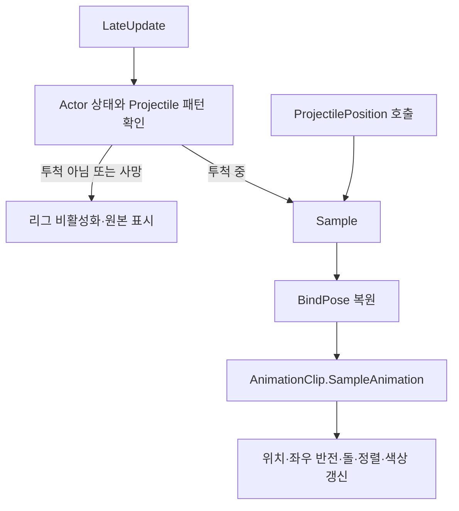

# 몬스터 투척 리그 용량 최적화 가이드

2026-11-18. [MonsterThrowRigView](../../Assets/3.Script/Preview/MonsterThrowRigView.cs)의 현재 구현을 기준으로 투척 리그의 빌드 용량·런타임 메모리·프레임 비용을 구분해 점검하는 가이드입니다. 이 문서는 가이드와 검증 기준이며, 대상 C# 파일이나 프리팹을 자동으로 변경하지 않습니다.

## 목차

1. [범위와 현재 구현](#1-범위와-현재-구현)
2. [최적화 우선순위](#2-최적화-우선순위)
3. [코드 경로 점검 기준](#3-코드-경로-점검-기준)
4. [리소스 점검 기준](#4-리소스-점검-기준)
5. [검증 절차와 완료 조건](#5-검증-절차와-완료-조건)
6. [변경 시 보존해야 할 계약](#6-변경-시-보존해야-할-계약)

## 1. 범위와 현재 구현

### 1.1 최적화 대상 구분

이 기능에서 “용량”은 다음 세 가지로 나누어 기록합니다.

| 구분 | 주된 대상 | 측정 지표 |
| --- | --- | --- |
| 빌드 용량 | PNG·Sprite Atlas·AnimationClip·프리팹·영상 | 빌드 리포트의 에셋별 바이트 |
| 런타임 메모리 | 텍스처 해상도·압축·중복 참조·활성 리그 수 | Profiler Memory, 텍스처 메모리 |
| 실행 비용 | 매 프레임 샘플링·Transform·Renderer 프로퍼티 | CPU ms, GC Alloc, SetPass/배치 |

`MonsterThrowRigView`의 C# 코드 크기는 빌드 용량에서 우선순위가 낮습니다. 실제 용량은 이 컴포넌트가 참조하는 `_source`, `_skin`, `_heldStone`, `HandOverlay`, `_throw`, `_throwHigh`의 원본 에셋과 프리팹 구조에서 발생합니다.

### 1.2 현재 코드 경로

현재 구현에서 유지할 점:

- `MaterialPropertyBlock`은 `Awake`에서 한 번 생성합니다.
- `SpriteRenderer.GetComponent`와 `HandOverlay` 검색은 초기화 시 한 번만 수행합니다.
- 투척 중이 아닐 때 리그를 비활성화합니다.
- 공격 경과는 정수 ms 상태에서 `SampleAnimation` 경계의 초 단위로만 변환합니다.

현재 비용 후보:

- 투척 중 매 프레임 `Restore`와 `SampleAnimation`을 수행합니다.
- `ProjectilePosition`을 같은 프레임에 여러 번 읽으면 `Sample`이 반복될 수 있습니다.
- 색상·sorting layer·sorting order가 변하지 않아도 Renderer에 다시 대입합니다.

## 2. 최적화 우선순위

### 2.1 1순위: 텍스처와 아틀라스

- 원화의 실제 표시 크기보다 큰 텍스처를 리사이즈합니다.
- 같은 몬스터·리그가 공유하는 스프라이트는 Sprite Atlas로 묶습니다.
- 동일한 PNG의 복사본을 만들지 않고 기존 Sprite를 재사용합니다.
- 플랫폼별 압축 포맷을 적용하되, 알파 경계·픽셀 선명도·색상 밴딩을 실제 화면에서 확인합니다.
- 사용하지 않는 원본 PSD·테스트 PNG·중복 추출물을 빌드에서 제외합니다.
- 아틀라스에 너무 많은 대형 원화를 한데 묶어 비활성 리그까지 메모리에 올라오는 구조는 피합니다. 함께 로드되고 함께 사용되는 범위로 나눕니다.

### 2.2 2순위: 애니메이션과 프리팹

- `_throw`와 `_throwHigh`가 실제로 다른 동작일 때만 별도 클립을 유지합니다.
- AnimationClip의 불필요한 Transform 키와 중복 커브를 제거합니다.
- 공격 판정에 사용되는 프레임 `0, 5, 12, 17`을 변경하지 않고 키를 줄입니다.
- 리그 프리팹마다 클립·머티리얼·스프라이트가 복제되지 않고 공통 에셋을 참조하는지 확인합니다.
- `HandOverlay`처럼 순서 표현에 필요한 계층만 남기고 사용하지 않는 Animator·Collider·ParticleSystem·컴포넌트는 제거합니다.
- 런타임 생성이 필요할 때는 풀링을 적용하되, 최대 동시 투척 리그 수를 기준으로 풀 상한을 둡니다.

### 2.3 3순위: 코드 경로

- 빌드 용량 절감보다 CPU·렌더링 비용 절감 목적의 작업으로 분류합니다.
- 공격 프레임이 바뀐 경우에만 `SampleAnimation`하는 캐시를 우선 검토합니다.
- 같은 프레임의 `ProjectilePosition` 조회는 마지막 샘플 결과를 재사용합니다.
- 색상·정렬·활성 상태가 실제로 바뀐 경우에만 Renderer에 대입합니다.
- `MaterialPropertyBlock`을 매 프레임 새로 만들지 않습니다.
- 최적화 전후의 실제 Profiler 수치 없이 “무할당” 또는 “60 FPS 보장”으로 기록하지 않습니다.

## 3. 코드 경로 점검 기준

### 3.1 샘플링 캐시

캐시를 추가할 경우 캐시 키는 최소한 다음 상태를 포함해야 합니다.

- 현재 공격 패턴 식별자
- 선택된 클립 식별자
- 공격 경과 ms에서 계산한 프레임 번호
- Facing
- 리그 활성 상태

패턴·클립·프레임·Facing 중 하나가 바뀌면 리그를 다시 샘플링합니다. 캐시 때문에 손 위치가 이전 공격 상태에 남지 않도록 투척 종료와 비활성화 시 캐시를 무효화합니다.

### 3.2 표현과 규칙의 경계

- 공격 판정·피해·비행 시간·AI 상태는 기존 몬스터 런타임과 도메인 규칙의 소유로 둡니다.
- 이 컴포넌트는 리그 표시와 손 위치 제공만 담당합니다.
- 정수 ms 공격 경과와 프레임 선택 계약을 실수 초 누적 방식으로 바꾸지 않습니다.
- 최적화 콜백에서 코어 명령을 다시 호출하거나 공격 상태를 변경하지 않습니다.
- 네트워크·리플레이를 추가하는 경우에도 전송 대상은 클립 참조가 아니라 안정적인 패턴 ID, 공격 경과 ms, Facing 등 직렬화 가능한 상태로 둡니다.

### 3.3 수명과 재사용

- 리그를 풀링할 경우 비활성화 시 원본 SpriteRenderer 표시, sorting 값, 색상, Transform, 돌 활성 상태, MaterialPropertyBlock을 초기화합니다.
- 외부 소유 앵커와 부모 Transform을 리그 정리 과정에서 삭제하지 않습니다.
- 생성·설정·대상 연결은 비활성 상태에서 완료한 뒤 활성화합니다.
- `Awake`의 필수 참조 실패는 현재처럼 조립자에 명확히 전달합니다.

## 4. 리소스 점검 기준

### 4.1 에셋별 확인표

| 대상 | 확인 내용 | 통과 기준 |
| --- | --- | --- |
| Sprite/PNG | 최대 표시 크기, 중복 파일, 알파, 압축 | 필요 이상 해상도 없음, 중복 참조 없음 |
| Sprite Atlas | 패킹 그룹, 페이지 수, 로드 범위 | 함께 사용하는 리그 단위로 분리 |
| AnimationClip | 키 수, 중복 커브, 공통 참조 | 동작을 보존하며 불필요한 키 제거 |
| 리그 프리팹 | 컴포넌트 수, 하위 오브젝트, 참조 | 표시·리깅에 필요한 최소 구조 |
| Material | 인스턴스 생성 여부, 셰이더 변형 | 공유 머티리얼 우선, 불필요한 변형 없음 |

### 4.2 빌드 리포트 해석

빌드 리포트에서 다음 순서로 확인합니다.

1. 투척 리그가 참조하는 PNG·Atlas의 전체 바이트를 합산합니다.
2. `_throw`와 `_throwHigh`가 중복 텍스처나 중복 메시를 끌어오는지 확인합니다.
3. 동일 Sprite·Material·AnimationClip이 여러 번 포함되었는지 확인합니다.
4. 코드 어셈블리 크기보다 텍스처·영상·오디오가 큰 항목인지 먼저 비교합니다.
5. 변경 후 빌드 리포트에서 감소량과 화면 품질 검증 결과를 함께 기록합니다.

## 5. 검증 절차와 완료 조건

### 5.1 실행 검증

- 투척 시작·중간·종료 시 손 위치가 동일합니다.
- 일반 투척과 높은 투척의 선택이 동일합니다.
- 좌우 Facing에 따른 좌우 반전이 동일합니다.
- 돌이 손 뒤에 있고 손 덮개가 돌 앞에 보입니다.
- 공격 프레임 `0, 5, 12, 17`의 시각적 타이밍과 판정 계약이 변하지 않습니다.
- 투척하지 않는 상태에서 리그가 활성화되거나 샘플링되지 않습니다.
- 여러 몬스터가 동시에 투척할 때 누락·공유 상태 오염이 없습니다.

### 5.2 측정 검증

최적화 전후에 동일한 씬·해상도·품질 설정·몬스터 수로 측정합니다.

- Build Report: 전체 빌드 크기와 투척 리그 관련 에셋 바이트
- Memory Profiler: 텍스처 메모리와 중복 에셋
- Unity Profiler: `SampleAnimation`, `Restore`, Renderer 갱신의 CPU 시간
- Profiler Timeline: GC Alloc과 프레임당 호출 횟수
- Frame Debugger: Sprite 배치와 머티리얼 변경 횟수

### 5.3 완료 조건

- 빌드 용량 감소는 에셋별 감소량으로 확인합니다.
- 런타임 개선은 CPU ms·GC Alloc·메모리 수치로 확인합니다.
- 화면·공격·정수 시간 계약의 회귀가 없습니다.
- 실제 Play와 Release 빌드 결과를 자동 검사·컴파일 통과와 구분해 기록합니다.
- 에셋 삭제는 참조 검색과 빌드 확인 후 진행하며, 원본 공급 파일과 가공·연결 파일의 기여를 문서에서 구분합니다.

## 6. 변경 시 보존해야 할 계약

- [MonsterThrowRigView](../../Assets/3.Script/Preview/MonsterThrowRigView.cs)의 책임은 리그 표현과 투사체 위치 제공에 한정합니다.
- 몬스터 AI·피해·비행 시간의 소유권을 이 컴포넌트로 옮기지 않습니다.
- 실수 값은 Unity API 경계에서만 사용하고, 규칙·상태·타이머는 기존 정수 단위를 유지합니다.
- 씬 전체 검색, 매 프레임 컴포넌트 검색, 누락 시 원점 생성으로 최적화하지 않습니다.
- 최적화로 인해 데이터 정의·프리팹 연결 계약·네트워크/리플레이 상태 소유권을 암묵적으로 바꾸지 않습니다.

관련 문서는 [반복 갱신과 임시 표시 최적화 설계](반복%20갱신과%20임시%20표시%20최적화%20설계.md), [1117 매달리기·옹귀 투척·어그로 시험 QA와 인수인계](1117%20매달리기·옹귀%20투척·어그로%20시험%20QA와%20인수인계.md), [빌드 리소스 포함과 실행 검증 설계](빌드%20리소스%20포함과%20실행%20검증%20설계.md)를 함께 봅니다.
