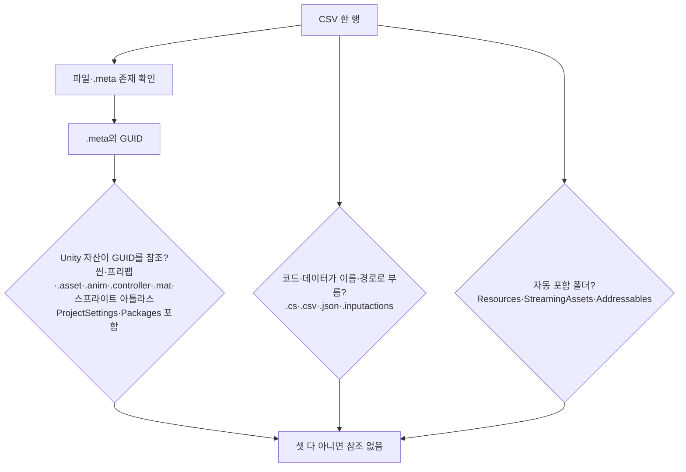

# 미사용 리소스 참조 확인 결과 (2026-11-20)

2026-11-20 · 대상: 리소스 정리·용량 최적화를 맡는 개발자, 원본 공급자(아트·사운드)

`인귀_미사용목록_20261120.csv`(235행)를 바탕으로, 각 파일이 실제 프로젝트에서 참조되는지 확인한 결과입니다. 목록은 "안씀" 106행, "쓰는거 아닌가?" 6행, "보류" 123행으로 나뉘어 있었고, 이 문서도 같은 구분으로 정리합니다. **이 문서는 확인만 했고 파일은 지우지 않았습니다.**

## 목차

1. [요약](#1-요약)
2. [확인 방법](#2-확인-방법)
3. [안씀 — 삭제 후보](#3-안씀--삭제-후보)
4. [쓰는거 아닌가? — 로딩 키아트](#4-쓰는거-아닌가--로딩-키아트)
5. [보류 — 별도 관리](#5-보류--별도-관리)
6. [삭제할 때 지킬 것](#6-삭제할-때-지킬-것)

## 1. 요약

기준: `HYT/work` `9d3232f7`.

| 구분 | 행 | 용량 MiB | 참조 확인 결과 | 권장 |
| --- | --- | --- | --- | --- |
| 안씀 | 106 | 89.14 | **모두 참조 없음** | 삭제 후보 |
| 쓰는거 아닌가? | 6 | 72.38 | **모두 참조 없음.** 현재 어떤 씬·프리팹·코드도 쓰지 않음 | 쓸 계획(로딩 화면 등)이 있는지 아트와 확인 후 결정 |
| 보류 | 123 | 16.12 | 모두 참조 없음 | 목록 작성자의 보류 판단대로 유지. 5장에 따로 둠 |
| 합계 | 235 | 177.64 | 235행 모두 파일과 `.meta`가 있고, 참조 0 | |

- 목록의 235행은 모두 실제로 있는 파일이고 `.meta`의 GUID가 있습니다.
- 어떤 씬·프리팹·애니메이션·설정 자산도 이 GUID를 참조하지 않습니다. 코드·데이터에서 파일 이름이나 경로로 부르는 곳도 없습니다.
- 처음 검색에서 문자열이 걸린 17건은 모두 다른 대상이었습니다(2장 "오탐").

## 2. 확인 방법

- **GUID 참조:** Unity는 이미지·소리를 경로가 아니라 `.meta`의 GUID로 연결합니다. 하위 스프라이트도 같은 GUID에 번호만 붙습니다. `Assets`·`ProjectSettings`·`Packages`의 모든 Unity 자산 파일에서 GUID를 대소문자 구분 없이 찾았습니다(Addressables 그룹의 `m_GUID` 포함).
- **이름·경로 문자열:** `Resources.Load`, 데이터의 이미지 키처럼 문자열로 부르는 경우를 찾았습니다. 6자 이상의 파일 이름이나 전체 경로를 검색했습니다.
- **자동 포함:** 목록 파일 중 `Resources`·`StreamingAssets` 폴더 안의 파일은 없습니다. Addressables 그룹(`Default Local Group`)은 항목이 비어 있습니다(`m_SerializeEntries: []`).

**오탐(참조처럼 보였지만 아닌 것) 17건:**

| 대상 | 걸린 곳 | 실제 |
| --- | --- | --- |
| `Art_New/Platforms/Air_Platform_N.png` 12개 | 스폰 JSON(`Data/Json/spawn`, `Map_ME/spawn`) | JSON의 `Air_Platform_N`은 **발판 프리팹 이름**입니다. 그 프리팹(`Prefabs/Map/Air_Platform_N.prefab`)은 이 PNG가 아니라 다른 이미지를 씁니다(예: `Air_Platform_1.prefab`은 이 PNG의 GUID를 참조하지 않음) |
| 쇄문아비 `Swaemoon/attack1·2·5.gif` (보류) | `SwaemunabiAttack2Preview.cs` | 필드 이름(`_attack1Frames`)이 겹친 것. 이 비교 재생기는 Inspector로 받은 스프라이트를 씀 |
| 같은 gif, `Swaemunabi_Phase2_Body.png` 2개 (보류) | `Swaemunabi_Phase2/Validation/*.json` | 리깅 검증 때 남긴 측정 기록 파일. 게임이 읽지 않음 |

## 3. 안씀 — 삭제 후보

106행, 89.14 MiB. 모두 참조가 없습니다.

### 3.1 사운드 (7개, 21.42 MiB)

| 폴더 | 파일 | MiB |
| --- | --- | --- |
| `Assets/8.Audio/SFX` | `Ambiance_Wind.wav` `HG_OJ_Fire.wav` `Monster_1(scarecrow).wav` `Monster_Combat.wav` `player_Death_Voice.wav` `player_FootStep.wav` `player_Hanging.wav` | 21.42 |

소리는 `GameAudio.prefab`이 GUID로 연결합니다. 이 7개는 거기에도 없습니다. 가장 큰 `Ambiance_Wind.wav`(16.6 MiB)만 지워도 사운드 쪽 용량 대부분이 줄어듭니다.

### 3.2 이미지 (99개, 67.72 MiB)

| 폴더 | 파일 | MiB |
| --- | --- | --- |
| `Assets` | `dee3d6b87ad0dcad 1.png` `dee3d6b87ad0dcad.png` | 2.19 |
| `Assets/4.Sprite/InGame_UI` | `Text_Box.png` | 1.16 |
| `Assets/4.Sprite/Map/Art/FX` | `ST01_HouseFire_01.png` `ST01_HouseFire_02.png` `ST01_HouseFire_03.png` `ST01_HouseFire_04.png` `ST01_HouseFire_05.png` `ST01_HouseFire_06.png` `ST01_HouseFire_07.png` `ST01_HouseSmoke_01.png` `ST01_HouseSmoke_02.png` `ST01_HouseSmoke_03.png` `ST01_HouseSmoke_04.png` `ST01_HouseSmoke_05.png` `ST01_HouseSmoke_06.png` `ST01_HouseSmoke_07.png` | 15.33 |
| `Assets/4.Sprite/Map/Art/Jangbubang` | `ST01_JB_Door.png` `ST01_JB_Shelf.png` | 0.41 |
| `Assets/4.Sprite/Map/Art/Map2` | `ST02_Block_StepHigh.png` `ST02_Block_StepLow.png` | 1.34 |
| `Assets/4.Sprite/Map/Art/Player` | `ST01_Player_Proxy.png` | 0.01 |
| `Assets/4.Sprite/Map/Art/Terrain` | `ST01_Ground_Fill_B.png` `ST01_Ground_Fill_C.png` `ST01_Ledge_Middle_B.png` `ST01_Plank_Middle_B.png` `ST01_Plank_Middle_C.png` | 0.38 |
| `Assets/4.Sprite/Map/Art_New/Maps` | `Dohwagol_R3c_Ground_0.png` `Dohwagol_R3c_Ground_1.png` `Hyeopgok_R3c_Ground_0.png` `Hyeopgok_R3c_Ground_1.png` `Sangil_R3c_Ground_0.png` `Sangil_R3c_Ground_1.png` | 39.04 |
| `Assets/4.Sprite/Map/Art_New/Platforms` | `Air_Platform_1.png` `Air_Platform_10.png` `Air_Platform_11.png` `Air_Platform_12.png` `Air_Platform_13.png` `Air_Platform_2.png` `Air_Platform_3.png` `Air_Platform_4.png` `Air_Platform_5.png` `Air_Platform_6.png` `Air_Platform_7.png` `Air_Platform_8.png` `Air_Platform_9.png` | 2.21 |
| `Assets/4.Sprite/Map/Kits9/01_Dohwagol/3_발판` | `발판_01_교수대받침.png` `발판_04_돌턱A.png` `발판_05_돌턱B.png` | 0.24 |
| `Assets/4.Sprite/Map/Kits9/01_Dohwagol/5_오브젝트` | `나무_02_소나무.png` `소품_06_수레.png` `소품_08_모닥불.png` `연기_01_기둥.png` `연기_02_기둥.png` `연기_03_기둥.png` | 0.88 |
| `Assets/4.Sprite/Map/Kits9/04_BossRoom/3_발판` | `발판_01.png` `발판_02.png` `발판_04.png` `발판_05.png` | 0.32 |
| `Assets/4.Sprite/Map/Kits9/04_BossRoom/5_오브젝트` | `구조물_03.png` `구조물_04.png` `소품_02.png` `소품_03.png` `소품_04.png` `소품_05.png` `소품_06.png` `자연_01.png` `자연_02.png` `자연_03.png` `자연_04.png` | 0.89 |
| `Assets/4.Sprite/Map/Kits9/05_X01_Galimgil/3_발판` | `발판_01.png` `발판_03.png` `발판_04.png` `발판_05.png` `발판_06.png` | 0.54 |
| `Assets/4.Sprite/Map/Kits9/05_X01_Galimgil/5_오브젝트` | `구조물_03.png` `구조물_04.png` `구조물_05.png` `소품_05.png` | 0.22 |
| `Assets/4.Sprite/Player` | `5_1.Jump_Attack.png` | 0.20 |
| `Assets/4.Sprite/Title` | `HG_UI_start_pressed.png` | 0.05 |
| `Assets/4.Sprite/UI_Temp/Shrine` | `ShrineUI_Panel_9slice_256.png` `ShrineUI_Panel_Large_1320x820.png` `ShrineUI_Panel_Small_560x660.png` `Untitled-1 1.png` | 2.07 |
| `Assets/5.Animation/Attack_Animetion` | `sparkles-animation (1).gif` `sparkles-animation (2).gif` `sparkles-animation (3).gif` `sparkles-animation (4).gif` `sparkles-animation (5).gif` `sparkles-animation (6).gif` `sparkles-animation (7).gif` `sparkles-animation (8).gif` `sparkles-animation.gif` | 0.09 |
| `Assets/TextMesh Pro/Examples & Extras/Textures` | `Gradient Vertical (Color).jpg` `Mask Zig-n-Zag.psd` `Wipe Pattern - Diagonal.psd` `Wipe Pattern - Radial Double.psd` `Wipe Pattern - Radial Quad.psd` | 0.15 |

참고:
- `Art_New/Maps/*_R3c_Ground_*`(약 39 MiB)는 이전 R3c 맵의 바닥 그림입니다. 현재 맵은 K9 프리팹을 씁니다.
- `Assets/dee3d6b87ad0dcad.png`와 `dee3d6b87ad0dcad 1.png`는 크기가 같은 복사본으로 보입니다.
- `TextMesh Pro/Examples & Extras`는 TextMesh Pro 예제 패키지입니다. 지우려면 예제 폴더 전체를 지우는 편이 깔끔합니다. 일부만 지우면 예제 씬·머티리얼이 깨집니다.

## 4. 쓰는거 아닌가? — 로딩 키아트

6행, 72.38 MiB.

| 폴더 | 파일 | MiB |
| --- | --- | --- |
| `Assets/4.Sprite/LodingImage` | `Background_KeyArt1_1920x1080.png` `Background_KeyArt2_1920x1080.png` `Background_KeyArt3_1920x1080.png` `Background_KeyArt4_1920x1080.png` `Background_KeyArt5_1920x1080.png` `Background_KeyArt6_1920x1080.png` | 72.38 |

- **현재는 참조가 없습니다.** 어떤 씬·프리팹도 이 그림을 연결하지 않고, 코드에도 `KeyArt` 문자열이 없습니다. 로딩 화면이 지금 이 그림을 쓰지 않는다는 뜻입니다.
- 3~6번은 한 장이 15~17 MiB라, 쓴다면 압축 설정을 같이 봐야 합니다.
- 결정: 로딩 화면에 넣을 계획이면 남기고 연결 작업을 잡습니다. 아니면 3장과 같이 삭제 후보입니다.

## 5. 보류 — 별도 관리

123행, 16.12 MiB. 이 행들도 **현재 참조는 없습니다.** 다만 목록 작성자가 보류로 분류했으므로 이번 정리에서 빼고, 이유별로 묶어 둡니다.

| 묶음 | 추정 보류 이유 | 다시 볼 때 |
| --- | --- | --- |
| `Map/Kits9/06~10_*`(옛 절·다음 마을·폐광·요괴 소굴·진 경로 끝) | 아직 만들지 않은 맵의 키트 | 해당 맵을 만들지 않기로 하면 삭제 |
| `Map/Kits9/01·02_*` 중경 반복·눈 나무 | 현재 맵의 대체·추가 배경 후보 | 배경 확정 뒤 |
| `NewMaps1113/Galimgil/03_Valley_and_Shaft.png` | 갈림길 중경 후보 | 갈림길 배경 확정 뒤 |
| `Swaemoon/*.gif`, `Test/*`, `Swaemunabi_Phase2/Source·Validation` | 쇄문아비 리깅 원본·비교 기준·검증 캡처 | 리깅 작업 기록이 더 필요 없을 때. 원본(`Source`)은 다시 리깅할 때 필요할 수 있음 |

| 폴더 | 파일 | MiB |
| --- | --- | --- |
| `Assets/4.Sprite/Map/Kits9/01_Dohwagol/2_산맥_중경` | `중경_불타는마을A_가로반복.png` `중경_불타는마을B_가로반복.png` | 0.81 |
| `Assets/4.Sprite/Map/Kits9/01_Dohwagol/5_오브젝트` | `Tree_03_Dead_Snow_448x592.png` `Tree_04_Dead_Snow_448x592.png` `Tree_05_Sapling_Snow_448x592.png` | 0.48 |
| `Assets/4.Sprite/Map/Kits9/02_Sangil/2_산맥_중경` | `중경_가로반복.png` | 0.70 |
| `Assets/4.Sprite/Map/Kits9/06_E01_OldTemple/2_산맥_중경` | `천장_가로반복.png` | 0.53 |
| `Assets/4.Sprite/Map/Kits9/06_E01_OldTemple/3_발판` | `발판_02.png` `발판_03.png` `발판_04.png` `발판_06.png` `발판_07.png` | 0.31 |
| `Assets/4.Sprite/Map/Kits9/06_E01_OldTemple/5_오브젝트` | `소품_01.png` `잔해_01.png` `잔해_02.png` `잔해_03.png` `잔해_04.png` `잔해_05.png` | 0.52 |
| `Assets/4.Sprite/Map/Kits9/07_E02_NextVillage/3_발판` | `발판_03.png` `발판_05.png` `발판_06.png` `발판_지붕_기와.png` `발판_지붕_초가.png` | 0.45 |
| `Assets/4.Sprite/Map/Kits9/07_E02_NextVillage/5_오브젝트` | `구조물_04.png` `구조물_05.png` `구조물_06.png` `소품_01.png` `소품_02.png` `소품_08.png` `자연_01.png` `자연_02.png` `자연_03.png` | 1.00 |
| `Assets/4.Sprite/Map/Kits9/08_M01_OldMine/3_발판` | `발판_01.png` `발판_02.png` `발판_03.png` `발판_04.png` `발판_05.png` `발판_06.png` | 0.51 |
| `Assets/4.Sprite/Map/Kits9/08_M01_OldMine/5_오브젝트` | `구조물_01.png` `구조물_02.png` `구조물_03.png` `구조물_04.png` `구조물_05.png` `구조물_06.png` `자연_02.png` `자연_03.png` `자연_06.png` | 0.58 |
| `Assets/4.Sprite/Map/Kits9/09_M02_YogoeLair/3_발판` | `발판_01.png` `발판_02.png` `발판_03.png` `발판_04.png` `발판_06.png` | 0.47 |
| `Assets/4.Sprite/Map/Kits9/09_M02_YogoeLair/5_오브젝트` | `구조물_01.png` `구조물_02.png` `구조물_03.png` `구조물_04.png` `구조물_05.png` `구조물_06.png` `소품_09.png` `자연_01.png` `자연_02.png` `자연_03.png` `자연_04.png` `자연_05.png` `자연_06.png` `자연_07.png` | 1.22 |
| `Assets/4.Sprite/Map/Kits9/10_M03_JinRouteEnd/3_발판` | `발판_01.png` `발판_02.png` `발판_03.png` `발판_04.png` `발판_05.png` `발판_06.png` | 0.55 |
| `Assets/4.Sprite/Map/Kits9/10_M03_JinRouteEnd/5_오브젝트` | `구조물_03.png` `구조물_04.png` `소품_01.png` `소품_02.png` `소품_03.png` `소품_04.png` `소품_05.png` `소품_06.png` `소품_07.png` `소품_08.png` `자연_01.png` `자연_02.png` `자연_04.png` `자연_05.png` `자연_06.png` | 0.90 |
| `Assets/4.Sprite/Map/NewMaps1113/Galimgil` | `03_Valley_and_Shaft.png` | 1.29 |
| `Assets/4.Sprite/Swaemoon` | `attack1.gif` `attack2.gif` `attack5.gif` `attack6.gif` `hit.gif` `idle.gif` `walk.gif` | 1.37 |
| `Assets/4.Sprite/Test` | `Boss_Phase_2.png` `Swaemunabi_Phase2_Body.png` `Swaemunabi_Phase2_Left_Arm.png` `Swaemunabi_Phase2_Right_Arm.png` | 0.08 |
| `Assets/5.Animation/Swaemunabi_Phase2/Source` | `Swaemunabi_Phase2_Body.png` `Swaemunabi_Phase2_Left_Arm.png` `Swaemunabi_Phase2_Right_Arm.png` | 0.05 |
| `Assets/5.Animation/Swaemunabi_Phase2/Validation` | `01_bind_pose.png` `02_play_continuous.png` `03_inhale_before_weights.png` `04_final_exhale.png` `05_final_inhale.png` `attack1_refined_return_left_idle.png` `attack1_refined_return_left_walk.png` `attack1_refined_return_right_idle.png` `attack1_refined_return_right_walk.png` `attack2_left_attack1_transition.png` `attack2_right_attack1_transition.png` `idle_refined_exhale.png` `idle_refined_inhale.png` `walk_draft_left_support.png` `walk_draft_left_swing.png` `walk_draft_right_support.png` `walk_draft_right_swing.png` `walk_refined_left_support.png` `walk_refined_left_swing.png` `walk_refined_right_support.png` `walk_refined_right_swing.png` | 4.32 |

## 6. 삭제할 때 지킬 것

- **Unity 에디터에서 지웁니다.** 파일만 지우고 `.meta`를 남기거나, 반대로 `.meta`만 남기지 않습니다.
- 지운 뒤 `./Tools/Verify-Project.ps1 -CompileUnity`와 각 맵·보스·타이틀 Play로 깨진 참조(Missing)가 없는지 봅니다.
- 이 확인은 "지금 Git에 있는 파일 기준"입니다. 다른 작업자가 아직 올리지 않은 씬·프리팹이 이 파일을 쓸 수 있습니다. 지우기 전에 팀에 공지합니다.
- 이미지·소리 원본은 아트·사운드 담당이 Git 밖에서 공급한 것입니다. 지우기 전에 원본 공급자에게 보관본이 있는지 확인합니다.
- 리소스 정리 커밋에는 코드·데이터 변경을 섞지 않습니다([리소스·프리팹 최적화 인수인계](다른%20개발자%20리소스·프리팹%20최적화%20작업%20인수인계.md) 5.3).
