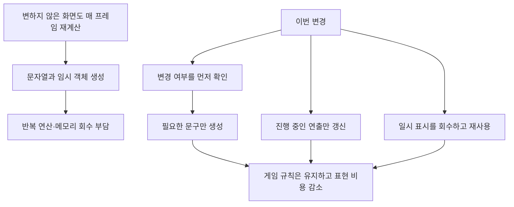
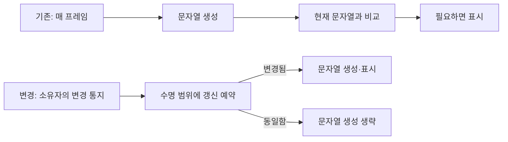
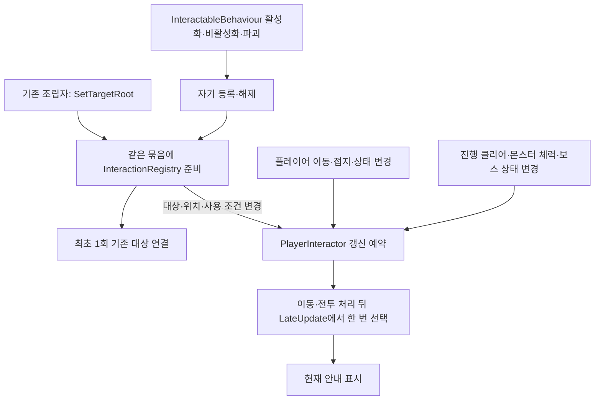
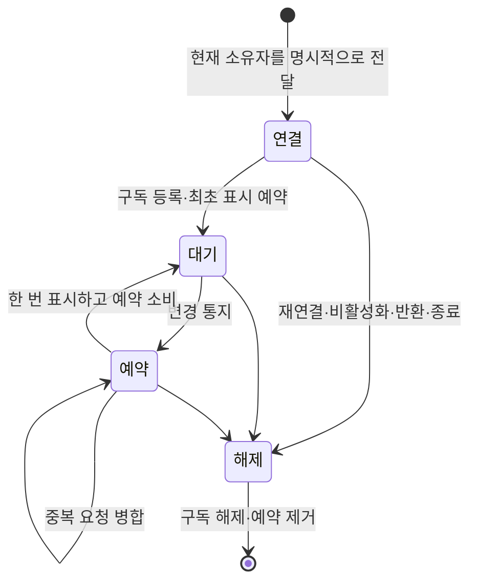
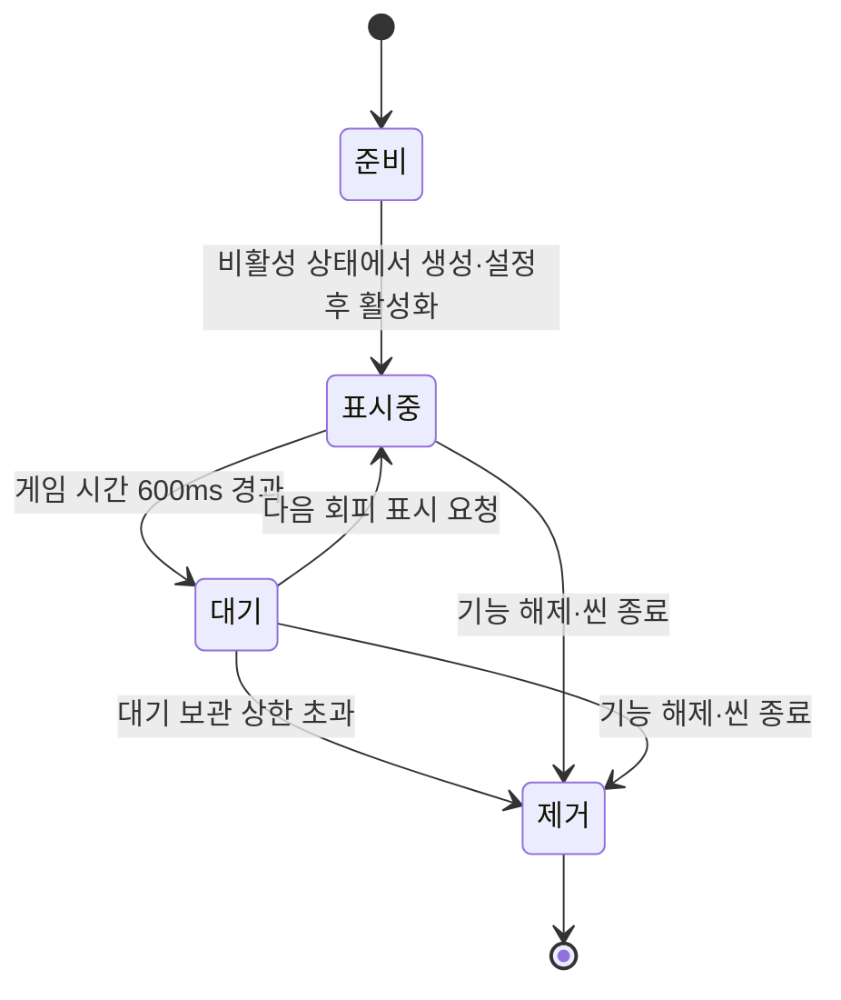

# 반복 갱신과 임시 표시 최적화 설계

> **아트 공동 기여:** 공급된 원본 아트의 제작·Git 외부 파일 전달에는 아트 담당자가 함께 참여했습니다. 아래 리소스 가공·프리팹·애니메이션·화면 연결 이력과 원본 제작 기여를 구분합니다. 미공급 전용 자산은 완료로 표기하지 않습니다. [작업자·커밋 기준](현재%20구현과%20검증%20현황.md#5-작업자별-역할과-git-근거)

## 목차

1. [왜 작업했나요?](#1-왜-작업했나요)
2. [기존과 무엇이 달라졌나요?](#2-기존과-무엇이-달라졌나요)
3. [객체와 데이터 수명은 어떻게 관리하나요?](#3-객체와-데이터-수명은-어떻게-관리하나요)
4. [기대 효과와 검증 범위](#4-기대-효과와-검증-범위)

## 1. 왜 작업했나요?

1920×1080 해상도와 기존 전투 규칙을 유지하면서 필요 없는 문자열 생성·표시 대입·사망 후 처리를 줄이기 위한 작업입니다. 최소 사양 후보는 Windows 64비트·쿼드코어 2.5GHz급·RAM 4GB·VRAM 2GB이며, 이 작업만으로 해당 장비의 60FPS를 보장하지 않습니다. 실제 후보 장비의 검증과 전체 플레이 성능 측정은 남아 있습니다.

렌더링 설정·HDR·아틀라스·이미지 압축·리소스 참조 구조는 미결로 제외했습니다. 데이터 테이블·전투 수치·공격 판정 주기·화면 해상도를 변경하지 않았습니다.

## 2. 기존과 무엇이 달라졌나요?

| 순서 | 기존 방식 | 변경 방식 | 해당 위치와 이유 |
| --- | --- | --- | --- |
| 1 | 몬스터 이름표는 매 프레임 문자열 조합 뒤 비교 | 기존 체력·상태·공격 판정 이벤트에서 변경 표시만 예약하고 LateUpdate에서 한 번 반영 | Preview/MonsterPreviewLabel: 코어 명령 없이 표시만 변경 |
| 1 | 플레이어·보스 상태 문구를 매 프레임 생성 | PlayerActor.DisplayChanged·보스 상태 통지로 갱신 예약. 쿨타임은 표시 초가 바뀔 때만 통지 | Preview/PreviewPresentation: 표시 구독과 예약 수명 소유 |
| 2 | 잔상·점멸·페이드가 끝나도 같은 값을 대입 | 잔상 완료 시 조기 종료, 점멸 중에만 계산, 값이 다른 경우에만 너비·투명도 적용 | Presentation/HealthDisplay·HudScreen: 표현의 진행 시간 소유 |
| 3 | 대화 중에도 상호작용 대상 선택, 같은 문구 반복 조회·조합 | 대상 자동 등록·해제 및 플레이어·대상·조건 변경 통지 때만 재선택. 입력 시 최신 상태 확인 | Adapters/Interaction: 등록 묶음·대상 기반 클래스·선택 소비자로 책임 분리 |
| 4 | 죽은 개체에도 AI Tick·표시와 이동 준비 반복 | 런타임은 사망 시 Tick 생략. 표시 담당은 사망 최초 반영·불길·섬광 색 복구가 필요할 때만 실행 | Adapters/MonsterRuntime·Preview/PreviewMonsterDriver: 규칙과 표현 경계 유지 |
| 5 | 회피 표시마다 Instantiate 후 지연 Destroy | 비활성 객체를 설정한 뒤 표시하고 600ms 후 풀로 반환 | Preview/PreviewCombatFeedback: 기존 피드백 소유자가 수명까지 소유 |

### 문구 생성 순서 비교

플레이어의 체력·상태·기력·약초·스킬 연결·쿨타임 표시 초·구속 연타를 PlayerActor.DisplayChanged로 통지합니다. PlayerSkill은 정수 밀리초를 유지하면서 올림 초가 바뀔 때만 알리고, PlayerHerbs는 실제 개수 변경만 알립니다. 보스와 몬스터는 기존 이벤트를 재사용합니다. 이벤트 콜백에서는 갱신만 예약하고 UI나 코어 명령을 실행하지 않습니다. 같은 호출 흐름의 여러 통지는 한 번의 표시 갱신으로 합쳐 최종 현재 값을 읽습니다.

### 상호작용 등록·해제 계약

NpcTalk·StageDoor·LedgerInteract·ShrineInteract는 InteractableBehaviour를 상속합니다. 같은 대상 묶음의 등록소가 최초 대상을 한 번 연결하며 이후 대상은 자기 수명에 따라 등록·해제합니다. 전체 씬 탐색·대상 목록의 매 프레임 정리는 하지 않습니다. 인터페이스만 직접 구현하는 외부 대상은 Changed 통지와 Register·Unregister를 직접 지켜야 합니다. 기본 확장은 공통 기반 클래스 상속을 권장합니다.

PlayerInteractor·HUD·몬스터 이름표는 실행 순서 1100의 LateUpdate에서 예약을 소비하므로 현재 기본 순서의 이동·전투 및 카메라 갱신 뒤 최종 값을 읽습니다. 이 세 표시는 서로의 실행 결과에 의존하지 않습니다. 새 이동 소유자의 실행 순서를 바꾸는 경우 이 선후 관계도 확인해야 합니다. 입력 시에는 예전 선택에 의존하지 않고 현재 범위와 사용 가능 상태를 재검사합니다.

기획자는 기존 대상 묶음과 프리팹을 사용하면 됩니다. 개발자가 지켜야 하는 변경 통지 경계는 다음과 같습니다.

| 변경한 소유자 | 호출 계약 |
| --- | --- |
| 플레이어 이동·낙하 복귀·저장 복원 | PlayerRuntime.SetPosition 사용. 외부 물리·부모 이동은 적용 후 NotifySpatialChanged 호출 |
| 플레이어 접지 | 기존 PlayerRuntime.SetGrounded 사용 |
| 보스 이동 | BossRuntime.SetPosition 사용 |
| 상호작용 대상 위치 | InteractableBehaviour.SetPosition 사용. 부모 이동·애니메이션·직접 Transform 변경 후에는 NotifyChanged 호출 |
| 대상 사용 가능 조건 | 변경을 완료한 뒤 NotifyChanged 호출. ShrineInteract.SetActive와 기존 Configure가 이를 수행 |
| 외부 함수로 판단하는 문 조건 | 소유자가 조건 변경 시 해당 문 NotifyChanged 또는 PlayerInteractor.RequestRefresh 호출 |
| 대상 묶음 교체 | 기존 SetTargetRoot 사용. 이전 구독·선택·예약을 정리한 뒤 새 묶음 연결 |
| 새 대상에서 수명 콜백 재정의 | OnEnable·OnDisable·OnDestroy·OnTransformParentChanged 재정의 시 base 호출 유지 |

현재 이동·보스 끌어당김·매달리기·낙하 복귀·저장 위치 복원 경로는 위 호출로 변경했습니다. 현재 문의 조건에 영향을 주는 몬스터 체력·진행 클리어·보스 상태 통지도 연결했습니다. 임의의 Transform 직접 수정까지 자동 감지한다고 보장하지 않습니다.

문구 캐시는 데이터 문맥의 수명에 종속되며 Connect·Disconnect에서 비웁니다. 실행 중 언어 전환이 추가되면 언어 변경 시 캐시를 비우고 RequestRefresh해야 합니다. 현재 한국어 조회 계약은 유지했습니다.

### 구독과 예약 정리를 같은 수명으로 묶은 이유

Core/SubscriptionScope는 해제 함수와 표시 예약만 담당합니다. 대상 목록·전투 규칙·Unity 오브젝트를 소유하지 않습니다. Dispose는 예약을 버리고 구독을 역순으로 해제하며 중복 호출이 안전합니다. 한 해제 함수가 실패해도 나머지를 정리한 뒤 오류를 보고합니다. 변경 예약 콜백은 이전 Scope에만 예약합니다. 초기화·입력·대화·파괴 콜백은 같은 Scope의 Guard로 감싸므로 호출 목록에 이미 복사되어 있더라도 해제 후 실행되지 않습니다. 해제된 콜백이 새 수명을 끊거나 새 대화를 닫지 않도록 한 계약입니다.

HUD·플레이어/보스 표시·몬스터 이름표·상호작용 화면·해당 씬의 상호작용 연결에 같은 Scope를 사용했습니다. HealthDisplayBinding은 이미 명시적인 체력 이벤트와 세대별 해제 계약을 갖고 있어 불필요하게 교체하지 않았습니다. 일시정지·페이드·체력 잔상 등의 실제 시간 진행은 필요한 동안 유지합니다. 모든 Update를 없앤 작업은 아닙니다.

PlayerRuntime 파괴 시에는 Destroyed 알림으로 상호작용 연결과 안내를 즉시 해제합니다. 초기화 완료 이벤트도 이전 수명에서 보관한 콜백이 뒤늦게 호출되면 이미 종료된 Scope를 확인하고 다시 연결하지 않습니다.

## 3. 객체와 데이터 수명은 어떻게 관리하나요?

회피 표시는 동시 개수를 제한하지 않고 대기 객체만 최대 16개 보관합니다. 이 숫자는 전투 콘텐츠 수치가 아니라 임시 표시의 보관 상한입니다. 반환 시 비활성화·문구 초기화를 하고 다음 사용 때 위치·문구·600ms 시간을 다시 설정합니다. 기존과 같이 스케일된 게임 시간을 사용하며 게임 진행 갱신이 중단된 동안 반환 타이머도 진행하지 않습니다. 섬광은 기존 비스케일 시간을 유지합니다.

GameplayPreview는 연결 전에 이전 피드백을 Dispose하고 OnDisable에서도 표시 중·대기 중 객체를 모두 정리합니다. 사망한 몬스터의 객체 자체를 비활성화하지 않으므로 사망 연출과 불길을 끊지 않습니다. 마지막 타격 섬광이 사망 색을 덮은 경우에는 복구 갱신을 허용합니다. 개체 목록은 출구 조건·저장·정리를 위해 유지하며 전체 순회 자체를 제거한 것은 아닙니다.

문구와 변경 예약은 화면 수명에서 관리합니다. 데이터 정의·프리팹 원본·저장 데이터는 변경하지 않습니다. 네트워크 전송·권한·난수 소비·공격 Tick 순서를 추가하거나 변경하지 않았습니다. 새 전역 관리자·코루틴·비동기 작업은 추가하지 않았습니다.

현재 사망한 MonsterActor를 부활시켜 재사용하는 계약은 없습니다. 추후 몬스터 풀·리스폰을 연결하면 새 드라이버를 조립하거나 사망 표시·불길 검사 상태의 초기화 계약을 함께 추가해야 합니다. 이번 회피 글자 풀과 몬스터 풀은 별개입니다.

## 4. 기대 효과와 검증 범위

기대 효과는 변화 없는 문구의 임시 문자열 할당 감소, 종료된 UI 연출의 반복 대입 감소, 사망 후 불필요한 실행 감소, 반복 회피 표시의 생성·파괴 감소입니다. FPS·전체 프레임 할당량·프로세스 메모리 개선 수치는 실측 전입니다.

Unity의 격리된 임시 객체로 플레이어 표시 유지·체력 변경·캐시 해제를 확인했습니다. 앞선 값 비교 단계에서 워밍업 후 동일 표시 함수 1000회 호출의 관리 힙 할당은 0바이트였습니다. 현재는 값 비교도 변경 예약 소비로 대체했습니다. 이 결과는 해당 함수 경로만의 결과이며 전체 게임의 무할당·60FPS 보장이 아닙니다. 데이터·코어 검사와 엔진 참조 컴파일, 실제 플레이 확인은 구분하여 보고합니다.

몬스터 이름표의 최초 표시·변경 예약·변경 반영·구독 해제와 회피 표시의 600ms 반환·동일 객체 재사용·위치 및 문구 재설정도 임시 객체로 확인했습니다. 편집기 격리 검사에서는 수명 콜백을 명시적으로 호출했으며 실제 Play의 씬 전환 검증을 대체하지 않습니다.

기획자와 다른 작업자의 확인 절차는 [표시 갱신 최적화 확인 안내](../기획자용%20안내문서/표시%20갱신%20최적화%20확인%20안내.md)를 따릅니다.

변경 통지의 코어 검사는 약초 연결·복원·소비, 스킬 연결, 쿨타임 초 경계·완료, 중복 요청 병합, 해제 후 예약 무효화, 클리어 중복 통지 방지, 일부 해제 실패 시 나머지 정리를 포함합니다. Unity 격리 검사에서는 초기·중복 등록, 조건·이동 통지, 비활성·재활성, 묶음 이동, 파괴 해제와 변경 없는 100회 상호작용 갱신에서 재탐색이 없는 것을 확인했습니다. 실제 씬 플레이 검증은 별도입니다.

실제 HUD 프리팹의 최초 표시·코어 이벤트 안에서 UI를 변경하지 않음·예약 반영·해제 후 예약 차단·재연결 최신 값 반영도 격리 검사했습니다. 이 검사는 임시 객체를 즉시 정리하며 기존 씬·프리팹 파일에 저장하지 않습니다.
