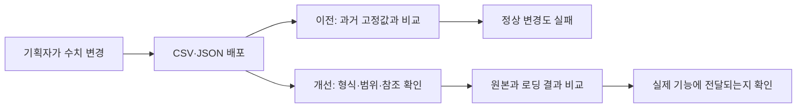
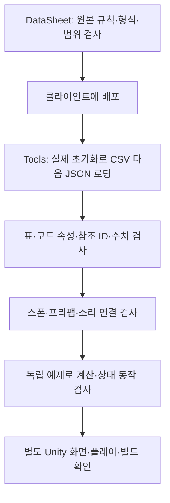

# 배포 데이터와 기능 연결 검사 설계

기준일: 2026-11-11. 배포 검사와 기능 검사의 책임을 분리해, 기획자가 수치를 변경해도 정상 데이터가 과거 밸런스 때문에 거부되지 않도록 합니다. [기획자 확인 안내](../기획자용%20안내문서/배포%20검사%20결과%20확인%20안내.md)를 함께 봅니다.

## 1. 왜 변경했는가

기존 검사는 실제 배포 데이터를 읽고도 이전 등급 하한 27·15·0과 몬스터 HP 35를 요구했습니다. 최신 데이터의 등급 8·5·0과 HP 30이 유효해도 빌드가 중단됐습니다. 검사 코드가 기획 수치를 소유한 것이 원인입니다.

## 2. 검사 책임과 순서

원본의 상세 규칙은 DataSheet 검사기가 소유합니다. 클라이언트의 `Tools`는 배포 결과와 소비 코드의 연결을 확인하는 개발 도구입니다. 런타임에 검사기를 추가하지 않았습니다.

| 위치 | 책임과 선택 이유 |
| --- | --- |
| Tools/CsvReader.Checks/DeploymentConnectionChecks.cs | 실제 초기화 결과와 배포 CSV를 대조하고 표·JSON 참조 및 캐릭터 생성 연결 확인. 엔진 없이 실행 가능한 데이터 경계에 배치 |
| Tools/Locomotion.Checks/ResourceConnectionChecks.cs | 프로젝트 파일 경로가 필요한 스폰·리소스 연결 확인. 기존 리소스 검사 실행 단계에 연결 |
| Tools/Locomotion.Checks/TestDefinitions.cs | 계산·상태 검사에 필요한 독립 예제 정의를 한곳에서 제공. 중복 Player·Monster CSV 읽기 코드는 제거 |
| Tools/Verify-Data.ps1 | 편집기 소스는 UNITY_EDITOR 조건에서만 포함해 실제 컴파일 대상 구분 |

새 전역 관리자나 런타임 비동기 처리는 없습니다. 기존 초기화·카탈로그·StageLayoutReader·StageLayoutRules를 재사용합니다. 원본 정의나 게임 수치는 수정하지 않습니다.

## 3. 적합한 수치와 연결의 기준

| 대상 | 현재 검사 |
| --- | --- |
| CSV 기본 ID·HP | 정수이며 양수. ID는 실제 등록된 행과 일치 |
| 일반 정수 필드 | 기본적으로 0 이상. 필수 양수 등 세부 의미는 원본 규칙과 함께 적용 |
| 효과 Value·SortOrder·스폰 좌표 | 의미상 음수가 가능하므로 무조건 양수로 바꾸지 않음 |
| Dodge·Crit·DeathLossRate | 정수이며 0~10000 |
| CSV 로딩 결과 | 원본 행 수·각 컬럼·코드 속성·변환된 값 일치 |
| 표 참조 | UnitID, StageID, NextStage, MonsterID, PlayerID, StateID, EffectID, CurrencyID, CutsceneID, SkillID, WeaponID, StartWeapon 및 TextID 계열의 대상 존재 |
| 조건 참조 | 현재 UnlockConditionType 1의 UnlockTargetID가 Stage에 존재 |
| 구조화 JSON | Item·PlayerState·BossState·EliteState·MonsterState의 위 참조 필드 확인 |
| 별도 정의 | 갈림길 스테이지·재화, 서낭당 재화·언어 ID 존재 |
| 실제 캐릭터 | 로딩한 Player·Monster·Boss의 HP가 생성된 런타임 HP와 일치. 플레이어 이동·스태미나, 몬스터 피해 후 원본 보존도 확인 |

참조값 0은 기존 계약의 ‘없음’을 유지합니다. 필수 참조까지 0으로 허용한다는 뜻은 아닙니다. 필수 여부는 원본 규칙에서 검사합니다. 신규 참조 컬럼이나 부호가 필요한 컬럼이 추가되면 이 연결 목록과 원본 규칙을 함께 갱신해야 합니다. 컬럼 이름만으로 모든 미래 의미를 자동 추론하지 않습니다.

## 4. 리소스 연결 범위

StageContentSet의 GUID가 실제 파일로 유일하게 연결되는지, 등록 스테이지·몬스터 코드가 CSV에 존재하는지 확인합니다. 실제 Spawn이 연결된 스테이지는 Stage.SpawnFile 경로, JSON StageID·정수 형식·배치 ID·플랫폼 프리팹·몬스터 코드와 프리팹·배치 규칙을 확인합니다. 총 스폰 수는 고정 30과 비교하지 않고 해당 JSON의 MaxMonsterCount와 비교합니다.

GameAudio의 클립 GUID, Sound ID와 주소, 같은 주소의 다른 클립 충돌, Stage의 배경음 키도 확인합니다. 현재 Spawn이 없는 보스 전용 경로는 스폰 JSON 검사를 적용하지 않습니다.

## 5. 고정된 예제 값이 남는 이유

실제 데이터 검사와 독립 계산 검사는 목적이 다릅니다. 실제 HP의 정답은 CSV입니다. 반면 ‘체력 10에서 피해 3을 받으면 7’ 같은 검사는 입력을 명확히 고정해야 계산 오류를 발견할 수 있습니다. TestDefinitions의 값은 이처럼 검사 전용 입력이며 게임에 배포되거나 실제 밸런스의 기준으로 사용되지 않습니다.

갈림길 읽기 검사는 실제 JSON과 별도 변경 예제를 같은 함수로 비교합니다. 따라서 현재 데이터만 우연히 맞추도록 값을 반환하는 오류도 감지합니다.

## 6. 확인 방법과 한계

프로젝트 루트에서 `./Tools/Verify-Project.ps1`을 실행합니다. 설치된 엔진 참조 컴파일도 필요하면 `-CompileUnity`를 사용합니다. 참조 컴파일은 Unity의 실제 플레이어 빌드를 대체하지 않습니다.

실패 메시지는 가능하면 표·행 ID·필드·참조 대상을 표시합니다. 예전 숫자에 맞추려고 정상 원본을 바꾸지 말고, 원본·배포 결과·코드 계약 중 어디가 어긋났는지 확인합니다.

현재 파일 검사만으로 모든 프리팹 내부 연결·앵커 범위·Unity 객체 fileID·Addressables 최종 묶음·미디어 재생·물리·전체 플레이 흐름의 정상 동작을 보증하지 않습니다. 해당 부분은 Unity와 실행파일에서 확인해야 합니다. 이 작업은 네트워크·리플레이 규칙이나 객체 수명 계약을 변경하지 않습니다.
