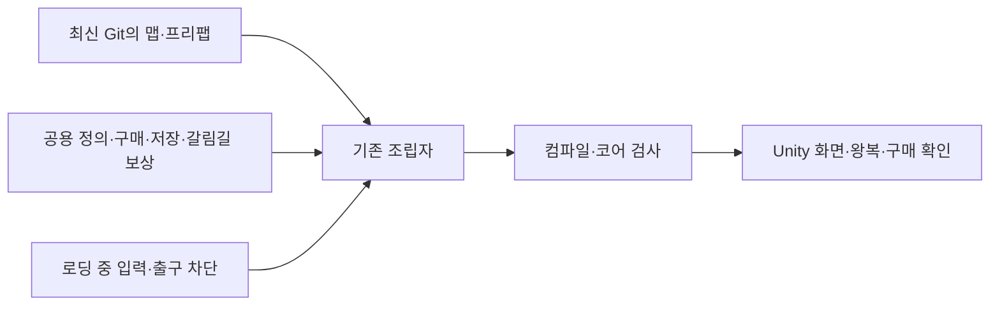
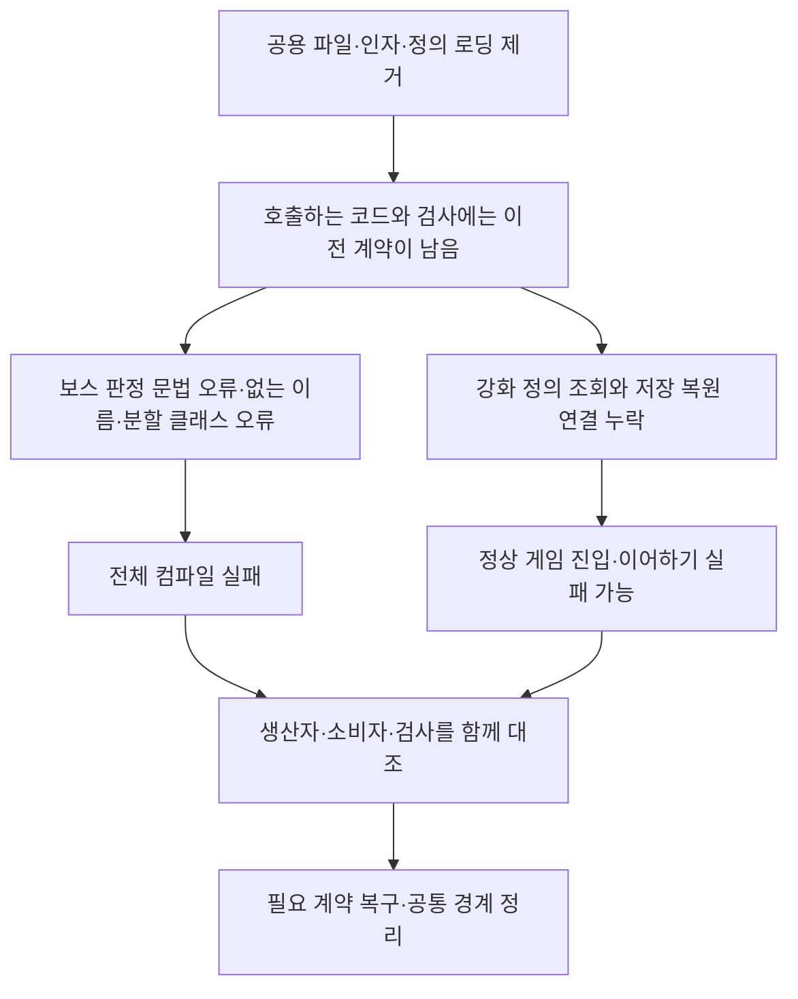
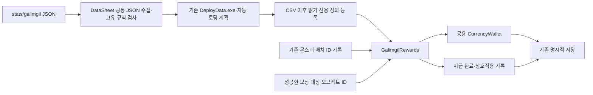
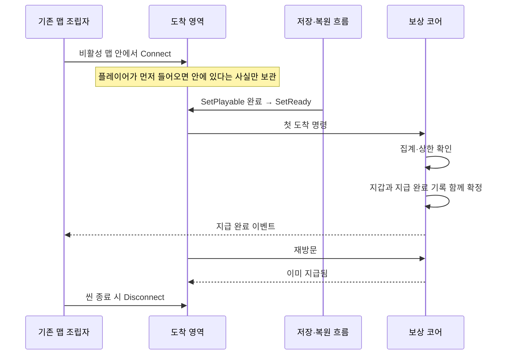
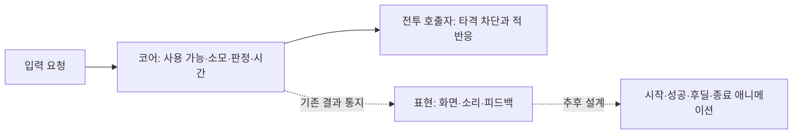

# 병합 누락 복구와 갈림길 보상 설계

## 2026-11-10 최신 Git 병합 기준

받은 기준은 `origin/Develop`의 `3858646`입니다. 기존 공통 구매·정의 로딩·저장 사본·갈림길 보상을 유지하고, Git에서 추가된 로딩 중 입력·출구·일시정지 차단을 함께 반영했습니다. 공통 기능을 새 어댑터로 복제하지 않고 기존 GameplayPreview·GameSaveContext·DataCatalog에 연결합니다. 패링의 새 흐름·연출 설계는 다른 작업자 담당으로 남깁니다.

프리팹과 그림은 받은 최신본을 사용합니다. 다만 MapDohwagolTest의 서낭당 화면 참조는 더 이상 존재하지 않는 이전 GUID를 가리켜, 최신 프리팹의 GUID로 씬 연결만 수정했습니다. 프리팹 자체의 구성은 변경하지 않았습니다. 메타 파일의 식별자는 이름이 같아도 달라질 수 있으므로 코드 컴파일만으로 연결 성공을 판단하지 않습니다.

최종 병합 검사: 데이터 1,023개·코어 851개 통과, 일반 Unity 참조 컴파일 경고·오류 0개. 실제 Unity Play·실행파일·성능 측정은 별도입니다. 자동 생성 로딩 계획과 데이터는 DataSheet 도구로 다시 배포했습니다.

기준일: 2026-11-10. 현재 코드·데이터·검사를 대조해 확인한 원인과 수정 범위입니다. 전체 실행파일의 성능·완주 확인을 대신하는 문서는 아닙니다. [기획자 확인 절차](../기획자용%20안내문서/갈림길%20보상%20작성과%20검수%20안내.md)를 함께 봅니다.

## 1. 무엇이 문제였는가

구현을 호출하는 코드와 그 기능을 제공하는 코드가 병합본에 함께 남지 않았습니다. 삭제 이력은 060b65a에서 확인했고, 이번 검수 시작 기준은 558d913입니다. 변경 전체를 되돌리는 대신 현재 소비자에게 필요한 계약만 대조해 복구했습니다.

| 확인한 원인 | 발생하는 영향 | 수정과 검증 기준 |
| --- | --- | --- |
| BossCombat.HitPlayer에 끝나지 않은 Resolve 호출과 같은 outcome 선언이 두 번 존재 | 보스 전투를 포함한 전체 컴파일 실패 | 끊어진 호출 제거, 유효한 한 번의 판정만 유지 |
| direction 인자와 HitOutcome.Parried가 제거됐지만 사용 코드는 존재 | 방향 판별과 패링 결과를 전달할 수 없음 | 기존 계약 복구, 일반몹·보스 호출부에서 실제 상대 방향 전달 |
| PlayerActor의 partial과 이동 잠금·시간 진행 연결 누락 | 성장·강화 분할 파일과 충돌, 행동 잠금 해제 누락 가능 | 분할 선언과 기존 수명 계약 복구, 전투 코어 검사 |
| 공통 구매 부모·강화 규칙·정의·리더 삭제 | 기존 UpgradeSession·임시 UI가 성립하지 않음 | 삭제 전 구현 중 필요한 공용 파일과 원래 식별자 복구 |
| 단일 정의 등록·조회와 JSON 읽기 함수 누락 | 서낭당·갈림길 정의를 공급하지 못함 | 기존 DataCatalog와 JsonLoader 경계 재사용 |
| WithSavePoints가 없는 지역 변수 openedGates를 참조 | 저장 코드 컴파일 실패 | WithSavePoints·WithOpenedGates가 한 Copy를 사용하도록 정리 |
| 폐기 관문 정리 경로 누락 | 현재 GateConfig에 없는 이전 기록으로 이어하기 실패 | 원본 대신 복원 사본만 정리하고 나머지 진행 보존 |
| 표시의 ClimbProgress 참조·성공 콜백은 남았지만 제공 코드 누락 | 표시 코드 컴파일 실패·구독 수명 불일치 | 표시 계약과 콜백·해제 연결 복구. 이동 방식을 새로 설계하지 않음 |
| 정의 조회 인터페이스를 구현한 편집기 검사 대역의 계약 누락 | 일반 또는 편집기 전용 컴파일 실패 | 체력·소리 검사 대역도 명시적으로 구현 |
| Currency 원본에 Category가 추가됐지만 최초 생성 클래스에는 없음 | 해당 열이 실행 정의에 반영되지 않음 | 확인한 원본 열만 추가, 이전 생성자 호출 호환 유지 |
| 돌진 명중 후 종료와 벽 충돌을 같은 공격으로 검사 | 현재 동작과 검사 기대가 모순 | 별도 공격 상황으로 나눠 양쪽 결과 확인 |

패링 흐름은 다른 작업자 담당입니다. 새로운 이벤트 단계·연출 전환은 이번 작업에서 수정하지 않습니다. 이번 복구를 그 설계까지 완성했다는 뜻으로 해석하지 않습니다.

## 2. 무엇을 간결하게 바꿨는가

중복 문법을 단순히 짧게 만드는 대신 같은 책임의 계산·조회만 모았습니다. 원본 밸런스·난수 소비 순서·저장 트리거를 바꾸지 않는 것이 기준입니다.

| 변경 전 | 변경 후 | 이유·효과 |
| --- | --- | --- |
| 일반 타격·구속 분기마다 피해 계산 호출 | 유효 판정 후 피해 한 번 계산, 결과 적용만 분기 | 중복 식과 서로 다른 능력치 참조 위험 감소. 보스 사슬의 비치명 피해 규칙 유지 |
| UpgradeSession이 표를 필터링해 배열을 만들고 다시 합산 | TableUpgrades가 소유한 단계·정의로 합산 | 조회마다 생기던 임시 배열 제거, 단계 책임 일원화 |
| 상태 애니메이션 선택 때마다 배열 순회 | 인스턴스별 상태 키 조회표 구성 | 매 프레임 반복 검색 감소. 원본 클립과 동적 선택 재정의는 유지 |
| 정지 프레임에서도 같은 sprite를 반복 대입 | 다른 값일 때만 대입 | 불필요한 엔진 속성 쓰기 감소 |
| HUD 초기화에서 부모 Canvas를 반복 조회하고 바로 역참조 | 한 번 조회 후 존재 확인 | 반복 탐색과 빈 객체 참조 원인을 함께 제거 |
| 서낭당·갈림길 JSON의 정수·문자열·참조 검사를 각각 구현 | DataSheet의 JsonAssetFields 공유 | 공통 형식 정책은 한곳, 단계·등급 등 고유 규칙은 기능별 수집기 |
| 정의 리더마다 같은 필드 변환 함수 | 기존 JsonValue.Read 공유 | 변환 정책 중복 감소, 클라이언트 검사기 추가 없음 |
| 여러 저장 사본 경로에 필드를 따로 전달 | SaveSnapshot.Copy 한곳 | 새 저장 필드가 일부 경로에서 빠질 위험 감소 |

클립 조회표는 컴포넌트가 소유합니다. Inspector 변경 시 OnValidate에서 조회표를 무효화하며 다음 조회에 다시 구성합니다. 파생 클래스의 동적 클립 선택까지 상태 키 하나로 고정하지 않았습니다. 스프라이트 애니메이션의 실제 프레임 샘플링·물리·시간 진행은 필요한 반복이므로 유지합니다.

새 전역 이벤트 버스·범용 검사 엔진·추상 관리자 계층은 만들지 않았습니다. 구매 규칙은 기존 UpgradePurchases 상속을, 표시 변형은 기존 PreviewStateSprite 상속을 재사용했습니다. 서로 다른 책임의 작은 함수까지 공통 부모에 넣지는 않았습니다.

위 효과는 코드 경로와 할당 제거를 기준으로 설명합니다. 실제 FPS·메모리 절감량은 측정하지 않았습니다. 텍스처·해상도·품질 변경과 최소 사양 확정은 별도입니다.

피해 계산은 이전에도 선택된 분기에서 한 번 실행됐습니다. 이 부분은 타격당 실행 횟수를 줄였다는 뜻이 아니라 식과 능력치 참조를 한곳에 모은 정리입니다. 임시 배열 제거·상태별 조회표·중복 속성 대입 방지는 실제 반복 처리나 할당을 줄이는 변경으로 구분합니다.

## 3. 갈림길 보상의 데이터·책임

확정: 갈림길 첫 도착에 한 번 지급합니다. 실제 갈림길 공간은 아직 없어 현재 맵의 임의 위치에는 도착 영역을 배치하지 않았습니다.

| 위치 | 소유하는 책임 |
| --- | --- |
| DataSheet의 GalimgilFileCollector | 필수 필드·정수·참조·스테이지 중복·등급 순서 검사 |
| Data/Definition·Mapping | 원본 사본으로 만든 읽기 전용 정의와 형식 변환 |
| Core/Progression/GalimgilRewards | 집계·미리 계산·지갑 상한·일회 지급·완료 이벤트 |
| Core/Saves/GalimgilSnapshot | 지급 여부0/1·성공 오브젝트 ID 목록 사본 |
| Adapters/Interaction/GalimgilArrival | 주입한 플레이어의 도착 관측 |
| 기존 GameplayPreview.Galimgil | 맵 내부 컴포넌트 자동 연결·준비 완료·정리 |

혼 계산은 `baseSoul + 처치 수 × soulPerKill + 상호작용 수 × soulPerInteraction`입니다. 현재 모든 항이 정수여서 실수 연산이나 추가 반올림이 필요하지 않습니다. 계산 중에는 long을 사용하고 보유량 int 범위를 넘으면 지급과 완료 기록을 함께 거부합니다. 현재 계수는 0·3·3이며 산길30마리만 집계하면90입니다.

countStages는 처치 집계에 적용합니다. 현재 대상은8002이며, 별도 누적 킬 카운터 없이 기존 DefeatedMonsters의 배치 ID를 중복 제거해 셉니다. 사망 시 처치 기록의 복원은 기존 저장 정책을 따릅니다. 아직 저장하지 않은 기록도 세션에는 존재하며 다음 명시적 저장에 기록됩니다.

상호작용은 RecordCompletedInteraction에 전달된 양수의 전역 고유 ID만 한 번씩 셉니다. 성공 판정을 소유한 기능이 성공 후 호출해야 합니다. 현재 보상 대상 오브젝트·ID 데이터는 없으므로 문·NPC·서낭당 조작을 임의로 집계하지 않습니다. 이 부분은 실제 대상 데이터가 준비되면 기존 상호작용 연결 지점에서 이어야 합니다.

내부 등급은 JSON 기준으로 계산해 지급 결과에 전달합니다. 화면 표시는 구현하지 않았으며 showGrade를 true로 바꾼다고 UI가 생기지 않습니다. 등급별 아이템과 지급 당시 등급의 영구 보존 정책은 후속입니다.

## 4. 첫 도착의 수명과 처리 순서

갈림길 도착 컴포넌트는 맵 내부에서 한 번 찾아 명시적으로 연결합니다. 장면 전체 검색·Update 탐색·임의 대기는 없습니다. 여러 플레이어 콜라이더를 하나의 체류로 취급하고, 플레이어 파괴·영역 비활성화·씬 종료 때 참조와 구독을 해제합니다. 다시 활성화할 경우 소유 조립자가 Connect부터 다시 실행해야 합니다.

지급 중 재진입과 기록 변경은 차단합니다. 0 보상도 첫 도착 완료로 확정합니다. 완료 소비자 예외는 전파하지만 이미 지급한 혼과 완료 기록을 되돌리지 않습니다. 연출 실패를 이유로 다시 지급하지 않습니다. 게임플레이 명령은 동기이며 파일 입출력 외 새 비동기 처리를 추가하지 않았습니다.

## 5. 저장 호환과 원본 보호

새 Galimgil 필드가 없는 버전1 저장은 읽을 때만 미지급·빈 상호작용 목록으로 확장합니다. 기존 위치·HP·재화·강화·처치 기록은 유지합니다. 원본 파일은 읽기 단계에서 변경하지 않습니다.

확인된 이전 재화 ID6301·6302는 읽는 사본에서 현재1·2로 변환합니다. 같은 저장에 이전·현재 ID가 함께 있으면 임의 합산하지 않고 오류로 전달합니다. 원본에 없던 관문은 현재 GateConfig를 기준으로 복원 사본에서만 제외합니다. 정상 수동·자동 저장이 실행될 때 새 형식이 기록됩니다.

갈림길 지급 자체는 파일 저장을 추가하지 않습니다. 지급·상호작용 기록도 명시적 저장 전까지 임시 상태이며, 사망으로 현재 세션의 지급 기록을 초기화하지 않습니다. 이전 저장을 선택해 복원하면 해당 기록으로 되돌아갑니다. 새 게임은 새 세션이므로 미지급으로 시작합니다.

## 6. 패링의 책임 구획과 이후 변경

입력은 명령이고 판정 결과는 동기 반환입니다. 완료 통지는 독립 표현 소비자가 받습니다. 애니메이션 이벤트가 피해 차단 여부를 결정하게 하지 않습니다. 이 문서의 초기 복구 작업에서는 누락 계약만 복구했습니다. 이후 다른 작업자가 일반몹 ReceiveParried의 공격 취소·경직 확정 뒤 Parried 이벤트와 표시 갱신을 반영했습니다. 현재 계약과 검증은 [캐릭터 상태 애니메이션 설계](캐릭터%20상태%20애니메이션%20연결%20설계.md#패링-수신과-경직-알림--2026-11-10)를 우선합니다. 시작·성공·시간 만료·취소를 모두 새 이벤트로 나눈 상태라고 확대하지 않습니다.

## 7. 검증 범위와 남은 확인

생성기 검사, CSV→JSON 순서·단일 정의 조회, 저장 왕복·이전 파일 보존, 전투·방향·구속·강화·재진입을 검사합니다. 갈림길은30마리90, 다른 맵 제외, 같은 배치 중복 제외, 오브젝트 중복 제외, 일회 지급, 0 보상, 상한, 소비자 오류 후 완료 보존을 검사합니다.

실제 갈림길 공간·보상 대상 오브젝트가 없어 최종 배치·실제 도착 Play는 후속입니다. 전체 전투·저장·씬 왕복·입력과 실행파일 완주는 별도입니다. 실제 성능 측정 없이 최소 사양이나 모든 병목 해소를 보장하지 않습니다. 향후 네트워크·리플레이 적용 시에도 배치 ID·오브젝트 ID·명령 순서와 상태 권한을 따로 설계해야 합니다.

## 8. 최종 검사와 담당 경계

- DataSheet 전체 검사129개, 최신 DeployData.exe 자체 검사와 실제 배포 통과.
- 클라이언트 데이터1023개·코어851개 통과, 일반·편집기 Unity 참조 컴파일 경고·오류0개.
- 실제 Unity Play·전체 맵 왕복·실행파일 완주·프레임 성능 측정은 별도.
- 패링 흐름·새 이벤트·애니메이션은 다른 작업자 담당. 이번 복구의 direction 선택 인자, HitOutcome.Parried, 기존 호출부와 수명 정리 계약을 대조해 이어 작업합니다.
- 나머지 기능도 명령은 동기 호출하고 확정한 결과만 이벤트로 공개합니다. 데이터 정의·변경 가능한 상태·도메인 규칙·표현·인프라를 분리하며 이벤트 콜백에서 코어 명령을 재호출하지 않습니다.
- 갈림길 실제 공간·보상 대상 오브젝트 ID·연출 데이터가 공급되면 현재 준비한 연결을 사용합니다. 임의 위치·대상·수량은 추가하지 않습니다.
