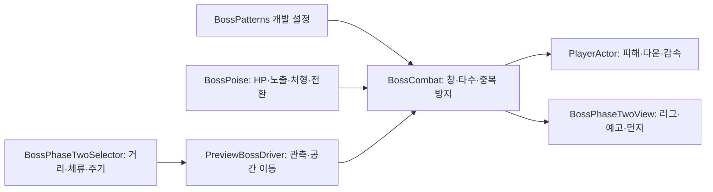

# 보스 2페이즈 전투와 피격 반응 연결

2026-11-13. 클라이언트 기준 `c89fabe`, 기획 원본 `DataSheet 2f93001`의 「쇄문아비_2페이즈_패턴_개발전달_1113.md」를 반영한 미커밋 작업입니다. 플레이어·적의 원본 아트는 공급한 아트 담당자의 작업이며, 이번 변경은 파생 Sprite·뼈 애니메이션·게임 연결입니다.

## 연결과 책임

- 보스 설정은 `Assets/2.Model/Prefabs/Config/BossPatterns.asset`. 1페이즈 3패턴과 2페이즈 6패턴, 총 9개입니다. 1페이즈 사슬은 그대로 유지하며 2페이즈에서 선택하지 않습니다.
- 기존 기본 API는 유지합니다. 보스 전환은 `BossPoise(..., phaseTransition: true)`에만 적용하고, 기존 일반 `AttackSpec`의 선딜 0 금지는 유지합니다. 직격 직후 울림에만 명시적 `immediate`를 사용합니다.
- 타격 창과 리그는 같은 `HitIndex/HitElapsed`를 읽습니다. 뼈 표시 순서 5는 현재 SpriteSkin 변형 순서 10보다 앞입니다. 런타임 IK는 없으며 새 동작의 IK는 편집 가능한 클립에 미리 구웠습니다.
- `BossGameplay`에 기존 공격 리그의 독립 복사본을 연결했습니다. 원본 리그·메시·가중치·bind pose·기존 시험 씬은 보존했습니다. 기존 루트 1.2배와 시각 2.3배를 유지하고, 리그 원점은 Body 바닥으로 맞췄습니다. 투명 셀 전체의 bounds를 발 위치로 사용하지 않습니다.

## 전환과 패턴

HP 500·ATK 34·BossState 4002의 HP50%/대기600ms를 읽습니다. 노출·처형 중 문턱을 넘으면 해당 동작이 끝날 때까지 전환을 미룹니다. 전환은 현재 공격을 중단하고 보스 무적·플레이어 이동/피해 잠금 → 흔들림·붉은 번쩍 → Dialogue 24003의 9줄 → 체세 전량 회복·리그 교체 순서입니다. 플레이어를 밀지 않습니다. 본 대사 기록은 세션 진행 객체에 남아 같은 세션 재도전에서는 생략하며, 기존 저장 파일의 스키마는 변경하지 않았습니다.

| 패턴 | 실행 기준 | 판정·회복 |
| --- | --- | --- |
| 기둥 내려찍기 | 700ms 예고, 피해40 | 120ms / 회복600ms, 앞3칸·높이6칸으로 +2/+4 발판 도달 |
| 세 번 내려찍기 | 예고700/500/500ms, 각 피해40 | 각120ms, 회복200/200/1200ms. 매 타 방향 재관측·1칸 전진 |
| 긴 팔 휩쓸기 | 예고500/250ms, 각 피해34 | 각100ms, 마지막 회복600ms. 앞3/4칸·높이2칸, +2 발판 안전 |
| 기어 돌진 | 예고1000ms, 피해48 | 기존 속도1200. 시간으로 중단하지 않고 실제 방 벽까지 이동. 벽 체세30·경직800ms |
| 광역 땅 찍기 | 예고900ms, 직격48·울림28 | 직격150ms/±2칸·높이6 → 즉시 울림300ms/±6칸·높이1 → 회복1000ms |
| 발악 뛰어 덮치기 | HP25% 이하, 예고800ms | 공중900ms 무적·무판정 → 직격150ms/54·±2칸·높이3 → 울림200ms/28·±4칸·높이1. 첫 착지400ms 뒤 재도약, 마지막 회복1500ms |

직격과 울림은 같은 피해 그룹으로 묶어 한 착지/시전에서 중복 피해를 막습니다. 도약 때 플레이어 X를 고정해 붉은 원과 착지를 맞추며 공중에서 추적하지 않습니다. 첫 패턴은 돌진, 근거리 기둥/휩쓸기 교대, 중거리 연타, 발판 체류3000ms 초과 시 기둥을 선택합니다. 돌진 사이 다른2패턴, 광역 사이 다른3패턴을 요구합니다. HP25% 문턱에서는 일반 패턴을 중단하고 발악을 우선하며 이후 광역과 교대합니다. 직접 호출도 HP25% 이전의 발악을 거부합니다.

휩쓸기 2타는 기존 리그의 약1.23~1.33초 구간을 실제 850~950ms 판정 창으로 옮겨 샘플링합니다. 기존 1페이즈 표시 클립은 보존했습니다. 모든 패턴에 붉은 예고, 연타 첫 예고에 3회 맥동, 도약 고정 원, 광역 먼지·흔들림을 적용했습니다. 별도 옅은 붉은 외곽과 피격 백색 번쩍은 스킨 변형을 지원하는 보스 전용 셰이더입니다. 사망하면 붉은 외곽을 끕니다.

## 피격 반응과 공급 경계

오늘 후속 기획의 넉백·다운·감속·패링 허용을 `BossHitReaction`과 타격별 개발 설정에 명시했습니다. 일반 보스 피격은 300ms 경직 뒤 무적600ms, 다운은 기존 Stun 상태600ms 뒤 무적600ms입니다. 생존 다운 표시는 기존 BackRoll을 재사용하며 Dead 클립을 재생하지 않습니다. 감속은 1000ms 동안 기본 이동50%, 재적용 시 시간 갱신이며 중첩하지 않습니다. 구르기·무적·대화 중 거부된 피해에는 반응도 없습니다. 사슬이 풀리면 무적600ms를 줍니다.

| 타격 | 넉백 | 부가 반응 | 패링 |
| --- | --- | --- | --- |
| 1페이즈 내려찍기 / 휩쓸기1타, 2페이즈 기둥 / 연타1·2 / 휩쓸기1 | 1칸/200ms | 경직300ms | 허용 |
| 휩쓸기2타 / 연타3타 | 2칸/250ms | 경직300ms | 허용 |
| 돌진 | 진행 방향2칸/250ms | 다운600ms | 불가 |
| 광역·도약 직격 | 보스/착지에서 멀어지는 쪽3칸/300ms | 다운600ms | 불가 |
| 광역·도약 울림 | 없음 | 경직300ms·감속 | 불가 |
| 1페이즈 사슬 | 기존 끌기 | 결박900ms | 불가 |

다운 피격은 기존 이펙트·큰 흔들림·짧은 슬로를 재사용합니다. HealthChanged보다 앞서 보스 피해의 관측 범위를 설정하고 finally에서 해제해 같은 타격의 피드백을 맞춥니다. 패링 성공은 피해/효과 없이 보스 체세30만 감소합니다.

**원본/배포 데이터는 수정하지 않았습니다.** 현재 게임 StatusEffect에는19001만 있고 원본에19002~19004가 추가되었습니다. 19005/19006과 Stun/Slow enum 원본은 아직 공급 대기입니다. 이번 실행은 확정 MD의 값을 개발 설정으로 명시한 독립 반응이며, 미배포 ID 조회나 자동 enum 등록을 하지 않습니다. 데이터 담당이 enum/행/배포를 준비한 뒤 정식 StatusEffect 바인딩을 연결해야 합니다. 신규 상태 ID도 만들지 않았습니다.

원본 `DeployData.exe --check`는 `Monster.xlsx` Q7/Q8/Q10의 빈 inlineStr 셀에 `<is>`가 없는 경우 `ExcelTableReader.ReadText`가 null을 처리하지 못해 중단합니다. 재배포하거나 시트를 고치지 않았습니다. 빈 문자열 읽기 처리는 데이터 도구 담당 후속입니다. 게임에 배포된 CSV/JSON 검사6853항목은 통과했습니다.

Inspector/Animation 창 확인용 `Controllers/Swaemunabi_Phase2_Gameplay.controller`에 7개 동작을 등록했습니다. BossGameplay/PhaseTwoRig의 Animator는 런타임에 비활성이고 표시 모듈만 시간을 공급합니다. 원래 시험 컨트롤러는 보존합니다.

## 확인 결과와 한계

- 코어1507·배포 데이터6853항목 통과. 격리 Unity1512항목(처형204/보스1089/이동·회복19/UI122/서낭당78) 통과.
- 저장 파일 없는 임시 Play에서 6패턴의 판정 창13개, 회복 VFX, 다운→기상 후 무적, 감속 적용/해제, 생존 다운 클립을 확인했습니다. 오류0, 원래 Title/Edit/clean으로 복귀했습니다. 맵/씬 파일 저장은 없습니다.
- 새 클립은 `Assets/5.Animation/Swaemunabi_Phase2/Clips/Swaemunabi_Phase2_DoubleSlam.anim`, `..._Leap.anim`, `..._Slump.anim`입니다.
- 원화의 새로운 시점/손 그림은 만들지 않았습니다. 기존 8뼈 근사의 형태와 새 동작의 최종 미감은 아트 확인 대상입니다. 최종 맵 완주·보스전2~3분 체감·성능·전용 포효 음원은 완료로 표기하지 않습니다. 전용 포효 음원은 현재 표에 연결이 없습니다.
- 엔딩·타이틀 흐름과 상호작용 E→F의 최근 원본 변경은 이번 작업 범위 밖입니다. 기존 구현과 미배포 내용을 구분하며 자동 재배포하지 않습니다.

## 마감 시 원격 변경

작업 시작에는 Develop/NYM이c89fabe로 같았습니다. 마감 조회에서 원격 Develop이4f2855d까지4커밋 진행됐습니다. fetch로 내용만 확인했고 이 작업 브랜치/파일은 리베이스·병합하지 않았습니다. 새 원격의 빌드 워크플로·UI_Lang/상태효과19002~19004 배포·엔딩 문구·맵/엠버/폰트 변경과 이번 제품 코드·프리팹의 파일 겹침은 없습니다. 현황 MD는 양쪽에서 바뀌었으므로 이후 합칠 때 두 기록을 보존해야 합니다. 현행 동작/검사 결과는 로컬c89fabe+이번 미커밋 변경 기준입니다.
