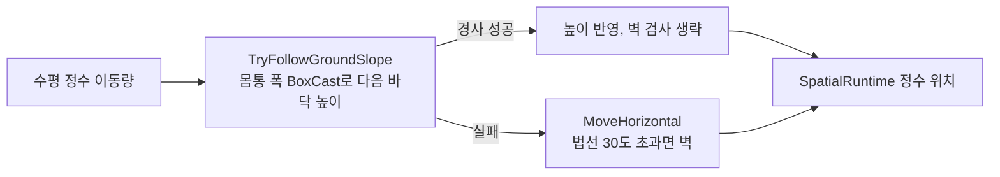
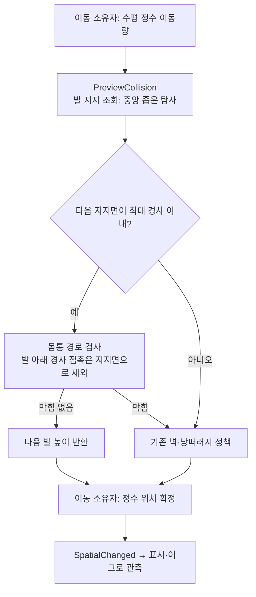
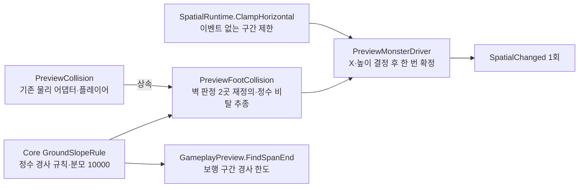

# 비탈길 접지와 이동 벡터 개선 설계

기준일: 2026-11-17 · 담당: 사용자 본인(11/17 확정) · 상태: **일반 몬스터 구현·컴파일·코어 검사 완료(플레이어 보류). 편집기 배치 검증과 실제 Play는 미실행.** 프리팹·데이터는 바꾸지 않았습니다. 구현 결과는 [10장](#10-구현-결과와-원칙-적용)을 봅니다.

원본 요청: [잡몹 비탈 발 폭 요청](../../../DataSheet/Docs/개발요청_비탈몬스터발폭_1116.md)(기획 김현호). 이 문서는 같은 날 작성된 1차 검토안을 실제 코드·프리팹 확인 결과로 다시 설계한 것입니다. 1차안과 달라진 점은 [8장](#8-1차-검토안과-달라진-점)에 정리했습니다.

## 목차

1. [현재 상태](#1-현재-상태)
2. [문제 정리](#2-문제-정리)
3. [설계 원칙과 범위](#3-설계-원칙과-범위)
4. [변경 설계](#4-변경-설계)
5. [영향 범위](#5-영향-범위)
6. [정수화·수명·비용](#6-정수화수명비용)
7. [검증 계획](#7-검증-계획)
8. [1차 검토안과 달라진 점](#8-1차-검토안과-달라진-점)
9. [결정 필요 사항과 작업 순서](#9-결정-필요-사항과-작업-순서)
10. [구현 결과와 원칙 적용](#10-구현-결과와-원칙-적용)

## 1. 현재 상태

### 1.1 지형

비탈은 산길 `Ground_2.prefab` 안의 `GroundSlope_1`~`9`(PolygonCollider2D)뿐입니다. 아래 기울기는 프리팹 안 Scale까지 반영한 월드 기준 실측입니다.

| 비탈 | 기울기(높이/폭) | 각도 |
| --- | --- | --- |
| GroundSlope_1·2·3·4·9 | 0.5 | 26.6° |
| GroundSlope_6 | 0.857 | 40.6° |
| GroundSlope_5·7·8 | 1.0 | 45° |

### 1.2 캐릭터 형상

**플레이어·몬스터·보스 프리팹에는 Collider2D와 Rigidbody2D가 없습니다.** 위치는 정수 좌표(`SpatialRuntime`)가 소유하고, 지형 조회는 `PreviewCollision`이 몸통 반크기로 직접 BoxCast합니다.

| 캐릭터 | 형상 원본 | 같은 형상을 쓰는 곳 |
| --- | --- | --- |
| 플레이어 | `GameplayPreview._playerHalfSize`(0.3×0.65) | 이동·바닥·천장·매달리기 |
| 일반 몬스터 | 자식 SpriteRenderer `Body`의 bounds(폭 약 1.875~2칸) | 이동·바닥 조회, 피격(`CheckPlayerHit`), 접촉 공격(`CheckMonsterHit`), 어그로 발 높이(`FootHeightOffset`), 턱 보호 |

11/16 커밋 `30589c84`("콜라이더 y축 0.2 낮춤")가 옮긴 것도 Collider가 아니라 이 `Body`·`PreviewSprite`의 로컬 위치입니다.

### 1.3 현재 경사 처리 흐름



| 위치 | 하는 일 | 바닥 기준 |
| --- | --- | --- |
| `PreviewCollision.FindFloor` | 아래로 몸통 폭 BoxCast | 몸통 폭 |
| `PreviewCollision.TryFollowGroundSlope` | 다음 높이 조회 → 위 공간·수평 경로 확인 | 몸통 폭 |
| `PreviewPlayerMotion.Move` | 위 결과를 플레이어 정수 위치에 반영 | 몸통 폭 |
| `PreviewMonsterDriver.FollowGroundSlope` | 실제 이동 거리로 다시 조회해 정수 위치에 반영(11/16 추가) | 몸통 폭 |
| `GameplayPreview.FindSpanEnd`·`TryFindSurface`·`FindFloorDrop` | 몬스터 보행 구간·배치 높이 | **중앙 한 점** |

## 2. 문제 정리

| # | 문제 | 원인 | 실측 영향 |
| --- | --- | --- | --- |
| P1 | 비탈에서 발이 뜸 | 몸통 폭 상자의 위쪽 모서리가 먼저 닿음. 뜨는 높이 = 반폭 × 기울기 | 허수귀·옹귀 0.47칸, 지게귀 0.5칸(26.6°). 45°에서는 약 0.94칸. 플레이어 0.15칸 |
| P2 | 발 기준이 둘 | 이동은 몸통 폭, 보행 구간은 중앙 한 점 | 구간 끝과 실제 이동 가능 범위가 어긋날 수 있음 |
| P3 | 최대 경사가 세 곳에 따로 고정 | `MoveHorizontal` 법선 0.5(30°), `TryFollowGroundSlope` 상승 여유 `이동량+0.04`, `FindSpanEnd` `0.25×0.6`(31°) | 몬스터는 40.6°·45° 비탈 4곳을 보행 구간에서 제외 |
| P4 | 오를 수 있는 각도가 프레임률에 따라 바뀜 | 상승 여유에 고정값 `Skin×2`(0.04)를 더함 | 프레임당 이동이 0.02면 약 71°까지 통과. 고속 프레임일수록 가파른 면을 오름 |
| P5 | 어그로·피격 위치가 뜬 높이 기준 | P1로 실제 몸통이 0.47칸 위에 있음 | 비탈 위 몬스터의 높이 비교·피격 상자가 그림과 다름 |

## 3. 설계 원칙과 범위

AGENTS.md 기준으로 다음을 지킵니다.

- **기존 구조 재사용:** 위치 소유(`SpatialRuntime` 정수 좌표)와 물리 조회(`PreviewCollision`)를 유지합니다. Rigidbody2D·Collider2D를 캐릭터에 새로 추가하지 않습니다.
- **공통 모듈 한 곳:** 경사 기하 계산은 `PreviewCollision`에만 둡니다. 플레이어·몬스터·보행 구간이 같은 함수를 쓰고 각 소유자는 정책(점프·낭떠러지·복귀)만 결정합니다.
- **책임 분리:** 몬스터 `Body`의 크기는 바꾸지 않습니다. 피격·공격·어그로 판정 크기는 그대로 두고 **바닥 지지 판정만** 분리합니다.
- **정수화:** 결과 위치는 정수로 확정합니다. 기울기 한계는 분모 10000 정수 비율로 정의하고 물리 경계에서만 실수로 바꿉니다.
- **담당 범위:** 비탈 경로만 바꿉니다. 보스 이동(`PreviewBossDriver`)과 그 밖의 플레이어 조작은 대상이 아닙니다.

| 포함 | 제외 |
| --- | --- |
| 바닥 지지 판정 분리(P1·P5) | 캐릭터 Collider·Rigidbody 도입, `Rigidbody2D.Slide` |
| 최대 경사 단일화(P3) | 법선 기반 접선 이동 전면 교체 |
| 프레임률 독립(P4) | 몬스터 낙하·중력 추가 |
| 보행 구간과 같은 발 기준(P2) | 몸통·그림 회전, 정지 중 미끄러짐 |
| 편집기 배치 검증 추가 | 보스·전투 패턴 수정 |

## 4. 변경 설계

### 4.1 전체 흐름



### 4.2 발 지지 판정 분리 (P1·P5)

바닥 높이는 **몸통 중앙의 좁은 탐사**로 잽니다. 벽·천장은 지금처럼 몸통 폭으로 검사합니다. 요청서 방법 B를 따르되 발 폭을 새 콘텐츠 값으로 두지 않고, 물리 여유 폭(`Skin` 기반)을 써서 보행 구간의 중앙 한 점 기준과 일치시킵니다.

| 조회 | 현재 | 변경 |
| --- | --- | --- |
| 비탈 높이(`TryFollowGroundSlope` 내부) | 몸통 폭 BoxCast | 중앙 좁은 BoxCast |
| 접지 유지·착지(`FindFloor`) | 몸통 폭 | **변경 없음**. 발판 끝에 서는 기존 조작감 유지 |
| 벽(`MoveHorizontal`)·천장(`MoveUp`) | 몸통 폭 | 몸통 폭 유지 + 아래 4.3의 지지면 제외 |

중앙 높이로 서면 몸통 상자의 오르막 쪽 모서리가 비탈 속으로 들어갑니다. 이 상태에서 몸통 상자로 벽·천장을 검사하면 시작부터 겹친 비탈을 거리 0의 벽으로 판정해 멈춥니다. 그래서 4.3이 함께 필요합니다.

### 4.3 지지면 제외 규칙

몸통 경로 검사의 접촉 중 아래 조건을 모두 만족하면 벽·천장이 아니라 **밟고 있는 지지면**으로 보고 제외합니다.

1. `IsGroundSlope`(현재 `GroundSlope_` 이름 + PolygonCollider2D 계약)인 콜라이더
2. 접촉 높이가 `발 높이 + 몸통 반폭 × 최대 경사` 이하

두 조건을 함께 보므로 머리 위의 다른 비탈이나 일반 벽은 계속 막습니다. 이름 조건을 없애 모든 콜라이더를 지면으로 인정하지 않습니다.

```text
설명용 예시(구현 코드 아님)
bool IsStandingSupport(RaycastHit2D hit, float feetY, float halfWidth)
    => IsGroundSlope(hit.collider) && hit.point.y <= feetY + halfWidth * MaxSlope + Skin;
```

### 4.4 최대 경사 단일화와 프레임률 독립 (P3·P4)

세 곳의 기준을 `PreviewCollision`의 값 하나로 합칩니다.

| 사용처 | 현재 | 변경 |
| --- | --- | --- |
| `MoveHorizontal` 벽 판정 | 법선 x 0.5 초과(30°) | 최대 경사를 넘는 법선만 벽 |
| `TryFollowGroundSlope` 상승 한계 | `이동량 + 0.04` | `이동량 × 최대 경사 + 오차 여유`. 오차 여유는 정수 위치 반올림(0.01칸)을 넘지 않음 |
| `FindSpanEnd` 탐사 | `0.25 × 0.6` | 같은 최대 경사로 공통 조회 사용 |

값은 정수 비율 `MaxSlopeRatio`(분모 10000)로 정의합니다. **2026-11-17 사용자 확정: 최대 경사 45°(10000)까지만 허용합니다.** 이렇게 하면 지금 플레이어가 오르는 9곳은 그대로 오르고, 몬스터도 40.6°·45° 4곳을 지나갈 수 있습니다. 45°를 넘는 면은 프레임률과 관계없이 벽입니다.

### 4.5 보행 구간 공통화 (P2)

`GameplayPreview.FindSpanEnd`의 점 탐사(`TryFindSurface`)를 `PreviewCollision`의 같은 발 지지 조회로 바꿉니다. 구간을 어디서 끝낼지(벽·낭떠러지·관문)는 기존처럼 `GameplayPreview`가 정하고, 높이와 경사 판정만 공통 함수를 씁니다. 기존 평지 규칙(앞이 막히거나 발밑 0.1칸이 비면 끝)은 유지합니다.

### 4.6 경사 속도

현재처럼 **수평 이동량을 기준**으로 둡니다(권장). 몬스터 속도·`LeashRange`·공격 거리·보행 구간·어그로 거리는 모두 가로 정수 계약이기 때문입니다. 대신 비탈 위의 실제 이동 거리는 26.6°에서 약 12%, 45°에서 약 41% 길어집니다.

비탈에서 느리게 보여야 한다는 기획 결정이 나면, 코어 계약은 그대로 두고 이동 소유자가 비탈 위에서만 수평 이동량에 정수 비율(분모 10000)을 곱하는 방식으로 추가합니다. 나머지는 기존 `IntegerMotion`처럼 보존해 저속에서 멈추지 않게 합니다.

## 5. 영향 범위

| 기능 | 변화 | 의도 여부와 확인 |
| --- | --- | --- |
| 몬스터 위치(비탈) | 최대 0.47칸(26.6°)~0.94칸(45°) 내려감 | 의도. 발이 그림 비탈에 닿음 |
| 플레이어 위치(비탈) | 최대 0.15칸(26.6°) 내려감 | 의도. 조작감 확인 필요 |
| 평지 | 변화 없음 | 중앙·몸통 폭 결과가 같음 |
| 몬스터 피격·접촉 공격 | 상자 크기 그대로, 위치만 실제 높이로 | 의도(P5 해소) |
| 어그로 높이(`FootHeightOffset`) | `Body.bounds.min.y`가 실제 발 높이가 됨 | 의도. 비탈 위·아래 인식 재확인 |
| 몬스터 보행 구간 | 40.6°·45° 비탈까지 연장 | 의도(최대 경사 45° 확정) |
| 턱 보호 | 현재 발 높이 기준(11/16) 유지 | 회귀 확인 |
| 저장 위치 | 비탈 위 저장 위치는 몸통 높이가 다를 수 있음 | 다음 이동 틱에 지지면으로 맞춰짐. 원점 이동 없음 |
| 보스 | `PreviewCollision`을 쓰지 않음 | 영향 없음 |
| `30589c84` 그림·Body 0.2칸 내림 | 평지 포함 전체 적용 | 비탈 보정과 별개. 변경 후 평지에서 그림이 묻히지 않는지만 확인 |

## 6. 정수화·수명·비용

- **정수:** 위치는 `SpatialRuntime` 정수로만 확정합니다. 비탈 높이는 프레임마다 지지면에서 새로 조회한 절대값이라 반올림 오차가 쌓이지 않습니다. `MaxSlopeRatio`는 분모 10000 정수이고, 실수 변환은 `PreviewCollision` 안에서만 합니다.
- **수명:** 새 이벤트·구독은 없습니다. `PreviewCollision`은 이동 소유자가 하나씩 소유하고 조회 버퍼(`_hits`)를 재사용합니다. 지지 콜라이더 참조는 한 번의 조회 안에서만 쓰고 프레임 사이에 보관하지 않습니다(기존 `_ignoredPlatform` 예외만 유지). 맵이 바뀌면 소유자와 함께 새로 만듭니다.
- **비용:** 비탈 높이 조회 BoxCast를 몸통 폭에서 좁은 폭으로 바꿀 뿐 횟수는 늘리지 않습니다. 몬스터는 11/16 수정대로 프레임당 경사 조회 1회를 유지합니다. 지지면 제외는 기존 조회 결과의 필터라 추가 조회가 없습니다.

## 7. 검증 계획

물리 조회는 코어 검사(`Locomotion.Checks`)에서 실행할 수 없습니다. 그래서 기존 `CameraLookVerification`과 같은 **편집기 배치 검증**을 하나 추가합니다(`Assets/Editor/Preview`). 새 씬은 만들지 않고 `Ground_2.prefab`과 실제 캐릭터 프리팹을 임시로 생성한 뒤 정리합니다.

| 시험 | 합격 기준 |
| --- | --- |
| `GroundSlope_1`~`9` 왕복(플레이어·허수귀·지게귀·옹귀) | 중앙 발과 비탈 표면 간격 0.02칸 이하, 비탈 안에서 멈춤 없음 |
| V자 바닥·비탈↔평지 연결 | 한 틱 높이 변화가 `이동량 × 최대 경사 + 오차 여유` 이하(튐 없음) |
| 30·60·144fps 프레임 이동량 | 같은 비탈에서 같은 결과. 45° 초과 시험 면은 모든 프레임률에서 벽 |
| Strip_5 수직 벽·낮은 천장 | 몸통 폭으로 계속 막힘 |
| 평지·발판 끝·낭떠러지 | 기존과 같은 위치에서 멈춤(회귀) |
| 보행 구간 | 몬스터 구간이 비탈 끝까지 이어지고 낭떠러지에서 끝남 |

Play 확인: 산길 x31~36 V자에서 몬스터 발 접지, 비탈 위 몬스터 피격·어그로, 플레이어 비탈 조작감. 검증 결과는 이 문서와 [현재 구현과 검증 현황](현재%20구현과%20검증%20현황.md)에 기록합니다.

## 8. 1차 검토안과 달라진 점

| 1차 검토안 | 이번 설계 | 이유 |
| --- | --- | --- |
| 실제 이동·피격 Collider와 Cast 정합성, CapsuleCollider2D 교체 | 대상 없음 | 캐릭터에 Collider2D가 없음. 형상은 `_playerHalfSize`와 `Body` bounds |
| `Rigidbody2D.Slide`를 이동 어댑터 교체 수준의 대안으로 둠 | 범위 제외 | Rigidbody2D·Collider2D를 모든 캐릭터에 새로 두고 위치 소유자를 바꿔야 함 |
| 법선 기반 접선 이동, 여러 레이 탐사 | 중앙 지지 + 지지면 제외 | 기존 경사 추종이 이미 있음. 원인은 바닥 폭 하나 |
| 지면 거리 기준 속도 권장 | 수평 기준 유지 | 가로 정수 계약 보존. 차이는 기획 결정 사항으로 분리 |
| 발 폭·탐사 거리 등 새 데이터 열 후보 | 새 열 없음, 최대 경사 하나만 결정 | 발 폭은 물리 여유 폭으로 충분. 콘텐츠 값 증가를 막음 |
| 기존 고정 경사 기준 언급 없음 | 세 곳 단일화·프레임률 독립 | 실측으로 확인한 P3·P4 |
| 보행 구간 계산 누락 | 공통 조회로 통합 | P2 |
| 보간 사용처 분석(5장) | 삭제 | 경사 접지와 관계없음. 경사 이동은 보간을 쓰지 않음 |

요청서 방법 A(그림만 내리기)는 채택하지 않았습니다. 피격·어그로가 계속 뜬 높이 기준이 되어 P5가 남기 때문입니다.

## 9. 결정 필요 사항과 작업 순서

| 결정 | 권장 | 결정 주체 |
| --- | --- | --- |
| 최대 경사 | **확정(11/17): 45°(10000)까지.** 플레이어·몬스터 공통, 몬스터도 40.6°·45° 비탈 보행 | 사용자 확정 |
| 최대 경사 위치 | **확정(11/17):** `PreviewCollision`의 이름 있는 정수 상수 하나. 캐릭터별 차이가 필요해지면 데이터 이전 | 사용자 확정 |
| 비탈 속도 | **확정(11/17):** 수평 기준 유지 | 사용자 확정 |
| 플레이어 적용 | **보류(11/17).** 이번에는 몬스터만 적용. 플레이어는 기존 경로(몸통 폭 바닥·기존 상승 여유)를 그대로 유지 | 사용자 확정 |

작업 순서와 상태입니다.

1. 최대 경사 단일화, 프레임률 독립(P3·P4) — **완료**(코어 `GroundSlopeRule`)
2. 중앙 발 지지 조회와 벽 판정 재정의(P1) — **완료**(`PreviewFootCollision`)
3. `PreviewMonsterDriver` 연결과 편집기 배치 검증 추가(P5) — **완료**(검증은 미실행). `PreviewPlayerMotion`은 보류
4. `GameplayPreview` 보행 구간 공통화(P2) — **완료**(같은 정수 경사 한도 사용)
5. 기획자 확인 안내 갱신 — **완료**([K9 맵 확인 안내](../기획자용%20안내문서/기획자용%20K9%20맵%20공급과%20연결%20확인%20안내.md))

## 10. 구현 결과와 원칙 적용

### 10.1 구조



| 위치 | 변경 |
| --- | --- |
| `Core/Locomotion/GroundSlopeRule.cs`(신규) | `MaxSlopeRatio = 10000`(45°), `MaxRise`·`CanTraverse`·`IsWalkableNormal`. 정수만 사용 |
| `PreviewCollision.cs` | 기반 클래스: `sealed` 해제, 벽 판정 재정의 지점 2개(`IgnoresWallHit`·`LimitHorizontal`, 기본 동작 없음) 추가. 플레이어 동작 불변 |
| 같은 파일 `PreviewFootCollision`(신규 파생) | 걸을 수 있는 비탈·겹친 비탈을 벽에서 제외, 오르막 파고들기 방지, 정수 `TryFollowFootSlope(center, run, out rise)` |
| `SpatialRuntime.ClampHorizontal`(추가) | 위치를 바꾸지 않고 구간 제한 목표 X 계산. 기존 `MoveHorizontal`이 이를 재사용(동작 동일) |
| `PreviewMonsterDriver` | X와 비탈 높이를 정한 뒤 `SetPosition` 한 번으로 확정 |
| `GameplayPreview.FindSpanEnd` | 0.6 고정값 대신 `GroundSlopeRule.MaxRise` |
| `Assets/Editor/Preview/SlopeGroundingVerification.cs`(신규) | 메뉴 `인귀/검사/비탈 접지 검증` 또는 배치 실행 |
| `Tools/Locomotion.Checks/GroundSlopeRuleChecks.cs`(신규) | 정수 규칙 코어 검사 17개 |

4.3의 "지지면 제외"는 구현에서 단순화했습니다. 이름·접촉점 조건 대신 **비탈 추종 경로는 몸통 아래를 반폭×최대 경사만큼 올린 상자로 검사**하고, 평지 수평 이동에서는 최대 경사 이내의 `GroundSlope_` 면과 이미 겹친 비탈만 벽에서 제외합니다. 비탈 추종이 실패한 수평 이동은 중앙 발 아래 지면이 높아지면 막아 몸통이 오르막 속으로 들어가지 않습니다.

### 10.2 원칙 적용과 예외

| 원칙 | 적용 | 적용하지 않은 곳과 이유 |
| --- | --- | --- |
| 정수화 | 몬스터 이동 경로 전체가 정수: 어댑터 공개 API(`TryFollowFootSlope(x, y, run)`·`MoveHorizontal(x, y, run)`), 경사 규칙·관측 오차·높이·띠·경로 길이(`IntegerDistance.Sqrt`), 보행 구간(`long`)·턱 보호·구간 제한(`ClampHorizontal(long…)`), 보행 구간·배치 바닥 탐사 단계 | 남은 float은 Unity 값 읽기(`bounds`·`lossyScale`·턱 위치 `Vector2`, 읽는 즉시 정수 변환)와 Physics2D 호출 줄의 인자·결과(법선은 분모 10000 정수로 즉시 변환), 맵 경계 `Step(minX, maxX)` 기존 계약(진입 즉시 변환)뿐입니다. 기반 `PreviewCollision`의 float API는 플레이어(보류)와 공유해 유지 |
| 상속·재정의 | 벽 판정 두 지점을 가상 메서드로 열고 파생 클래스가 재정의 | `GroundSlopeRule`은 상태 없는 규칙 하나라 인터페이스 없이 정적 클래스(데이터화 시 인스턴스로 전환) |
| 공통화·재사용 | 형상·필터·버퍼·바닥 조회는 기반 재사용. 정수↔월드 변환은 `SpatialRuntime` 재사용. 경사 한도는 이동·보행 구간·검증이 같은 규칙 사용 | 새 클래스는 파생 1개(기존 파일)와 코어 규칙 1개만 추가 |
| 독립성 | 코어 규칙은 Unity 비참조. 파생 클래스는 몬스터 드라이버만 생성 | — |
| 수명·이벤트 | 한 프레임 위치 확정 1회 → `SpatialChanged` 1회. 콜라이더 참조는 한 조회 안에서만 사용, 조회 버퍼 재사용, 새 구독 없음 | — |
| 데이터 관리 | — | 최대 경사는 사용자가 코드 상수 하나로 확정. 담을 기존 이동 시트 열이 없음 |

### 10.3 검증 상태

| 검증 | 결과 |
| --- | --- |
| 정식·개발·에디터 조건 컴파일 | 경고·오류 0 |
| `Verify-Project.ps1`(CI와 같은 검사) | 11/17 오전 데이터 10,856개·코어 2,305개 통과(정수 경사 규칙 포함). 이후 `1f7e2f9e`(보스 담당)에서 생긴 `BossCombat` null 참조로 코어 검사가 중단되어 최종 개수는 미출력. 비탈 코드와 무관하며 [현황 6.1](현재%20구현과%20검증%20현황.md#61-다른-담당-확인-요청-2026-11-17)에 기록 |
| 2026-11-17 정수화 보강 | 물리 어댑터의 높이·여유·띠·관측 오차를 모두 정수로 계산하고 Physics2D 호출 순간에만 월드 좌표로 변환. 관측 오차는 좌표 크기 기반 정수(`M >> 20`)로 규칙에 전달. 보행 구간·배치 바닥 탐사도 정수 단계로 변경(기존 `drop += step` 실수 누적 제거) |
| 편집기 검증 1차 실행(11/17, 사용자) | 26.6° 통과, 45°에서 실패 → 관측 오차 허용이 float 정밀도보다 작았던 결함을 발견해 위 정수 관측 오차로 수정. 재실행 필요 |
| Play 회귀(11/17, 사용자) | 몬스터가 평지에서 걷는 동작만 하고 이동하지 않음. 원인: 발 기준을 Body 아래변으로 가정했으나 프리팹은 그림 보정으로 Body를 지면보다 0.2칸 낮게 둠(`30589c84`). 오르막 파고들기 방지가 평지를 "0.2칸 오르막"으로 오판해 매 걸음 0으로 제한. 수정: 발 기준을 **몸통 중심 아래에서 관측한 실제 지지면**으로 바꾸고 높이 변화는 현재·다음 지지면 차이로 계산(`FindSupport`). 검증에 평지 왕복과 "Body 0.2칸 낮음" 경우를 추가. 재실행 필요 |
| Play 회귀 2(11/17, 사용자) | 비탈 시작점에서 앞뒤로 떨림. 원인: 평지 수평 벽 검사 상자가 Body 기준이라 지면 아래 0.16칸까지 내려가 비탈 다각형의 수직 옆면(지면 아래, 실측 x=18 등)에 닿아 벽으로 판정 → 방향 전환 반복. 실측상 이음새 높이 차이는 9곳 모두 0. 수정: 파생 조회가 벽 검사 상자(`GetWallBox` 재정의 지점 추가) 아래쪽을 실제 지지면보다 낮게 내리지 않음. 다음 탐사 시작점이 지면 속이면 막힘으로 처리. 재실행 필요 |
| 편집기 배치 검증 `SlopeGroundingVerification` | **미실행**(이 환경에서 Unity 실행 불가). 합성 지형으로 26.6°·45° 왕복, 50° 거부, V자, 0.5칸 계단, 비탈 위 벽·천장을 허수귀·지게귀·옹귀 × 30·60·144fps로 확인하며 발 간격 허용은 0.001칸 |
| 실제 Play | 미실행. K9 확인 안내의 항목으로 확인 |
